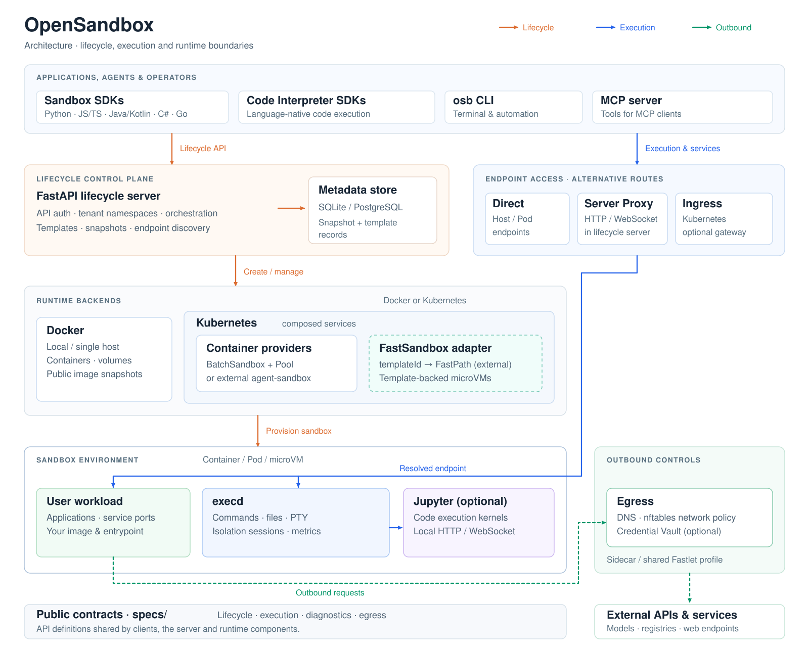

<div align="center">
  <picture>
    <source media="(prefers-color-scheme: dark)" srcset="docs/public/images/logo-dark.svg" />
    <source media="(prefers-color-scheme: light)" srcset="docs/public/images/logo.svg" />
    
  </picture>

  <h1>OpenSandbox</h1>

  <p align="center">
    <a href="https://aaif.io/projects/opensandbox"><strong>An Agentic AI Foundation (AAIF) Project</strong></a>
  </p>

<p align="center">
  <a href="https://github.com/opensandbox-group/OpenSandbox/releases"></a>
  <a href="https://github.com/opensandbox-group/OpenSandbox"></a>
  <a href="https://www.bestpractices.dev/projects/12588"></a>
  <a href="https://discord.gg/g7FuPs8YeD"></a>
  <a href="https://qr.dingtalk.com/action/joingroup?code=v1,k1,A4Bgl5q1I1eNU/r33D18YFNrMY108aFF38V+r19RJOM=&_dt_no_comment=1&origin=11"></a>
  <a href="https://github.com/opensandbox-group/OpenSandbox/actions/workflows/real-e2e.yml"></a>
  <a href="https://github.com/opensandbox-group/OpenSandbox/actions/workflows/kubernetes-nightly-build.yml"></a>
</p>

  <hr />
</div>

**Run AI agents in sandboxes on your own infrastructure.**

OpenSandbox gives AI applications isolated environments to execute code, run commands, manage files, and operate browsers or desktops. Start locally with Docker and deploy on Kubernetes through a unified sandbox API.

[Website](https://open-sandbox.ai) · [Quick Start](#getting-started) · [SDKs](#sdks) · [Examples](#examples) · [Kubernetes](docs/deployment/index.md) · [Fast Sandbox](docs/architecture/fast-sandbox/index.md) · [Documentation](#documentation)

## Features

| Feature | What it enables | Learn more |
|---------|-----------------|------------|
| **Fast Sandbox runtime** | Fast, high-density Firecracker + OverlayBD sandboxes on Kubernetes: **65.3 ms P50 (serial)** / **70.9 ms P50 (16 concurrent)** create (`t_api_ack`), up to **800 concurrent live MicroVMs per Fastlet**, **~10.2 MiB Firecracker PSS** (`~17.5 MiB` host memory delta) per 2 GiB sandbox, and full memory + disk pause/resume. | [Integration](docs/architecture/fast-sandbox/index.md) · [Benchmarks](benchmark/README.md) · [Pause/resume](docs/architecture/fast-sandbox/checkpoints.md) |
| **Multi-tier isolation & hardening** | Run workloads in standard containers, VM-isolated runtimes (`Kata`, `gVisor`, confidential `PeerPods`), default-on `execd` privilege reduction, and isolated in-sandbox sessions. | [Secure containers](docs/guides/secure-container.md) · [Isolated sessions](docs/guides/isolation-sessions.md) · [Hardening](docs/guides/privilege-reduction.md) |
| **Agent working environments** | Execute commands, manage files, and run code with built-in APIs, or host coding agents, browsers, and full desktops inside sandboxes. | [Examples](docs/examples/index.md) |
| **Lifecycle, pools, and auto-pause** | Start locally with Docker and scale on Kubernetes through one lifecycle API, with warm client pools (including Redis coordination), snapshots, and idle auto-pause with wake-on-access. | [Kubernetes](docs/deployment/index.md) · [Client Pool](docs/guides/client-pool.md) · [Auto-pause](docs/guides/auto-pause-wake.md) |
| **Network access control** | Route inbound traffic through a unified ingress gateway and enforce per-sandbox outbound policies or upstream proxy forwarding. | [Ingress](docs/architecture/network/ingress.md) · [Egress](docs/architecture/network/egress.md) · [Forward mode](docs/guides/egress-forward-mode.md) |
| **Credential Vault** | Let agents call external services through outbound TLS credential injection without exposing real credentials to sandbox workloads. | [Credential Vault](docs/guides/credential-vault.md) |
| **SDKs, CLI, MCP, and Console** | Integrate with Python, Java/Kotlin, TypeScript/JavaScript, C#/.NET, or Go SDKs; operate sandboxes from the `osb` CLI, MCP clients, or the optional Developer Console. | [SDKs](#sdks) · [CLI](#cli) · [MCP](#mcp) · [Console](docs/guides/developer-console.md) |
| **Extensible sandbox protocol** | Build custom runtime integrations against defined OpenAPI contracts for lifecycle, execution, egress, and diagnostics. | [API specs](specs/README.md) |

## Architecture

<p align="center">
  
</p>

OpenSandbox separates **lifecycle orchestration** (FastAPI server + Docker, Kubernetes, or Fast Sandbox backends), **direct data-plane execution** (`execd`, workload ports, and optional ingress gateway), and **outbound security controls** (egress policy enforcement and Credential Vault). See the [Architecture Overview](docs/architecture/index.md) for component boundaries and request flows.

## Getting Started

Requirements:

- Docker (required for local execution)
- Python 3.10+ and [`uv`](https://docs.astral.sh/uv/) (for zero-setup `uvx` / `uv run` execution)

### Install and Configure the Sandbox Server

```bash
uvx opensandbox-server init-config ~/.sandbox.toml --example docker

# Start the local server. Because example.config.toml leaves server.api_key unset,
# type YES at the startup prompt (or set server.api_key in ~/.sandbox.toml, or
# pass OPENSANDBOX_INSECURE_SERVER=YES in non-interactive shells).
uvx opensandbox-server

# Show help
# uvx opensandbox-server -h
```

### Create a Sandbox and Execute Commands/Scripts

Save the script below as `quickstart.py`:

```python
import asyncio

from opensandbox import Sandbox
from opensandbox.models import WriteEntry

async def main() -> None:
    # 1. Create a sandbox from the alpine image
    sandbox = await Sandbox.create("alpine")

    try:
        # 2. Execute a shell command
        execution = await sandbox.commands.run("echo 'Hello OpenSandbox!'")
        print(execution.logs.stdout[0].text)

        # 3. Write a script file
        await sandbox.files.write_files([
            WriteEntry(
                path="/tmp/hello.sh",
                data="echo \"Hello $1\"\necho '2 + 2 =' $((2 + 2))",
                mode=755,
            )
        ])

        # 4. Read the file back
        content = await sandbox.files.read_file("/tmp/hello.sh")
        print(f"Content: {content}")

        # 5. Execute the script
        execution = await sandbox.commands.run("sh /tmp/hello.sh OpenSandbox")
        for log in execution.logs.stdout:
            print(log.text)

    finally:
        # 6. Cleanup the sandbox
        await sandbox.destroy()

if __name__ == "__main__":
    asyncio.run(main())
```

Run it directly in an ephemeral environment with `uv` (no manual virtualenv setup required):

```bash
uv run --with opensandbox python quickstart.py
```

## Examples

Explore examples by what you want your agent to do. Runnable source code lives in [`examples/`](examples/).

| Use case | What you can build | Examples |
|----------|--------------------|----------|
| **Coding agents** | Run coding agents and frameworks in isolated environments to edit files, execute commands, and complete development tasks. | [Claude Code](docs/examples/claude-code.md) · [Gemini CLI](docs/examples/gemini-cli.md) · [Codex CLI](docs/examples/codex-cli.md) · [LangGraph](docs/examples/langgraph.md) · [DeerFlow](docs/examples/deer-flow.md) |
| **Code execution and data analysis** | Execute model-generated code and work with results through the Code Interpreter SDK. | [Code Interpreter](docs/examples/code-interpreter.md) |
| **Browser, desktop, and IDEs** | Automate web interactions and testing, or give agents and developers access to a browser IDE or desktop environment. | [Playwright](docs/examples/playwright.md) · [Chrome](docs/examples/chrome.md) · [Desktop](docs/examples/desktop.md) · [VS Code](docs/examples/vscode.md) |
| **Agent evaluation** | Run evaluations with a separate sandbox for each trial. | [Harbor Evaluation](docs/examples/harbor-evaluation.md) |

See the [full example catalog](docs/examples/index.md) for more coding agents, framework integrations, remote development environments, Kubernetes deployment, and storage patterns.

## SDKs

Pick your language:

<details>
<summary><b>Python</b></summary>

```bash
pip install opensandbox
```

</details>

<details>
<summary><b>Java/Kotlin (Gradle Kotlin DSL)</b></summary>

```kotlin
dependencies {
    implementation("com.alibaba.opensandbox:sandbox:{latest_version}")
}
```

</details>

<details>
<summary><b>Java/Kotlin (Maven)</b></summary>

```xml
<dependency>
    <groupId>com.alibaba.opensandbox</groupId>
    <artifactId>sandbox</artifactId>
    <version>{latest_version}</version>
</dependency>
```

</details>

<details>
<summary><b>JavaScript/TypeScript</b></summary>

```bash
npm install @alibaba-group/opensandbox
```

</details>

<details>
<summary><b>C#/.NET</b></summary>

```bash
dotnet add package Alibaba.OpenSandbox
```

</details>

<details>
<summary><b>Go</b></summary>

```bash
go get github.com/alibaba/OpenSandbox/sdks/sandbox/go
```

</details>

## CLI

OpenSandbox also provides `osb`, a terminal CLI for the common sandbox workflow: create sandboxes, run commands, move files, inspect diagnostics, and manage runtime egress policy.

Install:

```bash
pip install opensandbox-cli
# or
uv tool install opensandbox-cli
```

Quick start:

```bash
osb config init
osb config set connection.domain localhost:8080
osb config set connection.protocol http
# Optional if server.api_key is configured:
# osb config set connection.api_key <your-api-key>

osb sandbox create --image python:3.12 --timeout 30m -o json
osb command run <sandbox-id> -o raw -- python -c "print(1 + 1)"
osb sandbox kill <sandbox-id> -o json
```

See the [CLI README](cli/README.md) for the full command reference.

## MCP

The OpenSandbox MCP server exposes sandbox creation, command execution, and text file operations to MCP-capable clients such as Claude Code and Cursor.

Install and run:

```bash
pip install opensandbox-mcp
opensandbox-mcp --domain localhost:8080 --protocol http
```

Minimal stdio config:

```json
{
  "mcpServers": {
    "opensandbox": {
      "command": "opensandbox-mcp",
      "args": ["--domain", "localhost:8080", "--protocol", "http"]
    }
  }
}
```

See the [MCP README](sdks/mcp/sandbox/python/README.md) for client-specific setup.

## Official Container Images

OpenSandbox release images are published under the same component name in three official registries:

- Docker Hub: `docker.io/opensandbox/<component>`
- GitHub Container Registry: `ghcr.io/opensandbox-group/opensandbox/<component>`
- Alibaba Cloud Container Registry: `sandbox-registry.cn-zhangjiakou.cr.aliyuncs.com/opensandbox/<component>`

Pin production images by digest and check the [release verification guide](docs/community/release-verification.md) for signing coverage before deployment. Legacy per-component releases support Cosign signatures and provenance attestations; current umbrella releases have a [tracked signing and provenance gap](https://github.com/opensandbox-group/OpenSandbox/issues/2463) and must not be assumed to provide the same verification evidence.

## Documentation

- [Website](https://open-sandbox.ai) — Project homepage and documentation site
- [Architecture](docs/architecture/index.md) — System design and component responsibilities
- [Deployment Guide](docs/deployment/index.md) — Kubernetes installation and operations
- [Server Configuration](docs/getting-started/configuration.md) — Runtime and server settings
- [SDK Reference](docs/sdks/index.md) — Language guides and capability coverage
- [CLI Guide](cli/README.md) — Installation and command reference
- [MCP Integration](sdks/mcp/sandbox/python/README.md) — Setup for MCP-capable clients
- [Developer Console](docs/guides/developer-console.md) — Optional web UI and BFF for sandbox operations
- [API Reference](docs/api/index.md) — Sandbox lifecycle and execution contracts
- [Credential Vault](docs/guides/credential-vault.md) — Outbound credential injection
- [Release Verification](docs/community/release-verification.md) — Image signing and artifact verification
- [Enhancement Proposals](oseps/README.md) — Design proposals and technical direction
- [Roadmap](ROADMAP.md) — Project priorities and planning

## Contact and Discussion

- Issues: Submit bugs, feature requests, or design discussions through [GitHub Issues](https://github.com/opensandbox-group/OpenSandbox/issues)
- Security: Report vulnerabilities privately following [SECURITY.md](SECURITY.md) (do not open public issues)
- Discord: Join the [OpenSandbox Discord community](https://discord.gg/g7FuPs8YeD)
- DingTalk: Join the [OpenSandbox technical discussion group](https://qr.dingtalk.com/action/joingroup?code=v1,k1,A4Bgl5q1I1eNU/r33D18YFNrMY108aFF38V+r19RJOM=&_dt_no_comment=1&origin=11)

## About

OpenSandbox is a project of the [Agentic AI Foundation (AAIF)](https://aaif.io/projects/opensandbox), governed under its [Technical Charter](CHARTER.md) and [Project Governance](GOVERNANCE.md) (see [Maintainers](MAINTAINERS.md)).

Code is licensed under the [Apache 2.0 License](LICENSE). See the [contribution guide](CONTRIBUTING.md#license) for documentation licensing and contribution terms, and [SECURITY.md](SECURITY.md) for vulnerability reporting.
