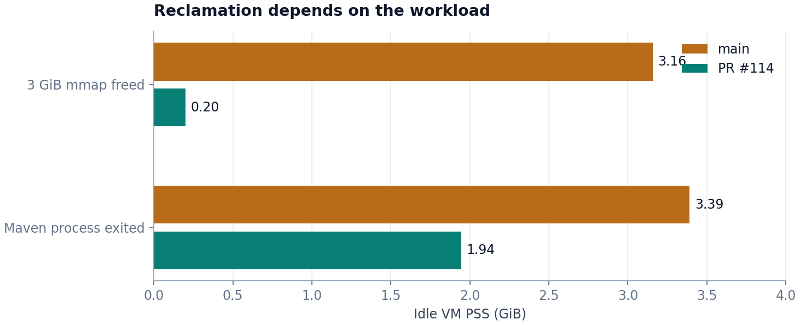
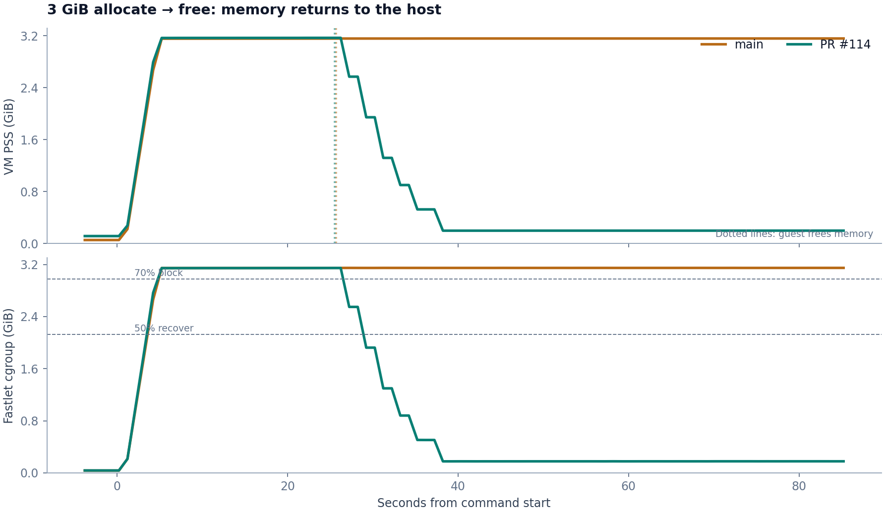
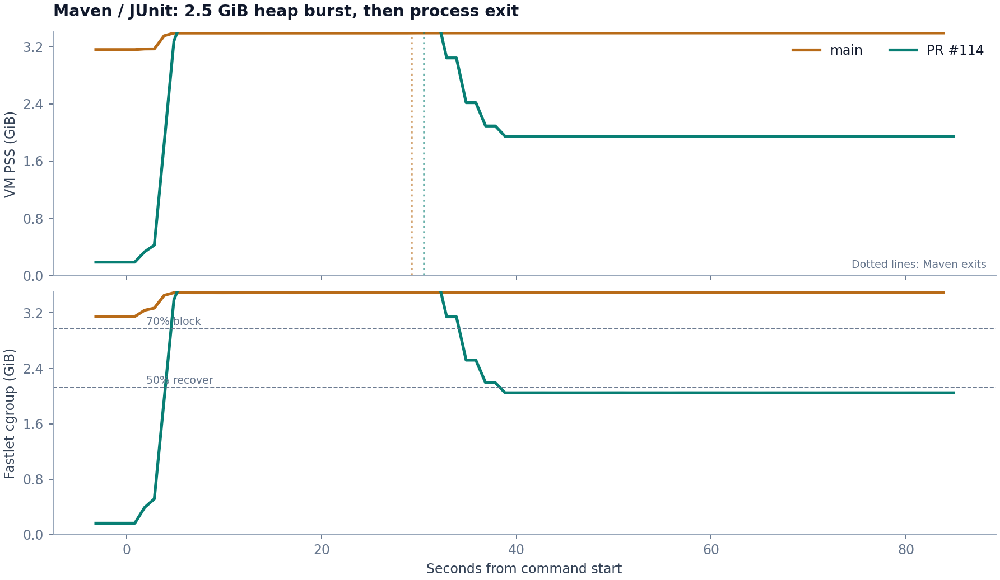
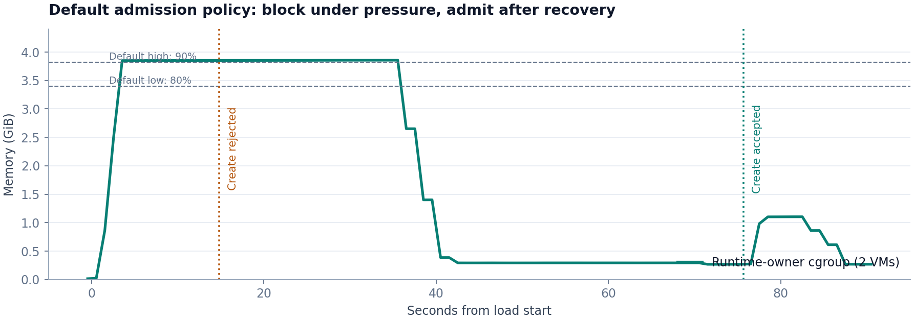

# Firecracker `virtio-balloon` Free-Page Reporting (FPR) Benchmark Report

- **Revision**: `opensandbox-group/fast-sandbox#114` (`ca82e10b`) vs. `main` (`d941c7ba`)
- **Run**: `2026-10-28` · ACK bare-metal/KVM cluster · Native object-store snapshots · 11 microVMs

## Executive Summary

Fast Sandbox enables zero-target (`amount_mib=0`) `virtio-balloon` Free-Page Reporting (FPR) by default on newly built Native object-store golden templates (`release-1.2.1`, [fast-sandbox#114](https://github.com/opensandbox-group/fast-sandbox/pull/114)). This report summarizes A/B host memory reclamation, admission recovery, pause/resume persistence, and OOM boundary measurements under `ResourceAware` memory oversubscription ([OSEP-0026](../oseps/0026-resource-oversubscription-accounting-for-fast-sandbox.md)).

**Bottom line**: FPR reliably returns guest-freed anonymous memory (**97.3%** net return on a 3 GiB burst, **-93.7%** idle VM PSS vs. disabled baseline) and restores Fastlet admission in **14–16 s**. However, **FPR does not prevent OOM when admitted VMs concurrently spike active memory past their shared cgroup limit**, reclaims less under JVM/Maven workloads (**-42.6%** idle PSS), and does not evict guest or host page cache.

| Metric | No-FPR (`main`) | Default-FPR (`#114`) | Delta / Finding |
| --- | ---: | ---: | --- |
| **3 GiB anonymous burst — Dwell PSS / cgroup** | 3,232.1 / 3,222.7 MiB | **203.8 / 182.4 MiB** | **-93.7%** idle PSS (**97.3%** net return, `t90 = 12.73 s`) |
| **Maven 2.5 GiB heap — Dwell PSS / cgroup** | 3,471.7 / 3,575.4 MiB | **1,991.2 / 2,096.3 MiB** | **-42.6%** idle PSS (**49.1%** net return; ~1.94 GiB residual) |
| **Repeated 3 GiB re-allocation (3 cycles)** | 1.91–1.93 s / cycle | 2.64–2.65 s / cycle | **+0.73 s (+38%)** host re-fault cost after `MADV_DONTNEED` |
| **Maven build duration** | 29.28 s | 30.52 s | **+1.24 s (+4.2%)**; both `BUILD SUCCESS` |
| **Admission recovery (70%/50% watermarks)** | Never (`BLOCKED`) | **14.12 s** after free | New VM admitted on same Fastlet |
| **Admission recovery (default 90%/80%, 2 VMs)** | — | **16.22 s** after free | Shared cgroup `3,949.3 → 301.4 MiB`; 3rd VM admitted |
| **Pause / Resume FPR persistence** | — | Preserved | Needed host page-cache eviction to resume; post-resume `t90 = 6.26 s` |
| **Concurrent spike (6 GiB in 4.25 GiB cgroup)** | — | `oom=2`, `oom_kill=4` | 1 Fastlet `OOMKilled` restart; execution interrupted |

## Test Environment

| Dimension | Configuration |
| --- | --- |
| **Hardware & OS** | 2-node ACK cluster (`AMD EPYC 9T95`, 192 CPUs, ~755 GiB RAM/node), host kernel `5.10.134-19.6.1.lifsea8.x86_64`, Fastlets pinned to one node |
| **Runtime & Guest** | Firecracker `1.16.1`, Guest Linux `6.18.36+`, Native snapshots (`FAST_SANDBOX_OCI_ENABLED=false`) on RustFS; identical control plane/runtime (`d941c7ba`) |
| **A/B Variable** | Baseline template: no balloon device. FPR template: `free_page_reporting=true`, `amount_mib=0`, `deflate_on_oom=true`, `stats_polling_interval_s=0` |
| **Pool Profile** | `ResourceAware`, `maxSandboxesPerPod: 4`, per-VM limit `2 vCPU / 4 GiB`, `overcommitRatio: cpu=2, memory=4` → shared Fastlet container limit **4.25 GiB (`4,352 MiB`)** (stress test setting, not a production default) |
| **Sampling** | 1 Hz host Firecracker PSS/RSS and Fastlet cgroup `memory.current` / `memory.events`, correlated with FastPath gRPC and heartbeat admission state |

## Memory Reclamation

### 1. Controlled 3 GiB Anonymous Burst (`mmap` → Hold 20 s → Free)

| Post-Free Window | No-FPR PSS / cgroup | Default-FPR PSS / cgroup |
| --- | ---: | ---: |
| Peak (`t + 0 s`) | 3,231.0 / 3,222.3 MiB | 3,242.2 / 3,221.2 MiB |
| `t + 2 s` | 3,231.2 / 3,222.7 MiB | 2,630.3 / 2,609.5 MiB |
| `t + 4 s` | 3,231.2 / 3,222.1 MiB | 1,990.3 / 1,969.0 MiB |
| `t + 10 s` | 3,231.3 / 3,222.6 MiB | 538.4 / 518.0 MiB |
| `t + 15 s` | 3,231.9 / 3,222.4 MiB | 203.2 / 181.9 MiB |
| **Dwell (50–60 s median)** | **3,232.1 / 3,222.7 MiB** (0.0% returned) | **203.8 / 182.4 MiB** (**97.3%** returned, `t90 = 12.73 s`) |

### 2. Offline Maven / JUnit 2.5 GiB Heap Burst

After JVM exit, FPR dropped host PSS from `3,726.4 MiB` to `1,991.2 MiB` within 10 s (`t+2s: 3,113.2`, `t+4s: 2,473.2`, `t+10s: 1,991.2 MiB`), a **42.6%** reduction vs. the baseline (`3,471.7 MiB`), with a **+4.2%** build time delta (`30.52 s` vs. `29.28 s`). The ~1.94 GiB residual reproduced on a fresh VM (`MemFree ≈ 3.63 GiB` inside guest) and did not improve when lowering `page_reporting_order` from `9` to `0`; its root cause remains open.

### 3. Regrowth, Live Data & Page Cache Behavior

- **Repeated growth (3 × 3 GiB)**: FPR returned **97.2%** of net delta (`t90 = 5.64 s`) with zero data corruption and zero OOM kills, at a **+38% (+0.73 s)** per-cycle re-allocation cost from host page re-faulting.
- **Active working sets**: Holding 1 GiB live memory for 30 s preserved all page contents and sentinels intact, then returned 100% after free (`t90 = 6.40 s`).
- **Guest file cache**: A 512 MiB guest file cache returned only **4.9%** while idle; explicit guest `drop_caches` was required to reclaim it (~599 MiB drop from peak).

## Admission Recovery, OOM & Pause/Resume Boundaries

| Aspect | Observed Behavior |
| --- | --- |
| **Watermark recovery** | Under 70%/50% watermarks, FPR recovered admission **14.12 s** after free (baseline stayed `BLOCKED`). Under default 90%/80% watermarks with two concurrent 1,856 MiB VMs, shared cgroup dropped from `3,949.3 → 301.4 MiB` and recovered in **16.22 s**, admitting a 3rd VM. |
| **Static ledger** | FPR only relieves dynamic memory watermarks; static commitment limits (`4` VMs max, `4 GiB` per-VM cap) still rejected excess or oversized requests. |
| **Oversubscribed OOM** | Two admitted VMs concurrently requesting 6 GiB inside the 4.25 GiB Fastlet cgroup triggered `oom=2`, `oom_kill=4`, and **1 Fastlet `OOMKilled` restart** (exit 137). |
| **Pause / Resume** | A 7.0 GiB Native checkpoint (~18.34 s VM dump freeze) preserved balloon/FPR config and live process state, and post-resume 3 GiB cycles still reclaimed (`t90 = 6.26 s`). However, host checkpoint/golden page cache (`file = 2,447.9 MiB`) kept cgroup `memory.current` above watermark, requiring targeted `posix_fadvise` eviction to unblock resume. After post-resume workloads, VM PSS dropped to **1.82 GiB** while cgroup remained **2.94 GiB** — confirming admission must use cgroup usage, not VM PSS alone. |

## `overcommitRatio.memory` Sizing Guidance

For pools configured via [Resource-Aware Scheduling](../docs/guides/resource-aware-scheduling.md):

| Workload Profile | Suggested `overcommitRatio.memory` | Rationale |
| --- | :---: | --- |
| **Bursty, anonymous-memory agents with long idle gaps** | **1.5× – 2.0×** | ~97% net return in ~13–16 s; leave headroom for overlapping bursts |
| **JVM / Maven / build workloads** | **1.25× – 1.5×** | ~50% (~1.94 GiB) residual remained after Maven exit |
| **File-cache-heavy or frequent pause/resume** | **1.0× – 1.25×** | Guest and host page caches persist in cgroup accounting |
| **4.0× high overcommit** | **Not recommended** | Caused Fastlet `OOMKilled` under two concurrent spikes |

## Limits & Uncovered Scope

- **Native snapshots only**: OCI OverlayBD template FPR (`fast-sandbox#248`) has not been benchmarked yet.
- **Host PSI unavailable**: The test kernel lacked `CONFIG_PSI` (`EOPNOTSUPP`); an empty PSI file fixture was bind-mounted in each Fastlet's private mount namespace. Memory usage, limits, and OOM events were real, but real `memory_psi_some_avg10` gating was not validated.
- **Small sample & no soak**: 11 VMs total; 16–50 concurrent multi-sandbox soak, cross-node resume, and post-reclaim `execd` P50/P95/P99 command latency distributions remain to be measured.
- **Uncollected VMM counters**: `stats_polling_interval_s=0` and Firecracker native metrics were not enabled; unobserved reclaim failures must not be assumed to be zero.
- **Open investigation**: Root cause of the ~1.94 GiB post-Maven residual memory remains unestablished.
