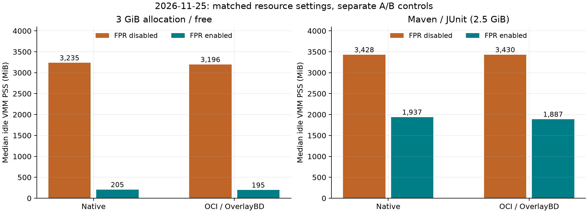
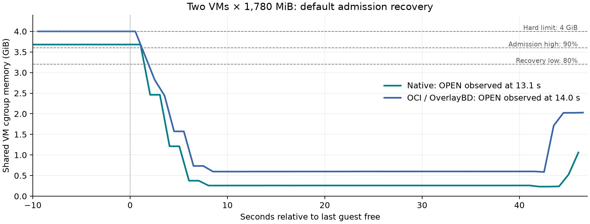

# Firecracker Free-Page Reporting (FPR) Benchmark

**FPR reduces idle VM memory and restores admission after bursts in both Native and OCI / OverlayBD. It cannot prevent OOM when admitted VMs concurrently exceed their shared memory budget.** The 2026-11-25 Native and OCI tests use the same code, runtime, workload image, and resource settings.

## Memory Reclamation

Each row compares enabled and disabled FPR within its own cohort. Sizes are MiB; idle values are median host VMM PSS.

| Cohort | Workload | FPR disabled | FPR enabled | Idle PSS reduction |
| --- | --- | ---: | ---: | ---: |
| Native, 2026-11-25 | Allocate/touch 3 GiB, hold 20 s, free | 3,235.3 | 205.1 | **93.7%** |
| Native, 2026-11-25 | Offline Maven/JUnit, 2.5 GiB heap burst | 3,428.5 | 1,936.8 | **43.5%** |
| OCI, 2026-11-25 | Allocate/touch 3 GiB, hold 20 s, free | 3,195.6 | 195.1 | **93.9%** |
| OCI, 2026-11-25 | Offline Maven/JUnit, 2.5 GiB heap burst | 3,429.8 | 1,886.6 | **45.0%** |

The 3 GiB workload reached 90% of its observed peak-to-idle PSS drop in **11.9 s (Native)** and **12.3 s (OCI)** after free. Maven builds succeeded in both variants, but enabled VMs retained **1.89 GiB (Native)** and **1.84 GiB (OCI)**; the full cause remains unresolved.

**Metric basis:** A/B reduction is `(disabled_idle − enabled_idle) / disabled_idle`. Both cohorts use 15–25 s after free with one VMM per group. Maven uses 30–50 s after command completion. Memory was sampled at approximately 1 Hz; recovery times are first observed states, not latency guarantees.

## Admission Recovery

The anonymous-memory cases recovered admission and created a new VM on the **same Fastlet/node**, followed by a successful 768 MiB content check. Disabled controls remained blocked during the corresponding observations.

| Test | Native | OCI |
| --- | --- | --- |
| Single 3 GiB burst, high/recovery watermarks 70%/50% | **15.9 s** after free | **17.7 s** after free |
| Dual-VM burst, default 90%/80% | **13.1 s**; cgroup 3,769 → 265 MiB | **14.0 s**; cgroup ~4,096 → 614 MiB |
| Separate Maven probe, default watermarks | Below the high watermark; post-build create/content check passed | Recovered **19.8 s** after completion; create/content check passed |

Both dual-VM tests used **1,780 MiB per VM**. At the Native Maven high probe, shared usage was **3,629 MiB**, below the **3,686 MiB (90%)** threshold, so admitting an idle VM was expected. No recovery delay is reported for that unblocked case.

Under strict 70%/50% watermarks, Maven left **1,972 MiB** charged in Native, below the **2,048 MiB** recovery line; its heartbeat reopened. OCI retained **2,295 MiB** and stayed blocked. Admission uses shared cgroup `memory.current`, including charged caches, rather than VMM PSS. FPR does not evict guest/host file caches or release static commitments.

## Regrowth, Snapshots, and OOM

| Check | Key evidence |
| --- | --- |
| Reuse after reclamation | Three consecutive 3 GiB cycles passed content checks in both cohorts, with no recorded OOM kills in normal-workload tests. |
| Pause/resume | Both paths preserved a 128 MiB process memory hash, file contents, and FPR with statistics polling off. Two subsequent 3 GiB cycles passed; final PSS was ~343 MiB Native / ~292 MiB OCI. Neither required forced host cache eviction in these cases. |
| Full cross-node restore | Both paths preserved file contents and FPR configuration, then passed 3 GiB growth/free; idle PSS was **195 MiB Native / 186 MiB OCI**. |
| RootfsOnly capture | Unvalidated in both runs: the fixture's relocated StateRoot did not satisfy the required capability/storage contract. |
| Static capacity | A fifth idle VM and a 5 GiB request were rejected by the commitment and runtime-budget checks, respectively. |

Two admitted VMs concurrently attempting **6 GiB** exceeded their shared hard budgets:

| Cohort | Hard budget / layout | Host cgroup event deltas | Impact |
| --- | --- | --- | --- |
| Native | 4 GiB VM subtree, outside Fastlet's container | `oom=4`, `oom_kill=4` | Commands interrupted; Fastlet/Proxy restarts stayed at 0 |
| OCI | Same 4 GiB VM layout | `oom=4`, `oom_kill=4` | Commands interrupted; Fastlet/Proxy restarts stayed at 0 |

`oom_kill` counts host-process kills, not guest OOMs. Fastlet and Proxy survived in both tests; VM workloads failed.

Native allocation times were **1.91–1.93 s disabled / 2.61–3.35 s enabled** across three cycles; Maven took **29.30 s / 30.63 s**. These small samples do not establish stable overhead or isolate its cause.

## Test Configuration and Limits

Both cohorts used the same two-node ACK/KVM cluster: 192 CPUs and ~755 GiB physical RAM per node, no swap, guest Linux 6.18.36+. Lifecycle operations used FastPath gRPC and commands used Fastlet Proxy. Limits were **2 vCPU / 4 GiB per VM**, four slots, and `overcommitRatio: cpu=2, memory=4`, deriving **1 CPU / 1 GiB commitment per VM**. VM hard budgets were **4 GiB**, with a separate 4.25 GiB Fastlet container limit. The whole node was not memory-saturated.

Both paths used all Fast Sandbox components from [main `15178de2`](https://github.com/opensandbox-group/fast-sandbox/commit/15178de2dfbbb270a60b21fcf758e3617cb486ad), Firecracker **1.17.0**, and the same workload-image digest. Each disabled control used the same source and zero-target balloon, changing only `free_page_reporting=false`.

Runtime API checks confirmed enabled FPR and **`stats_polling_interval_s=0`**, including after pause/resume and Full restore. Native sampling was moved into the cluster after client disconnects; incomplete timing attempts were excluded. An initial Native Full import hit cache-disk `ENOSPC`; it passed after unreferenced checkpoint caches were evicted. Valid A/B windows were collected without node DiskPressure.

Host PSI was unavailable and replaced by an empty-file fixture in test Fastlets. Real PSI admission, long-duration soak, full-node pressure, and ratio sweeps were not validated. Firecracker-native reclaimed-byte/failure counters were not collected: PSS drops are host-memory evidence, and missing failure counters cannot be reported as zero. Raw samples remain local.

## Sizing Implication

**The fixed 4× memory ratio was a stress-test setting, not a validated production recommendation.** Budget for simultaneous active demand, guest/VMM overhead, charged caches, and headroom. If overlap is unknown or every VM must reach its limit at once, start with `overcommitRatio.memory: "1"` and provision those costs. Validate higher ratios with representative concurrent bursts, regrowth, snapshots, OOM events, and command latency.

See [Resource-Aware Scheduling](https://github.com/opensandbox-group/OpenSandbox/blob/main/docs/guides/resource-aware-scheduling.md#choosing-overcommit-ratios) for configuration guidance.
