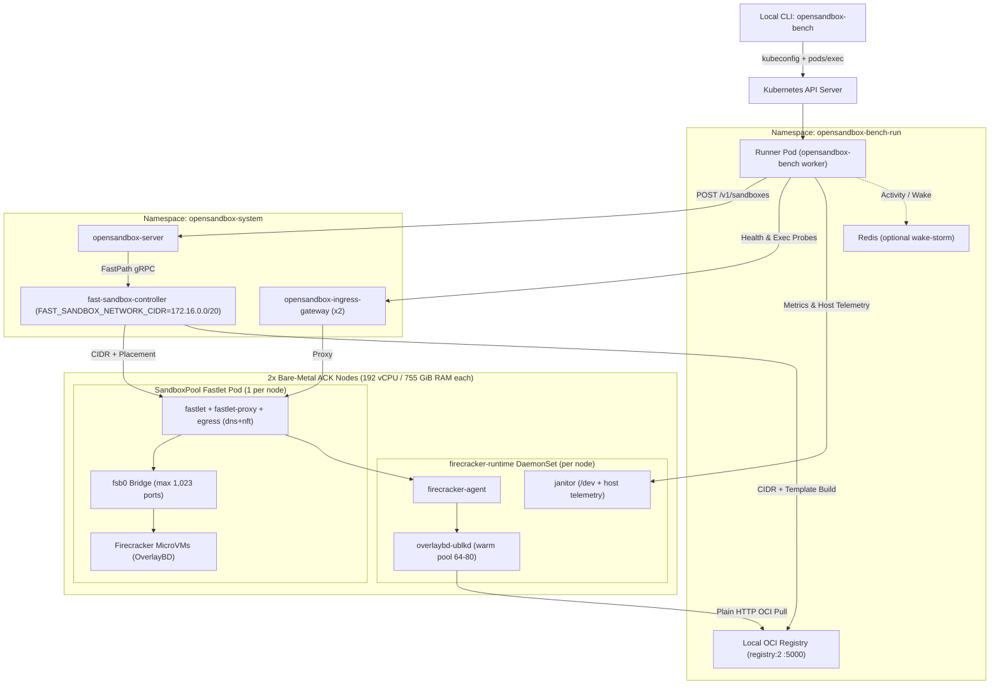

# OpenSandbox Benchmark

This directory hosts the standalone OpenSandbox benchmark harness (`opensandbox-bench`) and archived milestone/release baseline reports.

## Layout

- `tools/`: Standalone Go module (`cmd/opensandbox-bench`) implementing both the local orchestration CLI and the in-cluster worker subcommands (`opensandbox-bench worker ...`).
- `tools/profiles/`: Reference `BenchmarkProfile` YAML files (e.g., `fast-sandbox-overlaybd-ref.yaml`), embedded directly into the `opensandbox-bench` binary via `profiles.FS`.
- `reports/`: Archived milestone and pre-release baseline reports organized by `<tag-or-date>-<short-commit>/` (`report.json`, `summary.md`, and sampled `traces/`).

## Quick Start

```bash
cd benchmark/tools
make build

# Validate the reference profile
./bin/opensandbox-bench profile validate

# Cross-compile static Linux worker binary
make build-linux

# Run offline comparison between two reports
./bin/opensandbox-bench compare ../reports/<base>/report.json ../reports/<cand>/report.json

# Render a self-contained interactive HTML report (single run or two-version comparison)
./bin/opensandbox-bench plot ../reports/<run>/report.json --output report.html --host-memory ../reports/<run>/host-memory-profile.json
./bin/opensandbox-bench plot ../reports/<base>/report.json ../reports/<cand>/report.json --output compare.html
```

## Phase 2 Suites (`dataplane-microbench` & `noisy-neighbor`)

- `dataplane-microbench`: Evaluates in-sandbox data-plane overhead across CPU (`sysbench cpu` with `python3-fallback` for single vs concurrent sandboxes), OverlayBD `ublk` storage (`fio` 4K random R/W IOPS + 1M sequential cold/hot read MiB/s with `python3`/`dd` fallback), and egress/proxy network (`iperf3` or concurrent HTTP throughput & RTT P50/P95/P99). Configure optional overrides under `suites.dataplaneMicrobench`.
- `noisy-neighbor`: Launches a live fleet (`fleetSize`, default `20`), partitions it into aggressors (`aggressorRatio`, default `0.10`, at least 1) and victims, measures `victim_baseline_exec` vs `victim_noisy_exec` under background CPU/disk/network aggressor load (`stressModes`), reports P50/P95/P99 degradation ratios and failure rate delta, and cleans up all sandboxes on exit. Configure optional overrides under `suites.noisyNeighbor`.

## Running Benchmarks In-Cluster (`opensandbox-bench run`)

`opensandbox-bench run` uses the Kubernetes API Server as its sole network hop: it launches an isolated, per-invocation Runner Pod in `environment.benchNamespace`, injects a static Linux `opensandbox-bench` binary and profile YAML over `pods/exec` tar streams, executes `worker run` inside the cluster network, and pulls the resulting `run-bundle/` back to `--output`.

```bash
./bin/opensandbox-bench run \
  --kubeconfig ~/.kube/config \
  --profile my-profile.yaml \
  --suite schedule-burst \
  --api-key "$OPEN_SANDBOX_API_KEY" \
  --output ../reports/v1.3.0-abc1234
```

### Prerequisites & RBAC

- A `kubeconfig` with permissions in `environment.benchNamespace` to manage `namespaces` (`get`, `create`), `pods` (`get`, `create`, `delete`), and `pods/exec` (`create`), plus `nodes` (`get`) for cluster architecture detection (`amd64`/`arm64`).
- If `--provision` / `--teardown` are passed, additional cluster permissions are required to install/remove the target runtime stack.

### Key Flags & Operational Behavior

- **Per-invocation Runner Pod & cleanup**: Each invocation creates a uniquely named Pod (`opensandbox-bench-runner-<id>`) with soft node anti-affinity avoiding `fast-sandbox.io/firecracker-node=true` nodes. The Pod is automatically deleted on exit or cancellation (using an independent cleanup context) unless `--keep-runner` is specified.
- **Worker binary**: By default, `run` detects the Runner Pod node architecture and cross-compiles a static Linux binary (`CGO_ENABLED=0`) from `benchmark/tools` (override with `--module-dir`). Pass `--worker-binary <path>` to skip local compilation and inject a pre-built binary.
- **Target server**: Defaults to `opensandbox-server.<environment.systemNamespace>.svc:8080` derived from the active profile; override with `--server`.
- **Credential handling**: When `--api-key` is supplied, it is injected into the Runner Pod as a `0600` file (`/tmp/.opensandbox-api-key`) and passed via `--api-key-file` rather than on the `pods/exec` command line.
- **Output bundle**: `--output` must point to a non-existent or empty non-symlink directory so artifacts (`report.json`, `summary.md`, `traces/*.json`) from earlier runs are never mixed in. On worker failure, `run` still attempts a best-effort pull to preserve partial diagnostics. If `--output` is omitted, a warning is logged and the in-pod bundle is discarded when the Runner Pod is deleted.

## Reference Benchmark Environment

Archived `fast-sandbox` OverlayBD milestone baselines are collected on a standardized two-node ACK bare-metal environment with deterministic pre-warming, local registry storage, and full telemetry RBAC.



### Cluster & Host Hardware

| Dimension | Reference Specification |
|---|---|
| Nodes | 2× ACK bare-metal nodes (`ecs.ebmg9ae.48xlarge`), 192 vCPU and ~755 GiB allocatable RAM per node |
| OS & Kernel | Alibaba Cloud Linux Lifsea (ContainerOS) 3, Linux kernel `5.10.134-19.6.1.lifsea8.x86_64` (`amd64`) |
| Kubernetes & Runtime | Kubernetes `v1.36.2`, `containerd://2.1.9`, KVM enabled (`sandbox.fast.io/kvm=true`) |
| Kernel `ublk` Limit | `ublk_drv.ublks_max=65535` |

### Control-Plane, Runtime & Storage Stack

- **Controller-level Fastlet network CIDR**: `FAST_SANDBOX_NETWORK_CIDR=172.16.0.0/20` (4,094 usable IPs) is configured on `Deployment/fast-sandbox-controller` and propagated uniformly by the controller to `sandboxtemplate-builder` and `SandboxPool` Fastlet Pods, removing the default `/24` address ceiling. Note that a single Fastlet bridge (`fsb0`) remains bounded by the Linux kernel bridge port limit (`BR_MAX_PORTS=1024`, yielding a maximum of 1,023 sandboxes per Fastlet Pod).
- **In-cluster local OCI registry**: Enabled by default (`environment.registry.ephemeralInCluster: true`) via `opensandbox-bench-registry.<benchNS>.svc:5000` paired with `ConfigMap/fast-sandbox-registry` (`plainHTTP: true`, `insecure: true`), keeping template and snapshot OCI traffic inside the cluster network.
- **Core services & sidecars**: `opensandbox-server`, `opensandbox-ingress-gateway` (2 replicas), `egress` (`dns+nft` mode, `requests: 2 CPU / 4 GiB`, `limits: 4 CPU / 16 GiB`), and `fastlet-proxy` (`2 CPU / 4 GiB`).

### Pool, Prewarm & Cache Configuration

- **`SandboxPool` (`ResourceAware`)**: 2 Fastlets (1 per node via `podAntiAffinity`), `bufferMin=0`, `bufferMax=0`, `overcommitRatio` CPU `8` / Memory `4`, and `maxSandboxesPerPod` set to `500` in the reference profile (tuned to `240–1000` for single-Fastlet `density-ramp` runs).
- **OverlayBD `ublk` warm pool & caches**: `OVERLAYBD_POOL_LOW=64`, `OVERLAYBD_POOL_HIGH=80`, `OVERLAYBD_POOL_SIZE_GB=2`, and `OVERLAYBD_CACHE_SIZE_GB=32` on the reference ACK cluster (reference profile defaults: `poolLow=32`, `poolHigh=64`, `cacheSizeGB=64`); Fastlet `FAST_SANDBOX_OCI_BLOB_CACHE_SIZE_BYTES=16GiB` (reference profile: `64GiB`), `FAST_SANDBOX_SNAPSHOT_SPILL_DIR=/dev/shm/fsb-spill`, with DART P2P disabled.
- **Template & warmup**: `python:3.12-bookworm` + `execd` OverlayBD `Full` snapshot (`2 vCPU / 2048 MiB` on ACK runs or `4096 MiB` in the reference profile, `2 GiB` rootfs matching `OVERLAYBD_POOL_SIZE_GB=2`), with `WarmupRuns=2` executed before timed measurements in every suite.

### Runner Pod & Telemetry RBAC

To guarantee zero-degradation deterministic collection in `LoadSampler` (host `ublk` via `janitor` `/dev`, host `conntrack` via `nsenter -t 1 -n`, node memory, and Firecracker PSS/RSS) and `LeakAudit`, bind the `opensandbox-bench-runner` ServiceAccount to a `ClusterRole` granting:

- Core API (`""`): `get`, `list`, `watch` on `pods`, `nodes`, `namespaces`, `services`, `configmaps`, and `events`; `create`, `get` on `pods/exec` and `pods/log`.
- `apps`: `get`, `list` on `daemonsets` and `deployments`.
- `sandbox.fast.io` and `sandbox.opensandbox.io`: `get`, `list`, `watch` on sandbox, pool, template, and snapshot resources.

See [`tools/Makefile`](./tools/Makefile) for all build and test targets.
