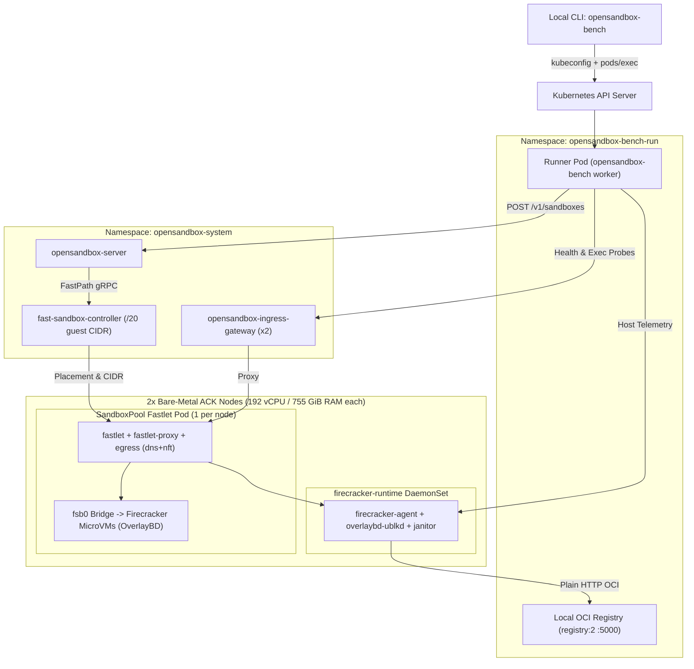

# OpenSandbox Benchmark

Standalone benchmark harness (`opensandbox-bench`), reference profiles, and archived performance reports for OpenSandbox runtimes.

## Published Reports

| Report | Scope | Highlights |
|--------|-------|------------|
| [`release-1.3.0-rc.4` ACK OverlayBD Baseline](./reports/release-1.3.0-rc.4-8d26739/summary.md) | 6-suite Firecracker + OverlayBD baseline on 2× bare-metal ACK nodes (`report.json`, `plot.html`, `compare-rc3.html`) | `65.3 ms` P50 serial / `70.9 ms` P50 (`c=16`) create (`t_api_ack`), `800` live MicroVMs per Fastlet, `~10.2 MiB` Firecracker PSS (`~17.5 MiB` host `ΔMemAvail`) per 2 GiB sandbox |
| [Firecracker Free-Page Reporting (FPR)](./FPR-report.md) | Native vs. OCI/OverlayBD memory reclamation (`virtio-balloon`), admission recovery, snapshots, and OOM boundaries | `93.7%–93.9%` idle PSS reduction after 3 GiB anonymous bursts; `43.5%–45.0%` after Maven heap bursts |
| [Egress Credential-Bound Interception](./egress-credential-bound-interception-report.md) | Fast Sandbox `credential-bound` vs. `all` TLS interception mode | `54%–57%` lower egress CPU and `~75%` lower per-connection memory at 5% bound traffic |

See [`reports/README.md`](./reports/README.md) for the `<tag-or-date>-<short-commit>/` archive layout (`report.json`, `summary.md`, and sampled OTel `traces/`).

## Layout

- `tools/`: Go module (`cmd/opensandbox-bench`) providing the local orchestration CLI and in-cluster worker (`opensandbox-bench worker ...`).
- `tools/profiles/`: Embedded `BenchmarkProfile` YAML definitions (such as `fast-sandbox-overlaybd-ref.yaml`).
- `reports/`: Commit- and tag-stamped milestone and pre-release run bundles.

## Benchmark Suites

| Suite | What it measures |
|-------|------------------|
| `schedule-burst` | Create latency (`t_api_ack`, `t_first_ping`) and throughput across concurrency steps (`c=1..128`) |
| `steady-churn` | Sustained fixed-RPS create/delete churn, tail latency, and slot conservation |
| `high-density-soak` | Multi-node active sandbox capacity, memory oversubscription ratios, Firecracker PSS/RSS, and OOM behavior |
| `density-ramp` | Single-Fastlet live MicroVM ramp up to bridge/slot limits, tracking `/ping` P99 and host memory deltas |
| `dataplane-microbench` | Guest CPU scaling, OverlayBD `ublk` 4K/1M I/O (`O_DIRECT`), and egress/proxy network throughput & RTT |
| `noisy-neighbor` | Co-located victim exec latency degradation and failure delta under background CPU/disk/network aggressor load |

## Quick Start (`opensandbox-bench`)

Build locally, validate profiles, and compare or plot archived bundles:

```bash
cd benchmark/tools
make build                  # host binary (use `make build-linux` for static Linux worker)
./bin/opensandbox-bench profile validate

# Compare two runs or render interactive HTML reports
./bin/opensandbox-bench compare ../reports/<base>/report.json ../reports/<cand>/report.json
./bin/opensandbox-bench plot ../reports/<run>/report.json --output report.html
```

Run a suite inside a Kubernetes cluster (`opensandbox-bench run` launches an isolated Runner Pod in `environment.benchNamespace` via `pods/exec`, runs `worker run` in-cluster, and pulls the bundle into `--output`):

```bash
./bin/opensandbox-bench run \
  --kubeconfig ~/.kube/config \
  --profile my-profile.yaml \
  --suite schedule-burst \
  --api-key "$OPEN_SANDBOX_API_KEY" \
  --output ../reports/v1.3.0-abc1234
```

Key operational behavior:

- **Runner lifecycle**: Creates `opensandbox-bench-runner-<id>` (avoiding `fast-sandbox.io/firecracker-node=true` nodes) and deletes it automatically on exit unless `--keep-runner` is set; pass `--worker-binary` to skip local cross-compilation.
- **Target & credentials**: Defaults to `opensandbox-server.<environment.systemNamespace>.svc:8080` (override with `--server`); `--api-key` is written into the pod as a `0600` file rather than exposed on process argv.
- **Output safety & RBAC**: `--output` must be a new or empty non-symlink directory. `kubeconfig` needs `namespaces`, `pods`, `pods/exec`, and `nodes` (`get`) access; full host telemetry (`LoadSampler` / `LeakAudit`) requires read access to `pods/log`, `daemonsets`, `deployments`, `sandbox.fast.io`, and `sandbox.opensandbox.io` resources.

## Reference ACK Environment

Archived `fast-sandbox` OverlayBD baselines run on a standardized two-node ACK bare-metal environment (`2× ecs.ebmg9ae.48xlarge`, 192 vCPU / ~755 GiB RAM, Lifsea 3, KVM + `ublk_drv.ublks_max=65535`):



- **Guest network CIDR**: `FAST_SANDBOX_NETWORK_CIDR` uses a `/20` block (4,094 IPs) propagated by `fast-sandbox-controller` to remove the default `/24` ceiling; each Fastlet `fsb0` bridge remains bounded by Linux `BR_MAX_PORTS=1024` (max 1,023 sandboxes/pod).
- **Local registry & warm caches**: In-cluster `registry:2` (`plainHTTP: true`) keeps template/snapshot pulls on the cluster network, paired with pre-warmed `overlaybd-ublkd` device pools, OCI blob caches, and `WarmupRuns=2` before timed measurements. See each report's methodology card and [`tools/Makefile`](./tools/Makefile) for exact parameters and build targets.
