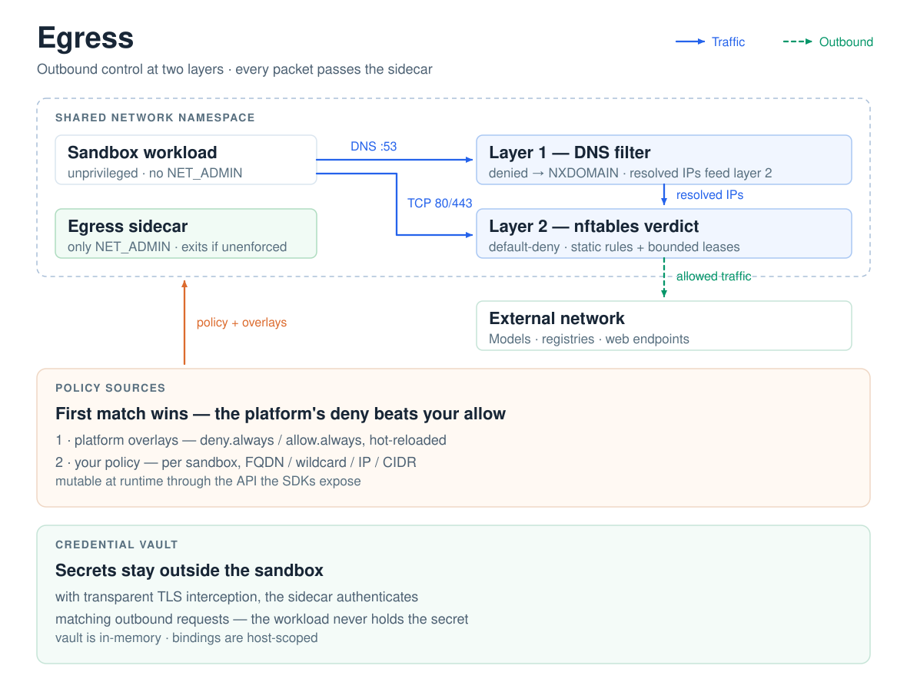

# Egress

Egress is how a sandbox gets a network policy instead of open internet access. It runs as a sidecar sharing the sandbox's network namespace, so every outbound packet passes it — no application configuration, and no way around it from inside. Policy is declared at create time (`networkPolicy`) or by the platform, and enforced continuously.

If you are a cluster administrator looking to configure the platform overlays — internal CIDR isolation, dangerous-domain blocking, and reachable-port caps — start with [Sandbox Network Security](/guides/network-security); this page explains how the machinery under those controls works.

## Capabilities at a glance

| Capability | What you get |
|---|---|
| FQDN rules | Allow or deny by domain, wildcard (`*.pypi.org`), IP, or CIDR — optionally scoped to TCP destination ports |
| DNS filtering (default) | Denied domains fail resolution; allowed ones resolve normally |
| Network enforcement (`dns+nft`) | Strict default-deny at the packet layer, fed by DNS-resolved addresses with bounded leases |
| Platform overlays | Operator-set `deny.always` / `allow.always` floors that user policy cannot override, plus a TCP port floor (`reachable.ports.cap`) that caps which ports are reachable at all |
| Credential Vault | Secrets stay in the sidecar; credentials are injected into matching outbound requests |
| Transparent TLS interception (L7) | See, control, and authenticate outbound HTTPS — production-usable mechanism, experimental configuration surface |
| Fail-closed startup | If enforcement cannot be installed, the sidecar exits — it never runs as a no-op |

## How interception works

- **Layer 1 — DNS.** All port-53 traffic is redirected into the sidecar's DNS proxy. Denied domains answer `NXDOMAIN`; allowed domains resolve through to the real upstream, and their resolved addresses are recorded.
- **Layer 2 — Network (`dns+nft` mode).** nftables drops everything not explicitly allowed. Allowed traffic passes by static rule or via DNS-learned address sets: a resolved IP receives a bounded lease (with a grace window for active TCP connections), so "allowed" never silently becomes "allowed forever". UDP and QUIC flows rely on DNS lease timing alone.
- **Precedence.** First matching rule wins: platform `deny.always`, then platform `allow.always`, then your policy — the platform's deny always beats your allow. Overlays live inside the egress image and hot-reload every minute in both profiles (per-sandbox sidecar and fast-sandbox); a reload publishes only after nftables accepts the corresponding policy. Parse or apply failures keep the last accepted in-memory rules and stay eligible for retry.
- **Runtime mutation.** Your policy is set per sandbox and can be mutated at runtime (add, replace, remove by target) through the API the SDKs expose.

**DNS installation acknowledgement.** In both profiles, an allowed A/AAAA answer waits for the selected network-policy callback to finish. If installation fails, the proxy returns `SERVFAIL` without resolved addresses rather than a successful but unusable answer; clients should treat this as a transient resolution failure. Infrastructure DNS continues through its separate callback, and domain targets combined with `ports` remain unsupported.

**DNS tracking limits.** Under a default-deny Classic `dns+nft` policy, an answer that cannot fit within the domain or per-domain address tracking limit returns `SERVFAIL` without installing new grants. A background lookup that no longer confirms an address stops DNS renewal, but the observation still counts until its lease and any TCP reconnect grace expire. If two domains resolve to the same IP, a shorter DNS answer does not cut short the other domain's grant, and an unexpired grant from one domain does not keep an expired record for the other domain in the table. Default-allow policies still do not use this tracking budget.

An active TCP poll can renew a live source lease or continue the grace already credited to that source. The final refresh after a connection closes only renews sources credited by the preceding active poll. Reloads preserve pending reconnect grace only for retained, still-live sources that received it; another domain sharing the IP cannot keep an expired source's credit alive.

**Policy replacement.** Classic `dns+nft` keeps the remaining lifetime of a DNS lease if the replacement default-deny policy still permits its source domain. `dropEstablished` uses historical addresses to identify revoked grants, but only live leases can protect a shared IP from teardown. Egress fills in remaining timeouts after assembling each nftables script, including a missing-table retry. If an expiry changes which grants or teardown exemptions should survive, egress rebuilds both before submission. If the outcome is unknown, egress stops adding or renewing grants until a successful apply establishes the current policy.

**Port floor.** Operators can also ship an `reachable.ports.cap` file next to the overlays: a whitelist of TCP ports (one port or `lo-hi` range per line) that are reachable **at all**. The sidecar derives the complement and enforces it as an always-deny ahead of every user rule — so regardless of what a sandbox's `defaultAction` or allow rules say, only the whitelisted ports pass (TCP only; the same fail-closed ordering that makes a deny rule win over any allow). A missing or empty file means no floor. The Fast Sandbox profile enforces the same floor profile-wide in its master nft chains, and both profiles hot-reload the file every minute. Under transparent MITM, the floor still applies to mitmproxy's own upstream connections, so keep intercepted ports within the whitelist — a non-whitelisted intercepted port fails at the proxy instead of passing silently. The floor never blackholes interception itself: flows redirected into the mitmproxy listener are accepted ahead of the floor because the redirect rewrites their destination port before the policy chain runs (see [Port-scoped rules](#port-scoped-rules)). By default established connections persist after a policy tighten (the nft chain accepts `ct state established,related` before the allow sets). Pass `?dropEstablished=true` on `PATCH`/`DELETE /policy` to drop keep-alive flows to destinations the new policy no longer allows (dns+nft sidecar; see #2329). The teardown rules are carried across later applies until the destination is allowed again or the established-flow conntrack timeout (`nf_conntrack_tcp_timeout_established`) has passed.

### Port-scoped rules

A rule's `target` may be omitted when `ports` is set, so a rule can scope by TCP destination port alone — `{"action": "deny", "ports": [25]}` blocks outbound SMTP regardless of destination. `target` and `ports` can also combine to scope an IP or CIDR rule to specific ports. Ports are enforced at the network layer (`dns+nft` mode) as `tcp dport` matches, and a deny rule — port-scoped or not — always wins over an allow rule.

**DNS limitation for targetless allows.** The DNS proxy only resolves hostnames matched by a domain rule; a targetless `allow` with `ports` is invisible to it. Under `defaultAction: deny`, hostname lookups therefore still fail (`NXDOMAIN`) and such a rule serves clients that dial IPs directly. Hostname access needs explicit domain allow rules — which are not port-scoped — or destinations addressed by stable IP.

Current limits: TCP only (no UDP); at most 256 ports per rule; domain targets cannot combine with `ports` (domain rules are evaluated at the DNS layer, which has no port dimension) and are rejected at validation; `DELETE /policy` removes rules by `target` — port-only rules have none, so `DELETE` with an explicit empty string (`""`) in the target list removes them all, or a full `POST`/`PUT` replaces the policy. The Fast Sandbox profile supports the same TCP port-scoped rules per subject: allowed traffic is marked in prerouting, denied traffic is dropped in the subject's forward chain, and MITM-redirected traffic is checked in the input chain against its conntrack original destination and port. Independently of user rules, operators can cap reachable ports platform-wide with the `reachable.ports.cap` floor (see [Precedence](#precedence)). One boundary to keep in mind in the classic profile: under transparent MITM, intercepted ports are redirected into the sidecar (destination rewritten to the mitmproxy listener port) before the nft policy chain sees them, so the chain accepts that rewritten destination ahead of port-scoped rules and interception works under default-deny policies and port floors — port-scoped rules and the cap then govern mitmproxy's own re-originated connections, keeping the interception port list within the cap.

## Design decisions

| Decision | Rationale |
|---|---|
| Enforcement lives in the data path | The sidecar installs redirect rules in the shared namespace; the workload holds no `NET_ADMIN`, so there is nothing to bypass and no application cooperation required. |
| Two layers, two costs | DNS filtering alone is cheap and universal but only gates names. `dns+nft` adds packet-level default-deny with DNS-learned, leased exceptions. |
| Encrypted DNS is an escape hatch | DoT (853) is always dropped, and blocking DoH over 443 is a one-switch option. |
| Fail-closed over best-effort | If redirect rules cannot be installed, the sidecar exits instead of running as silent pass-through; a supervisor restarts it with backoff and a crash-loop breaker. |
| Portable by fallback, honest about limits | Redirects install via iptables where available and fall back to native nftables (Firecracker-style guest kernels). gVisor does not support the nftables features either path needs, so neither works there — Kata is the supported secure runtime — and transparent mesh sidecars conflict by construction. |

## Transparent TLS interception (L7)

Layers 1 and 2 decide *whether* a connection may happen; the transparent MITM layer adds control and visibility over *what goes through it*. When enabled, outbound HTTP and HTTPS is redirected into a mitmproxy listener inside the sidecar, which recovers the true destination from connection state and terminates TLS on the sandbox's behalf.

**Status: experimental but production-usable.** Interception, credential injection, and CA delivery are complete and run in production settings; the configuration surface — extra ports and diagnostic switches — may still change between releases.

::: warning Internal OSEP-0023 revision runtime
`OPENSANDBOX_EGRESS_EXPERIMENTAL_REVISION_RUNTIME=true` is a development-only gate (default off) for the OSEP-0023 revision protocol. It adds no public configuration surface or supported `interceptionMode`. It selects sidecar live admission or Fast Sandbox subject installation according to the process profile.

Fast Sandbox accepts the operator-owned `OPENSANDBOX_EGRESS_FSB_INTERCEPTION_MODE` switch: `all` (default, unchanged) or `credential-bound`. Setting this variable in the sidecar profile fails startup; the sidecar revision gate is unchanged. With the new switch unset, the two legacy gates `OPENSANDBOX_EGRESS_EXPERIMENTAL_REVISION_RUNTIME=true` and `OPENSANDBOX_EGRESS_EXPERIMENTAL_FSB_TLS_ADMISSION=true` remain a deprecated alias for `credential-bound`, with one startup warning. Only the revision gate retains installation-only behavior; the admission gate alone fails startup. Explicit `all` conflicts with either true legacy gate, and explicit `credential-bound` conflicts with an explicitly disabled legacy gate. Empty or unknown switch values fail startup. The proposed switch name remains subject to maintainer confirmation.

Before profile dispatch or network setup, Fast Sandbox `credential-bound` requires `OPENSANDBOX_EGRESS_MITMPROXY_TRANSPARENT=true` and `OPENSANDBOX_EGRESS_MODE=dns+nft`. It rejects extra interception ports beyond the default `80,443`, `OPENSANDBOX_EGRESS_MITMPROXY_SSL_INSECURE=true`, and `OPENSANDBOX_EGRESS_UPSTREAM_PROXY`. Go also checks the mitmproxy runtime user's `.mitmproxy/config.yaml` and `config.yml` (loaded in that order) and rejects nonempty effective `ignore_hosts` / `allow_hosts`, static `ssl_insecure=true`, unreadable configuration, or malformed configuration. Chained upstream proxy support remains deferred for this mode.

When the resolved Fast Sandbox mode is `credential-bound`, the subject receiver admits HTTP/1.1 requests against the immutable current dispatch snapshot of the registry selected at TLS handshake, with the shared sidecar authority, binding, injection, and redaction checks; it never falls back to source-IP credential lookup. Plain HTTP follows the sidecar live path and receives no injected credentials. Decrypted connections do not negotiate HTTP/2, and HTTP/2 requests are denied defensively. Maintainer-owned exchange credentials remain unimplemented; exchange bindings fail explicitly. Revoking dispatch authority permanently fences existing memberships, including across snapshot reinstallation, without releasing their connection slots before disconnect. Identity retirement drops the registry's dispatch snapshot while already admitted requests retain their pinned snapshots. This mode remains experimental and is not production-ready.

Binding transitions in this mode follow the sidecar retirement rules (R2). When a committed revision removes the last binding for a host, the subject registry fences new requests on existing decrypted connections to that host before the commit receipt returns; new handshakes to that host pass through opaquely. Already admitted requests keep their pinned snapshot and may complete until a fixed deadline. At the deadline a drain loop closes the transport, whether it is busy or idle. A credential-only change keeps connections open: later requests use the new snapshot, while already admitted requests keep the old one. A policy-only change gives the deadline only to unfinished requests admitted under the old revision. Finishing such a request removes its obligation, and an idle connection whose host is still bound stays open. Repeated publication, consecutive rotations, and removing, re-adding, and removing a host again never extend the earliest deadline or reopen a fenced connection. The deadline reuses the existing `OPENSANDBOX_EGRESS_REVISION_DRAIN_TIMEOUT_SECONDS` setting and parser (default 30 seconds, range 1–300; other values fall back to the default), handed to the subject process only in `credential-bound` mode. Requesting a close does not release capacity: a connection slot is released only after mitmproxy reports the client disconnect. This covers HTTP/1.1 only.

Lifecycle teardown in this mode (R3) covers every client connection that reaches mitmproxy, both decrypted and opaque (no SNI, ECH, unbound host, or not yet handshaken). Each client is indexed at connect with the subject that owned its source address at that moment, so a later Register on the same address never lends its identity to an earlier connection. Unload, suspend, a receiver failure, a terminal owner error, and process shutdown first revoke routing or authority and fence new connections from the affected addresses, then close the exact old connections on the proxy event loop without holding owner or registry locks, and wait a bounded time (1 second) for mitmproxy to report each disconnect. Only a reported disconnect counts as closed, and connection slots are still released only then. The Unload receipt reports `closedConnections` and `remainingConnections`; any remaining connection turns the result into a fenced `subject_failed` with `transportObligations: "pending"`, which the Go worker records as the closed degraded reason `subject_transport_unconfirmed`. Suspend with unconfirmed closures also returns `subject_failed`, while a later prepare and commit still serves new connections. Before publishing a new Register, the receiver closes any connection still live on those addresses and rejects the Register (`subject_failed`) while one remains, so it does not rely on Go command ordering alone. Installation-only receivers keep the earlier receipt without counts, which proves nothing about live sockets. Traffic that never reaches mitmproxy (for example non-intercepted ports) belongs to the platform network attachment lifecycle: the Fast Sandbox nft removal does not flush conntrack, and established flows may continue until the attachment is torn down. R3 adds no such cleanup and does not change HTTP/2, exchange, or Actions v2 guarantees.

Readiness in this mode (R5) waits briefly for the subject snapshot acknowledgement. A `data-plane-ready` Hook arriving over Actions v1 before the current snapshot is acknowledged waits up to 50 ms for that acknowledgement before entering the action gate. The wait holds no action gate, policy, server, or owner lock, so other subjects' actions and Vault or policy relays proceed meanwhile. It is woken per subject when the worker records the acknowledgement or when the registration is replaced or unloaded, and it also ends on caller cancellation or shutdown. After the wait, the Hook runs the unchanged fence and acknowledgement checks under the gate: a timeout still returns 503, and a rebind or removal during the wait still returns 409. States an in-flight install cannot resolve (stale fence, no pending policy, a non-authoritative Vault entry, or a snapshot production failure) skip the wait. The Fastlet retries a failed Hook only on its next action probe tick (1 second at the pinned fast-sandbox commit), so without this wait a few milliseconds of acknowledgement IPC could add about a second to sandbox creation. Interception mode `all`, which has no subject drain, never waits, and Actions v2, which holds an owner lock around dispatch, is unchanged.

The experimental connection limits are `OPENSANDBOX_EGRESS_FSB_TLS_CAPACITY` (per subject, default 32) and `OPENSANDBOX_EGRESS_FSB_PROCESS_TLS_CAPACITY` (process, default 131072), each bounded to 1–1048576 using the existing integer environment parser. Per-subject limits are not reserved allocations. These defaults have not been measured for memory use; B6 must establish release defaults. Exhaustion terminates only new bound handshakes; existing memberships stay charged until disconnect, while opaque traffic consumes no decision-registry slot. Admission uses the dispatch snapshot, never the receiver's installation readback. On non-443 destinations, SNI-bearing TLS is denied even for a matching static selector; ECH and no-SNI retain their earlier opaque exceptions. This intentionally preserves the stricter existing classifier and CR-1 behavior.

A Fast Sandbox TLS admission deny (snapshot missing, unknown identity, budget exhaustion, `ssl_insecure`, malformed ClientHello extensions, or a dispatch error in the subject hook) closes the transport of exactly that client: the subject admission runtime cancels the real mitmproxy connection handler for that one connection on the proxy event loop, without holding runtime or registry locks and without waiting for the disconnect hook. Denying also permanently dooms the connection's index entry so it can never re-acquire subject authority; the entry and any charged budget are released only when mitmproxy reports the real disconnect. A missing handler, a closed event loop or a failed close keeps a fail-closed CLOSED-state fence that prevents decryption but is honestly reported as not closed — it does not claim the socket was closed. Verified locally on macOS loopback with explicit `CONNECT` tunnels against a real mitmdump, using dual trust-root probes (MITM CA and the origin's own CA): both roots observe an immediate explicit EOF/reset instead of the earlier handshake timeout, with zero origin HTTP requests and no credential leakage. Transparent-mode Linux/KVM interception closure remains unverified on this machine and is CI evidence pending. The sidecar live runtime's deny path is unchanged and still uses the shared fail-closed state fence; this fix makes no sidecar claim.

The bounded `egress.mitm.tls.connections_total` reasons include `registry_exhausted`. `egress.mitm.tls.registry.occupancy` and `egress.mitm.tls.registry.configured_budget` are histograms of admission/disconnect observations with only `profile=fast-sandbox` and `scope=process|subject` beyond shared process attributes. They contain no subject identity and are not time-weighted occupancy, aggregate subject gauges, or memory measurements. With the new switch unset, both legacy gates off, or only the revision gate on, retain the prior launch arguments and child environment.

The Fast Sandbox integration environment can select this mode. `EGRESS_INTERCEPTION_MODE` (empty by default; `all` or `credential-bound`) renders `OPENSANDBOX_EGRESS_FSB_INTERCEPTION_MODE` into the Pool's egress container only; empty leaves the rendered Pool byte-identical and passes no switch, and other values fail before any action. With `credential-bound`, both verify lanes add a stage against a persistent HTTP/1.1 TLS test origin: passthrough before any Vault; bound and unbound sandboxes on the same Fastlet Pod (same Pod UID, so the same egress registry); an existing connection across a new binding; credential rotation and last-binding removal, where a decrypted connection held across the removal acknowledgement must have its next request rejected without reaching the origin (a timeout or reconnect does not count); source-address reuse after killing a still-bound sandbox, counted only for a new identity with the same guest address on the same Fastlet Pod UID; mitmdump and egress restarts; a network deny on a passthrough flow; and a scan of the fully collected current and previous egress logs and the env logs for the test credential values, where a collection error fails instead of reporting clean. Passthrough is judged by the presented leaf certificate digest, because origin and MITM leaves chain to the same test CA. Retries cover only failures without traffic evidence: a credential or MITM leaf that a probe must not see fails the stage at once. The existing Vault, MITM CA, pause/resume, idle-pause and snapshot stages still run in that mode. The exchange stage is reported `BLOCKED` (issue I1) instead of passing, and an address reuse that is not observed is reported `NOT_RUN`. Neither counts as a pass. The integration workflow runs the default and `credential-bound` legs serially on the KVM runner. [PR-gated KVM run 43998800123](https://github.com/opensandbox-group/OpenSandbox/actions/runs/43998800123), recorded on 2026-11-17 for commit `4f190466a`, passed both legs. In the `credential-bound` leg, the native lane passed AC2–AC9, including source-address reuse; the overlaybd lane passed the other checks but reported AC6 as `NOT_RUN` because no qualifying reuse was observed in four attempts. Exchange remained `BLOCKED`. These excluded items are not passes, and this run is evidence for that commit and configuration, not for every subsequent revision. Local checks cover rendering, stage gating and the verifier decisions against a fake cluster boundary only. This adds no production-readiness claim.

**Restart-recovery matrix (R6, experimental).** The matrix below records what the current Fast Sandbox subject recovery does across restart windows and where each row's evidence comes from. "Local" evidence means the component tests: the Go control plane against the real Python subject addon over Unix IPC, and a real mitmdump child with a loopback TLS origin. Local evidence includes no Linux kernel enforcement, no nftables, no KVM, and no full egress process restart; a control-plane rebuild is a new server object sharing only the persisted files, and a child generation change is a real mitmdump restart against a live origin. Rows that need the Linux atomic file store or the full runner are marked Linux/KVM CI; rows marked as limitations are recorded as-is, not as satisfied contracts.

| Restart scenario | Current behavior | Evidence boundary |
|---|---|---|
| Child generation change (mitmdump restart) | The new child uses a fresh control generation and session; the old session token is rejected (401) and the old control generation is a confirmed mismatch (409), so an old generation's install cannot affect the new child. Existing ACKs never carry over: data-plane readiness stays closed until each subject's snapshot is reinstalled and re-acknowledged on the new child. Rebind or remove landing inside the window is not revived by the old queue or ACK, and a late detach of the previous client cannot clear the published one. | Local: real mitmdump restart with a live origin; real addon IPC. |
| Bound TLS during the reinstall window | A registered-but-uninstalled subject on the new child denies bound-SNI handshakes with an explicit transport close, probed with both the MITM CA and the origin CA (a timeout, a certificate verification error or a completed handshake does not count), and the request never reaches the origin; no-SNI and ECH-bearing ClientHellos keep the opaque passthrough rule (no credential injection) before and after recovery; once the snapshot is reinstalled the subject injects its own snapshot's credentials again, and a same-SNI unbound subject passes through with none. Old transports are accepted as closed only on explicit EOF/reset, never on a timeout. | Local: real TLS through explicit `CONNECT` tunnels against a loopback origin; transparent-mode Linux/KVM closure remains CI evidence pending. ECH rows use wire-level 0xfe0d extension bytes, not a full ECH client. |
| Control-plane rebuild, same fence (default Actions v1) | A new server object sharing only the persisted policy and vault files reloads same-fence vault content exactly at the recorded revision and policy epoch; an unbound subject stays explicitly empty; readiness opens only after a real install ACK. | Local control-plane rebuild over real files; the atomic file store itself is Linux-only, so these rows complete on Linux CI. Not a full egress process restart. |
| Known-unknown or unreadable v1 vault file | The subject stays unknown and not ready across both the rebuild and later child generation changes; it is never washed into an empty ready state. The existing explicit recovery path (restore the file, re-register) reinstalls it, while healthy subjects recover independently. | Local over real files (Linux CI for the atomic store). |
| v1 file missing after creation, stale-fence v1 file, first registration with no vault | Under the default Actions v1 contract all three resolve to the authoritative empty state. A missing or stale v1 file is not rejected: v1 records no restart provenance, so "never created" and "lost after creation" are indistinguishable after the fact. This is a recorded compatibility limitation, deliberately not claimed as fail-closed; a provenance-aware v1 authority is a separate design item. | Local over real files (Linux CI); locked in as current behavior by tests. |
| Strict Actions v2 | The owner/initialization/verify contract — including missing-file, stale-fence and unknown-state rejection with explicit verify recovery — is a separate deployment contract with its own regression suite. v2 results are never evidence for the v1 rows above, and v1 rows never relax the v2 contract. | Local strict-mode suite; unchanged. |
| Full Linux/KVM restart with kernel enforcement | Not covered by any local row: nftables enforcement, conntrack teardown and the full egress process lifecycle across a host restart remain PR-gated KVM CI evidence. | KVM runner legs only. |

The Fast Sandbox management transport has a separate `OPENSANDBOX_EGRESS_ACTIONS_API_VERSION` switch (default v1). Its experimental v2 value only selects strict Actions/relay HTTP routes; it does not enable the OSEP-0023 revision runtime or TLS interception. A v2 Fastlet Pool and every egress Handler must use the same version. V2 supports legacy-mode binding and Vault/Policy relay operations for clean-base Firecracker sandboxes; snapshots, template state, pause/resume, and restore are unsupported. Owner metadata fences the Sandbox runtime but is not caller authentication. Because the listener is on Pod-netns loopback, verify management-port isolation for the exact Fastlet Pod composition before enabling v2; this code does not configure or test that isolation.

Strict requests carry an explicit `mode: legacy`. The egress persists the complete owner and `active`/`retiring`/`retired` phase in `<policy-dir>/<uid>.json.owner` using the existing atomic writer. Retirement records are retained without credential material; late SET/Hook/relay operations cannot revive them after restart. This slice rejects same-UID rebind and live `SET null`; use terminal Sandbox Delete and a new UID. A never-registered owner is reported as `absent`, not `retired`; REMOVE first writes its terminal fence. Reopening a directory containing owner records with the v1 switch is rejected. Do not delete these records or roll the whole deployment back to an older binary that does not understand them.

The internal sidecar experiment covers bound HTTPS/443 HTTP/1.1 traffic and experimental HTTP/2 admission and bounded-drain wiring on the fixed-dependency direct/lazy path. Configured chained upstream proxies remain rejected for live HTTP/2. Long-held responses can still cause Go retries to time out; full client migration and Linux acceptance remain follow-up work. Key properties:

- Admission is per connection and per request, from an immutable snapshot installed over an authenticated channel; unknown or mismatched state denies — the mode never falls back to decrypt-all.
- Any uncertain outcome (unconfirmed mutation, session cleanup failure, unexpected child exit) latches a sticky recovery-required state: readiness drops, nft writes quiesce, and an independent quarantine table is installed for the process lifetime. Restarting the sidecar is not a verified recovery — destroy and recreate the sandbox instead.
- Updates are not one atomic visibility boundary: nft rules can affect traffic before receiver acknowledgement, and a committed update is not rolled back if the API response is lost. Retired connections drain within a bounded window (default 30 seconds).

Full contract, including the egress-owned policy-file storage requirements when `OPENSANDBOX_EGRESS_POLICY_FILE` is set: [credential vault guide](/guides/credential-vault#experimental-live-credential-bound-admission-osep-0023), [OSEP-0023](https://github.com/opensandbox-group/OpenSandbox/blob/main/oseps/0023-credential-bound-tls-interception.md), and the [HTTP/2 integration boundary](/architecture/network/osep-0023-h2-integration).
:::

**Trust is delivered, not disabled.** The sidecar exports its CA, and sandbox bootstrap installs it into the system, NSS, and JDK trust stores on a best-effort basis — clients keep certificate verification on (`curl` without `-k`). Chromium-family images should ship the native `certutil` package so the per-user NSS store can be updated.

Bootstrap waits for the exported CA before trusting it, guarding against a stale export left behind by a restarting egress sidecar: a file that was already present when bootstrap started is only trusted after an observed purge or content change, or after remaining unchanged for a full stabilization window. A background rotation watcher keeps running for the sandbox lifetime and reinstalls all trust stores whenever the exported CA content changes — this covers egress sidecar restarts that rotate the CA (the ephemeral mitmproxy confdir regenerates it) without restarting the sandbox container. Env vars (`NODE_EXTRA_CA_CERTS`, `REQUESTS_CA_BUNDLE`, `SSL_CERT_FILE`) reference stable file paths whose content is refreshed in place, so newly started processes pick up the rotated CA without re-exec; long-running processes that cached the old CA in memory (for example JVM `cacerts`) still need a restart. Install passes are retried up to three times per CA generation before giving up until the next rotation. The timing knobs, with defaults, are `MITM_CA_WAIT_TIMEOUT` (300s — how long bootstrap waits for the initial export), `MITM_CA_STABILIZE_WINDOW` (15s — how long a pre-existing export must stay unchanged before it is trusted; `<= 0` trusts a present non-empty CA file immediately without waiting), `MITM_CA_POLL_INTERVAL` (0.5s — wait-loop poll frequency), and `MITM_CA_WATCH_INTERVAL` (30s — rotation watch frequency; `<= 0` disables the background rotation watcher). Setting `MITM_CA_STABILIZE_WINDOW=0` or `MITM_CA_WATCH_INTERVAL=0` is only safe when the CA is statically baked into an immutable VM rootfs (such as Firecracker templates and `RootfsOnly` cold boots) and never rotates over a shared sidecar volume; container sandboxes using dynamic egress CA export should keep positive values so stale-CA protection and rotation healing remain active.

What it enables:

- **Credential Vault** — injection happens when request headers are read, so it applies regardless of body size, including fully streamed uploads.
- **TLS-level observability** — optional request-level outcome metrics (decrypt / passthrough) for targeted diagnostic windows.

**Extendable at L7.** The bundled system addon always loads first, then any comma-separated mitmproxy addons in `OPENSANDBOX_EGRESS_MITMPROXY_SCRIPT`, in order. Addons are standard mitmproxy scripts with the full L7 hook surface (hostname, method, URI path, headers, bodies), so operators can add hostname/method/header filtering, header injection, or request rewriting as ordinary Python addons — on top of, never ahead of, the built-in behavior.

**Chained upstream proxy.** Set `OPENSANDBOX_EGRESS_UPSTREAM_PROXY` to `http(s)://host[:port]` — optionally with `OPENSANDBOX_EGRESS_UPSTREAM_PROXY_AUTH` (a complete `Proxy-Authorization` value) — to chain all mitmproxy-handled egress through that proxy via `CONNECT`:

- The endpoint accepts only `host[:port]` or a single `/` path, and the host must be a literal IP or dotted domain (a dotless name resolves differently through the pod resolver's search list, so containment sets could miss the dialed address). Credentials, query, fragment, and other paths are rejected.
- Fail-closed: flows that cannot be chained (no SNI, `ignore_hosts`/`tcp_hosts`/`udp_hosts` matches, UDP) are refused rather than sent direct. Chaining requires transparent MITM, plus `dns+nft` outside the fast-sandbox profile; invalid combinations fail startup.
- Under `dns+nft`, the proxy endpoint is reachable only from the mitmproxy process (UID-, IP-, and port-scoped nft rules), never through the sandbox allow sets. Literal proxy IPs are permanently seeded in those sets; DNS-learned ones use bounded TTLs.
- Fast-sandbox profile: the endpoint is dropped profile-wide ahead of per-subject rules, and its hostname is registered as an infrastructure domain. The shared mitmproxy queries the pod resolver and its forward upstreams concurrently and seeds permanent drop sets with the union; startup fails (previous kernel table intact) unless both succeed with a nonempty union.
- Configuration: the server's `[egress.upstream_proxy]` section on Docker and Kubernetes — see [server configuration](https://github.com/opensandbox-group/OpenSandbox/blob/main/server/configuration.md#egress) and [Chained Upstream Proxy Operations](/guides/egress-upstream-proxy). The same section can deliver an extra CA bundle (a Docker host PEM path or a Kubernetes Secret mounted read-only into the egress sidecar only) that mitmproxy trusts in addition to — never instead of — the system roots.

**Scope notes:**

- Ports 80 and 443 are always intercepted; a bounded list of extra ports can be added. Vault binding matching currently fires on 80/443 only — extra ports are decrypted and logged but not credentialed.
- IPv6 destinations are intercepted alongside IPv4 (listeners and redirect rules cover both address families).
- A not-yet-initialized proxy is visible in health: the sidecar answers `503 mitmproxy not ready` rather than passing traffic unexamined.
- An SSE body larger than ~1 MB can be truncated when the origin closes the connection with a TCP RST mid-body — standard TCP semantics, not an interception bug. See [Egress SSE Truncation](/guides/egress-sse-truncation).

## Credentials without secrets in the sandbox

With transparent TLS interception enabled, the sidecar can inject credentials into outbound requests that match a vault binding — bearer tokens, basic auth, API keys, or custom headers. The vault lives in the sidecar's memory only: the sandbox workload sees authenticated traffic but never holds the secret itself. See [Credential Vault](/guides/credential-vault).

## Where it runs

| Deployment | Shape |
|---|---|
| Docker | A separate sidecar container; the sandbox joins the sidecar's network namespace |
| Kubernetes | The sidecar is appended to the sandbox pod and holds the pod's only `NET_ADMIN` |
| Pooled sandboxes | Pre-warmed pods cannot gain a sidecar per request — put required controls in the Pool template (per-request `networkPolicy` + pool references are rejected) |
| Fast Sandbox | A shared egress process per Fastlet pod, one subject per sandbox — see [Fast Sandbox: Networking](/architecture/fast-sandbox/networking) |

## Service Mesh Compatibility

::: warning Not supported with transparent mesh sidecars
Egress is designed to be the only transparent outbound interception layer in the sandbox's network namespace. Deployments that inject a service-mesh sidecar (Istio/Envoy and similar) into the same pod are not currently supported for egress features.
:::

Both layers rewrite outbound traffic in the same namespace, so per-sandbox policy, transparent MITM, and Credential Vault cannot be relied on alongside mesh injection. Prefer excluding sandbox pods from mesh injection, or enforce outbound policy with a CNI-level mechanism. The same constraint applies to gVisor — use Kata, which provides comparable isolation and full egress support (see the [compatibility matrix](/guides/secure-container#compatibility-matrix)).

## Shutdown

On shutdown, the sidecar keeps DNS and network rules working while in-flight deliveries finish (a bounded window), then removes its network rules and flushes telemetry in the legacy path; the experimental containment owner retains ordinary rules instead. Delivery is best effort — forced termination can drop events. Docker gives the sidecar a 9-second stop budget on deletion. A supervisor restarts crashes with exponential backoff, a crash-loop breaker, and stale-redirect cleanup before a fresh start.

## Observability (OpenTelemetry)

When the platform configures an OTLP endpoint, the sidecar exports per-sandbox metrics: denied request counts, DNS query outcomes (denied-by-policy and resolver-failure are deliberately separate counters — alerting on the wrong one inverts the diagnosis), nftables update failures, and process resource usage. Cardinality is bounded: no queried domain or destination ever becomes a label. See [telemetry](/guides/telemetry#egress-sidecar) for the metric list and export configuration.

In the experimental Fast Sandbox credential-bound mode, the Go subject worker also counts and times each lifecycle and snapshot IPC call by a closed transition and result. These metrics cover only the Go side of the worker. They do not cover the Python addon, connection teardown on Unload or rebind, or drain timing, and they are not evidence of isolation or credential injection. Revision-only Fast Sandbox and the legacy sidecar record nothing new. See [telemetry](/guides/telemetry#experimental-fast-sandbox-budget-and-transition-metrics).

## Experimental strict Vault v2 writes

The strict Fast Sandbox receiver can prepare a legacy-mode v2 Vault only through its separate, versioned management initialization contract. The paired control plane must authorize a new clean-base subject with a one-shot CAS grant; legacy mode or a missing file is not initialization authority. The owner record retains the initialization ID and lineage, while ordinary writes atomically replace only the Vault file. If the initial Vault write confirms that nothing was published, the receiver atomically rolls back the owner contract in the same request; only a confirmed rollback permits retrying the authorized fresh request. Otherwise incomplete initialization remains unavailable, and restart or a lost initialization acknowledgement requires verification, never another fresh grant. A crash between the owner and Vault writes still requires teardown when the Vault file is missing. This receiver change alone does not enable the feature.

The internal state relay carries a lineage/sequence token even for empty or deleted Vaults. Server-side PATCH retains the token from the read used to construct its update, so a delayed update cannot overwrite a deleted-and-recreated Vault whose public revision is again 1. Public responses omit private tokens and credential values. A lost write acknowledgement requires read-back reconciliation; independently repeated public requests have no new idempotency guarantee. Terminal removal retains the retired owner fence. Snapshot/carry, owner migration, automatic fence garbage collection and explicit credential-bound TLS remain outside this slice.

The paired manager first reads the Handler instance ID from the strict status endpoint, then POSTs to `/_fastlet/v2/vault-initialization/{uid}` with the injected owner/UID headers and `{ "handlerInstanceId": "<observed process>", "mode": "legacy", "fresh": true, "contract": { "version": "sandbox.fast.io/vault-writer/v2", "initializationId": "<authorized ID>", "lineage": "<fixed lineage>" } }`. It must consume the transient fresh grant before sending. This path is outside the ordinary relay namespace. Repeated fresh requests are rejected once the contract exists; subsequent calls use `fresh: false`. The structured ACK contains the Handler instance ID, full owner, initialization ID, state and private token; the manager must match all of them, and invalidate its ACK on Handler restart. HTTP 200 alone is insufficient. The stored contract is a receiver-side fence, not a substitute for the control plane's authorization CAS or deployment-level management listener isolation.

Server operations use the internal `/vault-state/{uid}` relay (mapped by strict Fastlet to `/_fastlet/v2/relay/vault-state/{uid}`). GET returns `{version, handlerInstanceId, owner, initializationId, state, token, vault?}`; `token` contains `lineage` and `sequence`. POST/PUT/DELETE send `{expectedState: token, vault: <ordinary create/replace body>}`; DELETE uses an empty body object. Only a 404 from the state endpoint selects legacy fallback; uncertainty never does. Once initialized, the old Vault mutation endpoint refuses writes without a private precondition. Initialization is not available through the public Vault API. Old receivers reject the new initialization path, and old strict readers reject the extended owner record rather than silently downgrade it.

A writer verify/state request from the current registered owner that detects a missing, malformed or unreadable owner record revokes the verified live Vault and makes subsequent active-socket reads unavailable, including conditional reads. Existing Vault bytes are preserved. Restoring the owner record alone does not republish credentials: a successful verify is required. Invalid request identity or initialization contract cannot clear another valid live Vault. This check runs on the management path, not on every data-plane request; it does not retract responses whose snapshots were captured before invalidation.
