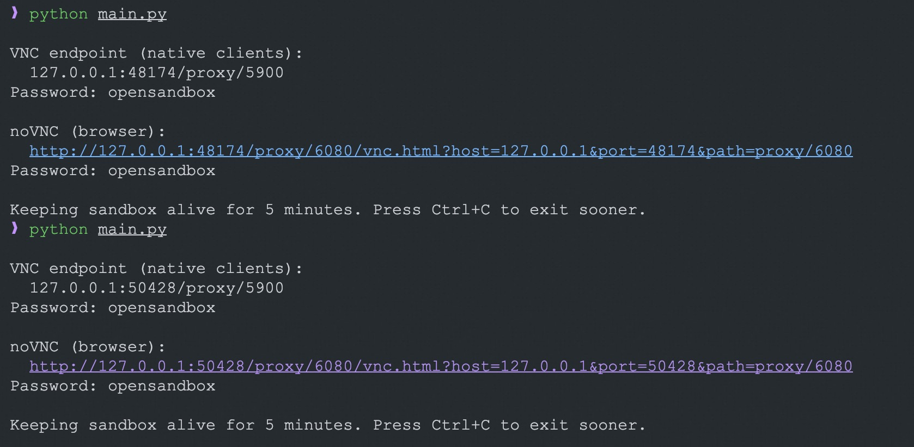
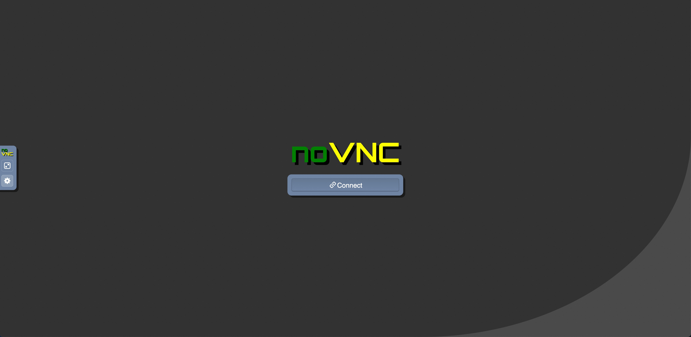
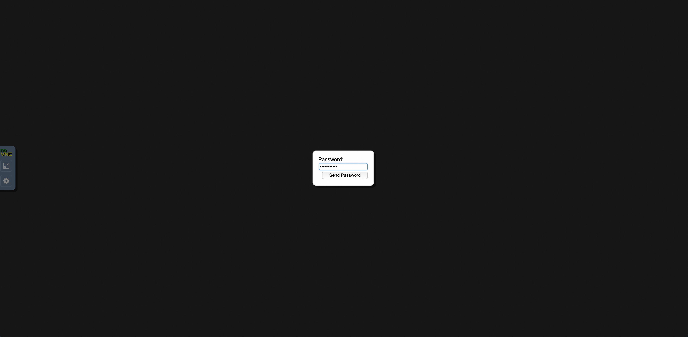
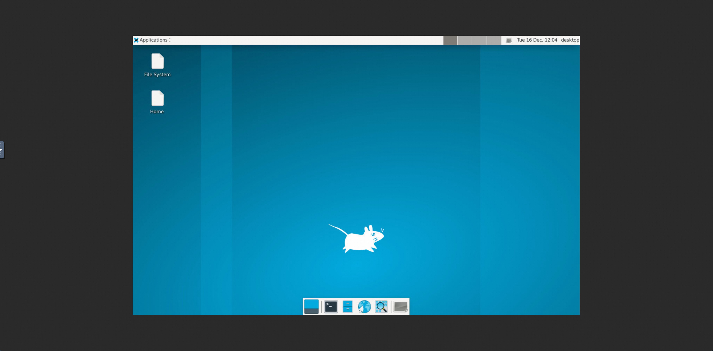

# Desktop (VNC) Example

Launch Xvfb + x11vnc + fluxbox in OpenSandbox to provide a VNC-accessible desktop environment.

## Build the Desktop Sandbox Image

The Dockerfile in the example directory builds a sandbox image with desktop and VNC components pre-installed:

```shell
cd examples/desktop
docker build -t opensandbox/desktop:latest .
```

This image includes:
- Xvfb (virtual framebuffer X server)
- x11vnc (VNC server)
- XFCE desktop (panel, file manager, terminal)
- Non-root user (desktop) for security

## Start OpenSandbox server [local]

Pre-pull the desktop image:

```shell
docker pull opensandbox/desktop:latest
```

Start the local OpenSandbox server:

```shell
uv pip install opensandbox-server
opensandbox-server init-config ~/.sandbox.toml --example docker
opensandbox-server
```

## Create and Access the Desktop Sandbox

```shell
# Install OpenSandbox package
uv pip install opensandbox

uv run python examples/desktop/main.py
```

The script starts the desktop stack (Xvfb + XFCE + x11vnc) and also launches noVNC/websockify. It prints:
- VNC endpoint (`endpoint.endpoint`) for native VNC clients, password from `VNC_PASSWORD` (default: `opensandbox`)
- noVNC URL for browsers (`/vnc.html?host=...&port=...&path=...`)

The sandbox stays alive for 5 minutes by default; interrupt sooner with Ctrl+C. Uses the prebuilt desktop image by default.

### Embed noVNC in an HTTPS page

Browsers block an `http://` noVNC iframe inside an HTTPS page, and direct sandbox endpoints do not terminate TLS, so HTTPS access needs every noVNC request to share one TLS origin.

The preferred path is the [ingress gateway](/architecture/network/ingress): deploy it, terminate TLS at an L7 proxy in front of it (see [Fronting ingress with TLS](/architecture/network/ingress#fronting-ingress-with-tls)), and point the example at that origin. Endpoint resolution then returns ingress URLs, and the noVNC page and its WebSocket share the HTTPS origin.

On deployments without the ingress gateway, the example still supports the deprecated server proxy (maintenance mode: no new features, security and bug fixes only). Terminate TLS at a reverse proxy in front of the OpenSandbox server, then make the example use that HTTPS origin and the server proxy:

```shell
export SANDBOX_DOMAIN=sandbox.example.com
export SANDBOX_PROTOCOL=https
export SANDBOX_USE_SERVER_PROXY=true
export VNC_PASSWORD=opensandbox

uv run python examples/desktop/main.py
```

The TLS reverse proxy must forward normal HTTP requests and WebSocket upgrades to the OpenSandbox server (for Nginx: `proxy_http_version 1.1;` with `proxy_set_header Upgrade $http_upgrade;` and `proxy_set_header Connection "upgrade";`).

::: warning Browser authentication
This direct browser URL works when the proxy route does not require browser-supplied authentication headers, including the default single-tenant mode. In multi-tenant mode, the proxy route requires `OPEN-SANDBOX-API-KEY` on both the noVNC HTTP request and the WebSocket upgrade, which a browser cannot attach; use a trusted, browser-authenticated reverse proxy that authorizes access to the sandbox and injects the tenant key. Server proxy mode does not support the raw TCP protocol used by native VNC clients, so the example omits the native VNC endpoint in this mode.
:::

   

## Environment Variables

| Variable | Default | Description |
|----------|---------|-------------|
| `SANDBOX_DOMAIN` | `localhost:8080` | Sandbox service address; may include an `http://` or `https://` scheme |
| `SANDBOX_PROTOCOL` | Domain scheme, otherwise `http` | Protocol used when `SANDBOX_DOMAIN` has no scheme (`http` or `https`) |
| `SANDBOX_USE_SERVER_PROXY` | `false` | Route sandbox service, noVNC HTTP, and WebSocket traffic through the OpenSandbox server; required with HTTPS on deployments without the ingress gateway (deprecated, maintenance mode) |
| `SANDBOX_API_KEY` | _(optional for local)_ | Example-specific API key; takes precedence over `OPEN_SANDBOX_API_KEY` |
| `OPEN_SANDBOX_API_KEY` | _(optional for local)_ | SDK-standard API key fallback when `SANDBOX_API_KEY` is unset |
| `SANDBOX_IMAGE` | `opensandbox/desktop:latest` | Sandbox image to use |
| `VNC_PASSWORD` | `opensandbox` | Password for VNC access |

## References

- [noVNC](https://github.com/novnc/noVNC)
- [x11vnc](https://github.com/LibVNC/x11vnc)
- [Source code on GitHub](https://github.com/opensandbox-group/OpenSandbox/tree/main/examples/desktop)
