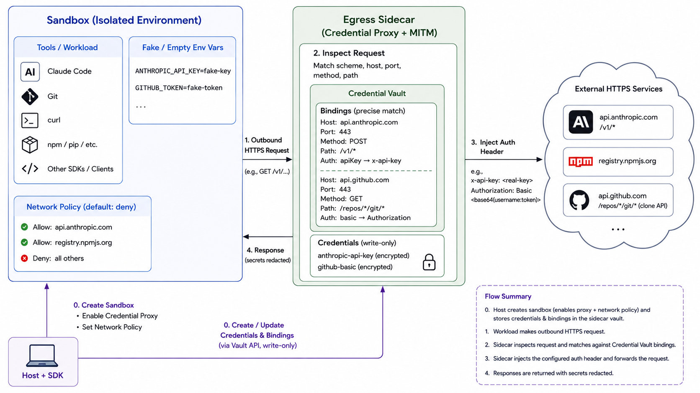
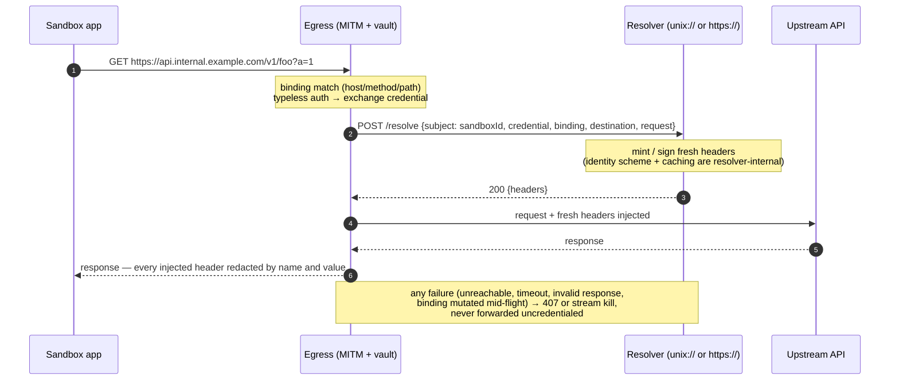

# Credential Vault

Credential Vault is OpenSandbox's outbound credential broker for sandboxed agents and developer tools. Real credentials are written to the egress sidecar by the host-side SDK, while the sandbox process only receives fake or empty credential values. When tools such as Claude Code, Git, curl, package managers, or model API clients make allowed outbound HTTPS requests, the sidecar matches the request against Credential Vault bindings and injects the required authentication headers on the way out. This lets existing tools keep their normal workflows while keeping real secrets out of the sandbox environment, command line, filesystem, and logs, reducing credential exfiltration risk from prompt injection or untrusted code.

## Requirements

- `opensandbox-server` >= 0.2.0
- `egress` >= 1.1.1
- Python SDK >= 0.1.11
- JavaScript/TypeScript SDK >= 0.1.9
- Kotlin SDK >= 1.0.13
- Go SDK >= 1.0.3
- C# SDK >= 0.1.3
- Server config sets `[egress].image`.
- Server config sets `[egress].mode = "dns+nft"`. Credential Vault refuses to activate in DNS-only mode because direct-IP connections can bypass DNS policy.
- Sandbox create request includes an outbound network policy.
- The outbound network policy should use `defaultAction="deny"` and explicitly allow every host referenced by a credential binding. Default-allow remains temporarily supported for backward compatibility but emits a security warning.
- Sandbox create request enables Credential Proxy.
- Exchange credentials (dynamic header resolution, the section below) require OpenSandbox release **1.2.1** or newer — the egress image, the server, and the Python/JavaScript/Go SDKs from the same release. Kotlin and C# SDK support is follow-up work.
- Sandbox pods are not running with an additional transparent service-mesh sidecar (for example Istio/Envoy injection) in the same network namespace. Credential Vault currently assumes the OpenSandbox egress sidecar is the only transparent outbound interception layer in the pod.
- The sandbox image has the tools you want to run. For Claude Code, use an image with Node.js and npm, such as the OpenSandbox code-interpreter image.

::: warning Migration notice
Credential Proxy still requires server `[egress].mode = "dns+nft"`; deployments that cannot provide nft enforcement cannot safely enable credential injection. Default-allow policies remain accepted during the compatibility period, but emit a security warning and should migrate to `defaultAction="deny"` before enforcement is tightened in a future release.
:::

## How It Works



Credential Vault is implemented by the egress sidecar. A sandbox must be created with both an outbound `network_policy` / `networkPolicy` and Credential Proxy enabled. The lifecycle API field name is `credentialProxy.enabled`; SDKs expose that field using their language-specific naming conventions.

At a high level:

1. The lifecycle server attaches the egress sidecar to the sandbox.
2. The SDK writes credentials and bindings to the sidecar Credential Vault API.
3. The sandbox process runs with fake or empty credential environment variables.
4. When the sandbox makes an HTTPS request, transparent MITM in the sidecar inspects the request metadata.
5. If exactly one binding matches the request scheme, host, port, method, and path, the sidecar injects the configured auth header and scoped placeholder substitutions.
6. Secret values are redacted from vault responses and response headers.

When the active-vault check succeeds, requests that do not match any credential binding are forwarded unchanged. Credential path-safety checks apply only after a binding matches and the request would otherwise receive credentials. The active-vault check itself runs before binding selection for every intercepted flow, including requests to hosts that would not match a binding.

Each flow reads that private endpoint with a cached opaque snapshot tag in `If-None-Match`: a `304 Not Modified` reuses the in-process snapshot without transferring secret values, a `200 OK` returns a fully validated replacement, and successful create/patch acks guarantee the next flow sees the new credentials with no cache-TTL delay. The tag is separate from the public revision — a deleted-and-recreated vault gets a different tag and cannot reuse plaintext from the old snapshot — and a `404` is the normal "no active vault" result: no injection, traffic continues.

::: warning Runtime availability dependency
The private active-vault socket is a hard availability dependency for all traffic intercepted by Credential Proxy, not only traffic that ultimately matches a credential binding. A timeout, refused connection, unexpected EOF, `5xx` response, malformed snapshot, or invalid `ETag` clears the affected plaintext cache and fails the request closed before any upstream forwarding. Small requests whose bodies are safely buffered receive a local `503 Service Unavailable` response. Requests that are already streaming, may cross the streaming threshold, or have an unknown body length are terminated instead, because mitmproxy cannot safely synthesize a local response after streaming has started. Operators should monitor the sidecar and private socket as part of the egress data plane's availability.
:::

## Persistence Across Pause and Resume

::: warning In-memory state
For sidecar-profile sandboxes the vault is process-local memory in the egress sidecar — not part of the sandbox root filesystem or the Pod template. Kubernetes pause deletes the Pod after snapshotting, so resume starts with an empty vault: re-create it once the sandbox is `Running`, before work that depends on those credentials. Docker pause/unpause preserves the sidecar and its vault — no re-creation needed; only a sidecar replacement or restart resets to an empty vault and requires re-injection.

Keep the original vault request (or a secret-manager reference) in a trusted control plane outside the sandbox. Never persist real credential values in sandbox metadata, environment variables, snapshots, or logs.
:::

::: info Fast-sandbox profile: server-routed vault
For template-backed (fsb) sandboxes the vault is egress-held: the server relays complete vault revisions to the egress and the relay response is the synchronous egress-validated ack. The same SDK entry points work unchanged (`sandbox.credential_vault` / `credentialVault` / `CredentialVault`) — but the vault is **not** carried at create time: create the sandbox first, then call the vault API.

Values stay write-only, and `PATCH` stays atomic (`412` = another writer won the revision — re-read and retry with the fresh `expectedRevision`). The vault persists egress-locally (memory plus one plaintext v1 file per sandbox under a Pod-scoped `emptyDir`): an egress restart inside the live Pod recovers when the Fastlet replays the bindings, and pause/resume carries the vault files in the snapshot bundle (export before teardown, re-stamped import at restore). The volume is part of the credential trust surface — mount it with `medium: Memory`. See [fast-sandbox networking](/architecture/fast-sandbox/networking#credential-delivery).
:::

## Service Mesh Compatibility

Credential Vault depends on the egress sidecar's transparent redirect and MITM path. If the sandbox pod is also injected with a transparent service-mesh sidecar such as Istio/Envoy, both layers will try to intercept outbound traffic in the same network namespace. OpenSandbox does not currently support that combination for Credential Vault.

Use one of these operator patterns instead:

- disable mesh sidecar injection for sandbox pods that need Credential Vault
- keep mesh injection enabled, but do not enable `credentialProxy` / Credential Vault for those pods
- move outbound policy and credential handling to a platform mechanism outside the sandbox pod if mesh injection is mandatory

For the underlying egress-sidecar limitation, see [Egress](/architecture/network/egress#service-mesh-compatibility).

Credential bindings are intentionally precise. A default-deny egress policy is required. Use a narrow path match, for example `/v1/*` for Anthropic API calls.

## Auth Types

Each binding uses an `auth` rule to describe how the referenced credential is rendered into the outbound request:

- `bearer`: injects `Authorization: Bearer <credential>`.
- `basic`: injects `Authorization: Basic <credential>`. The credential value must already be base64-encoded `username:password`.
- `apiKey`: injects the credential value into the configured header name.
- `customHeaders`: injects multiple configured headers, each backed by its own credential.
- `passthrough`: does not inject an auth header. Use it with `substitutions` when the upstream API requires a credential in a path, query string, or body placeholder instead of a header.

Simple examples:

```python
auth={"type": "bearer", "credential": "github-token"}
```

```http
Authorization: Bearer <github-token>
```

```python
auth={"type": "basic", "credential": "registry-basic"}
```

```http
Authorization: Basic <base64(username:password)>
```

```python
auth={"type": "apiKey", "name": "x-api-key", "credential": "anthropic-api-key"}
```

```http
x-api-key: <anthropic-api-key>
```

```python
auth={
    "type": "customHeaders",
    "headers": [
        {"name": "X-Client-Id", "credential": "client-id"},
        {"name": "X-Client-Secret", "credential": "client-secret"},
    ],
}
```

```http
X-Client-Id: <client-id>
X-Client-Secret: <client-secret>
```

### Scoped Placeholder Substitutions

Some upstream APIs require credentials in a request URL or body instead of a dedicated auth header. Credential Vault can handle those APIs without placing the real credential in the sandbox process. All auth types accept an optional `substitutions` list. Each substitution names a credential, a literal placeholder, and the request surfaces where replacement is allowed:

```python
auth={
    "type": "passthrough",
    "substitutions": [
        {
            "credential": "client-secret",
            "placeholder": "__client_secret__",
            "in": ["body", "query"],
        }
    ],
}
```

Use `type="passthrough"` when the binding only performs substitutions and should not inject an auth header. You can also combine substitutions with `bearer`, `basic`, `apiKey`, or `customHeaders` when the same upstream request needs both header injection and placeholder replacement.

Substitution is disabled by default and is exact, literal, and case-sensitive. Only the configured surfaces are rewritten:

| Surface | Behavior |
| --- | --- |
| `path` | Replaces placeholders in the request path and URL-encodes the credential value. If the rewritten path contains ambiguous path segments, encoded separators, or traversal-like content, the sidecar rejects the request instead of forwarding a secret-bearing URL outside the matched scope. |
| `query` | Replaces placeholders in the query string and URL-encodes the credential value. |
| `header` | Replaces placeholders in the original request headers, excluding hop-by-hop and security-sensitive headers such as `Host`, `Content-Length`, and forwarding headers. Substitutions run before Credential Vault injects auth headers, so the sidecar does not rewrite the credential headers it creates. |
| `body` | Replaces placeholders in UTF-8 request bodies. For `application/json`, the replacement is encoded as JSON string contents, so put the placeholder inside a quoted JSON string. For `application/x-www-form-urlencoded`, the replacement is form-encoded. Compressed and multipart bodies are skipped. |

Replacements for each surface run against the original request text in one pass, and inserted values are never re-scanned — one secret cannot rewrite another. A rewritten body becomes a fixed-size buffered body with an updated `Content-Length`. The placeholder and every encoding of the value (raw, URL-, form-, JSON-escaped) join the active redaction set; a matched binding that finds no placeholder logs a substitution miss without exposing values.

Example configuration:

```python
await sandbox.credential_vault.create(
    credentials=[
        Credential(name="tenant-id", source={"value": "tenant 42"}),
        Credential(name="api-key", source={"value": "query secret+value"}),
        Credential(name="client-secret", source={"value": 'body "secret" value'}),
    ],
    bindings=[
        CredentialBinding(
            name="token-request",
            match={
                "schemes": ["https"],
                "hosts": ["api.example.com"],
                "methods": ["POST"],
                "paths": ["/tenants/__tenant_id__/token"],
            },
            auth={
                "type": "passthrough",
                "substitutions": [
                    {
                        "credential": "tenant-id",
                        "placeholder": "__tenant_id__",
                        "in": ["path"],
                    },
                    {
                        "credential": "api-key",
                        "placeholder": "__api_key__",
                        "in": ["query"],
                    },
                    {
                        "credential": "client-secret",
                        "placeholder": "__client_secret__",
                        "in": ["body"],
                    },
                ],
            },
        )
    ],
)
```

The sandbox can use placeholders instead of real secrets:

```bash
curl -X POST \
  "https://api.example.com/tenants/__tenant_id__/token?api_key=__api_key__" \
  -H "content-type: application/json" \
  --data '{"client_secret":"__client_secret__"}'
```

The upstream receives the rewritten request:

```http
POST /tenants/tenant%2042/token?api_key=query%20secret%2Bvalue HTTP/1.1
content-type: application/json

{"client_secret":"body \"secret\" value"}
```

## Exchange Credentials (Dynamic Header Resolution)

::: tip New in 1.2.1
Exchange credentials ship in OpenSandbox release **1.2.1**. The egress image, the server, and the Python/JavaScript/Go SDKs must all come from that release or newer; inline credentials behave identically on older releases.
:::

Static credentials are delivered once at vault creation and rendered at revision time. Some credentials cannot work that way: identity-derived tokens (STS or OAuth2 client-credentials grants, SPIFFE-style signed proofs) are short-lived and computed from request context — an audience derived from the destination, or a signature bound to the method and path of one specific request. Exchange credentials cover this case: the credential does not carry a value, it names a **header resolver**; when a bound request arrives, the egress asks that resolver for a fresh header set and injects the response. The sandbox process never sees or holds the material, exactly like the static path.

An exchange credential declares where to resolve; a typeless binding auth declares when:

```jsonc
// vault create payload (POST /sandboxes/{id}/credential-vault)
{
  "credentials": [
    { "name": "spi-signer", "source": { "type": "exchange", "endpoint": "unix:///run/spi/spi.sock" } },
    { "name": "corp-resolver", "source": { "type": "exchange", "endpoint": "https://header-resolver.internal" } }
  ],
  "bindings": [
    { "name": "internal-api",
      "match": { "hosts": ["*.internal.example.com"], "methods": ["GET"], "paths": ["/v1/*"] },
      "auth": { "credential": "spi-signer" } }   // no "type": typeless = exchange reference
  ]
}
```

The rules that keep the two worlds unambiguous:

- Auth with a static `type` (`bearer`, `basic`, `apiKey`, `customHeaders`) must reference an `inline` credential; auth **without** `type` must reference an `exchange` credential. Cross-references are rejected with `400`.
- The typeless form carries only `credential` — `name`, `headers`, and `substitutions` are not valid on it. Substitutions always require a static type.
- Static and exchange bindings can coexist in one vault, including on the same host with disjoint `paths`/`methods` scopes.



The egress derives the caller identity from the connection — the sandbox id, never client-supplied — and sends it as `subject`, so one shared resolver can select per-sandbox identity. Resolved material exists for exactly one request: it is never persisted, and the vault travels pause/resume and egress restarts as pure configuration, re-resolving on demand.

### Failure Semantics

Resolution failure fails closed, never open: if the resolver is unreachable, slow beyond the timeout, returns an invalid or oversized response, or the bound credential is mutated mid-flight, the matched request is denied — a local `407` for buffered requests, a terminated stream for requests already streaming. The request is never forwarded without credentials, and a failed resolve never poisons the next one. Static bindings in the same vault keep flowing during a resolver outage.

Per-request resolution is bounded: every resolve carries its own timeout, and all resolves share the process-wide concurrency limit below. A slow resolver never blocks non-bound traffic, but when the concurrency limit is saturated (for example several slow resolvers, or a deliberately low limit), resolves for **other** bindings and sandboxes queue behind it and fail closed on their own timeouts.

| Environment variable | Default | Description |
| --- | --- | --- |
| `OPENSANDBOX_EGRESS_CREDENTIAL_RESOLVER_TIMEOUT` | `2` | Per-request resolver timeout in **integer seconds** (`2`, not `2s` — the egress parses an integer in `1..120`; any other value fails the resolver gate closed). |
| `OPENSANDBOX_EGRESS_CREDENTIAL_RESOLVER_MAX_CONCURRENCY` | `32` | Process-wide concurrent-resolve limit, integer `1..1024`, shared across all bindings and subjects in the egress process. |

A vault that references an exchange credential is rejected at write time unless the egress was started with resolver configuration (fail closed; inline-only vaults are unaffected).

### Running a Resolver

A resolver is any service that answers one route: `POST /resolve` with a JSON document describing the request, and returns the headers to inject. Both transports use the same framing — HTTP over a Unix socket for `unix:///path/to.sock`, TLS for `https://host[:port][/prefix]`:

```jsonc
// egress -> resolver
{
  "subject": "fsb-4f8a...",                 // the sandbox id, filled authoritatively by the egress
  "credential": "spi-signer",
  "binding": "internal-api",
  "destination": { "scheme": "https", "authority": "api.internal.example.com:443", "sni": "api.internal.example.com" },
  "request": { "method": "GET", "host": "api.internal.example.com", "path": "/v1/foo?a=1", "headers": {} }
}

// 200 OK
{ "headers": { "authorization": "Bearer ...", "x-signature": "..." } }
```

`request.path` is the full request target including the query string, so a resolver can bind signatures to the complete target. The `headers` field is reserved and currently always empty — request headers are not forwarded to the resolver, so proofs can only bind to the method, host, and path today. The optional `redactions` field on the response is additive only — the egress redacts every returned header regardless.

Hard requirements on a resolver endpoint:

- **Reachable only by the egress process.** A sandbox that could call the resolver directly could mint credentials and bypass the policy plane. Unix sockets are structurally isolated by directory/socket permissions (for example `0710`/`0660`) — guests have no filesystem path to them. For `https://` endpoints, egress caller authentication (an Ed25519 JWT verified by the resolver against server-published JWKS) closes this boundary at the application layer in both profiles — see [Resolver Caller Authentication](#resolver-caller-authentication-fast-sandbox); a sandbox process dialing the resolver directly receives 401.
- **Bounded responses.** The egress enforces an envelope — 64KiB total, at most 16 headers, 8KiB per value, 64 redaction entries — and denies the request when exceeded.
- **Per-request semantics.** Input includes request context; caching and rotation are resolver-internal and invisible to the contract.

A runnable reference resolver (with deterministic signatures and fault injection) ships at `components/egress/tests/resolver/resolver.py` in the repository.

### Quick-Start: a Runnable Resolver

That reference resolver is a single stdlib-only Python file — enough to wire the full path end to end and to develop against. It creates the production socket layout itself (`0710` directory, `0660` socket); run it as the egress user (or a user sharing its group) so the egress process can connect:

```bash
# 1. Place the resolver (from the repository; the egress image ships python3).
install -D -m 0755 components/egress/tests/resolver/resolver.py /opt/resolver/resolver.py

# 2. Start it on the socket your vault's endpoint names.
sudo -u <egress-user> python3 /opt/resolver/resolver.py --uds /run/spi/spi.sock

# 3. Verify POST /resolve from the egress environment.
curl -fsS --unix-socket /run/spi/spi.sock http://localhost/resolve \
  -H 'content-type: application/json' \
  -d '{"subject":"fsb-demo","credential":"spi-signer","binding":"internal-api",
       "destination":{"scheme":"https","authority":"api.internal.example.com:443","sni":"api.internal.example.com"},
       "request":{"method":"GET","host":"api.internal.example.com","path":"/v1/foo?a=1","headers":{}}}'
```

A working resolver answers `200` with deterministic headers — `authorization: Bearer test-spi-signer`, `x-test-subject` echoing the subject, and `x-test-signature = sha256(subject|credential|binding|authority|path)` — and supports `--delay <ms>`, `--fail once|rate`, and `--incomplete-redactions` for outage drills. In containerized deployments the same file runs next to the egress with a shared socket volume (the fast-sandbox integration verify drives it exactly that way). It is a test harness, not an identity service: for production, put your real signing service behind the same `POST /resolve` contract.

### Resolver Caller Authentication (fast-sandbox)

Every TCP resolve dial carries one header, `OpenSandbox-Egress-Credential`, holding a compact Ed25519 JWT minted by the egress. The credential proves "this resolve call originated from the egress process" and binds the attested `sub` (the sandboxId); resolvers verify it offline against a JWKS published by the lifecycle server at `GET /credential-vault/jwks/{kid}`. Unix sockets keep using socket permissions as their boundary and carry no credential.

Provisioning is operator-only and per-pool (fast-sandbox profile):

1. **Create the signing material and two Secrets** (one pair per pool and version, separate from the MITM CA Secret). Kubernetes Secret access is object-scoped: the lifecycle server reads the whole object it references, so the private key lives in its own Secret that the server never references — the server's object carries public entries only.

```bash
openssl genpkey -algorithm ed25519 -out signing.key
openssl pkey -in signing.key -pubout -outform DER | tail -c 32 | basenc --base64url | tr -d '=' > signing.pub.x

# Private-key Secret: referenced ONLY by the pool's egress mount below.
kubectl create secret generic opensandbox-egress-signing-<pool>-v1 \
  --from-file=signing.key=signing.key

# Publication Secret: referenced ONLY by the lifecycle server
# (kubernetes.egress_signing_key_secrets). Public entries only.
kubectl create secret generic opensandbox-egress-publish-<pool>-v1 \
  --from-file=signing.pub=signing.pub.x \
  --from-literal=kid='<pool>:v1'
```

2. **Project the private-key Secret into the pool's egress container** (SandboxPool `fastletTemplate`):

```yaml
      - name: egress
        # ... existing egress container fields ...
        env:
        - name: OPENSANDBOX_EGRESS_RESOLVER_SIGNING_KEY_DIR
          value: /var/lib/opensandbox-egress/signing
        - name: OPENSANDBOX_EGRESS_RESOLVER_SIGNING_KID
          value: "<pool>:v1"
        volumeMounts:
        - name: egress-signing
          mountPath: /var/lib/opensandbox-egress/signing
          readOnly: true
      volumes:
      - name: egress-signing
        secret:
          secretName: opensandbox-egress-signing-<pool>-v1
          items:
          - key: signing.key
            path: signing.key
```

Only `signing.key` is mounted into the egress. Without a loadable key, vault writes containing `https://` exchange credentials are rejected (fail closed); `unix://` exchange credentials and static vaults keep working.

3. **Publish the public key** — set `kubernetes.egress_signing_key_secrets` in the server config to the **publication** Secret name(s) (`opensandbox-egress-publish-<pool>-v1`), current version first. The server serves the JWK at `/credential-vault/jwks/{kid}` — public keys only, no API key required, and the server's RBAC never needs access to a private-key Secret.

4. **Verify on the resolver** with the Python SDK:

```python
from opensandbox.resolver_auth import CredentialVaultCallerAuth

caller_auth = CredentialVaultCallerAuth(
    jwks_base="https://<lifecycle-server>/credential-vault",
    expected_issuer="opensandbox",
    expected_audience="https://<this-resolver>:<port>",  # your own origin
)

subject = caller_auth.verify_caller(
    headers["OpenSandbox-Egress-Credential"],
    document_subject=document["subject"],
)
```

Every verification failure maps to HTTP 401. The test resolver enforces all of this behind `--require-credential --jwks-base <url>` (or `--jwks-file <path>` for self-contained runs).

**Sidecar profile (per-sandbox keys, always on).** Every sandbox created with `networkPolicy` gets a fresh keypair — the private PEM is injected into its egress sidecar through the auth-token env channel and discarded server-side, and the public JWK is recorded on the workload (Kubernetes annotation `opensandbox.io/egress-signing-jwk` / Docker container label) where `GET /credential-vault/jwks/{sandboxId}` reads it. There is no configuration for this: turning it off would reopen the resolver trust-boundary gap this feature closes. No operator key management either — sandbox recreation replaces the keypair, and the JWKS entry follows the workload. The resolver integration is unchanged — the same three SDK config values, with `expected_audience` still the resolver's own origin.

**Rotation** is the versioned-Secret runbook: create `-(v+1)` with its own kid, add it to `egress_signing_key_secrets` ahead of the old entry, update the SandboxPool reference, roll the pool, and remove the old Secret only after the rollout completes and credential TTL + leeway (about 1 hour) has passed — credentials minted by not-yet-rolled instances stay verifiable throughout. Resolvers re-validate cached keys at most hourly, so a retired kid stops verifying within that window; monitor resolver-side 401 rates and page the key owner on spikes.

### Python SDK Example

This example grants a sandbox access to an internal API through a signing resolver. The host-side script writes only the resolver endpoint into the vault; the sandbox code uses plain `requests` with no credential material anywhere in the process, environment, or logs.

```python
import os
from datetime import timedelta

from opensandbox import SandboxSync
from opensandbox.models.sandboxes import (
    Credential,
    CredentialBinding,
    CredentialProxyConfig,
    NetworkPolicy,
    NetworkRule,
    SandboxImageSpec,
)

API_HOST = "api.internal.example.com"
RESOLVER_ENDPOINT = "unix:///run/spi/spi.sock"  # or "https://header-resolver.internal"

sandbox = SandboxSync.create(
    image=SandboxImageSpec(os.getenv("SANDBOX_IMAGE", "opensandbox/code-interpreter:latest")),
    timeout=timedelta(minutes=15),
    network_policy=NetworkPolicy(
        defaultAction="deny",
        egress=[NetworkRule(action="allow", target=API_HOST)],
    ),
    credential_proxy=CredentialProxyConfig(enabled=True),
)

try:
    state = sandbox.credential_vault.create(
        credentials=[
            Credential(
                name="spi-signer",
                source={"type": "exchange", "endpoint": RESOLVER_ENDPOINT},
            )
        ],
        bindings=[
            CredentialBinding(
                name="internal-api",
                match={
                    "schemes": ["https"],
                    "hosts": [API_HOST],
                    "methods": ["GET"],
                    "paths": ["/v1/*"],
                },
                auth={"credential": "spi-signer"},  # typeless: exchange reference
            )
        ],
    )
    print(f"vault revision {state.revision}")

    # The sandbox process carries no credentials. Fresh, per-request headers
    # are injected on the way out; if the resolver is down this call fails
    # closed with 407 instead of leaking an unauthenticated request.
    result = sandbox.commands.run(
        "curl -fsS https://api.internal.example.com/v1/foo?a=1"
    )
    print(result.text)
finally:
    sandbox.kill()
```

The typed model `ExchangeCredentialSource` (`from opensandbox.models.sandboxes import ExchangeCredentialSource`) is equivalent to the `source` dict form; the typeless auth form is validated client-side — `CredentialAuth(credential="spi-signer")` without `type` accepts only the credential reference.

Reads are sanitized for exchange credentials the same way as for inline ones: `get`/`list` return `sourceType: "exchange"` and the typeless auth as `{"credential": "spi-signer"}`; the endpoint is treated as configuration and never carries resolved material.

::: info SDK support
Exchange credentials require release 1.2.1+ and are implemented in the Python, JavaScript/TypeScript, and Go SDKs. Kotlin and C# support is tracked as follow-up (T5b); until it lands, use the raw lifecycle API for those languages.
:::

## Egress Sidecar Configuration

| Environment variable | Default | Description |
| --- | --- | --- |
| `OPENSANDBOX_EGRESS_CREDENTIAL_VAULT_REQUIRE_TLS` | off | When enabled (`true`/`1`/`on`), credential vault write operations (create, patch, delete) require TLS, loopback transport, or `X-Forwarded-Proto: https` from a configured trusted proxy. When disabled (default), any authenticated request is accepted regardless of transport. Enable this in deployments where the egress sidecar is directly reachable from untrusted networks without a TLS-terminating reverse proxy. |
| `OPENSANDBOX_EGRESS_CREDENTIAL_VAULT_TRUSTED_PROXY_CIDRS` | empty | Comma-separated IP addresses or CIDRs allowed to assert `X-Forwarded-Proto: https`. Forwarded transport headers from all other peers are ignored. Configure this when TLS terminates at a reverse proxy before the egress sidecar. |
| `OPENSANDBOX_EGRESS_CREDENTIAL_VAULT_REQUIRE_SCOPED_MATCH` | off | When enabled, every credential binding must explicitly provide non-empty `match.methods` and `match.paths`, and paths cannot contain the host-wide `/*` pattern. Vault create and patch requests that omit either field are rejected instead of receiving compatibility defaults. Enable this for control planes that translate higher-level API tool definitions into Credential Vault bindings. |

The scoped-match setting is a fail-closed integration guard. It does not infer methods or paths from another platform's API tool definition. The caller that creates the vault must still copy the intended methods and paths into each binding and verify the sanitized binding readback.


## SDK Quick Reference

All sandbox SDKs use the same wire contract. The main differences are naming and language style:

| SDK | Enable proxy on sandbox create | Vault entry point | Create / patch methods |
| --- | --- | --- | --- |
| Python | `credential_proxy=CredentialProxyConfig(enabled=True)` | `sandbox.credential_vault` | `create(...)`, `patch(...)` |
| Go | `CredentialProxy: &opensandbox.CredentialProxyConfig{Enabled: true}` | `sandbox.CredentialVault(ctx)` or sandbox helpers | `CreateCredentialVault(ctx, req)`, `PatchCredentialVault(ctx, req)` |
| JavaScript/TypeScript | `credentialProxy: { enabled: true }` | `sandbox.credentialVault` | `create(request)`, `patch(request)` |
| Kotlin/JVM | `.credentialProxyEnabled(true)` or `.credentialProxy { enabled(true) }` | `sandbox.credentialVault()` | `create(request)`, `patch(request)` |
| C#/.NET | `CredentialProxy = new CredentialProxyConfig { Enabled = true }` | `sandbox.CredentialVault` or sandbox helpers | `CreateCredentialVaultAsync(...)`, `PatchCredentialVaultAsync(...)` |

Plaintext values are write-only — `get`, `list`, and patch responses carry sanitized metadata only. The same entry points work for template-backed (fsb) sandboxes through the server relay; the `credentialProxy` create-time flag is ignored on that profile (set the vault after creation, through the API).

## Claude Code With Anthropic

This example installs Claude Code in the sandbox and calls the official Anthropic API endpoint. The real API key is read on the host and written to Credential Vault. The sandbox only sees a fake `ANTHROPIC_API_KEY`.

Before running the script:

```bash
export ANTHROPIC_API_KEY="sk-ant-..."
# Optional: export ANTHROPIC_MODEL="<a Claude Code supported Anthropic model>"
```

Run:

```python
import os
from datetime import timedelta

from opensandbox import SandboxSync
from opensandbox.models.sandboxes import (
    Credential,
    CredentialBinding,
    CredentialProxyConfig,
    NetworkPolicy,
    NetworkRule,
    SandboxImageSpec,
)


ANTHROPIC_HOST = "api.anthropic.com"
ANTHROPIC_BASE_URL = "https://api.anthropic.com"
REAL_API_KEY = os.environ["ANTHROPIC_API_KEY"]


sandbox_env = {
    "ANTHROPIC_BASE_URL": ANTHROPIC_BASE_URL,
    "ANTHROPIC_API_KEY": "fake-key-inside-sandbox",
}
if os.getenv("ANTHROPIC_MODEL"):
    sandbox_env["ANTHROPIC_MODEL"] = os.environ["ANTHROPIC_MODEL"]


sandbox = SandboxSync.create(
    image=SandboxImageSpec(
        os.getenv("SANDBOX_IMAGE", "opensandbox/code-interpreter:latest")
    ),
    timeout=timedelta(minutes=15),
    env=sandbox_env,
    network_policy=NetworkPolicy(
        defaultAction="deny",
        egress=[
            NetworkRule(action="allow", target=ANTHROPIC_HOST),
            NetworkRule(action="allow", target="registry.npmjs.org"),
        ],
    ),
    credential_proxy=CredentialProxyConfig(enabled=True),
)

try:
    sandbox.credential_vault.create(
        credentials=[
            Credential(
                name="anthropic-api-key",
                source={"value": REAL_API_KEY},
            )
        ],
        bindings=[
            CredentialBinding(
                name="anthropic-api",
                match={
                    "schemes": ["https"],
                    "hosts": [ANTHROPIC_HOST],
                    "methods": ["GET", "POST"],
                    "paths": ["/v1/*"],
                },
                auth={
                    "type": "apiKey",
                    "name": "x-api-key",
                    "credential": "anthropic-api-key",
                },
            )
        ],
    )

    sandbox.commands.run(
        "npm install -g @anthropic-ai/claude-code --no-audit --no-fund"
    )
    result = sandbox.commands.run("claude -p '1+1'")
    output = "".join(part.text for part in result.logs.stdout)
    print(output)
finally:
    sandbox.kill()
    sandbox.close()
```

The Claude Code process reads the fake key from `ANTHROPIC_API_KEY`, but the outbound HTTPS request to `api.anthropic.com/v1/*` receives the real `x-api-key` header from Credential Vault. If your environment uses a private npm mirror, replace `registry.npmjs.org` in the network policy and the `npm install` command with that mirror host.

## Git And Curl With Vault-Injected Credentials

Credential Vault can also protect credentials used by command-line tools such as `git` and `curl`. Keep the command free of real secrets and bind the request shape to the credential in Vault instead.

For a private Git repository, store a base64-encoded `username:token` value and bind it with `basic` auth:

```python
Credential(name="git-basic", source={"value": "<base64(username:token)>"})

CredentialBinding(
    name="git-basic",
    match={
        "schemes": ["https"],
        "hosts": ["git.example.com"],
        "paths": ["/org/private-repo.git*"],
    },
    auth={"type": "basic", "credential": "git-basic"},
)
```

Then run the normal URL without embedding credentials:

```bash
GIT_TERMINAL_PROMPT=0 git clone https://git.example.com/org/private-repo.git
```

For an API request that expects a token header, bind the path and method to an `apiKey` auth rule:

```python
Credential(name="api-token", source={"value": "<token>"})

CredentialBinding(
    name="api-token",
    match={
        "schemes": ["https"],
        "hosts": ["api.example.com"],
        "methods": ["GET"],
        "paths": ["/v1/projects/123/variables"],
    },
    auth={"type": "apiKey", "name": "PRIVATE-TOKEN", "credential": "api-token"},
)
```

The sandbox command stays secret-free:

```bash
curl -fsS https://api.example.com/v1/projects/123/variables
```

## Binding Guidance

- Use `defaultAction="deny"` and only allow the service hosts required by the tool. Default-allow policies are deprecated because they may allow credential destination bypass and will emit a security warning.
- Scope bindings by path whenever possible, for example `/v1/*`.
- Avoid overlapping bindings at the same precedence; ambiguous matches are rejected.
- Rejected requests (ambiguous paths, encoded separators crossing a binding boundary) return `403` when the request body is small and fully known. Requests with bodies above the mitmproxy streaming threshold (~1 MiB) or with unknown length (chunked) cannot be answered with a `403` while the body is being streamed, so the sidecar drops the connection instead — either way the request is never forwarded upstream.
- Do not put real secrets in sandbox `env`, command arguments, files, or metadata.
- Keep fake environment variables when a CLI refuses to start without a key; the vault-injected header is what authenticates the outbound request.

## Path Ambiguity Guard

The sidecar inspects the request path only for requests that would receive injected credentials. A request is rejected with `403` when its path contains dot-segments (`..`) or backslashes (`\`, `%5c`) at any percent-decoding depth, or when percent-decoding does not converge within the guard's iteration bound — these are traversal or path-confusion primitives that legitimate clients do not send.

Encoded slashes (`%2f`, including nested forms like `%252f`) are allowed when every decoding depth of the path matches the same credential binding. This keeps legitimate encoded wire formats working — npm scoped registry paths (`/@scope%2fname`) and artifact-store download URLs whose coordinates are double-encoded (for example `pkg%252F1.0`, as produced by some internal pypi proxies) — while a path whose decoding would cross a binding boundary is still rejected before any credential is injected. Requests outside every binding scope pass through untouched.

## Migrating From `ports`

The `match.ports` field is deprecated. Port is now derived from scheme (`https`→443, `http`→80). Only ports 80 and 443 are supported; non-standard values are rejected with a validation error.

If you have existing bindings that use `ports` to narrow scope, migrate them to the equivalent `schemes` restriction:

| Before | After |
|--------|-------|
| `schemes: ["http", "https"], ports: [443]` | `schemes: ["https"]` |
| `schemes: ["http", "https"], ports: [80]` | `schemes: ["http"]` |
| `schemes: ["https"], ports: [443]` | `schemes: ["https"]` (remove `ports`) |

## Experimental Live Credential-Bound Admission (OSEP-0023)

::: warning Experimental boundary
The live credential-bound loop is an internal sidecar experiment, not a supported deployment mode. It is documented here to bound what the current implementation actually does; the gate remains off by default and no public configuration surface is added.
:::

When the experimental revision runtime is enabled, the sidecar installs an immutable decision snapshot into the mitmproxy child over a private authenticated IPC channel and admits traffic per connection and per request:

- **Dynamic decisions use the installed snapshot.** Unbound HTTPS passes through opaquely; bound hosts are decrypted only with a registry admission. Unknown identity denies. For a known identity, ECH, no-SNI and validated static TLS/443 bypass retain their early precedence, including during bootstrap. Other unknown, bootstrapping or mismatched state denies.
- **Static TLS/443 bypass is operator-owned.** Set `OPENSANDBOX_EGRESS_MITMPROXY_PASSTHROUGH_HOSTS` to a JSON array of exact FQDNs or leftmost `*.` selectors, for example `["status.example.com","*.logs.example.com"]`. A wildcard covers all proper subdomains, including multiple labels, but not its apex. Go normalizes IDNA, case, surrounding whitespace and one root dot, then freezes a sorted unique list. Unset and `[]` mean empty; explicit empty text is an error. JSON input and canonical output each have a 64 KiB limit; at most 256 input entries are allowed before deduplication. IPs, URLs, ports and regexes are rejected.
- **Migrate native bypass options before enabling live admission.** Both effective mitmproxy `ignore_hosts` and `allow_hosts` must remain empty. Static selectors run in the typed TLS hook at actual destination port 443, not in native regex options. HTTP/80 behavior and network policy are unchanged. Non-empty selectors cannot be combined with a chained upstream proxy. Explicit use of this variable outside live mode is rejected. Legacy regex behavior remains unchanged when the variable is unset. Existing `tcp_hosts` may still bypass HTTP credential handling; this change does not establish a general addon/options isolation boundary.
- **TLS overlap is rejected before publication.** Any semantic intersection between a static selector and an HTTPS/443 binding rejects the complete Vault or Policy candidate before IPC prepare, policy persistence or nft application. Methods and paths do not exempt an overlap. HTTP-only bindings remain eligible. The child independently rejects overlap before staging. The list cannot be changed by a Vault update and adds no snapshot fields; changing it requires replacing the sidecar process.
- **Sticky recovery, no same-sidecar restart.** Any terminal outcome with unknown external effects (a mutation whose remote result cannot be confirmed, a session cleanup failure, an unexpected child exit) latches a permanent recovery-required state: readiness drops, outstanding bootstrap tickets are invalidated, nft writes are quiesced, and quarantine is attempted. Packet isolation is established only when quarantine is confirmed. The same sidecar cannot bootstrap a fresh revision session afterwards; a whole-sidecar restart is not a verified safe recovery procedure.
- **Request admission and cutover.** A vault mutation is applied to the live receiver first and published publicly only after exact confirmation. A rendered snapshot exceeding the IPC size limit is rejected with HTTP 400 before transmission; the current vault and sidecar remain available. In-flight requests finish on their admitted revision; new requests on a connection whose host was removed are fenced immediately: HTTP/1 receives 403; valid HTTP/2 requests refused at `requestheaders` receive `REFUSED_STREAM` without reaching the origin. The retired transport is force-closed at the drain deadline. Deleting the vault affects new requests and new connections; a retired connection can never be revived by re-adding the host. Already-admitted requests may finish only inside the bounded drain window — deletion does not recall requests the remote origin already received or revoke credentials already delivered remotely.
- **Policy updates share the revision barrier.** Existing `POST`/`PUT`/`PATCH`/`DELETE /policy` operations and automatic `deny.always` / `allow.always` reloads validate the complete Policy/Vault pair. A policy that would deny any active binding is rejected before file, nft or receiver effects. A policy-only update preserves the public Vault revision, pinned credential bytes and bindings; it does not reread credential sources. Its commit order is optional user-policy file persistence, nft application, exact receiver confirmation, then Go proxy/base publication and API success. Reload skips user-policy persistence and publishes the accepted loader view only after receiver confirmation. Subsequent Vault writes and bootstraps use the committed internal Policy epoch rather than resetting it to zero.
- **Policy visibility and failure.** Disk, nft and receiver updates are not instantaneously atomic: new nft rules may affect traffic before receiver confirmation. A receiver failure after successful nft application requires sticky recovery, quarantine and exact-child cleanup, even if the receiver definitively rejected the candidate. Replaying old nft rules or restoring the file cannot prove that new connections or requests were undone. Unavailable or unconfirmed revision updates and recovery-blocked writes return a fixed, sanitized 503; the initial file/nft error may still be 500. Validation failures before effects do not themselves require recovery.
- **Policy no-ops and retries.** A DELETE with no matching target and an unchanged always-rule reload do not advance the internal Policy epoch, but cannot bypass recovery checks. Other committed writes, including equal content or a loader-detected rewrite, can advance the epoch and initiate another drain. No public epoch, Policy idempotency key or new SDK method is added. `GET /policy` reports the last Go-published user policy, not an in-progress transaction, always-rule overlay or packet-isolation status.
- **Drain accounting.** Retired transports carry a bounded retirement deadline (default 30 seconds, internal range 1–300). The drain sweep pages expired transports and closes them; a failed close is retried on the next sweep rather than extending the deadline. An HTTP 101 protocol upgrade (including WebSocket) retains its request admission until the connection disconnects, so credential rotation and policy-only changes also drain an upgraded transport even when its host remains bound. API success waits for publication and retirement-deadline registration, not for the 30-second window to elapse. Repeated updates never extend an older request's earliest deadline. A still-covered connection may admit new-revision requests, but closing it for an expired old request also interrupts those newer requests. A still-covered idle connection with no old request is not retired solely because the Policy epoch changes. Sweep scheduling and failed-close retries can delay actual closure; this is not a deadline for opaque or direct-IP connections outside the registry. HTTP/2 normal retirement delays the single `NO_ERROR` GOAWAY with its frozen admitted-stream upper bound until old streams and their downstream/upstream output obligations are terminal. Deadline expiry is abnormal closure, not graceful completion.
- **ECH is opaque pass-through.** A ClientHello carrying the `encrypted_client_hello` extension (0xfe0d), including GREASE forms, is forwarded untouched as an opaque tunnel without decryption; uninspectable ClientHello data denies. The implementation does not decrypt the inner ClientHello and does not guarantee that an ECH-enabled origin handshake succeeds.
- **HTTP/1 authority gate.** On a decrypted HTTP/1 connection every request must carry exactly one syntactically strict `Host` header equal to the intercepted SNI and the admission binding (port omitted or 443). A conflicting absolute-form target, a CONNECT authority-form inside the stream and missing/duplicate/malformed Host values are rejected before any credential can be injected.
- **HTTP/2 authority gate.** The fixed-version direct/lazy adapter validates original HTTPS pseudo-headers, authority, actual port 443 and SNI association before credential injection; invalid or missing identity fails closed.
- **`ssl_insecure` is refused in live mode.** The launcher and the addon reject an insecure-upstream configuration when the live admission bundle is active; the legacy installation-only receiver keeps its existing behavior.
- **Scope.** This mode is scoped to the internal sidecar profile: Docker DNS + nft enforcement, exact-host HTTPS on port 443, HTTP/1.1 origin-form or matching absolute-form requests, and inline credentials injected as headers. Experimental HTTP/2 admission and bounded drain wiring additionally cover only the fixed-dependency direct/lazy path; configured chained upstream proxies remain rejected for this live HTTP/2 path. Long-held responses can still cause Go retries to time out; full client migration and Linux acceptance remain follow-up work. See the [HTTP/2 integration boundary](/architecture/network/osep-0023-h2-integration). The fast-sandbox profile and recovery across a complete sidecar replacement remain out of scope. Dynamic DNS learning and Kubernetes deployments are not covered by this experiment's evidence. Policy participation is part of this implementation; its acceptance evidence is recorded separately from the earlier live-Vault checks below.

The task-level acceptance record for this experiment lives in [Live Vault Acceptance](/guides/live-vault-acceptance).
