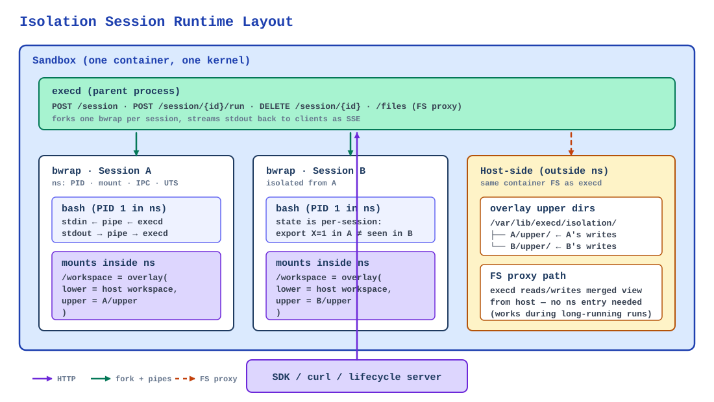
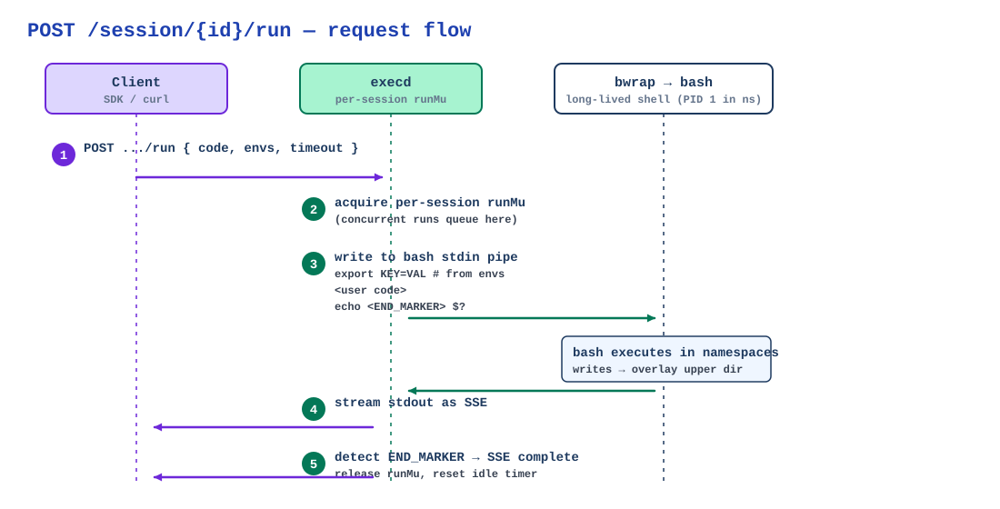

# Isolation Sessions

Isolation sessions run a **long-lived `bash` inside a [bubblewrap](https://github.com/containers/bubblewrap) namespace**, so one sandbox pod can host many mutually isolated task runs without spinning up a new container. Each session gets its own PID, mount, tmpfs, and env namespaces; startup is sub-millisecond.

## Table of Contents

- [Requirements](#requirements)
- [Overview](#overview)
- [How It Works](#how-it-works)
- [Quick Start](#quick-start)
- [Session Lifecycle](#session-lifecycle)
- [Workspace Modes](#workspace-modes)
- [Bind Mounts and Allowlist](#bind-mounts-and-allowlist)
- [Profiles and Defaults](#profiles-and-defaults)
- [Environment, UID, and Networking](#environment-uid-and-networking)
- [Filesystem Proxy](#filesystem-proxy)
- [Capabilities and Probing](#capabilities-and-probing)
- [Server Configuration](#server-configuration)
- [Limitations](#limitations)
- [See Also](#see-also)

---

## Requirements

Component versions needed for the features covered by this guide:

- `execd` >= 1.0.20 for base isolation session support; **>= 1.0.21 recommended** for `binds`, `List sessions`, `uid_mode: "userns"`, and the default writable allowlist (`/workspace`, `/mnt`, `/media`, `/data`)
- `opensandbox-server` >= 0.2.1 — the server injects `CAP_SYS_ADMIN`, unconfined AppArmor, seccomp, and protected-system-path settings, and the tmpfs mount required by `bwrap` when the execd image declares `bootstrap.execd.isolation`
- Python SDK >= 0.1.14 (`isolation.run_once` / `isolation.session` context manager); >= 0.1.13 for the generated isolation client only
- JavaScript / TypeScript SDK >= 0.1.10 (`isolation.runOnce` / `isolation.withSession`)
- Kotlin / Java SDK >= 1.0.16 (`isolation.runOnce()` / `isolation.withSession { ... }`); >= 1.0.15 for the generated isolation client only
- C# SDK >= 0.1.4 (`RunOnceAsync` / `WithSessionAsync`)
- Go SDK >= 1.0.4 (`IsolationRunOnce` / `IsolationWithSession`)

The `setpriv_available` / `userns_available` fields on [`/capabilities`](#capabilities-and-probing) were added after execd v1.0.21 and are only present on execd builds from `main` at the time of writing; older execd omits both fields (clients must tolerate their absence).

Host requirements (`bwrap` binary, `CAP_SYS_ADMIN`, `overlayfs`, etc.) are listed under [Server Configuration → Host Requirements](#server-configuration).

The published execd image includes the fail-closed native workload gate used during session startup. For a Linux source build, `make build` requires a C compiler plus static libc and produces `bin/opensandbox-session-gate`; run `make build-session-gate` and then `sudo make install-session-gate` before starting execd to install the helper at `/opt/opensandbox/opensandbox-session-gate`. Keep that path and its parent directory root-owned and not group- or world-writable.

---

## Overview

| Concept | Boundary | Startup | Typical Use |
|---|---|---|---|
| **Isolation session** | bubblewrap namespaces inside one sandbox | ~100 ms to create; subsequent `run` in an existing session is near-zero overhead | Many short, mutually isolated task runs reusing one long-lived session |
| Bash session (`/session`) | bash process, no extra namespaces | ms | Interactive REPL-style command sequences |
| Sandbox | container or pod | 100s of ms to seconds | Tenant, workspace, or user boundary |
| Secure runtime (gVisor / Kata) | user-space kernel or VM per sandbox | 10–500 ms | Hardware-level protection against container escape |

::: info Session creation vs. per-run cost
Creating a session takes about 100 ms because execd waits briefly after starting `bwrap` to detect an immediately-exiting child. Once the session exists, each `POST /run` reuses the same bash process, so per-run overhead is negligible. Design workloads that amortize the create cost across many `run` calls in one session.
:::

Good fits: **RL rollouts**, **batch code grading**, **multi-tool agent runs** — one sandbox per worker, many isolated tasks inside.

Not a fit: cross-language kernels (use `/code`), interactive REPLs (use `/session`), or hard trust boundaries against kernel exploits (use gVisor / Kata; see [Secure Container Runtime](/guides/secure-container)).

---

## How It Works

`execd` forks one `bwrap` child per session; `bwrap` sets up Linux namespaces, then `exec`s a long-lived `bash` inside them.



Two things the diagram doesn't show:

- `bash` is long-lived, so `export X=1` in one `run` is visible to the next `run` **in the same session** (never in another session).
- The FS proxy reads and writes the merged workspace view from **outside** the namespace, so uploads and downloads work while `bash` is busy.

### `run` request flow



Non-happy paths:

| Event | What happens |
|---|---|
| Run `timeout_seconds` elapsed | execd cancels the run context and sends `SIGINT` to the session process group, which interrupts the running command while the persistent shell stays alive; the run ends with an `IsolatedError` SSE event and the same session accepts the next `run`. |
| `bwrap` process exited | The next `run` returns an `IsolatedError` SSE event with `session process has exited`; only `ErrContextNotFound` (session ID unknown) becomes an HTTP-level error. `DELETE` + recreate. |
| Idle timeout reached | GC runs the same teardown as `DELETE`. |
| Client disconnects mid-SSE | The Gin request context is cancelled and execd sends `SIGINT` to the running command; the run does **not** continue in the background, and the session stays alive for the next `run`. |

::: tip SSE keepalive
Foreground `run` streams commit their SSE response headers immediately and send a `ping` event every few seconds, so proxies and gateways with idle-timeout policies do not reap the connection while a long command (e.g. `pip install`) produces no stdout. Treat `ping` as a no-op event type.
:::

---

## Quick Start

### curl

```bash
# Probe.
curl -s http://localhost:44772/v1/isolated/capabilities

# Create.
SESSION=$(curl -s -X POST http://localhost:44772/v1/isolated/session \
  -H "Content-Type: application/json" \
  -d '{
    "profile": "strict",
    "workspace": {"path": "/workspace", "mode": "overlay"},
    "idle_timeout_seconds": 300
  }' | jq -r .session_id)

# Run (SSE: stdout / error / complete).
curl -N -X POST "http://localhost:44772/v1/isolated/session/$SESSION/run" \
  -H "Content-Type: application/json" \
  -d '{"code": "export X=1; echo $X", "timeout_seconds": 30}'

# Second run reuses shell state.
curl -N -X POST "http://localhost:44772/v1/isolated/session/$SESSION/run" \
  -H "Content-Type: application/json" \
  -d '{"code": "echo $X"}'  # prints 1

# Delete.
curl -X DELETE "http://localhost:44772/v1/isolated/session/$SESSION"
```

### Python SDK

```python
from opensandbox import Sandbox
from opensandbox.models.isolated import (
    CreateIsolatedSessionRequest, IsolatedWorkspaceSpec, IsolatedRunOpts,
)

# Sandbox.create is an async classmethod, so await it before entering
# the async context manager.
async with (await Sandbox.create("python:3.11")) as sandbox:
    # One-shot.
    await sandbox.isolation.run_once(
        "python -c 'print(42)'", workspace="/workspace", profile="strict",
    )

    # Persistent session.
    async with sandbox.isolation.session(
        CreateIsolatedSessionRequest(
            workspace=IsolatedWorkspaceSpec(path="/workspace", mode="overlay"),
            profile="strict",
            idle_timeout_seconds=300,
        )
    ) as session:
        await session.run("export STAGE=train")
        await session.run("python train.py", opts=IsolatedRunOpts(timeout_seconds=600))
        await session.files.write_file("/workspace/data.csv", data_bytes)

    # Reattach after a client restart.
    handle = await sandbox.isolation.attach(known_session_id)
```

### JavaScript / TypeScript SDK

```ts
await sandbox.isolation.runOnce("node -e 'console.log(1)'", "/workspace", {
  profile: "strict",
});

await sandbox.isolation.withSession(
  { profile: "strict", workspace: { path: "/workspace", mode: "overlay" } },
  async (session) => { await session.run("npm test"); },
);
```

### Kotlin SDK

```kotlin
sandbox.isolation().runOnce(code = "python -c 'print(1)'", workspace = "/workspace")

sandbox.isolation().withSession(request) { session ->
    session.run("ls /workspace")
}
```

---

## Session Lifecycle

Under `/v1/isolated/` on execd. Use `X-EXECD-ACCESS-TOKEN` when execd has an access token configured.

| Method | Path | Purpose |
|---|---|---|
| `POST` | `/session` | Create; returns `{session_id, created_at}`. |
| `GET` | `/sessions` | List active sessions. |
| `GET` | `/session/{id}` | Full state; echoes creation params so a stateless client can rebuild the handle. |
| `POST` | `/session/{id}/run` | Foreground (default): SSE stream `stdout` / `error` / `complete`. Background (`"background": true`): returns `202` with a run handle. Runs on the same session are serialized. |
| `GET` | `/session/{id}/runs/{runId}` | Background run status: `running`, `exit_code`, `error`, timestamps. |
| `GET` | `/session/{id}/runs/{runId}/logs` | Background run combined output as plain text, with byte-cursor pagination. |
| `DELETE` | `/session/{id}` | Destroy. |
| `GET` | `/capabilities` | Probe. |

`idle_timeout_seconds > 0` destroys idle sessions automatically; set to `0` to disable idle GC and always `DELETE` explicitly.

---

## Background Runs

A background run starts code detached inside the session and returns immediately; the run's combined stdout/stderr and exit code are captured by execd, and the client polls them while other work continues on the session.

```bash
# Start detached; 202 returns {"session_id", "run_id", "started_at"}.
RUN=$(curl -s -X POST "http://localhost:44772/v1/isolated/session/$SESSION/run" \
  -H "Content-Type: application/json" \
  -d '{"code": "sleep 5 && echo done", "background": true}' | jq -r .run_id)

# Poll status until running=false.
curl -s "http://localhost:44772/v1/isolated/session/$SESSION/runs/$RUN"

# Read output (plain text). The response header EXECD-ISOLATED-TAIL-CURSOR
# carries the next byte offset for incremental reads.
curl -s "http://localhost:44772/v1/isolated/session/$SESSION/runs/$RUN/logs"
curl -s "http://localhost:44772/v1/isolated/session/$SESSION/runs/$RUN/logs?cursor=123"
```

Python SDK:

```python
session = await sandbox.isolation.create(CreateIsolatedSessionRequest(
    workspace=IsolatedWorkspaceSpec(path="/workspace", mode="rw"),
))

run = await session.run_background("sleep 5 && echo done")
while (status := await session.run_status(run.run_id)).running:
    await asyncio.sleep(0.2)
print(status.exit_code)
logs = await session.run_logs(run.run_id)   # .text + .cursor for pagination
```

Background run semantics:

- `timeout_seconds` is foreground-only; background runs are not time-limited.
- Idle GC is suspended while a background run is active; after it finishes, the normal idle window applies. Deleting the session kills the run.
- Background runs require a writable log location, so sessions with a read-only (`ro`) workspace reject them with `400`; `rw` and `overlay` workspaces are supported.
- Runs share the session's process group, so session-level signals (e.g. the `SIGINT` sent when a foreground run times out or is cancelled) also reach them.
- Each `logs` request returns at most 16 MiB; page through large output with the returned cursor. Per-run log retention is capped at 16 MiB — output beyond the cap is discarded when the run completes, so drain incrementally while the run is active if you need more than the first page.
- A run whose session dies mid-flight reports `running: false` with `error: "session terminated"`; run records and their logs are removed when the session is deleted or garbage-collected.

---

## Workspace Modes

| Mode | Semantics |
|---|---|
| `rw` | Bind-mount read-write; writes persist on the host. |
| `overlay` (default) | Copy-on-write via overlayfs; writes go to a per-session upper dir and vanish on `DELETE`. |
| `ro` | Bind-mount read-only; writes fail with `EROFS`. |

Overlay upper dirs live under `upper_root` (default `/var/lib/execd/isolation`).

::: warning Overlay mode is one-directional for the files API
While a session is running, files-API writes on an `overlay` workspace land in the host upper directory and are **not visible to `session.run`**: the kernel caches the overlayfs directory entries at mount time, so host-side writes bypass the overlay the namespace already holds. The `session.run` → `session.files` direction always works. For bidirectional file exchange between the two views, use workspace `mode: "rw"` or a bind mount instead of `overlay`.
:::

Because isolated-session state lives only in execd's memory, every session left under `upper_root` when execd exits is stale. Before publishing a new session, execd creates a durable cleanup record at `<upper_root>/.execd-cleanup/<session-id>`; on startup it recovers those records and removes the exact matching session directories. A record is retired only after the entire session subtree has been deleted, so partial deletion and transient filesystem failure retain a retryable identity across restarts. Residue that cannot be removed yet — e.g. an upper still referenced by a mount from the previous lifetime — stays counted toward `upper_max_bytes` and is retried by the idle collector.

Only recorded session directories are removed. Unrecorded children under `upper_root`, including allocator-shaped directory trees, are treated as operator data and are never reclaimed automatically. Directories left by execd versions that predate the cleanup registry therefore require explicit migration or manual cleanup; keep `upper_root` dedicated to execd and do not modify the reserved `.execd-cleanup` registry. In pooled / pre-provisioned sandboxes this prevents one occupant's session data from leaking to the next.

```json
{ "workspace": { "path": "/workspace", "mode": "overlay" } }
```

---

## Multiple Overlay Mounts

A session can carry **several independent overlay mounts** via the `overlays` request field (the single `workspace` remains supported as sugar for a one-element list; when both are present, `workspace` is prepended):

```json
{
  "overlays": [
    { "path": "/", "mode": "overlay" },
    { "path": "/workspace", "mode": "overlay", "persist": true },
    { "path": "/data/scratch", "mode": "overlay", "persist": false }
  ]
}
```

- Each entry has its own mount semantics, so workspace files, system-level changes (`apt install` → `/usr`, config → `/etc`), and additional project directories get **independent copy-on-write uppers**.
- Mounts are applied shallow-first; a nested overlay (e.g. `/workspace` on top of a `/` root overlay) shadows its ancestors within its own subtree. Paths must be absolute and unique.
- `persist` (overlay mode only, default `true`): `true` allocates a host upper directory under `upper_root`; `false` uses an ephemeral tmpfs upper whose writes are discarded when the session ends. `rw`/`ro` entries must not set `persist`. An ephemeral upper lives inside the namespace only, so the files API serves `persist=false` overlays from their host-side content: in-session writes under such an overlay are not observable through the files API and files-API writes into it are rejected.
- The files API routes each request to the session mount (overlay or bind) whose mount path is the longest prefix of the requested path; relative paths resolve against the first overlay. Paths outside every session mount — a `binds` destination that was not configured, `/etc`, ... — are rejected with an error instead of being silently resolved against the workspace. The exception is the strict profile's private `/tmp`, which is host-backed and therefore served like any other session mount (see [Profiles and Defaults](#profiles-and-defaults)).
- Background runs use the **first** overlay for their log location: it must be `rw`, or `overlay` with `persist: true`; otherwise background runs are rejected.

---

## Bind Mounts and Allowlist

- **`extra_writable`** — paths bind-mounted read-write at the same path (`source == destination`).
- **`binds`** — explicit `source` → `dest` mappings, optionally `readonly`. `source` must already exist; `dest` must already exist inside the namespace (bake it into the sandbox image).

```json
{
  "workspace": { "path": "/workspace", "mode": "rw" },
  "extra_writable": ["/data/scratch"],
  "binds": [
    { "source": "/data/in",  "dest": "/mnt/in",  "readonly": true },
    { "source": "/data/out", "dest": "/mnt/out" }
  ]
}
```

Every `source` is checked against the operator-configured `allowed_writable` allowlist **after** symlink resolution, so symlinks cannot escape it. Default allowlist: `/workspace`, `/mnt`, `/media`, `/data` (subpaths allowed). Empty allowlist rejects all extra binds.

Bind destinations are also served by the session files API: paths under `dest` resolve to the host `source` directory, so `session.files` and `session.run` see the same data in both directions (a bind is a live mount, unlike the overlay-mode upper). The bind view mirrors the namespace exactly: symlinked entries are followed (bubblewrap binds do not redirect symlink traversal) and `.wh.`-prefixed names are ordinary files, not overlay whiteouts. Writes through the files API are rejected for `readonly` binds, matching `--ro-bind` inside the namespace. When a bind shares a `dest` with an overlay or `extra_writable` path, the bind shadows it in both the namespace and the files view.

Destination constraints keep the two views in agreement; session creation rejects otherwise-valid-looking configs:

- **No duplicate `dest`** across `binds` entries (bwrap would expose only the last).
- **A `dest` must not be a strict ancestor** of another mount destination (`binds`, `overlays`, or `extra_writable`) — the later parent mount would hide that subtree in the namespace while the files API would still route into it.
- **A `dest` must not be `/run`, `/dev`, or `/proc`** (or nested under them) — the trusted base mounts are applied after every caller mount and always win.

---

## Profiles and Defaults

The `profile` field currently controls only how `/tmp` is exposed inside the namespace:

| Profile | `/tmp` |
|---|---|
| `strict` (default) | Session-private, host-backed bind (`--bind <upper_root>/<session>/tmp /tmp`) |
| `balanced` | Shared with the sandbox (`--bind /tmp /tmp`) |

In the `strict` profile the private `/tmp` is backed by a host directory under the session's `upper_root` subtree, bind-mounted into the namespace, so `session.files` and `session.run` see the same `/tmp` content in both directions. The directory is created empty at session start, lives only as long as the session, and is removed with the rest of the session state on `DELETE` / idle collection. A `binds` entry or overlay sharing the `/tmp` destination still shadows it, exactly as inside the namespace. The `balanced` profile shares the sandbox's own `/tmp`, which stays outside the files API's mount view.

`workspace.mode` and `env_passthrough` are **independent** of the profile: when they are omitted, execd normalizes `workspace.mode` to `overlay` and `env_passthrough.mode` to `deny` regardless of which profile you pick. Set those fields explicitly if you want persistent workspace writes (`"rw"`) or host env passthrough (`"allow"`).

---

## Environment, UID, and Networking

- **`env_passthrough`** — `mode: "allow"` + `keys` whitelists host env vars; default `deny`. Per-run overrides go in `IsolatedRunRequest.envs`.
- **`uid` / `gid`** with **`uid_mode: "setpriv"`** (default, real setuid/setgid drop) or **`"userns"`** (user namespace remap). Check `setpriv_available` / `userns_available` from [`/capabilities`](#capabilities-and-probing) before requesting a mode.
- **`share_net: true`** shares the sandbox's network namespace. Sandbox-level egress and Credential Vault policies still apply.
- **`share_net: false`** creates a private network namespace. Check `setpriv_net_available` / `userns_net_available` from [`/capabilities`](#capabilities-and-probing) for the requested uid mode: execd rejects unsupported combinations up front with `503 NOT_SUPPORTED` instead of failing inside bubblewrap. Before releasing the workload startup gate, execd opens the authenticated NetNS, obtains its real owning UserNS with `NS_GET_USERNS`, and bind-pins both below `/run/execd/namespaces/<opaque-id>/`. Any validation or pin failure aborts Session creation. Execd attempts pin cleanup on failed startup, process exit, explicit delete, idle collection, and runner shutdown; retryable failures retain Session ownership and are retried while execd remains alive. This applies to both UID modes; hardened network backends will require `uid_mode: "userns"`.

The legacy default remains unchanged in this phase: omitting `share_net` continues to share the sandbox network namespace. Namespace pinning alone does not enable Session egress or ingress.

Private Sessions are not recoverable across an execd restart. Deployments that enable them must treat execd as sandbox-critical and recreate the entire sandbox/container if execd exits; they must not launch a replacement execd inside the surviving mount namespace. Destroying the sandbox/container tears down that mount namespace and releases all pins. Execd intentionally does not scan and adopt opaque namespace-pin directories on startup because they do not carry a durable sandbox generation, so doing so could unmount another live process's resources.

---

## Filesystem Proxy

Reads and writes the session's **merged** mount view — the workspace overlays plus every `binds` destination — from outside the namespace. This is how SDKs `upload`, `download`, and `list` without spawning a shell, including against bind-mounted persistent data. The files API serves exactly those session mounts: absolute paths outside every mount (namespace-only locations such as an unconfigured `binds` destination) are rejected with an error rather than resolving to a different file. The strict profile's private `/tmp` is host-backed and is part of the view (see [Profiles and Defaults](#profiles-and-defaults)). All paths are per session under `/v1/isolated/session/{id}/`:

| Method | Path |
|---|---|
| `GET` | `files/info?path=...` |
| `GET` | `files/download?path=...` (supports `Range` and `offset`/`limit`) |
| `POST` | `files/upload` (multipart: `metadata` + `file`) |
| `DELETE` | `files?path=...` |
| `POST` | `files/mv` |
| `POST` | `files/permissions` |
| `POST` | `files/replace?verbose=true` |
| `GET` | `files/search?path=...&pattern=...` |
| `GET` | `directories/list?path=...&depth=N` |
| `POST` | `directories` |
| `DELETE` | `directories?path=...` |

Writes on a `ro` workspace fail; writes on `overlay` land in the upper dir and vanish on `DELETE`, and while the session runs they are not visible to `session.run` (see [Workspace Modes](#workspace-modes)); writes on a `readonly` bind fail.

`files/upload` and `files/replace` stage their bytes in a private temp file next to the destination and rename it into place, so a write that fails partway — `ENOSPC`, an I/O error, execd being killed mid-copy — leaves the file it was replacing untouched. This requires write permission on the containing directory. When only the destination file is writable (for example a `0666` file in a `0555` directory), the write falls back to in-place truncation: it still succeeds, but a partial failure can truncate the old content. Because the rename installs a new inode, an existing hardlink to the old file keeps the old content, and a process that already holds the file open in an `rw` session keeps reading the bytes it opened. The replacement keeps the destination's mode, including setuid/setgid/sticky bits. Ownership is not preserved: every session view assigns the written file to the session's UID/GID, as the isolated write paths have always done, so a file owned by someone else before the write is reassigned. Extended attributes are also not preserved on the staged path: replacing a file drops POSIX ACLs, file capabilities such as `security.capability`, and other xattrs. The in-place fallback updates the existing inode and keeps them. A read-only destination is still rejected; a symlinked destination is written through to the file the namespace sees on a `binds` mount and in the strict profile's `/tmp`, while the workspace views reject a symlinked destination as they always have. The `.osb-staging-` name prefix is reserved: staging files are hidden from `files/search` and `directories/list`, and no file API accepts one as its path — read, stat, rename, or remove. Do not create user files with that prefix. A session that creates its own symlink pointing at a staging name can still read through it, which only exposes that session's own in-flight upload.

---

## Capabilities and Probing

```bash
curl -s http://localhost:44772/v1/isolated/capabilities
```

```json
{
  "available": true,
  "isolator": "bwrap",
  "version": "0.9.0",
  "setpriv_available": true,
  "userns_available": false,
  "setpriv_net_available": true,
  "userns_net_available": false,
  "commit_supported": false,
  "diff_supported": false
}
```

- `available: false` — the trusted native workload gate is missing or untrusted, bubblewrap is missing, or the host can't create the required namespaces (missing `CAP_SYS_ADMIN`, restricted user-ns sysctl, etc.).
- `setpriv_available` / `userns_available` — whether sessions with `uid_mode: "setpriv"` or `"userns"` can be created. `setpriv_available` reflects only execd's **default** UID/GID; a session that requests a different UID/GID may still return `503 NOT_SUPPORTED` when identity switching is unavailable.
- `setpriv_net_available` / `userns_net_available` — whether the uid mode can also create the private network namespace required by `share_net: false`. In setpriv mode bwrap's loopback setup needs `CAP_NET_ADMIN` in the execd container; userns mode owns its network namespace and usually tracks `userns_available`. When a request asks for `share_net: false` in a mode whose flag is false, execd rejects it up front with `503 NOT_SUPPORTED` and a diagnostic message instead of failing inside bubblewrap with an opaque workload-gate error.
- `commit_supported` / `diff_supported` — Phase 2 stubs, currently return `503`.

---

## Server Configuration

Point execd at an optional TOML file:

| Flag | Env |
|---|---|
| `--isolation-config` | `EXECD_ISOLATION_CONFIG` |

```toml
# Parent directory for per-session overlay upper dirs.
upper_root = "/var/lib/execd/isolation"

# Allocation-time threshold for total overlay upper-directory size (bytes).
# Existing sessions can write beyond this value.
# Default: 8 GiB. Set to 0 to disable the allocation check.
upper_max_bytes = 8589934592  # 8 GiB

# Sources allowed for extra_writable / binds (symlink-resolved).
# Default: ["/workspace", "/mnt", "/media", "/data"]. Empty = reject all.
allowed_writable = ["/workspace", "/mnt", "/media", "/data"]
```

Example: `components/execd/configs/isolation.example.toml`.

`upper_max_bytes` is checked when creating an `overlay` workspace (the default mode). If a successful usage scan reports a total at or above the configured positive limit, the new session is rejected. This setting does not cap writes by existing sessions and does not apply to `rw` or `ro` workspaces.

Deleting an overlay session can restore admission once its cleanup succeeds and total usage falls below the threshold. Deletion discards that session's private upper data, so preserve any data you need before deleting it.

**Host requirements:** `bwrap` and the trusted native workload gate in the execd image; `CAP_SYS_ADMIN` (and `kernel.unprivileged_userns_clone=1` for `uid_mode: "userns"`); `CAP_NET_ADMIN` for `share_net: false` in `uid_mode: "setpriv"` (bwrap's loopback setup configures 127.0.0.1 inside the new network namespace); `overlayfs` in the kernel for `overlay` workspaces. The published image installs the gate automatically. Linux source builds must run `make build-session-gate` and then `sudo make install-session-gate` from `components/execd` before starting execd.

Note: `/capabilities` reports `available: false` when the native workload gate cannot be opened as a trusted executable or when bwrap itself cannot be started (missing binary or missing namespace capabilities). A missing `overlayfs` does **not** flip `available` — the overlay probe only influences Phase 2 `commit`/`diff` support, and default overlay-mode session creation can still fail at runtime on such hosts. If you rely on `workspace.mode: "overlay"`, verify `overlayfs` support directly on the host.

---

## Limitations

- **`diff` / `commit` are Phase 2 stubs**, currently return `503`.
- **No hardware-level guarantee.** Namespaces + seccomp only; pair with a secure runtime for kernel-exploit defense.
- **Linux only.** Non-Linux builds return `available: false`.
- **Serialized runs per session** — create multiple sessions for parallelism.
- **Bind destinations must pre-exist** in the sandbox image.

---

## See Also

- [execd](/architecture/data-plane/execd)
- [Secure Container Runtime](/guides/secure-container)
- [execd OpenAPI spec](/api/)
