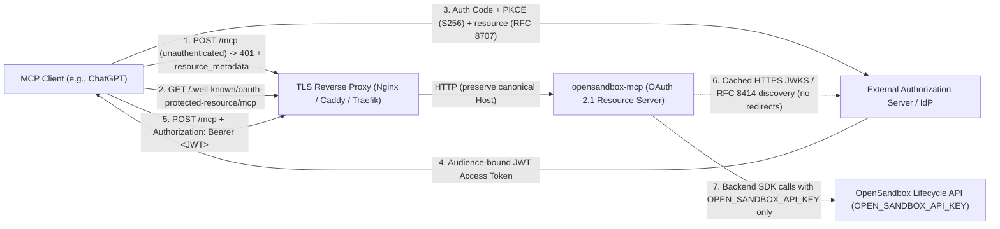

# OpenSandbox MCP Sandbox Server

## Overview

OpenSandbox MCP Server exposes the OpenSandbox Python SDK as MCP tools for Claude Code, Cursor, and other MCP-capable clients. It provides focused sandbox lifecycle management, command execution, and text file operations.

## Installation & Startup

### Source

```bash
cd sdks/mcp/sandbox/python
uv sync
uv run opensandbox-mcp
```

### Package

```bash
pip install opensandbox-mcp
opensandbox-mcp
```

### Configuration

Environment variables:

- `OPEN_SANDBOX_API_KEY`
- `OPEN_SANDBOX_DOMAIN`

CLI overrides:

```bash
opensandbox-mcp --api-key ... --domain ... --protocol https
```

Config fields:

- `api_key`: OpenSandbox API key for authentication.
- `domain`: OpenSandbox API domain, for example `api.opensandbox.io`.
- `protocol`: `http` or `https` for API requests.
- `request_timeout_seconds`: HTTP request timeout in seconds.
- `transport`: `stdio` by default, or `streamable-http`.

### Streamable HTTP

```bash
opensandbox-mcp \
  --transport streamable-http \
  --host 0.0.0.0 \
  --port 8000
```

The HTTP transport defaults to `127.0.0.1:8000`. Set `--host 0.0.0.0` when the MCP server must be reached from another container, and use `--port` to select a different listening port. Keep the default loopback host unless the container network or an upstream gateway protects the exposed endpoint.

::: warning Unauthenticated HTTP mode
Legacy unauthenticated `streamable-http` (`--oauth-mode none`, the default) performs **no** client authentication. Never expose unauthenticated `opensandbox-mcp` directly to the public internet; keep it on loopback (`127.0.0.1`), inside a private network, or enable OAuth 2.1 Resource Server mode behind HTTPS.
:::

## OAuth 2.1 Resource Server (Streamable HTTP)

`opensandbox-mcp` supports optional, native **OAuth 2.1 Resource Server** mode (`--oauth-mode jwt`) for the `streamable-http` transport. In this mode, `opensandbox-mcp` publishes RFC 9728 Protected Resource Metadata, returns standards-compliant `401`/`403` `WWW-Authenticate` challenges, and validates JWT bearer access tokens against a trusted external Authorization Server / Identity Provider (IdP) before executing any MCP request or tool.

**What OAuth Resource Server mode does NOT do:**

- It does **not** act as an OAuth Authorization Server, render login or consent pages, manage users, or issue access/refresh tokens; you must connect a separate standards-compliant external IdP.
- It does **not** apply to `stdio` transport (combining `--transport stdio` with `--oauth-mode jwt` fails closed at startup).
- It does **not** validate opaque tokens via RFC 7662 introspection in this release (JWT/JWKS verification only; keep token TTLs short, e.g. 5–15 minutes).
- It does **not** replace `OPEN_SANDBOX_API_KEY` or create per-user sandbox multi-tenancy (see [Security Model & Limitations](#security-model-limitations)).

### Architecture



### Sample Configuration

The example below binds locally on loopback behind an HTTPS reverse proxy serving `https://mcp.example.com/mcp` and trusts `https://idp.example.com`:

```bash
export OPEN_SANDBOX_API_KEY="replace-with-backend-api-key"
export OPEN_SANDBOX_DOMAIN="127.0.0.1:8080"

opensandbox-mcp \
  --transport streamable-http \
  --host 127.0.0.1 \
  --port 8000 \
  --oauth-mode jwt \
  --oauth-issuer-url "https://idp.example.com" \
  --oauth-resource-url "https://mcp.example.com/mcp" \
  --oauth-required-scope "opensandbox:mcp"
```

### Configuration Reference

CLI flags override `OPEN_SANDBOX_MCP_OAUTH_*` environment variables. Configuration is **fail-closed**: supplying any `--oauth-*` flag or environment variable while `--oauth-mode` is `none`, omitting a required field, or specifying an insecure/malformed setting causes `opensandbox-mcp` to exit immediately at startup with a non-secret error.

| CLI Flag | Environment Variable | Default | Validation / Behavior |
| --- | --- | --- | --- |
| `--oauth-mode` | `OPEN_SANDBOX_MCP_OAUTH_MODE` | `none` | `none` or `jwt`. `jwt` is only accepted with `--transport streamable-http`. |
| `--oauth-issuer-url` | `OPEN_SANDBOX_MCP_OAUTH_ISSUER_URL` | — | Required when `jwt`. Exact issuer URL (`https://`, no query/fragment/userinfo). |
| `--oauth-resource-url` | `OPEN_SANDBOX_MCP_OAUTH_RESOURCE_URL` | — | Required when `jwt`. Use the exact public MCP URL configured in clients (e.g., `https://mcp.example.com/mcp`), with lowercase scheme and host and no trailing slash on a non-root path. |
| `--oauth-required-scope` | `OPEN_SANDBOX_MCP_OAUTH_REQUIRED_SCOPES` | — | Required when `jwt`. Repeatable flag or space/comma-separated env var. Enforced on every protected HTTP request (`403 insufficient_scope` if missing). |
| `--oauth-audience` | `OPEN_SANDBOX_MCP_OAUTH_AUDIENCE` | `resource_url` | Expected JWT `aud` claim. Defaults to canonical `resource_url` per RFC 8707; override only when an IdP cannot emit a URL audience. |
| `--oauth-jwks-url` | `OPEN_SANDBOX_MCP_OAUTH_JWKS_URL` | Auto-discovered | Explicit trusted JWKS HTTPS URL. When omitted, discovered from `issuer_url` via RFC 8414 / OIDC discovery with same-origin enforcement. |
| `--oauth-allowed-algs` | `OPEN_SANDBOX_MCP_OAUTH_ALLOWED_ALGS` | `RS256,RS384,RS512,PS256,PS384,PS512,ES256,ES384,ES512,EdDSA` | Comma-separated subset of supported asymmetric JWS algorithms. `none` and `HS*` are always rejected. |
| `--oauth-clock-skew-seconds` | `OPEN_SANDBOX_MCP_OAUTH_CLOCK_SKEW_SECONDS` | `30` | Finite number in `[0, 300]` applied as leeway to `exp` and `nbf`. |
| `--oauth-http-timeout-seconds` | `OPEN_SANDBOX_MCP_OAUTH_HTTP_TIMEOUT_SECONDS` | `5` | Finite number in `(0, 60]` for outbound metadata/JWKS fetches (redirects disabled). |
| `--oauth-jwks-cache-ttl-seconds` | `OPEN_SANDBOX_MCP_OAUTH_JWKS_CACHE_TTL_SECONDS` | `300` | Finite number in `(0, 86400]`. Expired cache fails closed if JWKS is unreachable. |
| `--oauth-jwks-refresh-cooldown-seconds` | `OPEN_SANDBOX_MCP_OAUTH_JWKS_REFRESH_COOLDOWN_SECONDS` | `30` | Finite number in `[0, 3600]`. Minimum interval between forced JWKS refreshes on unknown `kid` and between retries after a fetch failure. |
| `--oauth-allowed-host` | `OPEN_SANDBOX_MCP_OAUTH_ALLOWED_HOSTS` | Derived from `resource_url` | Repeatable extra `Host` header entries permitted by DNS-rebinding protection. |
| `--oauth-allow-insecure-http` | `OPEN_SANDBOX_MCP_OAUTH_ALLOW_INSECURE_HTTP` | `false` | Allows `http://` strictly on loopback hosts (`127.0.0.1`, `localhost`, `[::1]`) for local testing only. |

### External Identity Provider Compatibility Checklist

Before connecting a remote MCP client, verify that your external Authorization Server / IdP supports:

- **Discovery metadata:** Publishes RFC 8414 (`/.well-known/oauth-authorization-server`) or OIDC Discovery (`/.well-known/openid-configuration`) with an exact matching `issuer` and HTTPS `jwks_uri`.
- **Signing keys:** Startup checks discovery and primes the JWKS cache before serving. If the IdP hosts its signing keys on a different origin, set `--oauth-jwks-url` to the trusted HTTPS JWKS URL. An explicit JWKS URL skips server-side metadata discovery.
- **PKCE `S256`:** Enforces Authorization Code + PKCE with `code_challenge_method=S256`.
- **Client registration:** Supports the registration mechanism required by your MCP client—Client ID Metadata Documents (CIMD), Dynamic Client Registration (RFC 7591), or pre-registered client credentials.
- **Audience-bound JWT access tokens:** Issues signed asymmetric JWT **access tokens** (RSA >= 2048 bits, EC >= 224 bits, or EdDSA—not opaque tokens and not ID tokens) whose `aud` matches `--oauth-resource-url` (RFC 8707) or your explicit `--oauth-audience`, and includes your configured `--oauth-required-scope` in `scope` or `scp`.

Use a dedicated access-token audience and configure the IdP to emit the exact audience string, including its path and trailing slash. For providers that emit generic `JWT` or omit `typ`, the audience must be distinct from all OIDC client IDs used for ID tokens. Prefer an explicitly typed `at+jwt` when supported.

The OAuth CLI disables Uvicorn access logging because request URLs can contain credentials even when a request is rejected. Configure reverse proxies and custom ASGI hosts to omit query strings and Authorization headers from their logs.

### Protocol Verification with `curl`

Replace `https://mcp.example.com` and the synthetic token placeholders with your local or staging endpoints:

```bash
# 1. Anonymous RFC 9728 Protected Resource Metadata discovery (expect HTTP 200)
curl -i https://mcp.example.com/.well-known/oauth-protected-resource/mcp

# 2. Missing bearer token (expect HTTP 401 with WWW-Authenticate resource_metadata hint)
curl -i -X POST https://mcp.example.com/mcp \
  -H "Content-Type: application/json" \
  -H "Accept: application/json, text/event-stream" \
  -d '{"jsonrpc":"2.0","id":1,"method":"initialize","params":{"protocolVersion":"2026-07-28","capabilities":{},"clientInfo":{"name":"curl","version":"1.0"}}}'

# 3. Invalid bearer token (expect HTTP 401)
curl -i -X POST https://mcp.example.com/mcp \
  -H "Authorization: Bearer invalid.test.token" \
  -H "Content-Type: application/json" \
  -H "Accept: application/json, text/event-stream" \
  -d '{"jsonrpc":"2.0","id":1,"method":"tools/list"}'

# 4. Valid JWT missing the required scope (expect HTTP 403 insufficient_scope)
curl -i -X POST https://mcp.example.com/mcp \
  -H "Authorization: Bearer <SYNTHETIC_JWT_WITHOUT_REQUIRED_SCOPE>" \
  -H "Content-Type: application/json" \
  -H "Accept: application/json, text/event-stream" \
  -d '{"jsonrpc":"2.0","id":1,"method":"tools/list"}'

# 5. Valid JWT with matching iss, aud, and required scope (expect HTTP 200)
curl -i -X POST https://mcp.example.com/mcp \
  -H "Authorization: Bearer <SYNTHETIC_VALID_ACCESS_TOKEN>" \
  -H "Content-Type: application/json" \
  -H "Accept: application/json, text/event-stream" \
  -d '{"jsonrpc":"2.0","id":1,"method":"initialize","params":{"protocolVersion":"2026-07-28","capabilities":{},"clientInfo":{"name":"curl","version":"1.0"}}}'
```

### ChatGPT Connection & Manual Verification Checklist

Automated tests in `sdks/mcp/sandbox/python/tests/test_auth_http.py` validate RFC 9728 discovery, `401`/`403` challenges, JWT verification, session principal binding, and MCP tool round-trips against a synthetic local Authorization Server. Live ChatGPT connector testing depends on your external IdP and public HTTPS domain and must be verified manually in staging before production cutover:

1. Terminate TLS at your reverse proxy (`https://mcp.example.com`) and forward `/mcp`, `/.well-known/oauth-protected-resource/mcp`, and `/.well-known/oauth-protected-resource` to `opensandbox-mcp` while preserving `Host: mcp.example.com` (do not rewrite `Host` to `127.0.0.1` unless added via `--oauth-allowed-host`).
2. Confirm `GET https://mcp.example.com/.well-known/oauth-protected-resource/mcp` returns `resource: "https://mcp.example.com/mcp"`, your IdP's exact `authorization_servers` entry, and `scopes_supported`.
3. Confirm your IdP publishes `/.well-known/oauth-authorization-server` or `/.well-known/openid-configuration` with PKCE `S256` and the client registration mode ChatGPT expects, and mints a JWT access token with `aud = https://mcp.example.com/mcp` and your required scope.
4. Register `https://mcp.example.com/mcp` as an OAuth-protected MCP connector in ChatGPT, complete the browser login flow at your IdP, and confirm `tools/list` and a non-destructive tool call (`sandbox_list`) succeed.

### Operations & Troubleshooting

- **Key rotation:** Unknown `kid` headers trigger at most one lock-serialized JWKS refresh per `--oauth-jwks-refresh-cooldown-seconds` window (default 30s). Metadata and JWKS responses must support uncompressed JSON and fit within 2 MiB each. Publish the new public key in your IdP's JWKS before signing tokens with it.
- **Reverse proxies & TLS:** `opensandbox-mcp` ignores `X-Forwarded-Host`, `X-Forwarded-Proto`, and `Forwarded` when emitting RFC 9728 metadata and `WWW-Authenticate` headers, and derives DNS-rebinding `allowed_hosts` strictly from `--oauth-resource-url` (plus any explicit `--oauth-allowed-host`).
- **Safe logging & restarts:** Access tokens and `OPEN_SANDBOX_API_KEY` are never written to logs or error responses. Stateful Streamable HTTP sessions are held in memory; after a restart, clients re-initialize and present a valid access token.

| Symptom | Likely Cause | Resolution |
| --- | --- | --- |
| Startup exits with code 2 mentioning `OAuth mode is 'none'` | One or more `--oauth-*` flags/env vars were set without `--oauth-mode jwt`. | Pass `--oauth-mode jwt` (or remove the OAuth flags/env vars). |
| `421 Invalid Host header` behind Nginx/Caddy | Reverse proxy overwrote `Host` to an upstream name not matching `--oauth-resource-url`. | Configure the proxy to forward `Host: mcp.example.com` (or add the internal host with `--oauth-allowed-host`). |
| `401` on a valid-looking token | `iss` trailing-slash mismatch, `aud` does not match `--oauth-resource-url`, ID token sent instead of access token, cross-origin `jwks_uri`, or JWKS unreachable after TTL. | Verify JWT `iss`/`aud`/`exp`/`alg`/`typ` claims; pin `--oauth-jwks-url` if your IdP serves JWKS on a different host; verify outbound HTTPS connectivity. |
| `403 insufficient_scope` | Access token verified cryptographically, but lacks a scope listed in `--oauth-required-scope`. | Ensure the IdP includes the required scope in the token's `scope` or `scp` claim. |
| `404 Session not found` on an active session | A different OAuth principal (`client_id`, `iss`, or `sub`) attempted to reuse another session's `Mcp-Session-Id`, or the server restarted. | Re-initialize a new MCP session with the current caller's token. |

### Migrating from `mcp-oauth-proxy` (and Rollback)

To migrate from `Client -> Reverse Proxy -> mcp-oauth-proxy -> opensandbox-mcp -> OpenSandbox` to `Client -> Reverse Proxy -> opensandbox-mcp (OAuth Resource Server) -> OpenSandbox`:

1. Configure your external IdP to mint JWT access tokens with `aud = https://mcp.example.com/mcp` and your chosen required scope (for example `opensandbox:mcp`).
2. Start a staging or side-by-side `opensandbox-mcp` instance with `--transport streamable-http --oauth-mode jwt` and the matching `--oauth-*` flags, keeping `OPEN_SANDBOX_API_KEY` unchanged.
3. Verify RFC 9728 discovery, `401`/`403` rejections, and an authorized MCP session using the `curl` checks above.
4. Update the TLS reverse proxy upstream for `/mcp` and `/.well-known/oauth-protected-resource*` to point directly at `opensandbox-mcp`, preserving the canonical `Host` header, and re-test client login and tool execution before decommissioning `mcp-oauth-proxy`.

#### Rollback

1. Restore a separate private MCP upstream for `mcp-oauth-proxy`. If reusing the current upstream, disable direct public routes to it before changing its configuration. Remove every `--oauth-*` flag and unset every `OPEN_SANDBOX_MCP_OAUTH_*` variable, including `OPEN_SANDBOX_MCP_OAUTH_MODE`, from the service definition, environment files, and inherited environment. Keep the backend domain and API key in place. Start or restart MCP and verify that the auth proxy can reach its private upstream.
2. Switch `/mcp` and the corresponding OAuth metadata routes on the TLS reverse proxy back to `mcp-oauth-proxy`. Verify that public requests without a token get a `401` challenge from the proxy, then complete sign-in and make an authenticated MCP call. Clients may need to sign in again and initialize a new session. Running sandboxes persist across this change.

### Security Model & Limitations

::: warning All OAuth callers share the backend API key's permissions
Every authorized caller can list, execute commands in, modify, or terminate any sandbox visible to the configured `OPEN_SANDBOX_API_KEY`. Restrict which users or groups can obtain tokens for this deployment's dedicated audience and required scope in your IdP. CIMD and Dynamic Client Registration register OAuth clients. Access to the audience and scope depends on the IdP's user, group, or organization policy. Verify that an account outside the allowed group cannot obtain a token with both values before exposing the service.
:::

- **Tenant isolation:** Run one MCP instance per trust domain, with its own OAuth audience and IdP policy. For Kubernetes, give each MCP instance a key scoped to a dedicated [OpenSandbox tenant namespace](/guides/multi-tenancy). For Docker, give each MCP instance a separate lifecycle backend with a dedicated API key and isolated workloads.
- **Audit logs:** In OAuth mode, `opensandbox_mcp.audit` emits an INFO event for each executed tool with the issuer, subject when present, client ID, tool name, sandbox ID when available, and outcome. Keep INFO logs for this logger in a restricted sink. These records exclude tokens, backend credentials, commands, file contents, and exception messages.
- **Credential separation:** Inbound OAuth bearer tokens are validated only at the HTTP boundary and are never forwarded to `opensandbox-server`, injected into sandbox containers, or returned in tool outputs. Backend calls exclusively use `OPEN_SANDBOX_API_KEY`.
- **Token transport:** Bearer tokens are accepted only via a single `Authorization: Bearer <token>` header. Duplicate `Authorization` headers, oversized headers, query-parameter tokens (`?access_token=`), and body tokens are rejected with `401` before any tool handler executes.

## Integrations

### Claude Code stdio

```bash
claude mcp add opensandbox-sandbox --transport stdio -- \
  opensandbox-mcp --api-key "$OPEN_SANDBOX_API_KEY" --domain "$OPEN_SANDBOX_DOMAIN"
```

### Claude Code http

```bash
claude mcp add opensandbox-sandbox --transport http http://localhost:8000/mcp
```

### Cursor stdio

```json
{
  "mcpServers": {
    "opensandbox-sandbox": {
      "command": "opensandbox-mcp",
      "args": [
        "--api-key",
        "${OPEN_SANDBOX_API_KEY}",
        "--domain",
        "${OPEN_SANDBOX_DOMAIN}"
      ]
    }
  }
}
```

### Cursor http

```json
{
  "mcpServers": {
    "opensandbox-sandbox": {
      "url": "http://localhost:8000/mcp"
    }
  }
}
```

## Tools

::: info
- Tools that interact with a sandbox use an ID registered by `sandbox_create` or `sandbox_connect`. `sandbox_list` lists server-side sandboxes without an existing local sandbox registration.
- `file_read`/`file_write` are text-only; use `encoding` and `range_header` for large files.
:::

The MCP server exposes the tool set below, not the complete Python SDK. It does not currently register tools for Client Pool, pool tracing, snapshots, templates, Credential Vault, or stable remote diagnostic logs/events. Use the [SDK guides](/sdks/) or [CLI](/cli/) for those workflows where supported.

### Sandbox

- `sandbox_create`: create a new sandbox and register it locally
- `sandbox_connect`: attach to an existing sandbox and register it locally
- `sandbox_kill`: terminate a sandbox by ID
- `sandbox_get_info`: fetch sandbox info by ID
- `sandbox_list`: list sandboxes with optional `filter` object
- `sandbox_renew`: extend sandbox expiration
- `sandbox_healthcheck`: check if sandbox is healthy
- `sandbox_get_metrics`: get resource metrics
- `sandbox_get_endpoint`: get network endpoint for a port

### Command Execution

- `command_run`: run a command inside a sandbox
- `command_get_status`: get a command's running state, exit code, and error
- `command_get_logs`: read combined stdout/stderr of a background command, with an optional `cursor` for incremental reads
- `command_interrupt`: interrupt a running command

### Filesystem

- `file_read`: read a text file
- `file_write`: write a text file
- `file_delete`: delete files
- `file_search`: search for files by glob
- `file_create_directories`: create directories
- `file_delete_directories`: delete directories
- `file_move`: move/rename files or directories
- `file_replace_contents`: replace file content

## Minimal Workflow

1. `sandbox_create` -> keep the `sandbox_id`.
2. `file_write` code or assets into the sandbox.
3. `command_run` to execute, install dependencies, or start a service.
4. `sandbox_get_endpoint` if you expose a port.
5. `sandbox_kill` when finished.

### Background Commands

1. `command_run` with `background=true` -> keep the execution `id`.
2. `command_get_status` until `running` is `false`; check `exit_code` and `error`.
3. Between status checks, `command_get_logs` with the `cursor` from the previous call to read only new output.
4. After `running` is `false`, call `command_get_logs` once more to read the remaining output.
5. `command_interrupt` to stop a command early.

::: tip
The `cursor` is a server-side position: pass back the returned value instead of computing it from the content length. Empty `content` does not mean the command finished. Completed command records are retained for at least 24 hours, so a "not found" error for an old execution does not mean the command failed.
:::

## Usage Examples

Here are some examples of what you can ask an LLM to do:

- "Create a Python sandbox and run a quick health command."
- "Write a Python script into the sandbox and run it."
- "Download a GitHub repo, install dependencies, and run its tests."
- "Run the test suite in the background, report progress, and tell me whether it passed."
- "Generate a CSV file with fake sales data and run a simple summary script."
- "Start a tiny web server on port 8000 and return the public URL."
- "Build a minimal REST API (hello + health) and expose it on port 8000."
- "Create a tar.gz of /app and report the file size."
- "Build a simple Snake game and return the web endpoint where it can be accessed."
