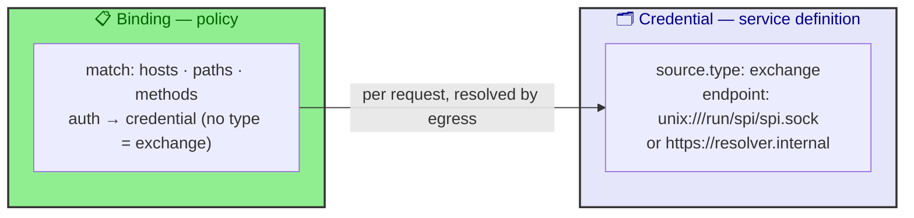
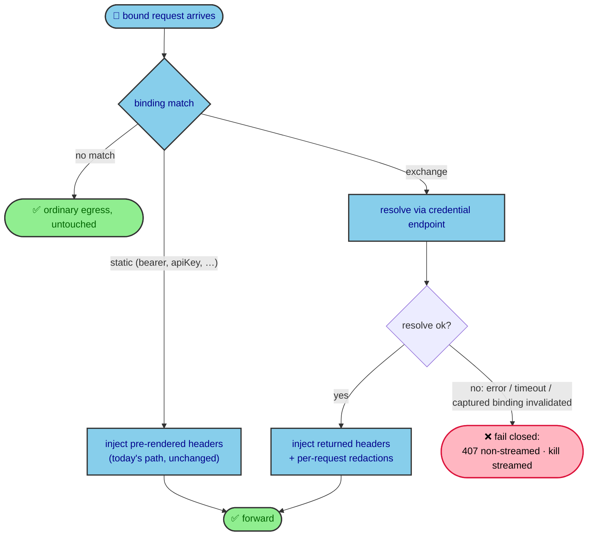
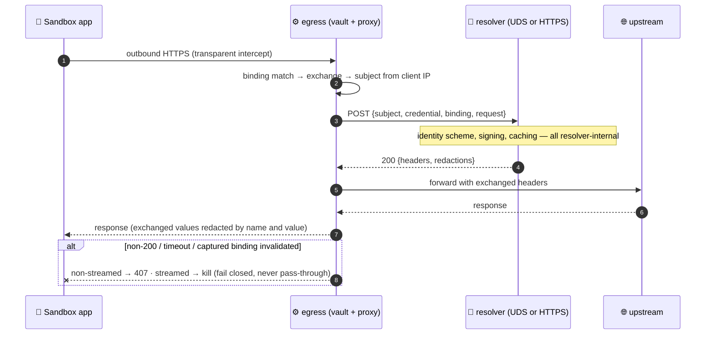

# OSEP-0025: Credential Vault Exchange and Delegated Header Resolution

<!-- toc -->
- [Summary](#summary)
- [Motivation](#motivation)
  - [Goals](#goals)
  - [Non-Goals](#non-goals)
- [Requirements](#requirements)
- [Proposal](#proposal)
  - [Notes/Constraints/Caveats](#notesconstraintscaveats)
  - [Risks and Mitigations](#risks-and-mitigations)
- [Design Details](#design-details)
  - [Credential and Binding Model](#credential-and-binding-model)
  - [API](#api)
  - [Usage Demos](#usage-demos)
  - [Request Handling](#request-handling)
  - [Resolver Contract](#resolver-contract)
  - [Example Instantiations](#example-instantiations)
  - [Fast Sandbox Profile](#fast-sandbox-profile)
  - [Observability](#observability)
  - [Relationship to Prior OSEPs](#relationship-to-prior-oseps)
- [Test Plan](#test-plan)
- [Drawbacks](#drawbacks)
- [Alternatives](#alternatives)
- [Infrastructure Needed](#infrastructure-needed)
- [Upgrade & Migration Strategy](#upgrade--migration-strategy)
<!-- /toc -->

## Summary

Credential Vault (OSEP-0012) brokers static credentials: callers deliver inline values, and the vault injects headers rendered once per revision. This proposal adds one dynamic building block. An **exchange credential** declares a header-resolver service — a local Unix socket or a remote HTTPS endpoint — and a binding whose auth references it resolves matched requests through that service. When a bound request arrives, the egress asks the resolver for fresh headers and injects the response. The resolver is a black box: the vault does not know how it is started, what identity scheme it implements, or how it caches. Exchange traffic inherits every OSEP-0012 policy invariant unchanged: binding match, egress alignment, ambiguity fail-closed, revisions, audit, redaction.

## Motivation

Two gaps remain after OSEP-0012.

First, identity-derived credentials (SPIFFE-compatible SVIDs, STS tokens, OAuth2 client-credentials grants) are short-lived and computed from request context — an audience derived from the destination, or a signature bound to the request's method, path, and headers. They cannot be delivered as a static value at vault creation and cannot be pre-rendered at revision time.

Second, sandboxes that need such identities today use ad-hoc mitm addons and per-sandbox signing daemons. Those paths bypass binding validation, egress policy alignment, ambiguity checks, audit, and fail-closed semantics, and they require the sandbox application to cooperate (for example by setting an opt-in header). Credential policy effectively leaks into application code.

### Goals

1. Add an `exchange` credential source: a declarative pointer to a header-resolver service, addressed by a URI (`unix://` socket or `https://` endpoint).
2. Add an exchange auth form on bindings — an auth that omits `type` and only references an exchange credential — which routes matched requests to that credential's resolver for per-request header resolution.
3. One transport-agnostic resolver contract; the egress proxies each request to the resolver and injects the returned headers.
4. Fail closed on resolution error or timeout; redact per request; never expose or persist exchanged material.
5. The subject is supplied by the egress on every resolution, so one resolver can serve many sandboxes; identical model in sidecar and fast-sandbox profiles.
6. Zero behavior change for vaults that use only `inline` credentials.

### Non-Goals

1. Becoming a general secret manager (unchanged from OSEP-0012).
2. Dictating resolver internals — how it is started, deployed, what identity scheme it implements, how it caches or rotates. The vault contract starts and ends at the resolver endpoint.
3. Putting credential scope or audience policy into the vault API; a resolver derives scope from request context itself.
4. Injecting at connection level (mTLS/X509-SVID); injection remains HTTP header substitution, as in OSEP-0012's MVP.
5. Adding new sandbox-facing lifecycle APIs; callers continue to use the existing egress Credential Vault API.

## Requirements

| ID | Requirement | Priority |
|----|-------------|----------|
| R1 | A new `exchange` credential source carries a resolver endpoint URI (`unix://` or `https://`); `inline` behavior is unchanged; unknown types are rejected | Must Have |
| R2 | Binding auth that omits `type` and references an exchange credential resolves headers per request through that credential's resolver | Must Have |
| R3 | Auth with a static `type` binds only to static sources; typeless auth binds only to exchange sources; cross-references are rejected at validation | Must Have |
| R4 | Resolution runs only inside the egress process trust boundary; sandboxes must not be able to obtain credential material by calling the resolver directly | Must Have |
| R5 | Resolution failure or timeout fails closed: 407 for non-streamed requests, kill for streamed requests | Must Have |
| R6 | The subject is derived by egress from connection observables (client IP) and passed to the resolver; no protocol surface accepts a client-declared subject | Must Have |
| R7 | Behavior is identical in sidecar and fast-sandbox profiles; the resolver contract carries the subject | Must Have |
| R8 | Vault reads, diagnostics, and logs never expose exchanged credential material | Must Have |
| R9 | Every header returned by a resolver is redacted per request — by name, by value, and by rendered variants — in response headers; resolver-supplied redaction hints are additive only, never authoritative | Must Have |
| R10 | Audit events record the credential (resolver) name, decision, and target host; never credential values | Must Have |
| R11 | The vault enforces only a resolution timeout; resolver-internal caching and refresh are invisible to the contract | Must Have |
| R12 | Exchanged material is never persisted to disk; restart recovery requires only policy | Must Have |
| R13 | Exchange binding hosts join the credential-bound TLS decrypt set (OSEP-0023) in both profiles | Should Have |
| R14 | The egress enforces a bounded resolver response envelope — total response bytes, header count, per-value length, and redaction count — before decoding; exceedance is a per-request denial | Must Have |

## Proposal

### Notes/Constraints/Caveats

1. **Additive by construction.** Sandboxes that use only `inline` credentials observe zero behavior change; static credential behavior is untouched.
2. **Resolver reachability is part of the trust model.** A sandbox that can mint credentials by calling the resolver directly bypasses the entire policy plane. `unix://` resolvers are scoped by socket permissions; `https://` resolvers must require caller authentication (for example an egress-only token provisioned through operator configuration, never through the sandbox).
3. **The subject is an opaque routing key, not a delegation.** The vault performs no identity delegation; the subject→identity authorization mapping belongs to the resolver's operator domain, which configures and audits it.
4. **Resolver outage means denial, never bypass.** An unreachable or slow resolver is indistinguishable from a policy denial for exchange bindings.
5. **Per-request latency is bounded.** The vault applies a fixed resolution timeout; whether the resolver served a cached token or performed a fresh signature is invisible to the contract.
6. **Version skew fails closed.** A runtime component that does not support exchange must reject a vault containing exchange bindings outright; a dynamic binding must never silently degrade into an empty static binding or a missing vault.
7. **One slow resolver affects only its matched requests.** Resolution is per request with a bounded timeout; unrelated traffic through the same egress is never blocked waiting on a resolver.
8. **Resolver output is bounded before decoding (R14).** The timeout alone is not a memory bound: a caller-operated resolver can answer immediately with an arbitrarily large body. The egress therefore enforces a response envelope budget — total response bytes, header count, per-value length, and redaction count — and treats exceedance as a per-request denial; a single subject cannot exhaust a shared egress through a resolver response.
9. **Resolver reachability under sidecar default-deny is an operator constraint, not an egress behavior.** The egress does not install exceptions for its own resolver dials. In the sidecar profile under `dns+nft` default-deny, locally re-originated dials traverse the OUTPUT policy, so the operator must provision resolver reachability for the egress process only — for example via the existing operator-provisioned UID-scoped exclusion mechanism used for upstream proxies, or equivalent host-level rules. Fast Sandbox imposes no OUTPUT enforcement for local dials, so once reachability is provisioned, behavior is identical in both profiles (R7). Resolver hosts must never be opened to the sandbox itself (never via the sandbox NetworkPolicy), which would violate R4.

### Risks and Mitigations

| Risk | Impact | Mitigation |
|------|--------|------------|
| Sandbox calls the resolver directly and mints credentials | Full policy bypass | `unix://` socket permissions; `https://` resolvers require caller authentication provisioned outside the sandbox (R4) |
| Client forges subject identity | Cross-subject credential use | Subject never accepted from the addon protocol; resolved from client IP with the existing authoritative mapping |
| Exchanged values leak through reads or diagnostics | Credential exposure | Resolution output exists per request only; redacted by name and value; never persisted |
| Resolver outage breaks exchange-bound traffic | Availability regression | Documented as fail-closed semantics; operators monitor resolver health; static bindings are unaffected |
| Malicious or broken resolver returns oversized responses | Shared-egress memory exhaustion across subjects | The egress enforces a bounded response envelope and denies on exceedance (R14) |

## Design Details

### Credential and Binding Model

The OSEP-0012 split is preserved: a **credential** is a service definition (what to exchange with), a **binding** is a policy (when to exchange). One exchange credential can serve many bindings.



### API

Endpoints are unchanged from OSEP-0012. Only schemas grow.

| Operation | Behavior |
|---|---|
| `POST /credential-vault` | Create the vault with credentials and bindings; activates the initial revision |
| `GET /credential-vault` (+ `/credentials`, `/bindings`) | Sanitized metadata; never returns values |
| `PATCH /credential-vault` | Atomic runtime mutation with optional `expectedRevision` |
| `DELETE /credential-vault` | Revoke the vault and all runtime material |

Schema delta:

```jsonc
{
  "credentials": [
    { "name": "gh-token", "source": { "type": "inline", "value": "..." } },       // static, unchanged
    { "name": "spi-signer",
      "source": { "type": "exchange", "endpoint": "unix:///run/spi/spi.sock" } }, // local resolver
    { "name": "corp-resolver",
      "source": { "type": "exchange", "endpoint": "https://header-resolver.internal" } }
  ],
  "bindings": [
    { "name": "github-read",
      "match": { "hosts": ["api.github.com"], "methods": ["GET"], "paths": ["/repos/*"] },
      "auth": { "type": "bearer", "credential": "gh-token" } },
    { "name": "internal-api",
      "match": { "hosts": ["*.internal.example.com"], "paths": ["/*"] },
      "auth": { "credential": "spi-signer" } }
  ]
}
```

Validation rules:

- Auth objects that declare a `type` (`bearer`, `basic`, `apiKey`, `customHeaders`) must reference static sources; auth objects without `type` are exchange references and must reference exchange sources. Cross-references fail with 400. `type` is omitted for exchange because the resolver produces the complete header set — there is no render shape to select, and the referenced credential's source already determines the behavior.
- The endpoint URI scheme must be `unix://` or `https://`; other schemes fail with 400.
- Header names returned by a resolver pass the same hop-by-hop rejection set as static injection.
- All existing rules apply unchanged: egress allow coverage, ambiguity fail-closed, `expectedRevision` optimistic concurrency, sanitized read responses.

Field semantics — the user-facing reading of the model:

| Field | Meaning |
|---|---|
| `source.type: "exchange"` | This credential is a resolver service definition, not a static value; validation cross-locks it against static auth types |
| `source.endpoint` | Where to exchange, per request. The URI scheme selects the transport: `unix://` is HTTP over a Unix socket, `https://` is TLS |
| `match` | When to exchange: the hosts, paths, and methods that trigger resolution |
| `auth.credential` (no `type`) | Which resolver to use when triggered; "when" and "where" are decoupled so one resolver can serve many bindings. No `type` field: the resolver produces the complete header set, so there is no render shape to declare |
| binding `name` | Audit identifier surfaced in audit logs only; never a metric dimension (tenant-provided names are unbounded) |

In short: `match` declares which requests, `endpoint` declares where to exchange, and the credential name welds the two together.

### Usage Demos

**Demo 1 — local signing resolver (UDS).** A SPIFFE-compatible signing service runs next to the egress and exposes a socket. One `POST /credential-vault` wires it up:

```jsonc
POST /credential-vault
{
  "credentials": [
    { "name": "spi-signer",
      "source": { "type": "exchange", "endpoint": "unix:///run/spi/spi.sock" } }
  ],
  "bindings": [
    { "name": "internal-api",
      "match": { "hosts": ["*.internal.example.com"], "paths": ["/*"] },
      "auth": { "credential": "spi-signer" } }
  ]
}
```

Sandbox code stays unchanged:

```python
requests.get("https://api.internal.example.com/v1/foo")
```

The request arrives at the upstream with fresh `Authorization` and signature headers. The sandbox process never sees or holds them. If the resolver is down, the request is denied (407) — never forwarded uncredentialed.

**Demo 2 — shared HTTPS resolver, one credential serving many bindings.** A centrally operated resolver behind TLS. The same credential backs different policies:

```jsonc
POST /credential-vault
{
  "credentials": [
    { "name": "corp-resolver",
      "source": { "type": "exchange", "endpoint": "https://header-resolver.internal" } }
  ],
  "bindings": [
    { "name": "team-a",
      "match": { "hosts": ["api.team-a.internal"], "paths": ["/*"] },
      "auth": { "credential": "corp-resolver" } },
    { "name": "team-b",
      "match": { "hosts": ["*.team-b.internal"], "methods": ["GET", "POST"], "paths": ["/v1/*"] },
      "auth": { "credential": "corp-resolver" } }
  ]
}
```

Both teams' hosts exchange through one service; per-sandbox identity selection happens inside the resolver, keyed on the subject the egress supplies.

**Demo 3 — runtime mutation.** Bindings can be added to a running sandbox atomically:

```jsonc
PATCH /credential-vault
{
  "expectedRevision": 7,
  "bindings": {
    "add": [
      { "name": "registry",
        "match": { "hosts": ["registry.internal"], "paths": ["/v2/*"] },
        "auth": { "credential": "corp-resolver" } }
    ]
  }
}
```

The response carries the acknowledged revision (8) and sanitized metadata. Reads never include values.

### Request Handling

The interaction view below is the complete implementation story: state reads (snapshot) and per-request resolution are separate interactions; exchange bindings carry only a marker until a request actually arrives.





Failure semantics: non-200 and timeout are per-request denials. Invalidation is scoped, not global. Each resolution is pinned to the opaque snapshot generation and subject under which it was captured, following the immutable-snapshot semantics of OSEP-0012 and OSEP-0023: an unrelated vault mutation — any patch that does not touch the captured binding — never denies an in-flight or already-completed resolution. A result is discarded and never injected when its captured binding is deleted or replaced, when the vault is deleted, or when its subject is replaced, including by a successor that reuses the same revision number. Denials never degrade to pass-through and never poison subsequent requests.

### Resolver Contract

The same JSON-over-HTTP contract applies to both transports: HTTP over a Unix socket for `unix://`, plain HTTPS for `https://`. This is the only surface a resolver implements.

HTTP framing: both transports issue `POST` with `Content-Type: application/json`. The request target is fixed at `/resolve`; an `https://` endpoint URI may carry a path prefix (for example `https://resolver.internal/egress`), in which case the request target is that prefix joined with `/resolve` and `Host` is the endpoint authority. For `unix://` endpoints the request target is `/resolve` and `Host` is the literal `localhost`, which resolvers ignore. This removes route ambiguity between independent egress and resolver implementations.

```jsonc
// egress → resolver
{
  "subject": "<sandboxId>",    // authoritative, filled by egress; the sandbox's external ID, identical in both profiles
  "credential": "spi-signer",
  "binding": "internal-api",
  "destination": {             // validated outbound destination, not the client-controlled Host
    "scheme": "https",
    "authority": "api.internal.example.com:443",
    "sni": "api.internal.example.com"
  },
  "request": { "method": "GET", "host": "api.internal.example.com",
               "path": "/v1/foo", "headers": { } }
}

// 200 — "redactions" is optional and additive: the egress redacts every
// returned header (name, value, rendered variants) regardless of this field
{
  "headers": { "authorization": "Bearer ...", "x-signature": "..." },
  "redactions": { "authorization": ["Bearer ..."] }
}
```

The `destination` block reflects the validated outbound destination as verified by the egress (scheme, authority including port, and SNI), so a resolver can bind a proof to the connection identity and distinguish `http://host` from `https://host`. Header names in the response are validated before injection.

**Subject identity.** The wire value is the sandbox's `sandboxId` — the external, lifecycle-level identifier — identical in both profiles, so a resolver operator provisions exactly one identity namespace keyed on the identifier callers already use. `subject` is an egress-internal concept; it never crosses the resolver boundary. The egress fills the `sandboxId` authoritatively: the sidecar egress holds the identity of the sandbox it serves; the fast-sandbox egress maps the connection's source IP through its internal subject registry, which is seeded from the same `sandboxId`. The raw client IP is never forwarded, and no protocol surface accepts a client-declared subject (R6).

Hard requirements on a resolver endpoint, none of which dictate an implementation:

| Requirement | Rationale |
|---|---|
| Reachable only by the egress process (socket permissions, or caller authentication for HTTPS) | trust boundary; prevents sandbox-side credential minting (R4) |
| Concurrent-safe, read-only | the egress issues parallel resolves |
| Responds within the vault resolution timeout | the vault fails closed beyond it |
| Stays within the egress-enforced response envelope (bounded bytes, header count, per-value length, redaction count) | shared-process memory safety; one subject cannot exhaust the egress through a resolver response (R14) |
| Per-request semantics | input includes request context; output differs per request |
| Absent/unreachable = denial | no fallback to uncredentialed pass-through |

Authentication material for `https://` resolvers is provisioned through operator configuration of the egress — origin-scoped, so a token is only ever presented to the endpoint it was configured for — never through the vault API and never into the sandbox.

### Example Instantiations

A SPIFFE-compatible signing service behind a local socket is the first target deployment: the credential points at its socket, the service fetches SVIDs and signs proof headers per request. The same contract is served unchanged by a remote `https://` resolver, which allows one centrally operated signing service shared by many egress instances and sandboxes.

### Fast Sandbox Profile

- Behavior is identical to the sidecar profile; the subject lets one shared resolver distinguish sandboxes.
- Exchanged material is never written to disk; after an egress restart, bindings and resolver references reactivate from persisted policy and material re-resolves on demand.
- Exchange binding hosts join the credential-bound TLS decrypt set (OSEP-0023).

### Observability

Audit events gain fields, never values: `credential` (resolver name), `resolution` (`resolved | denied | timeout`), `target_host`, `subject`. Metrics use only closed outcome attributes (`resolution` outcome, latency buckets) — credential and binding names are tenant-provided and must never become metric dimensions, keeping time-series cardinality bounded per OSEP-0010; they live in audit logs only.

### Relationship to Prior OSEPs

- **OSEP-0012**: this proposal adds one source discriminator and a typeless auth form. Every policy invariant is inherited, not restated; the static path is untouched.
- **OSEP-0023**: exchange binding hosts feed the credential-bound TLS decrypt set; resolution failures deny at the HTTP layer exactly as static denials do.

## Test Plan

### Integration Tests

- Static path regression: inline-only vaults behave byte-for-byte as before.
- Exchange happy path with both transports (UDS and HTTPS): resolve → inject → upstream sees fresh headers.
- Fail-closed matrix: resolver down, timeout, and captured-binding invalidation each deny without pass-through.
- In-flight stability: an unrelated binding patch does not deny an admitted resolution; deleting or replacing the captured binding does.
- Response bounds: oversized and over-count resolver responses are denied per request while sibling subjects and unrelated traffic are unaffected (R14).
- Subject isolation: no protocol surface accepts a subject string; the resolver always receives the egress-derived subject, and the wire value is the sandbox's `sandboxId`, identical across profiles.
- Resolver access control: a sandbox process cannot obtain credential material by calling the resolver directly.
- Sidecar resolver reachability: with an operator-provisioned reachability exclusion, the egress-originated HTTPS resolver dial succeeds while a sandbox process dialing the same endpoint is denied.
- Redaction: injected dynamic values are removed from response headers by name and value; logs contain no values.
- Restart recovery: exchange bindings reactivate from persisted policy; no material on disk before or after.

### E2E Tests

- A SPIFFE-compatible signing service behind a UDS endpoint: sandbox process calls a bound host with no credential material and the request arrives with valid fresh headers.
- A remote HTTPS resolver shared across sandboxes: subject-derived identity selection works per sandbox.
- A sandbox that cannot reach the resolver receives denials for exchange bindings while static bindings keep working.

## Drawbacks

- Exchange bindings add a per-request resolver hop (bounded by the resolution timeout; resolvers cache internally).
- Exchange-bound availability now depends on resolver health; this is inherent to brokered identity but is a real operational change.
- HTTPS resolver caller authentication is new operator configuration to get right.

## Alternatives

### App-Driven Header Signing (status quo for identity workloads)

Per-sandbox signing daemons plus mitm addons that the application opts into by header. Rejected as the general mechanism: no policy plane, no audit, application cooperation required, identity scope uncontrolled.

### Pre-Rendering Exchanged Material at Revision Time

Rejected: request-derived scope makes the material set unbounded before the request exists; per-request signatures cannot be computed pre-request; reuse of pre-rendered output would break proof-of-possession properties (the signature is bound to one request, so reuse is invalid by construction) and weaken fail-closed (stale material keeps flowing after resolver failure until TTL). A fixed-scope, non-signing token could be modeled as a static-with-rotation source — an allowed optimization for resolvers that choose it, not a replacement for resolution.

### Addon-Direct Resolver Calls

The addon would resolve directly against the signing service, fragmenting validation, revision consistency, redaction, and audit across processes, with no subject dimension. Rejected.

### Treat Identity Tokens as Inline Values with External Refreshers

Callers would run their own refresh loops and re-POST values. This reintroduces the plaintext-delivery path OSEP-0012 removed and loses per-request binding. Rejected.

## Infrastructure Needed

- Egress: `exchange` source type, typeless auth form, resolver proxy (UDS and HTTPS clients), and response envelope enforcement — no new component or image.
- Lifecycle server and spec: extend the `Credential.source` schema (today fixed to inline) and the binding auth union (today requires `type`) for the fast-sandbox relay path, including sanitization, server-side merge, and regenerated SDKs.
- Operator configuration surface for the resolution timeout, per-origin resolver caller authentication, and the egress-side exchange capability gate.
- Documentation and one example per transport.

No new required external service is introduced by this proposal.

## Upgrade & Migration Strategy

The proposal is additive and opt-in. Sandboxes that use only `inline` credentials are unaffected.

1. Land the schema and resolver proxy behind an explicit egress-side exchange gate: the egress accepts vaults containing exchange bindings only when its resolver operator configuration (resolution timeout; caller-authentication table for HTTPS endpoints) is provisioned, and rejects them outright otherwise (fail closed). The lifecycle server needs no separate gate — it relays the extended schema, which also covers the fast-sandbox profile, which does not consult `credentialProxy.enabled`.
2. Extend the lifecycle server path (source/auth schema, sanitization, merge, regenerated SDKs) so exchange requests survive the fast-sandbox relay round-trip instead of failing server-side validation.
3. Validate against a local UDS signing service.
4. Migrate operator templates from bespoke per-sandbox signing addons to exchange credentials and retire those addons.
5. Document operator guidance: narrow binding scopes, resolver health monitoring, and sidecar resolver reachability provisioning under default-deny (egress-process-only access; never exposed to the sandbox).

Scope note: the first implementation targets the Fast Sandbox use case with one publicly testable resolver and explicitly rejects unsupported combinations (per the version-skew caveat above). Full OSEP-0023 integration depth, recovery/drain hardening, body signing, and soak/performance matrices are follow-up work and do not block this proposal.
