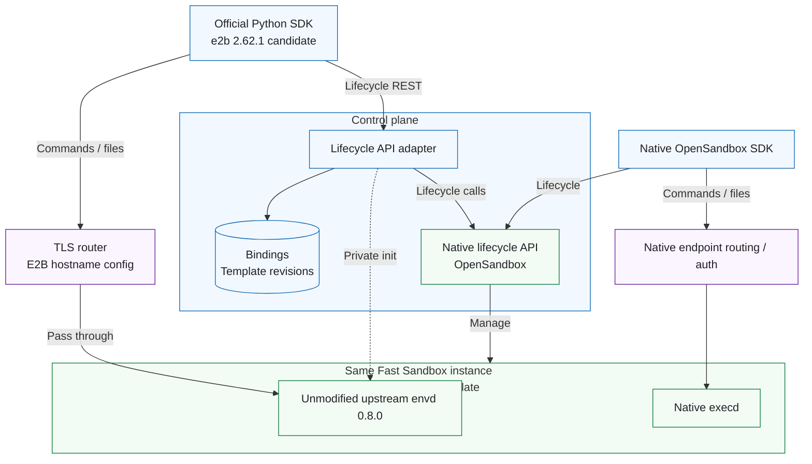
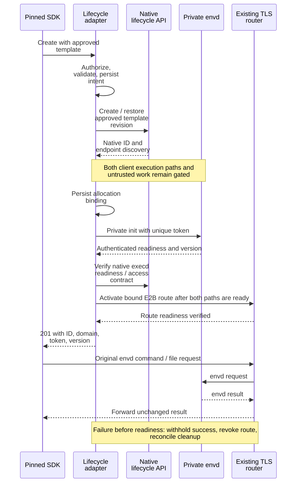
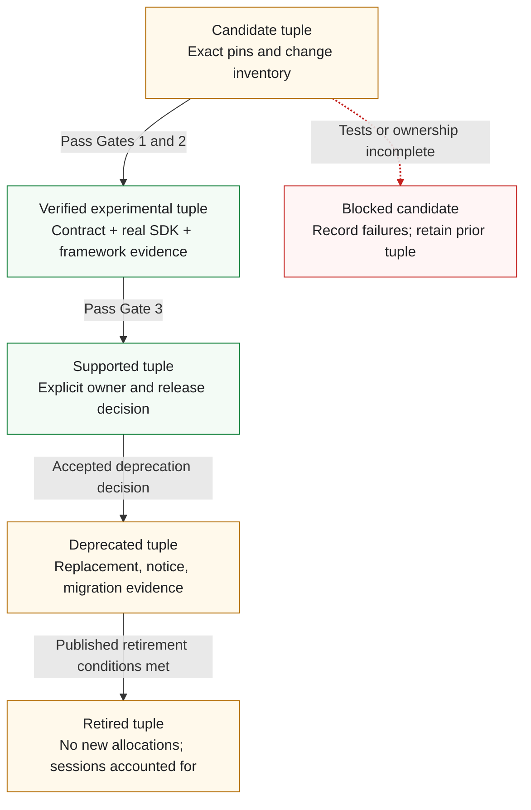

# OSEP-0026: Optional E2B Compatibility for Core Agent Workflows

<!-- toc -->
- [Summary](#summary)
- [Motivation](#motivation)
  - [Goals](#goals)
  - [Non-Goals](#non-goals)
- [Requirements](#requirements)
- [Proposal](#proposal)
  - [Notes/Constraints/Caveats](#notesconstraintscaveats)
  - [Risks and Mitigations](#risks-and-mitigations)
- [Design Details](#design-details)
  - [Initial Version and Capability Profile](#initial-version-and-capability-profile)
  - [Control Plane and Resource Identity](#control-plane-and-resource-identity)
  - [Upstream envd Packaging and Readiness](#upstream-envd-packaging-and-readiness)
  - [Routing and Security](#routing-and-security)
  - [Errors and Operational Behavior](#errors-and-operational-behavior)
  - [Delivery Gates and Community Work](#delivery-gates-and-community-work)
- [Test Plan](#test-plan)
- [Drawbacks](#drawbacks)
- [Alternatives](#alternatives)
- [Infrastructure Needed](#infrastructure-needed)
- [Upgrade & Migration Strategy](#upgrade--migration-strategy)
- [References](#references)
<!-- /toc -->

## Summary

This proposal adds an optional control-plane API adapter so selected applications can use an unmodified E2B SDK with OpenSandbox. The adapter translates sandbox lifecycle operations; an opt-in sandbox runtime runs a pinned, unmodified upstream envd for command and file operations, with no envd-to-execd protocol translation. The first candidate is Python `e2b==2.62.1` with envd `0.8.0` on Linux/amd64 Fast Sandbox using approved prebuilt templates that retain native execd alongside envd; this documentation proposal does not establish tested compatibility, implementation ownership, or a release commitment.

## Motivation

Applications using E2B SDKs can require substantial integration work to adopt a different sandbox backend. A shared compatibility component could reduce repeated adapters and make a small set of common workflows reusable across deployments.

[Issue #800](https://github.com/opensandbox-group/OpenSandbox/issues/800) raised this request. The [maintainer response](https://github.com/opensandbox-group/OpenSandbox/issues/800#issuecomment-4394440123) declined direct core API compatibility because of abstraction differences, maintenance costs, and misleading equivalence. A later [community report](https://github.com/opensandbox-group/OpenSandbox/issues/800#issuecomment-5474176640) described a standalone sidecar PoC; its reported results are useful prior art, not independently verified acceptance evidence for this proposal.

This OSEP narrows the question to an optional, tested compatibility surface with explicit limits. Permission to discuss this direction does not establish design approval, implementation ownership, or ongoing support. E2B is an external product API and SDK ecosystem, not an OpenSandbox-owned interoperability standard.

### Goals

1. Demonstrate at least one agreed agent workflow using an unmodified, pinned official E2B SDK against OpenSandbox, with only documented endpoint, credential, and template configuration changes.
2. Define a minimum base-SDK profile covering creation, connection to a running sandbox, inspection, listing, timeout changes, command execution, file transfer, and deletion. Include every additional operation required by the selected workflow before declaring that integration supported.
3. Preserve observable behavior for advertised operations, including errors, authorization, streaming completion, timeouts, and resource cleanup.
4. Publish a compatibility matrix and executable tests that distinguish supported behavior, explicit limitations, unsupported operations, and untested combinations.
5. Provide independent work items for community contributors without making the native server, SDKs, or every runtime depend on the compatibility component.

### Non-Goals

- Full E2B API, SDK, CLI, cloud service, or future-version parity; a claim that all E2B integrations work unchanged.
- Replacing or renaming OpenSandbox's public APIs, or changing native defaults to match E2B.
- Adding E2B protocol handlers to execd, translating envd command/file protocols, or forking envd to emulate missing behavior. Native execd remains unchanged.
- Initial support for JavaScript, the asynchronous Python client, or code-interpreter SDK packages. envd alone does not provide the separate Jupyter code-execution service used by `run_code`/`runCode`.
- E2B account management, billing, template build API compatibility, hosted domains, or cloud infrastructure provisioning. Templates are prepared through existing OpenSandbox/Fast Sandbox tooling.
- Initial compatibility for ordinary Pod-per-sandbox or standalone Docker backends, including the Pod init-container/shared-volume delivery path; envd-only templates. Kubernetes remains the infrastructure underneath Fast Sandbox.
- Equating container images with E2B templates, or root filesystem snapshots with E2B process/memory snapshots.
- Initial support for pause/resume, auto-pause, fork, volume management, PTY, filesystem watchers, arbitrary public port exposure, or cloud identity features. A workflow requiring one of these is blocked until that feature is separately designed and tested; it is not silently approximated.
- Promising every runtime, language, SDK release, image, or operating system. Unvalidated combinations remain unsupported.

## Requirements

| ID | Requirement |
|---|---|
| R1 | Compatibility is opt-in and separately addressable; disabling it leaves native OpenSandbox APIs usable without an E2B dependency. |
| R2 | Each advertised profile pins the SDK packages, relevant protocol sources, OpenSandbox version, runtime, image/template and any injected-payload digest, transport configuration, and operation-level tests. No version is supported solely because its source was inspected. |
| R3 | The actual official SDK and a selected real framework workflow must pass against a real OpenSandbox backend before that integration is advertised. Mock or direct HTTP tests alone are insufficient. |
| R4 | Accepted inputs retain their documented semantics. Unsupported control-plane operations and non-default options fail explicitly before side effects; no ignored security policy, fabricated metadata, or success-shaped fallback. |
| R5 | Authentication and resource authorization apply to both planes. Routing identifiers never confer access, and native backend credentials never reach clients or sandbox workloads. |
| R6 | Existing OpenSandbox policy and isolation constraints remain effective. Compatibility cannot grant broader images, resources, filesystem identity, network access, or sandbox visibility. |
| R7 | Resource mapping survives adapter restarts; create failures, deletion, expiry, and ambiguous upstream outcomes have bounded reconciliation and cleanup behavior. |
| R8 | Native regression checks and the published compatibility test matrix are release gates for the affected component. Support expansion requires evidence and an explicitly accepted maintainer for that work. |

## Proposal

Use a separately deployable control-plane adapter on its own API origin. It authenticates E2B lifecycle requests, translates the supported subset to native OpenSandbox lifecycle APIs, and tracks resource identity and readiness. No E2B routes are added to the native server.

Use Fast Sandbox as the single initial acceptance backend. Map approved E2B-facing template IDs or aliases to existing, ready OpenSandbox templates with immutable artifacts. Bake the pinned upstream envd executable and startup wiring into the template alongside native execd. Native OpenSandbox SDKs retain the native lifecycle API and execd command/file path; E2B SDKs use the adapter for lifecycle and envd for command/file traffic through configured TLS routing. Each path retains its own protocol, routing, and authentication contract, with no translation or implicit fallback between daemons. Packaging, private per-instance initialization after restore, endpoint discovery, and ingress configuration remain integration work to validate.

Blue denotes client/control state, green backend execution, and purple the routing boundary. Solid arrows show lifecycle or client traffic; the dashed arrow is private setup traffic. This is a proposed topology, not a deployed result. Both SDK paths reach the same sandbox without protocol changes. Their session/process identifiers and daemon-local defaults are not interchangeable; the native resource remains authoritative for lifetime.

### Notes/Constraints/Caveats

- The OSEP remains `draft`. Selecting this architecture and initial version candidate does not imply that the candidate passes its acceptance tests.
- Compatibility claims must name the tested profile. No complete E2B parity, universal framework support, forward compatibility, delivery date, or SLA is promised.
- The first runtime target is Linux/amd64 Fast Sandbox with approved prebuilt templates, backed by Kubernetes. Ordinary Pod-per-sandbox and other runtime compatibility need separate scope, evidence, and ownership; native runtime support is unaffected. Docker may assist development but cannot substitute for Fast Sandbox acceptance.
- The first real framework scenario remains a Gate 0 selection with interested contributors. A scenario requiring code interpreter, pause/resume, or another excluded feature cannot be used to advertise this base-SDK profile as sufficient.
- Placement, implementation language, storage technology, and release ownership remain review decisions. The adapter is optional software, not a proposed official hosted service.

### Risks and Mitigations

| Risk | Mitigation |
|---|---|
| SDK/envd source pins are mistaken for a supported combination | Label them candidate until the locked SDK, image, backend, and workflow pass together. |
| envd starts or resumes with an uninitialized or cloned authentication state | Keep client execution through both paths and untrusted template work gated until per-instance initialization and authenticated readiness succeed; validate restore/restart isolation. |
| Correct envd protocols still fail behind a proxy | Test actual SDK addressing, TLS, streaming, headers, and file bytes through the documented routing configuration. |
| Lifecycle translation changes resource or security semantics | Validate supported defaults/options and real backend state; reject unsupported requests before allocation. |
| Retries or outages leak sandboxes | Persist allocation intent/bindings, reconcile ambiguous outcomes, and disable unsafe automatic retries. |
| Upstream evolution creates unlimited maintenance work | Maintain explicit version tuples, require owners and evidence for upgrades, and publish deprecation/retirement decisions. |

## Design Details

### Initial Version and Capability Profile

The initial proposed tuple is concrete but **unvalidated**. It is a starting point for the experiment, not a claim that these releases were tested together.

| Dimension | Initial candidate | Evidence still required |
|---|---|---|
| Official client | Python synchronous `e2b==2.62.1`, source `9301cd84757b0e3f3fccbd349e85ff2bd403a1f4` | Lock transitive dependencies and Python version; run actual SDK calls without forks or monkeypatches. |
| Sandbox daemon | envd `0.8.0`, from official runtime release `2026.30`, source `f32ee8a2a50052f32e3632ceb451111a98dd5104` | Pin binary provenance/checksum and immutable image or injected-payload digest; verify the running version. |
| Backend | OpenSandbox inspected baseline `fab314287bded086a5f76b2735935c7f484a0332`; Fast Sandbox inspected baseline `f44561ad111e6a94ae00e5923fce307317dba17d`; Linux/amd64 MicroVMs on Kubernetes | Pin server, Fast Sandbox, Firecracker/guest kernel, native execd, and template artifacts. Select one template storage/restore recipe at Gate 0 and record the actual deployment. |
| Client transport | Documented custom domain/API configuration; explicitly set `E2B_HTTP_VERSION=1.1` for this profile because the pinned SDK defaults to HTTP/2 | Prove both lifecycle and sandbox hosts, TLS, and proxy behavior; debug mode is not an acceptance configuration. |
| Framework | One base-SDK scenario, to be agreed at Gate 0 | Exact framework/version/configuration and complete call inventory; none is claimed supported yet. |
| Status | Candidate only | Gates 1–3 determine feasibility, experimental evidence, and any supported release. |

The [released Python package source](https://github.com/e2b-dev/E2B/blob/9301cd84757b0e3f3fccbd349e85ff2bd403a1f4/packages/python-sdk/pyproject.toml) declares `2.62.1`. The [envd version source](https://github.com/e2b-dev/runtime/blob/f32ee8a2a50052f32e3632ceb451111a98dd5104/packages/envd/pkg/version.go) declares `0.8.0`; `2026.30` is the runtime repository's release tag, not envd's protocol version. These independent release numbers do not establish interoperability.

| Surface | Initial acceptance target | Boundary |
|---|---|---|
| Lifecycle | Create, connect to a running sandbox, get info, list, set timeout, kill | Exact supported defaults, filters, pagination, error behavior, and repeated-delete behavior are fixtures. No resume of paused sandboxes. |
| Commands via envd | Foreground commands, stdout/stderr, exit status, command timeout | Test approved users, environment, working directory, disconnect behavior, and resource bounds. |
| Files via envd | Read/write and binary upload/download | Test paths, overwrite, permissions, missing files, and size limits. |
| Template configuration | Approved E2B ID/alias → ready native template and immutable artifact revision, execd/envd startup, resource limits, allowed identity/network settings | Reject unknown, unready, or profile-incompatible mappings before allocation. No E2B template build service; alias updates affect only future creates. |
| Other envd capabilities | Outside the initial tested/advertised matrix | The original daemon may expose more methods. A support boundary is not an access-control filter; do not claim that untested PTY/watch/background methods are removed. |
| Code interpreter and other SDKs | Deferred | The code-interpreter client uses a separate Jupyter service and API. Adding it needs its own image, pins, tests, and accepted scope; no mapping to execd is proposed. |

The support matrix describes tested behavior, not a new envd implementation. Deployments needing to prohibit particular envd capabilities must establish an enforceable policy before adopting this runtime recipe. Failure to enforce a required policy blocks that deployment; it is not solved by silently changing envd or execd.

### Control Plane and Resource Identity

The pinned [SDK lifecycle implementation](https://github.com/e2b-dev/E2B/blob/9301cd84757b0e3f3fccbd349e85ff2bd403a1f4/packages/python-sdk/e2b/sandbox_sync/sandbox_api.py) and its generated models define the client-facing contract. The native [lifecycle contract](https://github.com/opensandbox-group/OpenSandbox/blob/fab314287bded086a5f76b2735935c7f484a0332/specs/sandbox-lifecycle.yml) defines backend calls under `/v1`. E2B `/v2` routes are not the native API base. The pinned client mixes `/v2` and non-`/v2` paths, as shown below.

| Pinned E2B client request | Native operation under `/v1` | Adapter responsibility |
|---|---|---|
| `POST /v2/sandboxes` | `POST /sandboxes` | Resolve an approved template, validate options/resources, allocate, privately initialize envd, and publish a usable route before returning `201`. |
| `POST /v2/sandboxes/{id}/connect` | Get sandbox; conditionally renew expiration | Return `200` only for a usable running sandbox in scope. An omitted timeout defaults to 300 seconds; extend TTL only when the requested/default duration exceeds remaining lifetime, never shorten it. Do not fabricate the `201` resumed-sandbox result. |
| `GET /sandboxes/{id}` | `GET /sandboxes/{sandboxId}` | Combine authoritative native state with owned template/identity metadata; preserve the pinned info schema. |
| `GET /v2/sandboxes` | List/reconcile native state and owned bindings | Return only owned resources in the pinned list shape, with tested filters, ordering, and pagination. |
| `POST /sandboxes/{id}/timeout` | `POST /sandboxes/{sandboxId}/renew-expiration` | Convert duration to expiration and enforce finite limits, units, shortening/extension semantics, and policy. |
| `DELETE /sandboxes/{id}` | `DELETE /sandboxes/{sandboxId}` | Revoke the public route, request deletion, preserve SDK-visible deletion semantics, and reconcile asynchronous backend cleanup. |

Create/connect responses must use the actual pinned models, including `sandboxID`, `templateID`, `clientID`, `envdVersion`, `envdAccessToken`, and the configured `domain` where needed. IDs represent real adapter-owned identities; version fields describe the running daemon, never a fabricated high version to bypass SDK feature checks. Return the initialized `envdAccessToken` for this authenticated profile. Supply the separate optional `trafficAccessToken` only if the chosen deployment implements its proxy-access semantics.

Maintain a durable binding between authenticated scope, E2B-facing ID, native sandbox ID, template revision/image digest and any injected-payload digest, version tuple, expiration, and readiness/cleanup state. Protect any stored per-sandbox token material. Native state is authoritative for existence and lifetime; a persisted binding alone cannot establish that a sandbox is running. TTL-stopping/terminated, failed, and paused resources cannot be returned as usable running sessions. Initially expose only adapter-created, durably registered instances through the E2B path, not arbitrary native sandboxes. Reconcile deletion, expiry, and timeout changes initiated through either SDK or native administration, including route revocation and existing-stream cleanup; mutations that bypass the adapter must not leave a stale E2B session usable.

Template identity does not establish parameter equivalence. The inspected [native template-mode validation](https://github.com/opensandbox-group/OpenSandbox/blob/fab314287bded086a5f76b2735935c7f484a0332/server/opensandbox_server/api/schema.py#L1091-L1139) rejects workload-shaping overrides such as `env`, `entrypoint`, `resourceLimits`, `resourceRequests`, and `volumes`, and does not allow enabling `secureAccess` in that request. The contract inventory must specify an approved mapping or explicit rejection for each E2B option before allocation. Setting accepted E2B user/environment defaults through private envd initialization must be tested against SDK semantics; it does not change execd or every process in the template. Define UID/GID, cwd, permissions, and shared-file behavior without promising shared daemon sessions or process IDs.

Inventory defaults as well as explicit options. In particular, the pinned v2 client includes memory-related defaults for auto-pause/connect; accepting an irrelevant default for a running-only operation does not provide snapshot support. Reject requests that actually require pause/resume, memory restore, volumes, cloud identity, or unmapped network policy before side effects. The first contract inventory must distinguish these cases and define list filters over the supported resource set.

The initial profile excludes caller-supplied `Idempotency-Key`: reject it explicitly before allocation. The [pinned SDK](https://github.com/e2b-dev/E2B/blob/9301cd84757b0e3f3fccbd349e85ff2bd403a1f4/packages/python-sdk/e2b/retry.py) omits the key when none is supplied. Require SDK lifecycle `retries=0` and `E2B_CONNECTION_RETRIES=0` for the first profile: response retries and connection retries are separate SDK settings. Disable proxy retries for mutating requests. If an allocation outcome is ambiguous, return a non-retryable result (`Should-Retry: false` where a response can be delivered), reconcile recorded intent against backend allocations, and never blindly create again. No native exactly-once guarantee is assumed. Gate 1 must specify persistence/concurrency control, allocation correlation, restart recovery, and a bounded orphan cleanup policy before implementation proceeds.

### Upstream envd Packaging and Readiness

Package the pinned upstream executable without protocol changes in an approved Fast Sandbox template that also retains execd. Record binary provenance, licenses/dependencies, immutable template artifact, process supervisor, approved user, writable paths, resource limits, and startup recipe. A ready native template is necessary but does not establish envd readiness or E2B compatibility. An envd-only profile can be considered separately after native build, startup, health-check, and management flows have been demonstrated without execd.

Fast Sandbox's [template converter](https://github.com/opensandbox-group/fast-sandbox/blob/f44561ad111e6a94ae00e5923fce307317dba17d/cmd/sandboxtemplate-builder/convert.go#L332-L413) copies execd runtime files into the guest rootfs, renders startup configuration, and uses an execd readiness probe by default. Reuse the build-stage approach to include envd through the source image and startup recipe or a separately reviewed builder extension; the inspected builder does not already provide envd-specific integration. Preserve execd's native integration and verify envd separately. Supervise both daemons and test each daemon's failure, restart, termination, and resource cleanup without silently falling back to the other protocol.

A golden rootfs or memory snapshot must not contain live per-sandbox envd credentials or tenant sessions. Restore can resume existing processes without rerunning guest init. Gate 1 must demonstrate trusted, isolated per-instance initialization after allocation/restore and before untrusted execution or client exposure, rather than assuming a fresh boot. Infrastructure use of a golden snapshot does not add E2B pause/resume support.

Gate 1 must establish the envd startup flags, cgroup behavior, and MMDS handling for the actual Fast Sandbox guest. Upstream envd provides `-isnotfc` for non-Firecracker execution and `-no-cgroups` to disable its cgroup management; neither a Docker recipe nor the presence of Firecracker proves that upstream E2B-specific MMDS behavior matches this backend. Test the selected configuration, including localhost forwarding and post-init polling; outer runtime resource enforcement remains mandatory. Do not inherit upstream debug privileges or assume unsupported flags fix integration gaps.

The pinned envd implementation permits first initialization when no token/MMDS identity is configured. Therefore, the adapter's trusted setup path must initialize a unique per-sandbox token and approved user/environment before exposing client execution through either daemon or starting untrusted application work. Keeping only the public envd route closed is insufficient: a client using execd, or an untrusted process already running in the template, must not be able to race the first `POST /init`. The startup barrier must cover those paths as well as direct/peer access. Verify initialized, authenticated readiness and the reported `X-Envd-Version`; a listening port or unauthenticated health check alone is insufficient. Keep management operations such as `POST /init`, `POST /upgrade`, and freeze inaccessible through the public client route on envd's service port (default `49983`).

The sequence is the acceptance order, not a claim that a startup barrier or a particular router management API already exists. A route may be preconfigured if it remains inaccessible until readiness. A daemon restart that loses token initialization must not reopen an unauthenticated service: revoke affected access and prevent untrusted local initialization races until trusted reinitialization is verified, or terminate/recreate the sandbox. If the deployment cannot guarantee this ordering and isolation, it does not pass Gate 1.

### Routing and Security

The SDK's default custom-domain sandbox address is `<port>-<sandbox-id>.<domain>`. Setting an API base URL alone does not provide that sandbox route. The inspected [Fast Sandbox endpoint implementation](https://github.com/opensandbox-group/OpenSandbox/blob/fab314287bded086a5f76b2735935c7f484a0332/server/opensandbox_server/services/fast_sandbox/endpoint.py#L35-L92) requires an ingress gateway with header or URI routing and a signing key; it does not provide the generic native hostname recipe as an interchangeable route. Configure an existing L7 proxy to map the E2B hostname to the authorized endpoint returned by the native API, preserving envd paths, bodies, streaming, and errors. No command/file protocol translation belongs in that proxy or adapter.

- Resolve endpoints through native `GET /sandboxes/{sandboxId}/endpoints/{port}` and validated bindings. Honor the returned endpoint URI and required access/routing headers. The inspected Fast Sandbox path rejects the `expires` parameter; do not invent a per-endpoint expiry guarantee. Define credential refresh and route revocation using the actual backend contract and authoritative sandbox lifetime.
- Pin and test DNS, TLS, HTTP transport, and proxy configuration. The inspected native ingress accepts HTTP/1.1; do not assume it can terminate client TLS or HTTP/2. Use supported SDK configuration and an external TLS endpoint as needed.
- Bind host, sandbox ID, port, and routing headers, including the SDK's `E2b-Sandbox-Id` and `E2b-Sandbox-Port`, to one resource. Reject conflicting selectors, strip untrusted native routing headers, and never accept arbitrary upstream URLs. Expose only required service ports; arbitrary application port URLs are outside this profile.
- Use the original envd authentication contract, including `X-Access-Token` and applicable signed file access. Control-plane API keys, envd tokens, and native endpoint access headers are distinct; do not leak native server credentials into sandbox workloads or clients.
- Keep bootstrap/management endpoints private and direct backend ingress blocked. Upstream envd also forwards localhost listeners to the sandbox interface; restricting public routes alone is insufficient. Gate 1 must verify sandbox network isolation prevents peers from reaching envd or forwarded ports, including during initialization. Test that envd forwarding cannot expose execd or management ports through an unintended route. Preserve the native path's actual routing/authentication contract; do not assume every deployment uses a daemon-local execd token. A signed native ingress route does not replace envd authentication. Route revocation on kill/expiry must stop new access and define termination of existing streams; envd credentials alone must not permit bypass.
- Initially constrain a deployment to one explicitly trusted administrative scope unless independent authorization for mutually untrusted users is designed and tested. An OpenSandbox server key does not prove per-user tenancy. Even within one scope, one sandbox's token must not authorize another sandbox.
- Preserve native image/resource/network policy. If an existing router cannot enforce the required routing and isolation contract, the deployment remains blocked pending an explicit scope decision; an execd bridge is not a fallback.

### Errors and Operational Behavior

The adapter owns lifecycle status/body mappings, pagination tokens, and SDK exception behavior. envd owns command/file results and protocol errors; routing must pass those through. Unsupported control-plane requests fail before side effects with errors the pinned SDK handles explicitly. Do not replace native failures with success-shaped responses or expose infrastructure secrets.

Keep sandbox lifetime, command timeout, client request timeout, and proxy stream idle timeout distinct. Verify nonzero exits, transport failures, and expiry through the real SDK. Configure bounded buffering and stream cleanup, and never replay commands transparently after they may have executed. Data-plane conformance tests exercise original envd through the deployment, not new protocol handlers.

Record version tuple, operation, result class, latency, and safe correlation IDs. Bound metric cardinality and exclude API keys, access tokens, command/file contents, and arbitrary environment/metadata by default. Adapter readiness depends on required backend/storage access; its shutdown policy must account for live bindings and cleanup without disabling native APIs.

### Delivery Gates and Community Work

| Gate | Deliverable | Exit condition |
|---|---|---|
| 0 — Target agreement | Confirm Fast Sandbox and approved prebuilt templates, choose one storage/restore recipe and base-SDK framework scenario, lock pins/options, and define resource/stream limits | Maintainer confirmation and explicit contributor opt-in recorded in this PR or a tracking issue. If pins or scope change, update the candidate and rationale visibly. |
| 1 — Control-plane and packaging feasibility | Lifecycle adapter spike, original envd packaging, persistence/recovery design, private bootstrap, routing configuration, and dependency review | Real pinned E2B SDK passes template create/restore → command → binary file round trip → delete on Fast Sandbox; the native SDK accesses that same instance through execd. Demonstrate both readiness/authentication contracts, lifecycle defaults, per-instance restore initialization, failure cleanup, and restart isolation. No data-plane bridge. Resolve design gaps before OSEP status becomes `implementable`. |
| 2 — Experimental implementation | Reviewable PRs, contract fixtures, runtime/security tests, deployment example, and framework evidence | T1–T7 pass for the complete candidate tuple; publish exact artifacts, limitations, and an experimental label. |
| 3 — Supported release decision | Version matrix, retained upgrade/rollback artifacts, accepted owners and deprecation policy | Maintainers explicitly accept the advertised scope and maintenance responsibilities. Passing Gate 2 does not automatically establish support or an SLA. |

Community work can split into control-plane contracts/translation; durable bindings and reconciliation; envd packaging/bootstrap and routing configuration; and real SDK/framework tests plus version-matrix maintenance. Each work item records its dependencies, accepting reviewer, and evidence. There is no envd-to-execd workstream. Contributors opt in; nobody is assigned indefinite ownership by this proposal.

The proposal author can coordinate discussion and the initial contract inventory. Implementation schedules, review capacity, and release responsibility are accepted separately. Invite the existing PoC contributor to share reusable lifecycle code, image configuration, and tests with attribution/license review; access to that implementation is not assumed.

## Test Plan

These are future implementation acceptance criteria, not results of this documentation PR.

| ID | Evidence required |
|---|---|
| T1 — Control-plane contract | Pinned v2 create/connect/list and other lifecycle fixtures; required response fields; defaults/options; filtering/pagination; units; SDK exception behavior; unsupported options and idempotency keys rejected before allocation. |
| T2 — Real SDK lifecycle | Create/readiness, running reconnect with explicit/omitted timeout and extension-only TTL, info/list, explicit timeout shortening/extension, expiry, kill/repeated kill, missing sandbox, invalid credentials, and retry suppression against the real backend. |
| T3 — Unmodified envd integration | Pinned original daemon through the real TLS/router path: interleaved stdout/stderr, nonzero exit, timeout/disconnect, text/binary files, overwrite, missing paths, permissions, and configured bounds. Record binary/image or injected-payload provenance and running version; test Fast Sandbox template build/restore initialization and both daemons' independent readiness. Docker-only results do not satisfy this gate. |
| T4 — Authorization/bootstrap | Two instances restored from the same approved template in parallel, with no shared live credentials or tenant sessions; wrong/missing tokens, signed file access, forged/conflicting selectors, forbidden ports, public init/upgrade attempts, direct-backend bypass, and cold-start/restore/restart races, including attempts through execd before envd initialization and forwarded management-port access. Test two independent user scopes only if that tenancy mode is proposed. |
| T5 — Recovery | Adapter/storage/backend failures, lost create responses, partial allocation, concurrent timeout/delete, expiry, route revocation and existing-stream termination, mutations through native and E2B SDKs, independent execd/envd failures or restarts, and cleanup bounds. No blind replay or unauthenticated restart window. |
| T6 — Framework integration | One pinned real base-SDK framework scenario through its normal integration, with the complete call path and documented configuration. No SDK fork/monkeypatch. Additional required services or framework changes block a configuration-only claim until separately accepted. |
| T7 — Native regression and evolution | Both SDKs target the same adapter-created sandbox: execute commands and exchange binary files in both directions, with explicit user/cwd/env/permission semantics and independent auth. Native clients work with the adapter enabled/stopped; exact artifact/configuration matrix matches tests; candidate upgrade and rollback preserve existing bindings or drain them according to policy; unsupported tuples remain unadvertised. |

Contract fixtures can run on each adapter change. Real SDK/envd/backend tests are required for every advertised tuple before release; lifecycle-only success cannot validate command/file integration. Test outcomes should distinguish passed, failed, and untested. Performance evidence reports the setup and observed overhead without inventing an SLA.

## Drawbacks

The control-plane adapter still needs storage, authentication, cleanup, routing, and operational ownership. Shipping original envd avoids a second protocol implementation but adds an upstream binary, image dependencies, and a security/update lifecycle. A restricted matrix can exclude popular frameworks, particularly those requiring code interpreter or snapshots. Native framework integrations may remain a better use of available maintainers.

## Alternatives

1. **Native OpenSandbox integration per framework.** Keeps native semantics and may be simplest for a few frameworks, but does not reuse an existing official E2B SDK unchanged.
2. **E2B-style SDK wrapper.** A possible migration helper, but it does not meet the unmodified official SDK goal.
3. **E2B lifecycle routes in the core server.** Avoids a separate service while coupling native API/security releases to an external contract. A separate optional adapter is preferred initially.
4. **envd-to-execd protocol bridge.** Not selected. It duplicates command/file protocol behavior and expands long-term maintenance. Reusing upstream envd keeps that responsibility upstream; any future reconsideration requires a separate scope decision.
5. **Migration documentation only.** A valid outcome if the candidate cannot meet its gates within an accepted maintenance scope.

## Infrastructure Needed

A disposable Linux/amd64 KVM-capable Fast Sandbox environment on Kubernetes, pinned server/Fast Sandbox/guest artifacts, an approved prebuilt template containing execd and envd, locked SDK/framework dependencies, protected state storage, and controlled DNS/TLS routing are needed for the experiment. Gate 0 selects one storage/restore recipe; Gate 1 validates packaging, storage, and CI resources. Local Docker checks are development aids only. No production deployment, public service, cloud account, or recurring budget is authorized by this OSEP.

Maintained usage documentation belongs under `docs/guides/`, architecture under `docs/architecture/`, and runnable examples under `examples/`. The OSEP is the design record; released artifacts must carry their own maintained compatibility matrix and executable tests. Any necessary native public contract change needs separate aligned spec/server/SDK review.

## Upgrade & Migration Strategy

Native deployments need no migration. Compatibility is opt-in through an adapter version and approved template mapping. Existing E2B cloud sandboxes, templates, snapshots, and data are not imported. The SDK's deprecated `api_url`/`sandbox_url` overrides must be recorded if used; prefer a tested custom-domain configuration and do not promise that future SDKs retain those overrides.

Maintain **version tuples**, not broad claims such as “E2B v2 supported.” Each entry records adapter revision, SDK/package lock, envd source/binary version, image/template and any injected-payload digest, OpenSandbox revision, runtime/transport configuration, tested operations/workflow, evidence, limitations, and accepted release owner. The initial tuple above is candidate; source inspection alone cannot promote it.

Orange denotes pending/change-policy states, green evidence/acceptance gates, and red a blocked candidate. These labels describe the proposed lifecycle; the initial tuple has not passed verification.

For an upgrade, a contributor reviews upstream SDK control-plane changes, envd release/security changes, and dependencies, then proposes an exact new tuple with contract diffs and migration notes. CI retains tests for advertised tuples and evaluates the candidate alongside them; it does not promise every SDK/envd cross-product. New SDK languages or code-interpreter packages are separate profile expansions. Failed candidates leave the prior approved tuple unchanged.

Use immutable images, injected payloads, and template revisions. Existing sandboxes keep their recorded envd/image/payload tuple; do not hot-upgrade envd or change its reported version in place. Roll out a verified tuple to new disposable allocations before changing the default alias. Adapter upgrades must preserve response/routing behavior for retained live tuples, or require an explicit drain before deployment.

Before a supported release, record who owns control-plane contract changes, image/envd updates, test infrastructure, and release approval, plus the deprecation notice mechanism and retention/removal conditions. No fixed support window or indefinite upstream tracking is promised here. Security-driven exceptions must document affected tuples, stop-new-allocation/drain or termination policy, and operator action; they must not silently change running sessions.

Rollback restores the previous adapter/image/template artifacts only with compatible storage/binding state. Stop new allocations first if necessary, retain an inventory of live resources, and preserve routes and tokens for retained sessions or explicitly drain/terminate them. Test schema rollback/migration and cleanup before support claims. Disabling the adapter does not migrate clients back to E2B and must leave native API access available for administration.

## References

- [Issue #800: E2B interface compatibility request](https://github.com/opensandbox-group/OpenSandbox/issues/800), including the maintainer decision and subsequent community PoC report.
- [OpenSandbox lifecycle API at the proposal's inspected baseline](https://github.com/opensandbox-group/OpenSandbox/blob/fab314287bded086a5f76b2735935c7f484a0332/specs/sandbox-lifecycle.yml).
- [OpenSandbox ingress routing at the inspected baseline](https://github.com/opensandbox-group/OpenSandbox/blob/fab314287bded086a5f76b2735935c7f484a0332/docs/architecture/network/ingress.md).
- [Official E2B Python SDK connection configuration](https://github.com/e2b-dev/E2B/blob/9301cd84757b0e3f3fccbd349e85ff2bd403a1f4/packages/python-sdk/e2b/connection_config.py) and [sandbox implementation](https://github.com/e2b-dev/E2B/blob/9301cd84757b0e3f3fccbd349e85ff2bd403a1f4/packages/python-sdk/e2b/sandbox_sync/main.py).
- [Upstream runtime release 2026.30](https://github.com/e2b-dev/runtime/releases/tag/2026.30), [envd startup flags](https://github.com/e2b-dev/runtime/blob/f32ee8a2a50052f32e3632ceb451111a98dd5104/packages/envd/main.go), [initialization](https://github.com/e2b-dev/runtime/blob/f32ee8a2a50052f32e3632ceb451111a98dd5104/packages/envd/internal/api/init.go), and [authentication](https://github.com/e2b-dev/runtime/blob/f32ee8a2a50052f32e3632ceb451111a98dd5104/packages/envd/internal/api/auth.go).
- [Fast Sandbox template runtime injection](https://github.com/opensandbox-group/fast-sandbox/blob/f44561ad111e6a94ae00e5923fce307317dba17d/cmd/sandboxtemplate-builder/convert.go) and [OpenSandbox template model](https://github.com/opensandbox-group/OpenSandbox/blob/fab314287bded086a5f76b2735935c7f484a0332/docs/architecture/fast-sandbox/templates.md): packaging and lifecycle references, not compatibility test evidence.
- PR #2591 feedback on [Fast Sandbox scope](https://github.com/opensandbox-group/OpenSandbox/pull/2591#issuecomment-6651076592) and [retaining both SDK paths](https://github.com/opensandbox-group/OpenSandbox/pull/2591#issuecomment-6651266417).
- [Separate code-interpreter service calls](https://github.com/e2b-dev/E2B/blob/9301cd84757b0e3f3fccbd349e85ff2bd403a1f4/packages/code-interpreter-python/e2b_code_interpreter/code_interpreter_sync.py).

The source revisions were inspected to define the candidate and protocol boundaries. Runtime interoperability, image/route security, and framework acceptance remain to be demonstrated; this PR contains no such execution evidence.
