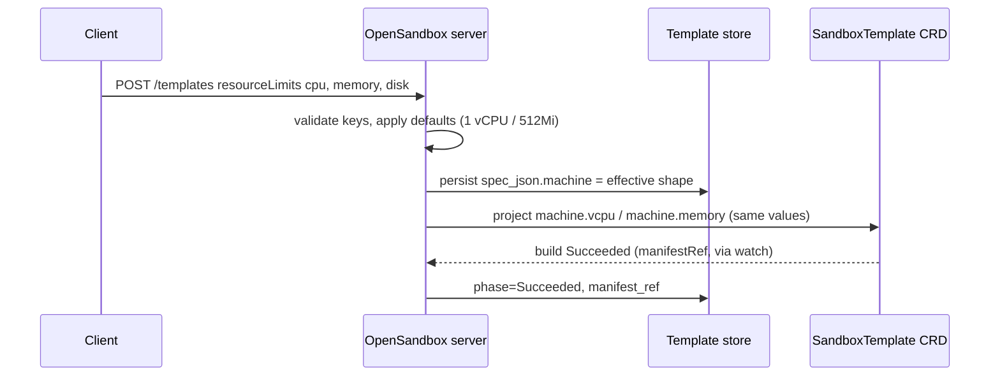
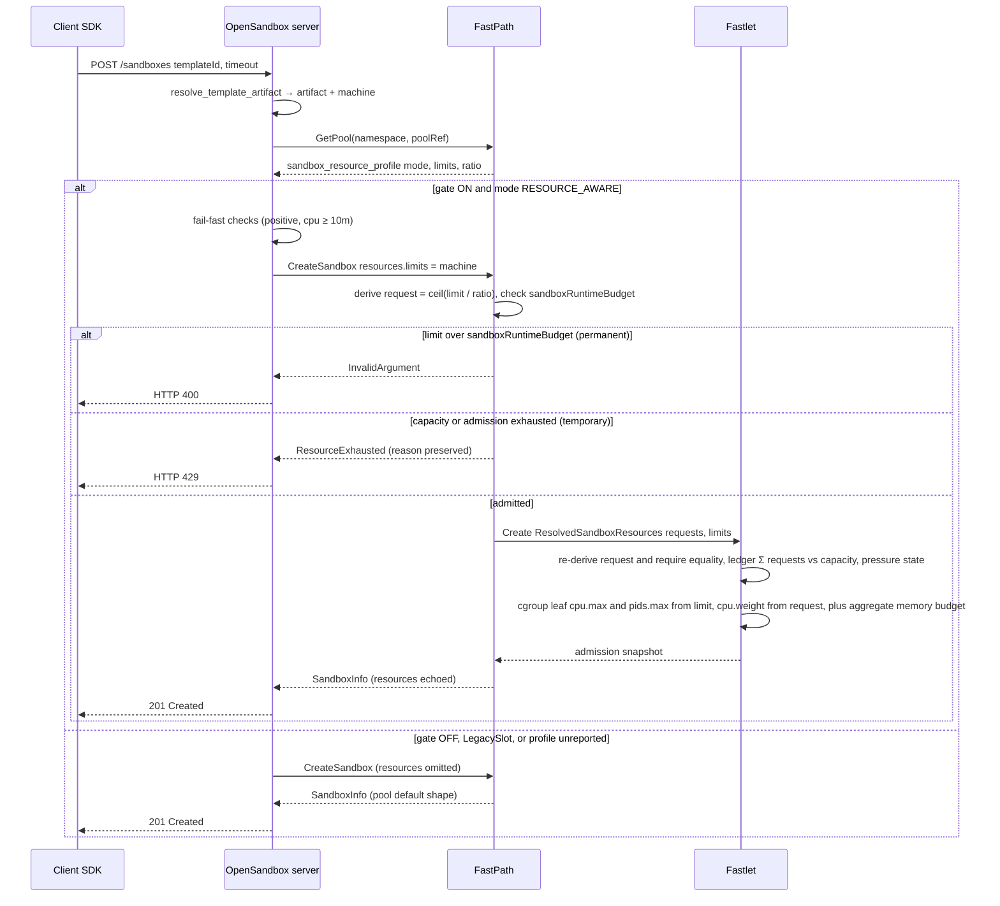

# OSEP-0026: Resource Oversubscription Accounting for Fast Sandbox

<!-- toc -->
- [Summary](#summary)
- [Motivation](#motivation)
  - [Goals](#goals)
  - [Non-Goals](#non-goals)
- [Requirements](#requirements)
- [Proposal](#proposal)
  - [Flow diagrams](#flow-diagrams)
  - [Contract summary](#contract-summary)
  - [Notes/Constraints/Caveats](#notesconstraintscaveats)
  - [Risks and Mitigations](#risks-and-mitigations)
- [Design Details](#design-details)
  - [Responsibility boundaries](#responsibility-boundaries)
  - [Parameter flow specification](#parameter-flow-specification)
  - [Server-side changes](#server-side-changes)
  - [Units and guest machine derivation](#units-and-guest-machine-derivation)
  - [Idempotency and retries](#idempotency-and-retries)
  - [Compatibility matrix](#compatibility-matrix)
- [Test Plan](#test-plan)
- [Drawbacks](#drawbacks)
- [Alternatives](#alternatives)
- [Infrastructure Needed](#infrastructure-needed)
- [Upgrade & Migration Strategy](#upgrade--migration-strategy)
<!-- /toc -->

## Summary

fast-sandbox supports resource-aware oversubscription: `ResourceAware` pools declare per-sandbox limits plus overcommit ratios ([PR #122](https://github.com/opensandbox-group/fast-sandbox/pull/122)), FastPath accepts per-sandbox `resources.limits` on `CreateSandbox`, Fastlet keeps a heterogeneous request ledger with pressure-aware admission, and the Firecracker runtime enforces host cgroup budgets per sandbox ([PR #162](https://github.com/opensandbox-group/fast-sandbox/pull/162)). The OpenSandbox server passes none of it: image-mode `resourceLimits` are equality-checked against the pool profile and then dropped, and template-mode creates forward nothing resource-shaped, so every sandbox runs the pool default shape.

This OSEP defines an **internal contract between the OpenSandbox server and fast-sandbox FastPath** — no public OpenAPI or SDK changes. The server records the template's **effective machine shape (CPU, memory) at build time** in its template store and forwards it as `CreateSandboxRequest.resources.limits` when creating sandboxes from that template on a `ResourceAware` pool; snapshot restore replays the source sandbox's recorded limits through the same gate. Requests stay pool-owned: FastPath remains the single overcommit authority, deriving each sandbox's request from its limits via the pool ratios. This aligns admission accounting and host enforcement with the machine the golden image was built for — and makes templates whose machine exceeds the pool defaults creatable at all.

## Motivation

**The current resource contract is pool-fixed and lossy.** `create_mapping.py` rejects `resourceRequests` outright, and validates `resourceLimits` only for canonical equality against the pool profile before dropping both — with the stale rationale that "FastPath has no per-sandbox resource field". FastPath v2 has had that field (`CreateSandboxRequest.resources`, field 15) since PR #122; no fast-sandbox create from the server carries resources today.

**Template builds have a reference machine that accounting ignores.** A `SandboxTemplate` is built for a declared machine — `machine.vcpu`/`machine.memory`, "the reference machine of the golden image", defaulted to `1` vCPU / `512Mi` — and for manifest-backed Firecracker creates that machine tuple is baked into the golden snapshot and restored verbatim (fast-sandbox validates that the supplied limits can accommodate it, nothing more). But at create time `resolve_template_artifact` returns only `(artifact_ref, entrypoint)`, so everything resource-shaped falls back to pool defaults, with two failure modes: on a `ResourceAware` pool whose defaults are smaller than the template machine, the create is rejected outright (`validateRestoreMachine` refuses limits that permit fewer vCPUs than the snapshot's machine); when the defaults fit, the guest machine is right but the request ledger and host cgroup limits account and enforce pool-default numbers. OSEP-0007's promise that "the workload shape is fixed by the template's golden image" is unmet for the resource dimension.

**Oversubscription accounting needs per-sandbox truth.** The Fastlet ledger re-derives each sandbox's request from its limits via the pool ratio, the pool scaler bin-packs heterogeneous demand, and PR #162 enforces `cpu.max` (limit), `cpu.weight` (request), and the aggregate VM memory budget on the host. All of that precision operates on pool defaults unless the caller declares each sandbox's shape.

### Goals

- Record the effective machine shape (post-default) at template creation and persist it in normalized, create-path-consumable form.
- Forward the recorded shape as `resources.limits` on template-mode creates, gated on the selected pool reporting `RESOURCE_AWARE`.
- Preserve the source shape across snapshot restore: record the source sandbox's limits at snapshot creation and replay them at restore through the same gate.
- Regenerate the checked-in FastPath Python stubs (fields 15 / 17 / 10 below).
- Preserve the single overcommit authority: limits only, requests always pool-derived.
- Keep the public API, spec, and SDKs unchanged; template `resourceLimits` keeps guest-machine-sizing semantics and template-mode create still rejects caller `resourceLimits`/`resourceRequests`.
- Preserve today's behavior on `LegacySlot` pools and older FastPath deployments; keep the existing error mapping and its permanence semantics — over-budget limits are a 400 `InvalidArgument`, temporary capacity/admission exhaustion is a retryable 429.

### Non-Goals

- Any new public field on the template or sandbox APIs, or any `specs/` change.
- Passing `requests`, ratios, or server-side oversubscription policy.
- Caller-controlled limit overrides at create or restore: recorded values are replayed, and caller-supplied `resourceLimits` on image-mode creates remain pool-equality-checked exactly as today (general pass-through is deferred; it can reuse this mechanism).
- Server-side creation or mutation of `SandboxPool` CRs (operator-owned), and `pids`/`disk` handling (pool-owned pids; disk is a build-artifact dimension).
- Any fast-sandbox protocol or CRD change — the fast-sandbox side of this contract already exists on main (PR #122, PR #162).

## Requirements

- Persist the normalized effective machine shape at template creation, using the same values projected into the CRD `machine` field; handle existing rows without a schema migration.
- Resolve the recorded shape deterministically, so idempotent retries of the same `request_id` carry identical limits (limits are immutable on the Sandbox CRD after create).
- Send `resources.limits` only when `GetPool` reports `sandbox_resource_profile.mode == RESOURCE_AWARE`; omit it on `LEGACY_SLOT`, unknown modes, or older FastPath builds that do not report the field.
- Fail fast on malformed shapes (positive CPU/memory, CPU ≥ `10m`); treat FastPath as authoritative for budget and admission decisions and surface its rejections through the existing error mapping.
- Replay the source sandbox's effective limits on snapshot restore; snapshots created before this change fall back to pool defaults and must fail explicitly (400, not a silent small machine) if the snapshot's machine exceeds them.
- Keep `LegacySlot` behavior bit-for-bit identical; no public spec, SDK, CLI, or docs-site contract change.

## Proposal

### Flow diagrams

Template build — the server pins the effective machine shape once, in the same values the CRD projection uses:

Template-mode create — gated limit forwarding and the existing downstream accounting chain:

### Contract summary

| Concern | Owner | Mechanism |
| --- | --- | --- |
| Per-sandbox runtime limits | Template (pinned in server DB at build) | `CreateSandboxRequest.resources.limits.{cpu,memory}` (proto field 15) |
| Per-sandbox requests | Pool (single overcommit authority) | fast-sandbox derives `request = ceil(limit / pool.overcommitRatio)` |
| Commitment capacity | Pool controller | `defaultRequest × maxSandboxesPerPod` per Fastlet |
| Admission / pressure | Fastlet | static CPU/memory ledger + memory watermark / PSI / OOM / host-pressure states |
| Host enforcement | Fastlet (Firecracker) | per-sandbox cgroup leaf (`cpu.max` from limit, `cpu.weight` from request, `pids.max`), aggregate VM memory budget |
| Guest machine shape | Golden image (template restores); limits otherwise | Template restores: machine tuple baked in the snapshot, limits only validated to accommodate it (`requestedVCPUs ≥ machine.VCPUCount`). Non-restore path: `VCPUs = ceil(milliCPU/1000)`, `MemSizeMiB = ceil(bytes/MiB)` |
| Pool mode detection | Server | `GetPool` → `PoolInfo.sandbox_resource_profile.mode` (proto field 17) |

### Notes/Constraints/Caveats

- **Requests are never caller-owned.** fast-sandbox re-derives requests from limits via the immutable pool ratio and rejects mismatches (`ProfileMismatch`), fenced by the pool-profile hash; this contract therefore sends limits only.
- **LegacySlot fastlets reject per-sandbox resources**, so the pool-mode gate is required for correctness, not merely compatibility.
- **Units.** Template `cpu` is a vCPU count; a Kubernetes quantity of `"2"` is exactly 2 cores (2000m), so the count is forwarded verbatim, as is the memory quantity. The equivalence is a documented invariant of this contract — there is no conversion layer.
- **The recorded shape is a build artifact**: pinned at creation, reshaping requires a template rebuild. A shape larger than the pool's per-sandbox ceiling is legal at build time and rejected at create time with a permanent 400 (`InvalidArgument` via the existing mapping) — distinct from retryable capacity or admission exhaustion (429). FastPath is authoritative for the boundary.

### Risks and Mitigations

- **Rollout changes sandbox shape on `ResourceAware` pools** (the intended fix, but visible): mitigated by the config gate below and release notes; pool defaults remain the fallback.
- **Oversized templates fail at create, not build**: the create fails with a permanent 400 (`InvalidArgument`, FastPath reason preserved), which does not invite retrying an unchanged request; temporary capacity or admission exhaustion remains the retryable 429 path.
- **Stub drift**: the checked-in stubs already predate fields 15/17; the mode gate makes stale stubs fail safe (feature off), and regeneration is a documented procedure (`server/DEVELOPMENT.md`).
- **Idempotency**: limits are CRD-immutable, so a retry computing a different shape would conflict — impossible here because shape resolution is a pure function of the immutable row.

## Design Details

### Responsibility boundaries

Single-fact rule: every parameter has exactly one authoritative producer; everyone else treats it as read-only and only validates it.

| Participant | Owns / decides | Must not |
| --- | --- | --- |
| Template creator | Build-time guest machine: `resourceLimits.cpu` (vCPU count), `.memory`, `.disk` (artifact size) | Express requests, ratios, or per-create overrides (template mode rejects them) |
| OpenSandbox server | Pin `spec_json.machine` at build; resolve deterministically at create; send gate (config + pool mode); fail-fast checks; error mapping | Derive/send requests; send ratios, pids, or disk; make budget/capacity decisions; send resources to a non-`ResourceAware` pool |
| Pool operator | The whole overcommit policy: default limits, `overcommitRatio`, `maxSandboxesPerPod`, `pids`, runtime — in the immutable `sandboxResources` profile | Mutate `sandboxResources` after pool creation (fast-sandbox enforces) |
| FastPath | Single overcommit authority: request derivation, per-sandbox ceiling (`sandboxRuntimeBudget`), placement, pool scaling | Accept caller-supplied requests (re-derives and rejects mismatches) |
| Fastlet | Admission truth (ledger, pressure states); host cgroup enforcement | Admit on stale telemetry (fails closed: `UNKNOWN/TELEMETRY_*` blocks) |
| Public API / SDKs | Nothing new | Change |

Two consequences: the server's `GetPool` read is for **gating only** — it never replicates capacity math, so it cannot drift from FastPath; and since `sandboxResources` is immutable, the reported mode is stable by construction, so the per-create `GetPool` (one call per attempt, mirroring image mode) is a freshness/availability mechanism, not a race guard.

### Parameter flow specification

| # | Hop | Field | Format | Producer rule | Consumer validation | On violation |
| --- | --- | --- | --- | --- | --- | --- |
| 1 | Client → server (template create) | `resourceLimits.{cpu,memory,disk}` | `cpu` decimal vCPU count; `memory`/`disk` Kubernetes quantities | Client-declared, guest-machine sizing | Existing: keys ⊆ `{cpu,memory,disk}`; positive values | 400 `INVALID_PARAMETER` (unchanged) |
| 2 | Server → template store | `spec_json.machine = {cpu, memory}` | Effective shape after defaults (`1` / `512Mi`); identical to CRD `machine` projection | Written once at creation, immutable; pre-existing rows derive lazily via the same pure function | Create path: present and positive (total function; unreachable for server-built rows) | 500-class invariant error |
| 3 | Server → FastPath (create) | `resources.limits.{cpu,memory}` (field 15) | Verbatim from `spec_json.machine`; `"N"` vCPUs ≡ quantity `N` cores | Set iff config gate on **and** mode is `RESOURCE_AWARE`; one `GetPool` per attempt; retries re-read the same immutable row | Server (fail-fast): positive, CPU ≥ `10m`. FastPath (authoritative): mode, both members, positivity, CPU ≥ `10m`, limit ≤ `sandboxRuntimeBudget` | Server: omit or reject pre-send. FastPath: over-budget → `InvalidArgument` → **400 (permanent)**; capacity/admission → existing **429 (retryable)** mapping |
| 4 | FastPath → Fastlet (existing, unchanged) | `ResolvedSandboxResources{Requests, Limits}` | Requests derived as `ceil(limit/ratio)`, exact rational, rounded up to millicore/byte | Orchestrator resolves limits (override or pool default) and derives requests | Fastlet re-derives and requires equality (`ProfileMismatch`); then static ledger + pressure admission | Reject create; capacity rejections are retryable |
| 5 | Snapshot restore: server → FastPath | recorded source limits → `resources.limits` (field 15) | Verbatim from the snapshot's recorded limits | Recorded at snapshot creation from `SandboxInfo.resources` (field 10) into the existing `restore_config` JSON column; replayed through the hop-3 gate on the image-mode restore create | Caller `resourceLimits` on a restore must be quantity-equal to the recorded values (otherwise the recorded values win with a 400 on mismatch) | Mismatch → 400. Legacy snapshots without recorded limits fall back to pool defaults and fail explicitly (400) if the snapshot machine exceeds them |

Deliberately **not** passed by the server: `requests` (pool-owned authority), `overcommitRatio` (pool-owned, immutable), `pids` (pool-owned), `disk` (build artifact, not a runtime limit).

### Server-side changes

- **Stubs:** regenerate `fastpath_pb2*.py` from fast-sandbox's `api/proto/v2/fastpath.proto` per `server/DEVELOPMENT.md` — adds field 15, `SandboxResourceRequirements`/`ComputeResourceProfile`/`SandboxResourceProfileInfo`, `PoolInfo.sandbox_resource_profile` (17), `SandboxInfo.resources` (10).
- **Record:** persist `spec_json.machine` in `create_template` (same values `_build_crd` projects); legacy rows derive lazily (`resourceLimits.cpu or "1"`, `resourceLimits.memory or "512Mi"`); `resourceLimits` stays verbatim for API echo; `disk` untouched.
- **Forward (touchpoints):** `resolve_template_artifact` also returns the shape; `_create_sandbox_sync` gains image mode's two-pass pool lookup (`GetPool` once); `map_template_create_request` sets `resources.limits` iff gate passes; `_pool_resources` extended to expose the profile mode so both modes share one pool view (legacy pools keep the existing fields and equality check).
- **Snapshot replay:** at snapshot creation, record the source sandbox's effective limits (read from `GetSandbox` → `SandboxInfo.resources`, the Fastlet-side truth) into the existing `restore_config` JSON column (no schema migration); `snapshot_restore` resolution returns them and the image-mode restore create forwards them through the same gate. Snapshots without recorded limits keep today's pool-default behavior.

### Units and guest machine derivation

No conversion layer: the vCPU count string is a valid Kubernetes CPU quantity and memory is forwarded verbatim. For manifest-backed template creates the guest machine tuple comes from the golden snapshot (baked into the vmstate; fast-sandbox only validates that the limits accommodate it, e.g. `requestedVCPUs ≥ machine.VCPUCount`); on paths that build a machine from limits, `VCPUs = ceil(milliCPU/1000)` and `MemSizeMiB = ceil(bytes/MiB)`. Either way the host cgroup leaf enforces the forwarded numbers, which is the accounting alignment this OSEP is after.

### Idempotency and retries

A retried `request_id` carries byte-identical limits by construction: shape resolution is a pure function of the immutable template row, and the gate depends only on that row, the config flag, and the pool's immutable mode. Pool recreation or `request_id` reuse after reaping falls to FastPath's existing idempotent-create semantics; the server adds no new conflict handling.

### Compatibility matrix

| Server | FastPath / pool | Behavior |
| --- | --- | --- |
| New, gate on | New, `ResourceAware` pool | Limits forwarded; per-sandbox accounting and enforcement active (target state) |
| New, gate on | New, `LegacySlot` pool | Limits omitted; legacy slot accounting (unchanged) |
| New, gate on | Old (no field 17) | Limits omitted (mode unknown → fail safe) |
| New, gate off | Any | Limits omitted (rollout / rollback position) |
| Old | New | Old stubs cannot set field 15; FastPath sees omission → pool defaults (unchanged) |

## Test Plan

- **Unit — template store:** normalization (declared / defaulted / partial), `spec_json.machine` persistence, lazy derivation for legacy rows, verbatim `resourceLimits` echo.
- **Unit — create mapping:** `resources.limits` set iff `RESOURCE_AWARE`; values equal the recorded shape; image-mode mapping unchanged (`resourceRequests` still rejected, legacy equality check intact).
- **Contract — fake FastPath:** field set/absent per the compatibility matrix; idempotent retry carries identical limits.
- **Integration / E2E:** on a `ResourceAware` Firecracker pool, a distinctly-shaped template (e.g. 2 vCPU / 1Gi) yields the snapshot's guest machine config, a ledger entry with the derived request, and cgroup leaf values matching the forwarded limits (`cpu.max`, `cpu.weight`, aggregate `memory.max`) — asserted separately — plus correct heterogeneous packing; an oversized template yields a permanent 400 and temporary capacity exhaustion yields a retryable 429.
- **Snapshot round-trip:** template whose shape differs from the pool defaults → create → snapshot → restore succeeds with the same recorded limits; caller `resourceLimits` on restore that mismatch the recorded values → 400; a legacy snapshot without recorded limits falls back to pool defaults and fails explicitly (400) if its machine exceeds them.
- **Regression:** `LegacySlot` pools and image-mode creates produce byte-identical `CreateSandboxRequest` messages (excluding the new field) before and after.

## Drawbacks

- Template shape is fixed at build time for `ResourceAware` pools: reshaping requires a rebuild rather than a pool change.
- The server gains a real dependency on FastPath proto evolution (fields 15/17) and must keep stubs current.
- Shapes larger than pool budgets surface only at create time.

## Alternatives

- **Pass `requests` too** — rejected: fast-sandbox keeps request derivation pool-owned (single authority, profile-hash fence, `ProfileMismatch`); caller-chosen requests would reopen overcommit governance.
- **Read the machine from the `SandboxTemplate` CRD instead of the DB** — rejected: the create path is deliberately DB-driven and CRDs may be pruned or rebuilt; the row already stores everything needed.
- **Public runtime-limit fields on the API** — rejected by scope (spec/SDK churn; reopens OSEP-0007's template-mode restrictions).
- **Keep the pool-fixed contract** — rejected: it drops the reference machine, blocks accounting for heterogeneous templates, and leaves PR #122/#162 enforcement running on defaulted shapes.
- **Per-template pools** — rejected: operator blowup, and it forfeits cross-shape oversubscription.

## Infrastructure Needed

None beyond stub regeneration. E2E needs a `ResourceAware` `SandboxPool` fixture in the fast-sandbox dev environment; the vendored CRDs (`manifests/charts/base/files/fast-sandbox-crds.yaml`) already support it.

## Upgrade & Migration Strategy

1. **Phase 0 — stubs:** regenerate; no behavior change.
2. **Phase 1 — recording:** persist `spec_json.machine` on new templates; no create-time change.
3. **Phase 2 — gated forwarding:** add `fastpath_forward_template_resources` (default off), enable forwarding on `ResourceAware` pools for template creates and snapshot-restore replay, soak, then default on.
4. **Rollback:** flag off (or pin prior server version); the field is omitted and pool defaults resume — the recorded `machine` key is inert when forwarding is off.
5. **Docs:** update `docs/architecture/fast-sandbox/templates.md` and `scheduling.md` (ResourceAware nuance: the template's shape, not only pool capacity, shapes the sandbox); OSEP-0007's template-mode restriction stands.
