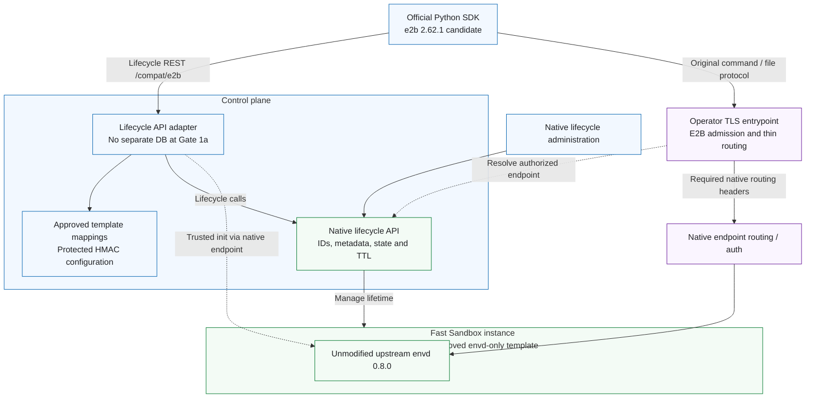
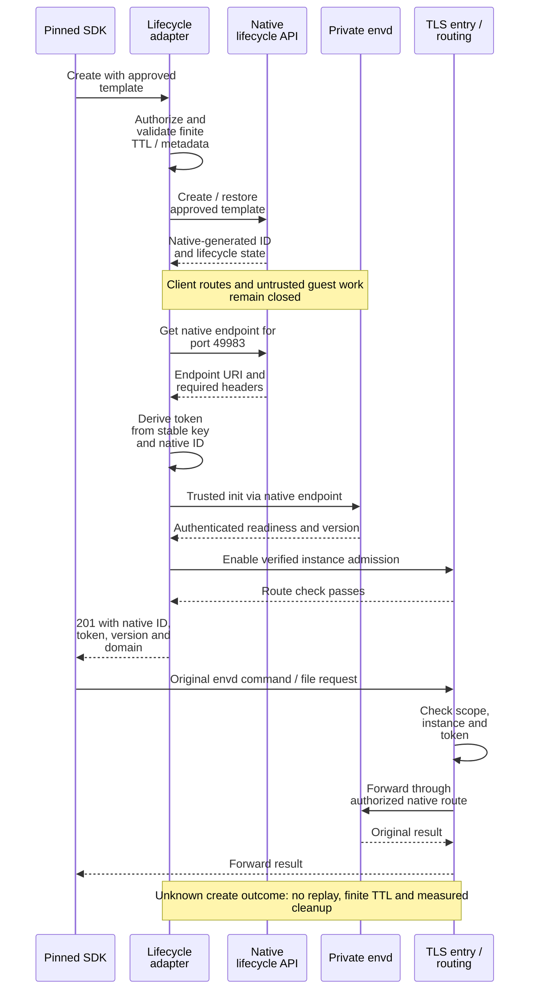
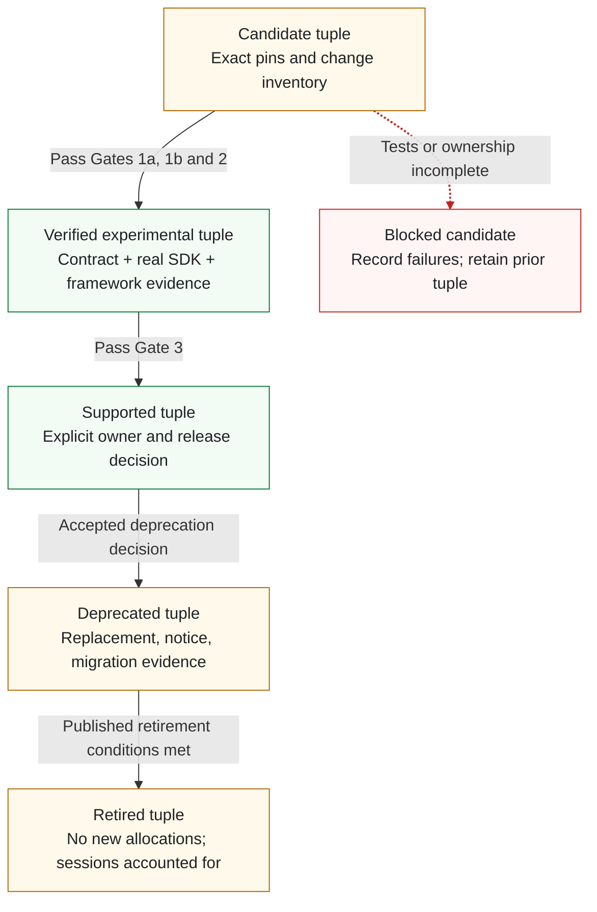

# OSEP-0027: Optional E2B Compatibility for Core Agent Workflows

<!-- toc -->
- [Summary](#summary)
- [Motivation](#motivation)
  - [Goals](#goals)
  - [Non-Goals](#non-goals)
- [Requirements](#requirements)
- [Proposal](#proposal)
  - [Notes/Constraints/Caveats](#notesconstraintscaveats)
  - [Risks and Mitigations](#risks-and-mitigations)
- [Design Details](#design-details)
  - [Initial Version and Capability Profile](#initial-version-and-capability-profile)
  - [Control Plane and Resource Identity](#control-plane-and-resource-identity)
    - [Timeout Semantics](#timeout-semantics)
    - [SDK-visible State and Cleanup](#sdk-visible-state-and-cleanup)
    - [Manual Pause and Full-State Resume](#manual-pause-and-full-state-resume)
  - [Upstream envd Packaging and Readiness](#upstream-envd-packaging-and-readiness)
  - [Routing and Security](#routing-and-security)
  - [Errors and Operational Behavior](#errors-and-operational-behavior)
  - [Delivery Gates and Community Work](#delivery-gates-and-community-work)
- [Test Plan](#test-plan)
- [Drawbacks](#drawbacks)
- [Alternatives](#alternatives)
- [Infrastructure Needed](#infrastructure-needed)
- [Upgrade & Migration Strategy](#upgrade--migration-strategy)
- [References](#references)
<!-- /toc -->

## Summary

This proposal adds an optional control-plane API adapter so selected applications can use an unmodified E2B SDK with OpenSandbox. The first experiment uses native sandbox IDs and metadata, HMAC-derived envd tokens, and an envd-only Fast Sandbox template, without a separate adapter database or envd-to-execd protocol translation. Gate 1a proves create, command/file round trip, and delete; Gate 1b then validates manual full-state pause and resume through connect. Python `e2b==2.62.1` with envd `0.8.0` is an unvalidated candidate; this documentation proposal establishes no implementation, release, or maintenance commitment.

## Motivation

Applications using E2B SDKs can require substantial integration work to adopt a different sandbox backend. A shared compatibility component could reduce repeated adapters and make a small set of common workflows reusable across deployments.

[Issue #800](https://github.com/opensandbox-group/OpenSandbox/issues/800) raised this request. The [maintainer response](https://github.com/opensandbox-group/OpenSandbox/issues/800#issuecomment-4394440123) declined direct core API compatibility because of abstraction differences, maintenance costs, and misleading equivalence. A later [community report](https://github.com/opensandbox-group/OpenSandbox/issues/800#issuecomment-5474176640) described a standalone sidecar PoC; its reported results are useful prior art, not independently verified acceptance evidence for this proposal.

This OSEP narrows the question to an optional, tested compatibility surface with explicit limits. Permission to discuss this direction does not establish design approval, implementation ownership, or ongoing support. E2B is an external product API and SDK ecosystem, not an OpenSandbox-owned interoperability standard.

### Goals

1. Demonstrate at least one agreed agent workflow using an unmodified, pinned official E2B SDK against OpenSandbox, with only documented endpoint, credential, and template configuration changes.
2. Stage the base-SDK candidate: first validate creation, commands, files, and deletion; then manual full-state pause/resume. Running connect, inspection, listing, and timeout changes remain candidate contract work, with explicit unsupported behavior until validated. Include every operation required by the selected workflow before advertising that integration.
3. Preserve observable behavior for advertised operations, including errors, authorization, streaming completion, timeouts, and resource cleanup.
4. Publish a compatibility matrix and executable tests that distinguish supported behavior, explicit limitations, unsupported operations, and untested combinations.
5. Provide independent work items for community contributors without making the native server, SDKs, or every runtime depend on the compatibility component.

### Non-Goals

- Full E2B API, SDK, CLI, cloud service, or future-version parity; a claim that all E2B integrations work unchanged.
- Replacing or renaming OpenSandbox's public APIs, or changing native defaults to match E2B.
- Adding E2B protocol handlers to execd, translating envd command/file protocols, or forking envd to emulate missing behavior. Native execd remains unchanged.
- Initial support for JavaScript, the asynchronous Python client, or code-interpreter SDK packages. envd alone does not provide the separate Jupyter code-execution service used by `run_code`/`runCode`.
- E2B account management, billing, template build API compatibility, hosted domains, or cloud infrastructure provisioning. Templates are prepared through existing OpenSandbox/Fast Sandbox tooling.
- Initial compatibility for ordinary Pod-per-sandbox or standalone Docker backends, including the Pod init-container/shared-volume delivery path. Kubernetes remains the infrastructure underneath Fast Sandbox.
- Joint execd/envd injection, bootstrap, supervision, or dual-SDK command/file acceptance on the same instance. Coexistence is a separate community-driven extension; existing native deployments remain unchanged.
- Designing or building DNS hosting, certificate issuance, or private-zone tooling. Operators supply the chosen network prerequisites.
- Equating container images with E2B templates, or root filesystem snapshots with E2B process/memory snapshots.
- Initial support for auto-pause, traffic-triggered auto-resume, filesystem-only pause, reboot-on-connect, public snapshot APIs, fork, volume management, PTY, filesystem watchers, arbitrary public port exposure, or cloud identity features. A workflow requiring one of these is blocked until that feature is separately designed and tested; it is not silently approximated.
- Promising every runtime, language, SDK release, image, or operating system. Unvalidated combinations remain unsupported.

## Requirements

| ID | Requirement |
|---|---|
| R1 | Compatibility is opt-in and separately addressable; disabling it leaves native OpenSandbox APIs usable without an E2B dependency. |
| R2 | Each advertised profile pins the SDK packages, relevant protocol sources, OpenSandbox version, runtime, image/template and any injected-payload digest, transport configuration, and operation-level tests. No version is supported solely because its source was inspected. |
| R3 | The actual official SDK and a selected real framework workflow must pass against a real OpenSandbox backend before that integration is advertised. Mock or direct HTTP tests alone are insufficient. |
| R4 | Accepted inputs retain their documented semantics. Unsupported control-plane operations and non-default options fail explicitly before side effects; no ignored security policy, fabricated metadata, or success-shaped fallback. |
| R5 | Authentication and resource authorization apply to both planes. Routing identifiers never confer access, and native backend credentials never reach clients or sandbox workloads. |
| R6 | Existing OpenSandbox policy and isolation constraints remain effective. Compatibility cannot grant broader images, resources, filesystem identity, network access, or sandbox visibility. |
| R7 | Reuse authoritative native identity and lifecycle state across adapter restarts. Document and test ambiguous-operation behavior, finite-TTL resource cleanup, and access convergence; no blind replay or transparent recovery claim without evidence. Add only the minimal persistent operation information that native state cannot recover. |
| R8 | Native regression checks and the published compatibility test matrix are release gates for the affected component. Support expansion requires evidence and an explicitly accepted maintainer for that work. |

## Proposal

Use a separately deployable control-plane adapter exposed under a dedicated path-scoped base, for example `https://my.site/compat/e2b`. It authenticates E2B lifecycle requests and translates the validated subset to native OpenSandbox APIs, using native identity and lifecycle state rather than a second sandbox registry. Same-origin or separate-origin deployment is possible, but neither exposes root-level E2B routes: top-level namespaces, including `/v2`, remain reserved for native APIs. No E2B routes are added to the native server.

Use Fast Sandbox as the single initial acceptance backend. Map approved E2B-facing template IDs or aliases to existing, ready OpenSandbox templates with immutable artifacts. Package pinned, unmodified upstream envd in an envd-only template; native SDK command/file access to that instance is not required. E2B lifecycle calls use the adapter; command/file protocols pass through thin routing integration to envd. Native lifecycle administration remains available. Packaging, trusted per-instance initialization after allocation/restore, endpoint resolution, and authenticated readiness remain real-backend integration work.

Blue denotes clients/control configuration, green native lifecycle and execution, and purple the routing boundary. Dashed arrows show endpoint discovery or private setup, not new command/file protocols. This is a proposed responsibility split, not a deployed topology or a requirement for another routing service. The native resource remains authoritative for lifetime.

### Notes/Constraints/Caveats

- The OSEP remains `draft`. Selecting this architecture and initial version candidate does not imply that the candidate passes its acceptance tests.
- Compatibility claims must name the tested profile. No complete E2B parity, universal framework support, forward compatibility, delivery date, or SLA is promised.
- The first runtime target is Linux/amd64 Fast Sandbox with approved prebuilt templates, backed by Kubernetes. Ordinary Pod-per-sandbox and other runtime compatibility need separate scope, evidence, and ownership; native runtime support is unaffected. Docker may assist development but cannot substitute for Fast Sandbox acceptance.
- The first real framework scenario remains a Gate 0 selection with interested contributors. A scenario requiring code interpreter, automatic pause/resume, alternative snapshot modes, or another excluded feature cannot be used to advertise this base-SDK profile as sufficient.
- Placement, implementation language, and release ownership remain review decisions. Gate 1a uses no separate adapter database; later in-flight operations may need minimal persistence if native state is insufficient. The adapter is optional software, not a proposed official hosted service.

### Risks and Mitigations

| Risk | Mitigation |
|---|---|
| SDK/envd source pins are mistaken for a supported combination | Label them candidate until the locked SDK, image, backend, and workflow pass together. |
| envd starts or resumes with uninitialized or cloned authentication state | Keep client routes and untrusted guest work closed until trusted initialization. Preserve existing authentication on same-instance resume; test daemon restart and clone isolation. |
| Correct envd protocols still fail behind a proxy | Test actual SDK addressing, TLS, streaming, headers, and file bytes through the documented routing configuration. |
| Lifecycle translation changes resource or security semantics | Validate supported defaults/options and real backend state; reject unsupported requests before allocation. |
| Retries or outages leak sandboxes | Disable mutation retries, report ambiguous creates without replay, require finite native TTL, and fault-test actual reclamation. Correlation metadata aids observation but is not an idempotency guarantee. |
| Secret changes invalidate live sessions | Keep stable protected HMAC configuration for the experiment; rotation does not update envd tokens. Use explicit drain/recreate or a separately validated migration policy. |
| Upstream evolution creates unlimited maintenance work | Maintain explicit version tuples, require owners and evidence for upgrades, and publish deprecation/retirement decisions. |

## Design Details

### Initial Version and Capability Profile

The initial proposed tuple is concrete but **unvalidated**. It is a starting point for the experiment, not a claim that these releases were tested together.

| Dimension | Initial candidate | Evidence still required |
|---|---|---|
| Official client | Python synchronous `e2b==2.62.1`, source `9301cd84757b0e3f3fccbd349e85ff2bd403a1f4` | Lock transitive dependencies and Python version; run actual SDK calls without forks or monkeypatches. |
| Sandbox daemon | envd `0.8.0`, from official runtime release `2026.30`, source `f32ee8a2a50052f32e3632ceb451111a98dd5104` | Pin binary provenance/checksum and immutable image or injected-payload digest; verify the running version. |
| Backend | OpenSandbox inspected baseline `fab314287bded086a5f76b2735935c7f484a0332`; Fast Sandbox inspected baseline `f44561ad111e6a94ae00e5923fce307317dba17d`; Linux/amd64 MicroVMs on Kubernetes | Pin server, Fast Sandbox, Firecracker/guest kernel and envd-only artifacts. Gate 0 records one actual storage/restore and pool/readiness recipe. Supplemental source checks do not silently upgrade or validate this tuple. |
| Client transport | Require `E2B_API_URL=https://my.site/compat/e2b` or an equivalent explicitly path-scoped base; configure envd addressing separately. Set `E2B_HTTP_VERSION=1.1` because the pinned SDK defaults to HTTP/2 | Lock HTTP/proxy configuration and operator DNS/TLS prerequisites. Test both lifecycle path families, supported calls and explicit rejections; validate all seven routes before advertising the complete candidate. Debug mode is not acceptance. |
| Framework | One base-SDK scenario, to be agreed at Gate 0 | Exact framework/version/configuration and complete call inventory; none is claimed supported yet. |
| Status | Candidate only | Gates 1a/1b establish staged feasibility; Gates 2/3 establish complete experimental evidence and any supported release. |

The [released Python package source](https://github.com/e2b-dev/E2B/blob/9301cd84757b0e3f3fccbd349e85ff2bd403a1f4/packages/python-sdk/pyproject.toml) declares `2.62.1`. The [envd version source](https://github.com/e2b-dev/runtime/blob/f32ee8a2a50052f32e3632ceb451111a98dd5104/packages/envd/pkg/version.go) declares `0.8.0`; `2026.30` is the runtime repository's release tag, not envd's protocol version. These independent release numbers do not establish interoperability.

| Surface | Initial acceptance target | Boundary |
|---|---|---|
| Lifecycle | Gate 1a: create and kill. Gate 1b: manual full-state pause and resume through connect. Complete candidate: running connect, info, list and timeout changes as well | Unsupported operations fail explicitly at each stage. List and zero-timeout are not required for 1a; all advertised semantics must pass before Gate 2 completes. Automatic lifecycle and alternative snapshot modes remain excluded. |
| Commands via envd | Foreground commands, stdout/stderr, exit status, command timeout | Test approved users, environment, working directory, disconnect behavior, and resource bounds. |
| Files via envd | Read/write and binary upload/download | Test paths, overwrite, permissions, missing files, and size limits. |
| Template configuration | Approved E2B ID/alias → ready native template and immutable artifact revision, envd startup, resource limits, allowed identity/network settings | Reject unknown, unready, or profile-incompatible mappings before allocation. No E2B template build service; alias updates affect only future creates. |
| Other envd capabilities | Outside the initial tested/advertised matrix | The original daemon may expose more methods. A support boundary is not an access-control filter; do not claim that untested PTY/watch/background methods are removed. |
| Code interpreter and other SDKs | Deferred | The code-interpreter client uses a separate Jupyter service and API. Adding it needs its own image, pins, tests, and accepted scope; no mapping to execd is proposed. |

The support matrix describes tested behavior, not a new envd implementation. Deployments needing to prohibit particular envd capabilities must establish an enforceable policy before adopting this runtime recipe. Failure to enforce a required policy blocks that deployment; it is not solved by silently changing envd or execd.

### Control Plane and Resource Identity

The pinned [SDK lifecycle implementation](https://github.com/e2b-dev/E2B/blob/9301cd84757b0e3f3fccbd349e85ff2bd403a1f4/packages/python-sdk/e2b/sandbox_sync/sandbox_api.py) and its generated models define client requests and response handling; service-side semantics also need explicit source references and fixtures. The native [lifecycle contract](https://github.com/opensandbox-group/OpenSandbox/blob/fab314287bded086a5f76b2735935c7f484a0332/specs/sandbox-lifecycle.yml) defines backend calls under `/v1`. The E2B paths below are relative to the required compatibility base: `/v2/sandboxes` becomes `/compat/e2b/v2/sandboxes`, while `/sandboxes/{id}` becomes `/compat/e2b/sandboxes/{id}`. They do not claim native root-level namespaces. A proxy may strip the prefix internally, but must preserve both SDK route families at the public boundary.

| Pinned E2B request relative to compatibility base | Native operation under `/v1` | Adapter responsibility |
|---|---|---|
| `POST /v2/sandboxes` | `POST /sandboxes` | Resolve an approved template, validate options/resources, allocate, privately initialize envd, and publish a usable route before returning `201`. |
| `POST /v2/sandboxes/{id}/connect` | Get sandbox; renew expiration as appropriate; native resume for a paused instance | Candidate running connect returns `200` after extension-only TTL and readiness checks. Gate 1b resumed connect returns `201` only after full-state restore, authenticated envd readiness and fresh routing. Omitted timeout defaults to 300 seconds. |
| `POST /sandboxes/{id}/pause` | Native pause, then poll native state | Gate 1b: full-state only; native `202` is not completion. Return E2B `204` after confirmed pause and E2B access/stream suspension. Reserve `409` for confirmed already-paused because the SDK returns `False`. |
| `GET /sandboxes/{id}` | `GET /sandboxes/{sandboxId}` | Combine authoritative native state with owned template/identity metadata; preserve the pinned info schema. |
| `GET /v2/sandboxes` | Native list filtered by compatibility/scope metadata | Unsupported at Gate 1a. For the complete candidate, map filters, visibility, ordering and pagination using native objects without a second registry. |
| `POST /sandboxes/{id}/timeout` | Positive: native renew-expiration; zero: candidate deletion workflow | Gate 1a rejects this operation, including zero, before mutation. Later support must meet the timeout contract below; never send `expiresAt=now` or silently round up. |
| `DELETE /sandboxes/{id}` | `DELETE /sandboxes/{sandboxId}` | Gate 1a: establish the access-revocation/native-acceptance conditions below, then verify asynchronous resource cleanup. No immediate-eviction claim. |

Create/connect responses must use the actual pinned models, including `sandboxID`, `templateID`, `clientID`, `envdVersion`, `envdAccessToken`, and the configured `domain` where needed. IDs represent real adapter-owned identities; version fields describe the running daemon, never a fabricated high version to bypass SDK feature checks. Return the initialized `envdAccessToken` for this authenticated profile. Supply the separate optional `trafficAccessToken` only if the chosen deployment implements its proxy-access semantics.

Use the native sandbox ID directly as `sandboxID`. The native server generates it; the public create request does not accept a caller-selected ID. Persist compact, validated template/profile references, authenticated scope and a compatibility marker in native metadata at creation. Retain immutable approved mapping revisions in deployment configuration so get/connect can recover the original template and tuple after restart or alias change. Only expose authorized, adapter-created objects whose provenance/configuration can be validated; do not adopt an arbitrary sandbox merely because a writable marker was added.

The first experiment uses one explicitly trusted administrative scope. Native metadata is ordinary object data, not an authorization proof: callers with native write access can modify ordinary markers, and public metadata PATCH has no caller-supplied compare-and-swap precondition. Enforce actual authentication/object scope independently and verify token ownership before obtaining privileged native routes. Respect metadata limits; use approved short references rather than assuming long aliases or JSON fit, and reject unrepresentable user metadata before allocation. The [supplemental metadata contract](https://github.com/opensandbox-group/OpenSandbox/blob/6dd4fa93f9a39ad762d6f88b4ec83beaf06db24b/specs/sandbox-lifecycle.yml#L1008-L1040) and [Fast Sandbox mapping](https://github.com/opensandbox-group/OpenSandbox/blob/6dd4fa93f9a39ad762d6f88b4ec83beaf06db24b/server/opensandbox_server/services/fast_sandbox/create_mapping.py#L331-L350) are source references, not deployment validation.

Derive `envdAccessToken` from a protected adapter HMAC key and the native ID, with a fixed algorithm, encoding and deployment/purpose domain separation. After allocation, initialize envd with that value through the trusted path; connect recomputes it only for an authorized, ready instance. No per-instance token table is required. Keep the key and any key-version/configuration reference stable for Gate 1a; do not perform hot rotation. A changed key changes recomputed values but not existing envd state. The pinned init protocol does not allow an arbitrary new token merely because the old token is known. Key loss/change requires explicit drain/recreate or separately validated migration, not implicit session repair; native administrative cleanup remains available.

Native state is authoritative for existence/lifetime and must be checked for admission, including native-side mutations. Do not predesign a separate binding-generation ledger, tombstone store or general reconciliation database for Gate 1a. Reuse native persisted lifecycle intent first. For later pause/resume or zero-timeout support, identify the specific ambiguity native state cannot recover and retain only the minimal operation information needed. No separate database does not mean no state or transparent recovery. Test freshness, restart, unknown-state rejection and access/stream convergence; immediate revocation or an existing-stream bound cannot be inferred from credential expiry.

Template identity does not establish parameter equivalence. The inspected [native template-mode validation](https://github.com/opensandbox-group/OpenSandbox/blob/fab314287bded086a5f76b2735935c7f484a0332/server/opensandbox_server/api/schema.py#L1091-L1139) rejects workload-shaping overrides such as `env`, `entrypoint`, `resourceLimits`, `resourceRequests`, and `volumes`, and does not allow enabling `secureAccess` in that request. Inventory an approved mapping or explicit rejection for each E2B option before allocation. Approved user/environment setup through private envd initialization must be tested against SDK semantics; define UID/GID, cwd and permissions without promising native execd sessions.

Inventory defaults as well as explicit options. Gate 1a explicitly rejects pause and other unimplemented lifecycle operations. Gate 1b accepts manual pause/connect with omitted `memory` or `memory=true` only for the approved full-state profile. The pinned SDK [mode resolver](https://github.com/e2b-dev/E2B/blob/9301cd84757b0e3f3fccbd349e85ff2bd403a1f4/packages/python-sdk/e2b/sandbox/sandbox_api.py) maps `pause(mode="full")` to `memory=true` and `connect(on_resume="restore")` to an omitted field. Reject `memory=false`, invalid types, automatic lifecycle options, public snapshot operations, volumes, cloud identity and unmapped network policy before side effects. Validate effective native idle/wake configuration so data-plane traffic and probes cannot auto-resume. Distinguish irrelevant default fields from requests enabling excluded features.

The initial profile excludes caller-supplied `Idempotency-Key`: reject it before allocation. The [pinned SDK](https://github.com/e2b-dev/E2B/blob/9301cd84757b0e3f3fccbd349e85ff2bd403a1f4/packages/python-sdk/e2b/retry.py) omits it when none is supplied. Require SDK lifecycle `retries=0` and `E2B_CONNECTION_RETRIES=0`; response and connection retries are separate. Disable proxy mutation retries. For an ambiguous create, return explicit non-success (`Should-Retry: false` where deliverable), never automatically allocate again, and require finite native TTL. Test actual reclamation after lost responses and adapter restarts. Correlation metadata may aid observation, but a list miss is not proof of non-allocation and correlation is not REST idempotency. Gate 1a promises neither transparent recovery of a missing ID nor exactly-once create.

#### Timeout Semantics

Timeouts are integer seconds, distinct from client request and command timeouts. The inspected upstream [timeout validator](https://github.com/e2b-dev/runtime/blob/791fb4c52475e85186accc472c30fb017a1466b7/packages/api/internal/handlers/timeout_helper.go) rejects nonpositive create/connect durations, whereas [set-timeout](https://github.com/e2b-dev/runtime/blob/791fb4c52475e85186accc472c30fb017a1466b7/packages/api/internal/handlers/sandbox_timeout.go) accepts zero and requests immediate expiry. These server references are independent of the SDK/envd pins; they do not establish the exact behavior or eviction latency of a hosted E2B deployment. Native [renewal validation](https://github.com/opensandbox-group/OpenSandbox/blob/6e709dfe18b6a0b31b84eef116d9e38b98c38618/server/opensandbox_server/services/validators.py) requires a future timestamp, and the [create contract](https://github.com/opensandbox-group/OpenSandbox/blob/6e709dfe18b6a0b31b84eef116d9e38b98c38618/specs/sandbox-lifecycle.yml) requires a timeout of at least 60 seconds for this template-based profile.

The pinned SDK omits a Python `None` timeout from the request. The inspected [v2 create handler](https://github.com/e2b-dev/runtime/blob/791fb4c52475e85186accc472c30fb017a1466b7/packages/api/internal/handlers/sandbox_create.go) selects [a five-minute default](https://github.com/e2b-dev/runtime/blob/791fb4c52475e85186accc472c30fb017a1466b7/packages/api/internal/sandbox/sandboxtypes/states.go), rather than the legacy create default of 15 seconds. The initial profile therefore uses 300 seconds for an omitted create timeout. A raw JSON `null` is distinct from an omitted field and is rejected by this profile. The native timeout/state references at `6e709dfe` are supplemental source checks; the cited validator, state-mapping file and lifecycle spec are unchanged from `fab3142`, and the initial candidate tuple is not upgraded by these references.

| Operation/input | Candidate behavior when the operation is enabled |
|---|---|
| Create with omitted timeout, including Python `None` serialized as omission | Use 300 seconds, subject to the same pre-allocation limits as an explicit value. Do not use the legacy 15-second default. |
| Raw JSON `null`, boolean, fractional, string, or other non-integer timeout | Return `400` before mutation; do not coerce values. This does not reject SDK `None`, which is omitted. |
| Create/connect with zero or a negative duration | Return `400` before allocation, renewal, or resume. Do not reuse set-timeout's zero handling. |
| Create with 1–59 seconds | Return `400` with an explicit profile limitation before allocation. Do not round up or allocate first and shorten later. |
| Create with at least 60 seconds | Apply native and profile limits and the approved template policy. Preserve the accepted duration. |
| Running connect with a positive duration, or no duration | Default the omitted value to 300 seconds; extend only, never shorten. |
| Paused connect with a positive duration, or no duration | Default to 300 seconds. After validation, compute one absolute deadline from the start of this resume attempt and renew the paused resource before requesting resume. This is a new running interval, not the running-connect extension-only rule. The deadline continues through restore; do not silently grant extra time if readiness is late. |
| Set timeout with a positive duration | Convert once to an absolute deadline and renew, permitting shortening or extension within profile policy. The create minimum is not a renewal minimum. If that deadline is already past when validated, return an error rather than silently granting extra time. |
| Set timeout with zero | Unsupported at Gate 1a. Before advertising later support, prove the termination/deletion conditions below; never approximate zero by a positive duration. |
| Set timeout with a negative duration | Return `400` without mutation. The profile does not reproduce permissive handling outside the nonnegative input schema. |
| Create/connect/set-timeout exceeding the applicable native or profile maximum | Return `400` before allocation, renewal, or resume, including an omitted value whose effective default exceeds the limit. Do not clamp to the maximum or partially mutate. Gate 0 fixes the profile limits; native renewal having no create-time maximum does not remove them. |

The table inventories the complete candidate; Gate 1a implements create timeout and finite expiry only. Its unsupported timeout endpoint returns explicit non-success before mutation. This staged rejection is a declared limitation, not E2B parity.

Gate 1a explicit deletion, and later zero-timeout support, require BOTH conditions before `204`: (1) the chosen E2B admission/stream mechanism confirms access revocation for this instance; AND (2) native `DELETE` returned its successful `204`, OR authoritative state confirms termination/absence. The OR applies only within (2). Native deletion acknowledges asynchronous cleanup, not physical release; local queueing alone is insufficient. Validate these observations without requiring a general adapter database. No instantaneous route or physical-eviction guarantee is made.

If a condition is unknown, return `503` with `Should-Retry: false` where deliverable; explicit lifecycle conflict returns `409`. Keep admission closed where the instance can be identified, use recoverable native deletion intent and finite TTL, and verify restart and resource-release behavior. Failure does not prove a mutation never happened. Before enabling zero timeout or concurrent pause/resume, specify minimal persistent in-flight information, if any, needed to avoid losing an incomplete operation or reopening an ended session. Prefer native evidence; no general binding/tombstone database is required in advance. Adapter serialization does not fence native administrators: test races and never replay mutations blindly.

#### SDK-visible State and Cleanup

The E2B state enum cannot carry native terminal or failure states. The inspected upstream [info handler](https://github.com/e2b-dev/runtime/blob/791fb4c52475e85186accc472c30fb017a1466b7/packages/api/internal/handlers/sandbox_get.go) returns `404` while killing, while [connect](https://github.com/e2b-dev/runtime/blob/791fb4c52475e85186accc472c30fb017a1466b7/packages/api/internal/handlers/sandbox_connect.go) returns `409` in that transition. The native [Fast Sandbox mapping](https://github.com/opensandbox-group/OpenSandbox/blob/6e709dfe18b6a0b31b84eef116d9e38b98c38618/server/opensandbox_server/services/fast_sandbox/status_mapping.py) retains stopped resources as `Terminated`, and also maps runtime/data-plane unavailability to `Failed`. Thus a failure state alone is not proof of permanent deletion.

The following complete-candidate projection applies after authentication and object-scope checks; Gate 1a does not implement list or advertise untested info/connect behavior. Native termination evidence or a recoverable accepted termination intent takes precedence over stale `Running`. Unknown or unowned IDs use not-found without revealing another scope's resources.

| Authoritative observation / adapter state | List | Info | Connect |
|---|---|---|---|
| `Running` with authenticated readiness | Include as `running` | `200`, `running` | `200`, extension-only timeout policy |
| Confirmed termination in progress, including `Stopping` with termination evidence or recoverable termination intent | Exclude | `404` | `409` until termination/absence is confirmed, then `404` |
| `Terminated` or confirmed native absence | Exclude | `404` | `404` |
| `Failed`, or `Stopping` without enough evidence to establish termination | `503` if any such in-scope compatibility instance is in the authenticated scope; no partial list | `503`; retain native recovery information | `503`; do not recreate or resume |
| Backend unavailable or state cannot be determined | `503`, not an apparently complete empty list | `503` | `503` |
| Known `Pending`, `Pausing`, `Resuming`, or incomplete readiness | Exclude from the usable set | `409` | `409` |
| An in-scope instance confirmed `Paused`, including native administration | Include as `paused` when it matches the requested filter | `200`, `paused`, with authoritative fields | Resume the same instance using the full-state procedure; return `201` only after its success conditions hold |

Pause/resume has operation-specific responses below; the info/connect table does not apply verbatim to pause. Do not invent missing response fields: inability to supply the pinned schema blocks that behavior at its gate. Draining may map to native `Stopping` without irreversible termination; use lifecycle evidence, not the label alone. Transient failure must not erase recoverable native identity or be treated as permanent absence. These are proposed adapter policies, not full upstream parity.

When set-timeout is enabled, only authenticated, ready `Running` accepts a new mutation; terminal/absent state returns `404`, termination or transitional/paused state returns `409`, and failed/indeterminate state returns `503`. Accepted zero-timeout follows the two-condition rule even if native termination wins a race. Explicit `DELETE` remains available for an in-scope native object in `Failed`, `Stopping`, `Paused`, or retained `Terminated`; failed readiness must not prevent cleanup. A present object returns `204` only after deletion conditions hold; confirmed absence returns `404` after accounting for known residual access. Backend unavailability yields `503`, native lifecycle conflict `409`. Errors do not permit forgetting required in-flight cleanup information.

List is explicitly unsupported/unvalidated at Gate 1a. For the complete candidate, prefer native list with compatibility/scope metadata filters, then apply SDK state visibility. Native page/pageSize and equality filters do not establish E2B cursor, ordering or filter equivalence. Define supported filters, bounded enumeration and concurrent-page behavior before advertising the mapping; filtering a single page must not silently lose later visible objects. A cursor does not itself imply snapshot consistency. Unknown state must not appear as a complete empty result; the conservative candidate fails list if any in-scope compatibility instance has failed/indeterminate availability. Native filtering may still serve operational observation before E2B list is supported.

A paused instance is still live: retain native identity/metadata, private checkpoint and token configuration until deletion/expiry. Releasing runtime capacity is not terminal cleanup. Native metadata disappears with its object; GC/retention must be verified, not assumed as an indefinite tombstone store. Gate 1a uses native lifecycle evidence and finite TTL, not a new tombstone inventory. If later operation records are necessary, define retention and cleanup at that feature's gate; do not discard unresolved intent on a timer, reuse ended identities or delete unrelated native objects. Record tested cleanup/freshness limits without an SLA.

#### Manual Pause and Full-State Resume

Retain manual `pause()` and resume through `connect()` in the initial candidate, following [the maintainer suggestion](https://github.com/opensandbox-group/OpenSandbox/pull/2591#discussion_r4513033501), and validate them at Gate 1b after the independent Gate 1a loop. Full-state preserves guest memory, processes and writable disk in the same logical sandbox; a replacement from the original template is not resume. Auto-pause, traffic-triggered auto-resume, alternative modes and public snapshot APIs remain separate work. No runtime compatibility or delivery commitment follows from this scope decision.

The [native lifecycle contract](https://github.com/opensandbox-group/OpenSandbox/blob/fed6e60193efe913d470ad545c13289021c1d49e/specs/sandbox-lifecycle.yml) returns `202` for pause/resume and requires polling. The [Fast Sandbox lifecycle](https://github.com/opensandbox-group/fast-sandbox/blob/c95f0ac3293cdbbc444bda1ce4d68f66e41f3e8d/docs/concepts/sandbox-lifecycle.md) describes durable full-state checkpoints, the same sandbox identity after resume, changed route generations, and expiry while paused. The inspected upstream [pause handler](https://github.com/e2b-dev/runtime/blob/791fb4c52475e85186accc472c30fb017a1466b7/packages/api/internal/handlers/sandbox_pause.go) uses `204` for completed pause; [connect](https://github.com/e2b-dev/runtime/blob/791fb4c52475e85186accc472c30fb017a1466b7/packages/api/internal/handlers/sandbox_connect.go) distinguishes running `200` from resumed `201`. These are supplemental feasibility references, not an upgrade or validation of the initial tuple. Gate 0 must pin a tuple supporting these requirements; Gate 1b must prove them through the native APIs actually used by the adapter.

| Operation and observation | Required adapter behavior |
|---|---|
| Pause a ready `Running` instance | Preserve recoverable operation intent, suspend E2B access/end transport streams, submit native pause, then wait for `Paused` with completed checkpoint/release semantics. Return `204` only after completion and suspension for this operation, with no intervening resume/termination; SDK returns `True`. Prefer native persistence, adding only demonstrated missing operation information. |
| Pause an already `Paused` instance | Reconcile and confirm access suspension, then return `409`; the pinned SDK intentionally returns `False` for this case. Do not claim another checkpoint was created. |
| Pause during `Pausing`, `Resuming`, termination, failed readiness, or an ambiguous outcome | Return `503` with `Should-Retry: false`, not `409` or `204`. The [pinned pause implementation](https://github.com/e2b-dev/E2B/blob/9301cd84757b0e3f3fccbd349e85ff2bd403a1f4/packages/python-sdk/e2b/sandbox_sync/sandbox_api.py) treats every `409` as already paused, so a generic native conflict must not be passed through. Confirmed terminal/absent or unowned instances return `404`. |
| Connect to a confirmed `Paused` instance | Validate full-state mode, identity and timeout; preserve attempt intent/fixed deadline, renew expiration and submit resume. Wait for `Running`, authenticated envd readiness, fresh endpoint resolution and usable routing for the resumed instance. Only then return `201` with the same native/E2B ID and actual token/version. |
| Connect while transition/readiness is incomplete | Return `409` for an observed transition, `503` for failed or unknown state, and no usable session. A later explicit connect after a reconciled resume returns `200` if already ready; it must not allocate another sandbox or replay the old resume blindly. |

Pausing does not freeze Fast Sandbox's absolute `expiresAt`. The initial profile preserves that native deadline while paused, publishes it in info, and documents this retention limitation; it neither extends paused lifetime automatically nor promises indefinite checkpoint retention. An instance that expires while paused becomes unavailable under the normal termination projection. Connect must reject an already-expired instance before renewal/resume, and expiry or deletion winning a race must never resurrect it. A selected workflow needing different paused-retention semantics blocks acceptance until that policy is explicitly designed and tested. Resume uses the new deadline defined in the timeout table; even if renewal succeeds and resume later fails, record that partial outcome and reconcile it rather than assuming both mutations were rolled back.

A paused-instance checkpoint contains that instance's live envd and application state. Keep it private to the same authorized identity; never publish it as a reusable golden template or use it to allocate another tenant's instance. Resume must preserve and authenticate the existing envd token and daemon state, not rerun first-time `POST /init` or generate a new token silently. Refresh native endpoint routing credentials as required without conflating them with the preserved envd token. Missing checkpoint, reset/recreation, identity mismatch, lost authentication state, or failed full-state validation blocks success; no cold-boot, reset, fresh allocation, or unauthenticated fallback is permitted. New E2B commands and file operations must work after resume; native SDK command/file coexistence is a later extension. Existing TCP streams need not survive: clients reconnect, and no command is automatically replayed.

Native `Running` alone is insufficient for activation. Check that completion still belongs to the same instance/attempt, without intervening deletion, expiry, native mutation or route-generation change; re-resolve endpoints rather than reusing pre-pause routes. Adapter locking does not fence native administrators. Public REST resume exposes no checkpoint-ID precondition; do not assume stronger FastPath RPC fencing is available. Gate 1b must establish identity/checkpoint continuity, native-side race handling and any minimal durable operation information missing from native state. If continuity cannot be established, fail closed and keep pause/resume unadvertised; this does not block independent Gate 1a evidence. Probes must not enable automatic wake-on-access.

Use bounded lifecycle polling and a request budget distinct from sandbox TTL. After timeout, lost response, restart or partial failure, reconcile retained native state and any justified minimal operation record before reopening access. Reopen only after confirmed same-instance readiness and routing, including a confirmed failed pause that leaves the original instance running; otherwise return an error and retain recovery/cleanup ownership. Never reset/recreate as rollback. Gate 1b fixes budgets, recovery, checkpoint access/retention and evidence for success.

### Upstream envd Packaging and Readiness

Package the pinned, unmodified executable in an approved envd-only Fast Sandbox template. Record provenance, licenses/dependencies, immutable artifact, process supervision, approved user, writable paths, resource limits and startup recipe. Do not design joint execd/envd injection or a dual-daemon barrier. Native API regression remains required; native SDK command/file compatibility on this instance does not.

Supplemental inspection of the [template builder](https://github.com/opensandbox-group/fast-sandbox/blob/cc9b7b88061b3b63cba4f9732805a79f9bbeffa8/cmd/sandboxtemplate-builder/oci.go#L81-L101) shows conditional execd extraction. The [guest-init/probe code](https://github.com/opensandbox-group/fast-sandbox/blob/cc9b7b88061b3b63cba4f9732805a79f9bbeffa8/cmd/sandboxtemplate-builder/convert.go#L336-L429) permits explicit probes and bootstrap/entrypoint choices. Use an envd-targeted probe, but verify actual pool components, guest-control, egress/action bindings and aggregate READY without execd as the first Gate 1a integration check. Source configurability is not a working recipe. An actual coupling requires a documented configuration/scope decision, not silent dual injection or an unreviewed native contract change.

A reusable golden rootfs or memory snapshot must contain no live per-instance envd credentials or tenant sessions. Restore can resume processes without rerunning guest init. After allocation the trusted setup path obtains the native ID and port `49983` endpoint, computes the HMAC token, and performs private `POST /init` before E2B admission or untrusted guest work. Prove this ordering/isolation for allocation, clones and daemon restarts. A same-instance Gate 1b checkpoint instead retains existing credentials and must not run first-time initialization.

Establish envd flags, cgroup behavior and MMDS handling for the actual guest. `-isnotfc` supports non-Firecracker execution and `-no-cgroups` disables envd cgroup management; neither a Docker recipe nor Firecracker's presence proves E2B-specific MMDS assumptions hold. Test localhost forwarding and post-init polling while retaining native resource/network enforcement.

Pinned envd permits first initialization without token/MMDS identity, and ordinary authentication has an unset-token path. Public route closure alone is insufficient: untrusted guest work, peers or forwarded ports must not race init or reach unprotected execution. Verify authenticated readiness and `X-Envd-Version`; a listening port/health response alone is insufficient. Keep `POST /init`, `POST /upgrade` and other management operations inaccessible through the client route.

This defines acceptance ordering, not an existing initialization barrier/router management API. Routes may be static if admission stays closed until readiness. A daemon restart that loses authentication requires closed access and proven trusted reinitialization before untrusted work, or termination. A replacement requires a new explicit create/identity and cannot satisfy connect/resume. Failure to enforce ordering/isolation blocks Gate 1a.

### Routing and Security

For the pinned SDK's custom-domain path, envd uses `<port>-<sandbox-id>.<domain>`; a control-plane API base does not supply that route. Operators provide name resolution and matching trusted TLS. Wildcard DNS and a wildcard certificate are common prerequisites for this dynamic-host recipe, not tooling owned by either workstream. A cloud private zone is a deployment option, not an AWS requirement; private DNS does not supply TLS trust.

A bounded fixed-entrypoint experiment is also possible: the deprecated `sandbox_url` / `E2B_SANDBOX_URL` override and `E2b-Sandbox-Id` / `E2b-Sandbox-Port` headers have a [CubeSandbox example](https://github.com/TencentCloud/CubeSandbox/blob/e298a426/docs/guide/multi-node-deploy.md#L179-L203). This is inspected prior art, not a result from this proposal. Gate 1a is entrypoint-neutral: select and test one configuration for commands/files. Fixed-host success does not establish arbitrary-port, `get_host`, signed/direct-file URL or path-prefix compatibility. Override removal blocks dependent SDK upgrades until an alternative is reviewed/tested. Cube's Redis-backed routing and MySQL/Redis deployment are not evidence of stateless implementation.

Both forms need thin routing integration to OpenSandbox. The inspected [Fast Sandbox endpoint implementation](https://github.com/opensandbox-group/OpenSandbox/blob/fab314287bded086a5f76b2735935c7f484a0332/server/opensandbox_server/services/fast_sandbox/endpoint.py#L35-L92) uses signed header/URI routing, not an interchangeable E2B hostname recipe. Resolve native `GET /sandboxes/{sandboxId}/endpoints/{port}` server-side and honor its URI/headers; do not copy signing keys into the adapter to mint scope. Preserve envd paths, bodies, streams and errors without protocol translation.

- Before obtaining/injecting privileged native routes, authorize instance/scope and validate the supplied envd token against HMAC recomputation. Reject unknown/not-ready/invalid requests; selectors are not authorization. Keep native credentials server-side.
- Bind host, ID, port and SDK headers to one resource; reject conflicts, strip untrusted native routing headers and prevent arbitrary upstream URLs. Permit only the approved envd service port. Do not add an RPC-level feature whitelist merely because other envd methods are untested.
- Preserve envd authentication, including `X-Access-Token` and applicable file signatures. API keys, envd tokens, ingress scope and upstream routing credentials have different purposes. Direct/signed-file URL access is outside Gate 1a and needs separate routing/authentication tests before advertisement.
- Pin HTTP/proxy settings. Native ingress's inspected HTTP/1.1 support does not establish client TLS/HTTP/2 termination; use an operator-provided TLS entrypoint. Document required records/names, certificate coverage and trust installation, not provisioning tooling.
- Keep management endpoints private and direct-backend bypass blocked, including guest/peer access and envd's localhost forwarding. Test missing/wrong-token access to protected operations; health/init exceptions are not execution authorization.
- Check native lifetime/readiness for admission; test stale caches, observer/backend failure, expiry and deletion. The inspected endpoint rejects `expires`; signed scope is not a proven per-endpoint expiry/revocation guarantee. Measure new-request and existing-stream convergence separately; neither immediate revocation nor an existing-stream upper bound follows solely from credential TTL.
- Preserve native policy. If the selected route or envd-only recipe cannot enforce isolation, document the gap before changing scope. An execd bridge or unauthenticated route is not a fallback.

### Errors and Operational Behavior

The adapter owns enabled lifecycle status/body mappings and SDK exception behavior; add list pagination only when validated. envd owns command/file protocol results, which routing passes through. Unsupported control-plane requests fail before side effects with explicit pinned-SDK errors. Never replace failures with success-shaped responses or expose infrastructure secrets.

Keep sandbox lifetime, command timeout, client request timeout, and proxy stream idle timeout distinct. Verify nonzero exits, transport failures, and expiry through the real SDK. Configure bounded buffering and stream cleanup, and never replay commands transparently after they may have executed. Data-plane conformance tests exercise original envd through the deployment, not new protocol handlers.

Record version tuple, operation, result class, latency and safe correlation IDs. Bound cardinality; exclude API keys, tokens, command/file contents and arbitrary environment/metadata by default. Adapter readiness depends on native access and protected configuration, plus any justified later operation persistence. Shutdown/restart must account for known in-flight work and admission without disabling native administration.

Before enabling list, distinguish backend unavailability from observed instance failure and indeterminate instance state in SDK-visible error messages within the pinned error schema, with safe correlation information linking to protected diagnostics. Keep affected native IDs and observed reasons available to authorized operators through native list/get and scoped diagnostic records; do not put instance IDs in metric labels or disclose another scope's resources. Record bounded-cardinality failure counts and observation freshness without claiming a known affected count when enumeration itself fails. The deployment operator owns investigation and, where appropriate, native deletion of a genuinely failed instance. This recovery path must remain usable when compatibility list/info fails and must report when native access is itself unavailable; it does not depend on recovering an ID from a successful E2B list.

### Delivery Gates and Community Work

| Gate | Deliverable | Exit condition |
|---|---|---|
| 0 — Target agreement | Confirm Fast Sandbox/envd-only, one trusted scope, a template/pool/restore recipe, operator network prerequisites, framework scenario, pins/options and limits | Maintainer confirmation and contributor opt-in in this PR or a tracking issue. Distinguish the 1a subset from the complete candidate; scope/pin changes remain visible. |
| 1a — Minimal real-backend loop | Independent lifecycle and envd/routing spikes, using native ID/metadata, fixed HMAC configuration and no separate adapter DB | Real pinned SDK passes create/restore → command/file round trip → delete on one Fast Sandbox tuple. Verify envd-only native readiness, trusted init/clone/restart isolation, routing/auth, finite timeout/defaults, no mutation replay, lost-response cleanup and native deletion/expiry behavior. List, zero-timeout and pause/resume remain explicitly unsupported. No dual-SDK acceptance; component/stub success is insufficient. |
| 1b — Manual full-state pause/resume | Extend the loop with pause → connect/resume → command/file round trip | Prove same ID and process/memory/writable-file continuity, preserved envd token, refreshed routing, completed transitions, paused expiry, partial failure and restart recovery. Prefer native operation state, justifying only minimal missing persistence. Resolve missing checkpoint preconditions/native-side races for this capability without delaying independent 1a evidence. |
| 2 — Experimental implementation | Reviewable PRs, complete contract fixtures, real-backend/security tests, deployment recipe and framework evidence | T1–T7 pass for every advertised operation of the exact candidate, including list/timeout if retained. Explicitly reject omissions and revise the profile visibly; 1a/1b do not imply complete compatibility. |
| 3 — Supported release decision | Version matrix, upgrade/rollback artifacts, accepted owners and deprecation policy | Maintainers explicitly accept scope and responsibilities. Experimental results do not establish support or an SLA automatically. |

Feasibility spikes may precede design approval. Resolve the intended profile's design gaps and obtain maintainer acceptance before changing OSEP status to `implementable`; passing a subset experiment does not approve the remaining contract.

Two first-class workstreams can start in parallel after agreeing a small integration contract:

| Workstream | Responsibility | Independent evidence before integration |
|---|---|---|
| A — Lifecycle/control plane | Path-scoped HTTP/auth, template mapping, native ID/metadata, HMAC, finite TTL/deletion and staged errors; later pause/connect/list/timeout | Fixtures and integration stubs exercise responses and unknown outcomes. No general binding DB or second sandbox inventory. Stubs are not backend acceptance. |
| B — Sandbox/data plane | envd-only template/startup, private init, authenticated readiness, thin endpoint routing, isolation and command/file conformance; later restore checks | Real template/envd/routing tests with fixture identity/configuration. Reuse operator DNS/TLS; no execd coexistence, protocol bridge or DNS/certificate tooling workstream. |

The versioned integration contract names:

| Field group | Required meaning |
|---|---|
| Identity and artifacts | Native ID as E2B ID, authenticated scope, compact native metadata references, immutable approved template/profile revision and exact tuple. |
| Endpoint and domain | Native URI/required headers, chosen E2B entrypoint/selectors and observed route identity. Untrusted input cannot choose arbitrary upstreams. |
| Token and version | Protected stable HMAC configuration, derivation/version agreement and actual envd version. No per-instance token store; credentials do not enter logs or golden templates. |
| Readiness | Trusted initialization/authenticated envd for this native instance; verify native aggregate readiness separately. At 1b preserve same-instance authentication and refresh routing. |
| Failure and cleanup | Native lifecycle observations, ambiguous results, actual access/stream checks, resource cleanup ownership and any demonstrated need for minimal in-flight persistence. |

A owns lifecycle success/error decisions and follow-up of known incomplete requests; B supplies prepare/readiness/admission/cleanup observations. The native runtime owns lifetime/resource release. A must not infer revoked access from a local queue entry; B does not introduce another TTL authority. Define failure handoffs and restart recovery without assuming the other side cleaned up. Only a concrete gap justifies additional persistent operation state.

Both streams converge on the same real instance/tuple at 1a, then 1b. Framework tests and tuple maintenance span both. Execd coexistence and dual-SDK tests may be community extensions, not dependencies of the first E2B milestones. Contributions record dependencies, reviewer and evidence; nobody is assigned indefinite ownership.

The author can coordinate discussion and the contract inventory. Schedules, review capacity and release responsibilities are accepted separately. Invite existing PoC contributors to share code/configuration/tests with attribution/license review; access is not assumed.

## Test Plan

These are future implementation acceptance criteria, not results of this documentation PR. Apply each row to the stage enabling that behavior; later tests do not block a separately reported Gate 1a result.

| ID | Evidence required |
|---|---|
| T1 — Control-plane contract | At 1a capture create/delete and explicit unsupported responses under the path-scoped base, both `/v2` and non-`/v2` families and trailing-slash configuration. Before complete-candidate advertisement test all seven routes, actual list pagination/filters and each enabled schema/error. Verify no root-level E2B routes and no side effects for unsupported options/idempotency keys. |
| T2 — Real SDK lifecycle | At 1a verify 300-second omitted create default, raw null/type errors, 0/1/59/60 and above-limit rejection without clamping, deletion acceptance versus resource release, repeated deletion, invalid credentials and both retry controls. Reject unimplemented timeout/list/pause. At later gates test running connect extension-only TTL, positive renewal, zero rejection or proven termination, info/state/list rules. At 1b test pause `204`/True, already-paused `409`/False, other conflicts `503`, resumed connect `201` after readiness and later running connect `200`. |
| T3 — Unmodified envd integration | At 1a real pinned daemon through TLS/router: stdout/stderr, nonzero exit, timeout/disconnect, text/binary files, overwrite, missing paths, permissions and limits. Verify provenance/version, envd-only build/restore, native aggregate readiness and authenticated envd. Test selected hostname/header configuration. Docker-only checks do not satisfy Fast Sandbox acceptance. |
| T4 — Authorization/bootstrap | At 1a two allocations from one template must not share live credentials. Test HMAC stability, wrong-instance/missing/wrong token, metadata tampering under actual permissions, selectors/ports, management endpoints, direct/peer/localhost bypass and cold-start/clone/restart races. Native routing credentials stay server-side. Direct/signed-file URLs and mutually untrusted tenancy need separate scope/evidence. |
| T5 — Failure and recovery | At 1a lost create/delete responses, adapter/backend failures/restart, native deletion/expiry, stale admission/cache and observer failure. Verify no automatic allocation replay, actual finite-TTL reclamation, unknown-state rejection and measured new-request/stream convergence; correlation/list misses are not proof of non-allocation. At later gates test minimal-intent recovery, concurrent native mutations, partial renewal/resume, list failure and retention. Before enabling list, test one failed/indeterminate instance among healthy instances across native pages, distinguish it from backend unavailability in SDK errors and protected diagnostics, verify operator discovery/cleanup through native APIs, and verify list recovery when authoritative observation recovers or cleanup completes. Record the observed failure window without assuming a fixed recovery bound. Static review proves neither DB necessity nor complete stateless recovery. |
| T6 — Framework integration | Before advertisement, one pinned real base-SDK workflow through its normal integration and documented configuration. No SDK fork/monkeypatch; required unsupported operations or extra services block that workflow claim. |
| T7 — Pause, native regression and evolution | At 1b verify process/memory/file continuity, same ID, envd authentication, refreshed routes, stale-route rejection, paused expiry/fixed deadline, missing checkpoint, another-Fastlet restore, lost responses/restart and native-side races. No reset/recreate, auto-wake or command replay. Native administration and existing native deployments stay usable with adapter enabled/stopped; dual-SDK command/file testing belongs to a later extension. Test exact tuple upgrade/rollback and key changes with preserved live configuration or explicit drain; no silent envd/token hot change. |

Contract fixtures may run on each adapter change. Real SDK/envd/backend tests are required for every advertised tuple; lifecycle-only success does not validate command/file integration. Distinguish passed, failed and untested. Report observed performance/convergence with the environment, without an SLA.

## Drawbacks

The adapter still needs authentication, protected configuration, access admission, cleanup and operational ownership. Native metadata/HMAC reduce first-stage storage work but do not eliminate state or ambiguous outcomes. Original envd adds a binary/dependency and security-update lifecycle. Restricted profiles exclude some frameworks; native integrations may remain preferable. Deprecated endpoint overrides and envd-only runtime integration remain feasibility risks.

The conservative list policy trades availability for an explicit failure instead of an apparently complete partial result: one failed or indeterminate in-scope instance can prevent listing otherwise healthy instances in that scope. A transient data-plane observation failure can trigger this behavior without proving permanent resource loss. This proposal sets no upper bound on that window; diagnostics and the operator recovery path above are required before list is advertised, not for Gate 1a. The shared `503` status alone cannot distinguish these causes. Returning a subset with an incomplete marker is a possible future alternative only if the unmodified pinned SDK exposes that distinction to callers; adding an ignored response header is insufficient. Likewise, elapsed uncertainty alone does not establish absence: excluding an instance and returning `404` after a timer would require a separately reviewed visibility/recovery policy and restart-safe timing semantics. Neither alternative changes the current projection table.

## Alternatives

1. **Native OpenSandbox integration per framework.** Keeps native semantics and may be simplest for a few frameworks, but does not reuse an existing official E2B SDK unchanged.
2. **E2B-style SDK wrapper.** A possible migration helper, but it does not meet the unmodified official SDK goal.
3. **E2B lifecycle routes in the core server.** Avoids a separate service while coupling native API/security releases to an external contract. A separate optional adapter is preferred initially.
4. **envd-to-execd protocol bridge.** Not selected. It duplicates command/file protocol behavior and expands long-term maintenance. Reusing upstream envd keeps that responsibility upstream; any future reconsideration requires a separate scope decision.
5. **Migration documentation only.** A valid outcome if the candidate cannot meet its gates within an accepted maintenance scope.

## Infrastructure Needed

A disposable Linux/amd64 KVM-capable Fast Sandbox environment on Kubernetes, pinned server/runtime/guest artifacts, an approved envd-only template, locked SDK/framework dependencies and protected HMAC configuration are needed. Operators provide reachable entrypoints, DNS and matching trusted TLS/certificate coverage for the chosen hostname or fixed-entrypoint recipe. Document/test those prerequisites; neither workstream builds DNS/private-zone/certificate tooling. Gate 1a adds no separate adapter database. Reuse native persistence and assess only concrete missing operation information at later gates. Gate 0 selects a template storage/restore recipe; Docker checks are development aids. No production deployment, hosted service, cloud account or recurring budget is authorized.

Maintained usage documentation belongs under `docs/guides/`, architecture under `docs/architecture/`, and runnable examples under `examples/`. The OSEP is the design record; released artifacts must carry their own maintained compatibility matrix and executable tests. Any necessary native public contract change needs separate aligned spec/server/SDK review.

## Upgrade & Migration Strategy

Native deployments need no migration. Compatibility is opt-in through an adapter version and approved template mapping. Existing E2B cloud sandboxes, templates, snapshots, and data are not imported. The required path-scoped control-plane base uses the pinned SDK's deprecated `api_url`/`E2B_API_URL` override; a custom domain alone does not satisfy that requirement. Record this dependency and any sandbox URL override separately. An SDK upgrade that removes or changes prefix handling is blocked until a reviewed, tested configuration preserves the contract; do not expose root-level E2B routes or fork/monkeypatch the SDK as an implicit fallback.

Maintain **version tuples**, not broad claims such as “E2B v2 supported.” Each entry records adapter revision, SDK/package lock, envd source/binary version, image/template and any injected-payload digest, OpenSandbox revision, runtime/transport configuration, tested operations/workflow, evidence, limitations, and accepted release owner. The initial tuple above is candidate; source inspection alone cannot promote it.

Orange denotes pending/change-policy states, green evidence/acceptance gates, and red a blocked candidate. These labels describe the proposed lifecycle; the initial tuple has not passed verification.

For an upgrade, a contributor reviews upstream SDK control-plane changes, envd release/security changes, and dependencies, then proposes an exact new tuple with contract diffs and migration notes. Distinguish released artifacts from development-branch version strings. A newer SDK passing URL-prefix checks does not replace the initial candidate or establish lifecycle/data-plane compatibility. CI retains tests for advertised tuples and evaluates the candidate alongside them, including the deprecated endpoint configuration; it does not promise every SDK/envd cross-product. New SDK languages or code-interpreter packages are separate profile expansions. Failed candidates leave the prior approved tuple unchanged.

Use immutable images, injected payloads and template revisions. Native metadata references retained approved tuple/template configuration; alias changes affect new allocations only. Existing sandboxes retain envd/artifact/token configuration; do not hot-upgrade envd or fabricate its version. Roll verified tuples to new disposable allocations before changing defaults. Preserve behavior for live tuples or explicitly drain them. Keep HMAC algorithm/encoding/key versions compatible with retained instances; a new secret does not update guest tokens.

Before a supported release, record who owns control-plane contract changes, image/envd updates, test infrastructure, and release approval, plus the deprecation notice mechanism and retention/removal conditions. No fixed support window or indefinite upstream tracking is promised here. Security-driven exceptions must document affected tuples, stop-new-allocation/drain or termination policy, and operator action; they must not silently change running sessions.

Rollback restores compatible adapter/artifact/configuration revisions, including HMAC key and metadata interpretation and any later minimal-operation schema. Stop allocations if necessary, enumerate native resources under documented limitations, and preserve live routes/tokens or explicitly drain/terminate. Test recovery and cleanup; lost keys do not remove native administrative cleanup capability. Disabling the adapter does not migrate clients to E2B and must leave native administration available.

## References

- [Issue #800: E2B interface compatibility request](https://github.com/opensandbox-group/OpenSandbox/issues/800), including the maintainer decision and subsequent community PoC report.
- [OpenSandbox lifecycle API at the proposal's inspected baseline](https://github.com/opensandbox-group/OpenSandbox/blob/fab314287bded086a5f76b2735935c7f484a0332/specs/sandbox-lifecycle.yml).
- [OpenSandbox ingress routing at the inspected baseline](https://github.com/opensandbox-group/OpenSandbox/blob/fab314287bded086a5f76b2735935c7f484a0332/docs/architecture/network/ingress.md).
- [Official E2B Python SDK connection configuration](https://github.com/e2b-dev/E2B/blob/9301cd84757b0e3f3fccbd349e85ff2bd403a1f4/packages/python-sdk/e2b/connection_config.py) and [sandbox implementation](https://github.com/e2b-dev/E2B/blob/9301cd84757b0e3f3fccbd349e85ff2bd403a1f4/packages/python-sdk/e2b/sandbox_sync/main.py).
- [Upstream runtime release 2026.30](https://github.com/e2b-dev/runtime/releases/tag/2026.30), [envd startup flags](https://github.com/e2b-dev/runtime/blob/f32ee8a2a50052f32e3632ceb451111a98dd5104/packages/envd/main.go), [initialization](https://github.com/e2b-dev/runtime/blob/f32ee8a2a50052f32e3632ceb451111a98dd5104/packages/envd/internal/api/init.go), and [authentication](https://github.com/e2b-dev/runtime/blob/f32ee8a2a50052f32e3632ceb451111a98dd5104/packages/envd/internal/api/auth.go).
- [Fast Sandbox template runtime injection](https://github.com/opensandbox-group/fast-sandbox/blob/f44561ad111e6a94ae00e5923fce307317dba17d/cmd/sandboxtemplate-builder/convert.go) and [OpenSandbox template model](https://github.com/opensandbox-group/OpenSandbox/blob/fab314287bded086a5f76b2735935c7f484a0332/docs/architecture/fast-sandbox/templates.md): packaging and lifecycle references, not compatibility test evidence.
- PR #2591 feedback on [Fast Sandbox scope](https://github.com/opensandbox-group/OpenSandbox/pull/2591#issuecomment-6651076592), [earlier dual-SDK proposal](https://github.com/opensandbox-group/OpenSandbox/pull/2591#issuecomment-6651266417), and [manual full-state pause/resume](https://github.com/opensandbox-group/OpenSandbox/pull/2591#discussion_r4513033501).
- Subsequent feedback on [operator DNS/TLS](https://github.com/opensandbox-group/OpenSandbox/pull/2591#discussion_r4534042467), [envd-only](https://github.com/opensandbox-group/OpenSandbox/pull/2591#discussion_r4534042788), [minimal state](https://github.com/opensandbox-group/OpenSandbox/pull/2591#discussion_r4534043122) and [Gate 1a/1b](https://github.com/opensandbox-group/OpenSandbox/pull/2591#discussion_r4534043465).
- [CubeSandbox fixed-entrypoint example](https://github.com/TencentCloud/CubeSandbox/blob/e298a426/docs/guide/multi-node-deploy.md#L179-L203) and [DNS/TLS guidance](https://github.com/TencentCloud/CubeSandbox/blob/e298a426/docs/guide/https-and-domain.md#L21-L49): inspected patterns, not compatibility results or a stateless reference.
- [Separate code-interpreter service calls](https://github.com/e2b-dev/E2B/blob/9301cd84757b0e3f3fccbd349e85ff2bd403a1f4/packages/code-interpreter-python/e2b_code_interpreter/code_interpreter_sync.py).

The source revisions were inspected to define the candidate and protocol boundaries. Runtime interoperability, image/route security, and framework acceptance remain to be demonstrated; this PR contains no such execution evidence.
