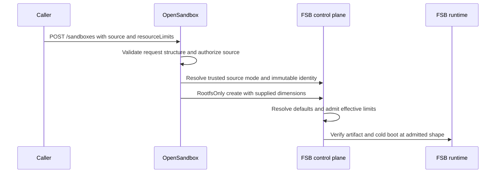

# OSEP-0028: CPU and Memory Overrides for Rootfs-Only Sandbox Creation

<!-- toc -->
- [Summary](#summary)
- [Motivation and scope](#motivation-and-scope)
- [Public contract](#public-contract)
- [Runtime integration](#runtime-integration)
- [Compatibility and rollout](#compatibility-and-rollout)
- [Test plan](#test-plan)
- [Alternatives and review decision](#alternatives-and-review-decision)
<!-- /toc -->

## Summary

Reuse `POST /sandboxes` and its existing top-level `resourceLimits` field. When a tenant creates a new Sandbox from a verified FSB RootfsOnly source, each CPU or memory value present on the wire sets that dimension for the new guest. The other dimension inherits its source default. For example, a memory-only request can retain a snapshot's half-core CPU quota while booting with 4 GiB of RAM. The [companion FSEP](https://github.com/opensandbox-group/fast-sandbox/pull/219) covers resource admission, cold boot and recapture.

## Motivation and scope

A RootfsOnly artifact boots a fresh kernel from disk, so the new guest can have a different machine shape. Full restores must honor the saved VM state. This change applies to RootfsOnly sources on qualified ResourceAware FSB pools. Full checkpoint resume, other runtimes and ordinary image creation follow their existing rules. Changing the business entrypoint is a separate use case.

**Amendments proposed for the implementation release:**

- [OSEP-0007](0007-fast-sandbox-runtime-support.md) and the [lifecycle OpenAPI specification](../specs/sandbox-lifecycle.yml): qualify the `templateId` paragraph that rejects `resourceLimits` with 400. An authorized, ready template whose artifact is verified RootfsOnly may accept CPU and memory overrides. Other template classes retain the rejection. Document the corresponding `snapshotId` and `resourceLimits` conditions.
- [OSEP-0026](0026-resource-oversubscription-accounting-for-fast-sandbox.md): its build-time machine tuple stays immutable. For a RootfsOnly template, it supplies the default size for a new instance; resizing that instance does not require rebuilding the template. For a RootfsOnly snapshot, per-dimension overrides relax the recorded-limit equality check. Full restore and existing pool budget/admission rules still apply.

## Public contract

```http
POST /sandboxes HTTP/1.1
Content-Type: application/json

{
  "snapshotId": "snap_example",
  "timeout": 600,
  "resourceLimits": { "memory": "4Gi" }
}
```

| Authorized source | CPU or memory omitted from a partial override | Missing inheritance data |
|---|---|---|
| `snapshotId` | Use the captured Sandbox's admitted limits, represented today by `SnapshotRestoreConfig.limits`. A recorded `500m` remains `500m` even if the guest saw one vCPU. | If a legacy snapshot lacks a required dimension, ask the caller to supply it. An explicit complete pair needs no inherited values. |
| `templateId` | Use the effective build-time `spec_json.machine` of the catalog template. An integer count of two vCPUs supplies a default of two cores. A fractional quota first enters this chain through an explicit override or a later snapshot. | Use the existing OSEP-0026 derivation for pre-existing catalog rows. An invalid effective machine after derivation is a template data error. |

Accept CPU only, memory only or both as positive Kubernetes quantities within runtime limits. For a verified RootfsOnly source, omitting the entire object requests both source defaults. Reject explicitly empty objects, null dimension values and unsupported override dimensions. Preserve existing handling of pool-owned constraints on legacy requests; a pool constraint such as `pids` cannot resize a guest. Treat all transmitted CPU and memory quantities literally, including values inserted by older SDKs. Existing workload and tenant restrictions continue to apply.

**Timeout:** the public request validator requires a non-null `timeout` with `templateId`. With `snapshotId`, the public schema permits omission or null for backends that support non-expiring Sandboxes. For an otherwise valid FSB snapshot create, the OpenSandbox Server's FSB adapter returns HTTP 400 synchronously in either case, before calling FastPath CreateSandbox. FSB callers must supply a timeout for either source.

**Discovery:** callers can inspect public `Snapshot.mode` (`full` or `rootfsOnly`; legacy records report `full`). For templates, propose an optional read-only artifact mode on `FsbTemplate`, populated from FSB only when known. Template storage `format` and build `status.phase` do not establish eligibility. Reject template overrides if the artifact's RootfsOnly mode cannot be verified.

**Response:** retain the existing create/status contract, including HTTP 202. Public observability of effective resource limits is **deferred**. A follow-up can expose admitted CPU/memory on `GET /sandboxes/{sandboxId}`, distinguishing them from measured usage and guest hardware. Do not infer either inherited limits or successful boot from an accepted create response.

## Runtime integration



Delay mode-specific validation until the source has been authorized and classified. A Full template with limits still receives 400; a Full snapshot retains existing restore validation. OpenSandbox forwards the immutable source reference, source kind and supplied dimensions over gRPC, preserving absence before applying any legacy defaults. Bind source defaults to that identity, using the catalog/recorded values above or their authoritative FSB projection. FSB resolves the final resource pair once and verifies mode/digest before launch. OSB does not mount or read artifact manifests.

Keep the distinct override-aware gRPC create operation. An old FSB returns `UNIMPLEMENTED`; do not retry a reshape through legacy Create. Qualify the pool and selected Fastlet before enabling the new behavior. Preserve current behavior on deployments where this feature is disabled, including legacy creates that only replay recorded limits. Capacity rejection and invalid input retain their existing error mappings.

## Compatibility and rollout

| Wire request | Pre-feature OSB | OSB with RootfsOnly support enabled |
|---|---|---|
| RootfsOnly snapshot with recorded limits, different CPU/memory | Source equality check rejects the change | Create with the transmitted values if admitted |
| Same snapshot, values equal to recorded limits | Existing restore can succeed | Same intended limits |
| RootfsOnly catalog template with limits | Template validation rejects | Apply supplied dimensions and inherit the rest |
| Full template with limits or Full snapshot with changed recorded limits | Reject | Reject |
| Snapshot with missing recorded limits | Existing pool-based validation can apply | For a verified RootfsOnly override, require any value that cannot be inherited |

The ordinary snapshot create paths in the Python, Go, C#, JavaScript and Kotlin SDKs send `1 CPU / 2Gi` by default when the caller supplies no resources. For a source recorded at `4 CPU / 8Gi`, upgrading the server can therefore turn a rejected request into a successful create at `1 CPU / 2Gi`. Release notes must name all five affected SDKs and explain that the server applies the transmitted values. For callers who want to inherit source limits, document a method such as `createFromRootfs()` that uses the same endpoint and serializes only caller-supplied dimensions. Raw HTTP follows the same omission rules. SDK calls requiring the new behavior should target a qualified server; the legacy pool fallback makes a universal old-server rejection guarantee impossible.

Qualify FSB before enabling the OSB mapping. Disable new reshapes first on rollback, retaining compatible workers for admitted instances, pending retries and recapture.

## Test plan

| Case | Acceptance |
|---|---|
| Wire and SDK | For Python, Go, C#, JavaScript and Kotlin, inspect the outgoing body of an ordinary snapshot create with no caller-supplied resources and verify the default pair against the compatibility matrix. For the new helper in each SDK and for raw HTTP, verify that a memory-only request inherits CPU and that omitting both dimensions inherits both source limits. |
| Source defaults | Override only memory on a `500m` snapshot and on a two-vCPU template. Verify quotas of `500m` and two cores respectively. Cover a legacy snapshot missing the omitted value and a legacy catalog row with derivable build defaults. |
| Timeout | Test omitted and explicit null separately. For a template, expect public validation to reject the request. For an otherwise valid FSB snapshot create, assert a synchronous HTTP 400 and zero FastPath CreateSandbox calls. A supported explicit timeout reaches admission for both source types. |
| Eligibility | Verify reported snapshot/template mode, missing metadata, inaccessible sources, Full rejection and pool constraints. An old FSB or ineligible worker cannot silently create a reshaped guest through legacy Create. |
| Runtime | Test smaller and larger guests, quota inheritance across recapture, asynchronous failures and subsequent Full restore. Qualify each supported storage backend with the FSEP tests. |

## Alternatives and review decision

A separate HTTP route would make unsupported-version rejection independent of existing validators, but would duplicate the public create operation. Reusing the known field is sufficient under the agreed wire semantics; its compatibility behavior depends on the existing validation rules and should have regression coverage. A new field on the old route would be unsafe because older servers can ignore it. Review the RootfsOnly-only amendments, the two sources of defaults and the proposed read-only template mode before updating the OpenAPI specification.
