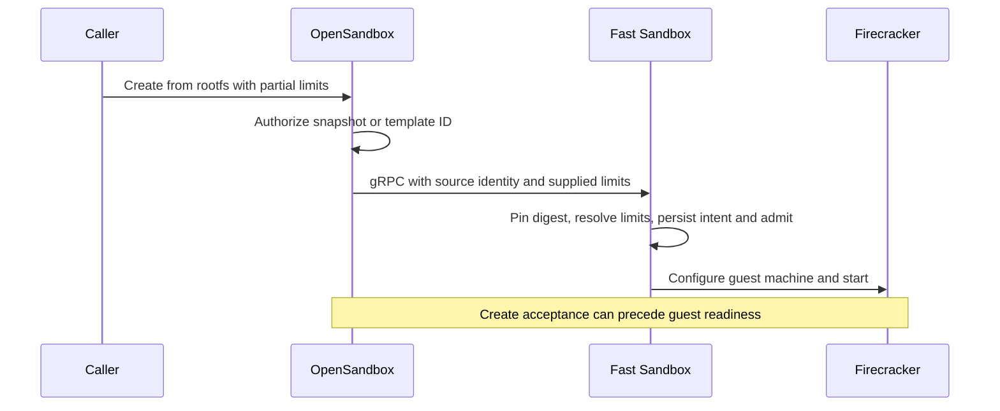

# OSEP-0032: CPU and Memory Overrides for Rootfs-Only Sandbox Creation

<!-- toc -->
- [Summary](#summary)
- [Motivation and scope](#motivation-and-scope)
- [Public contract](#public-contract)
- [Runtime integration](#runtime-integration)
- [Compatibility and rollout](#compatibility-and-rollout)
- [Test plan](#test-plan)
- [Alternatives and review decision](#alternatives-and-review-decision)
<!-- /toc -->

## Summary

A caller with a RootfsOnly snapshot of a 2-vCPU, 2-GiB environment should be able to create a new Sandbox with 4 GiB of RAM while retaining the source CPU limit. This draft proposes an explicit create operation for that purpose. OpenSandbox owns source authorization, the HTTP contract and SDK behavior. Fast Sandbox (FSB) resolves the artifact and applies the requested limits. The [companion FSEP](https://github.com/opensandbox-group/fast-sandbox/pull/219) defines admission, boot and recapture.

## Motivation and scope

Today the FSB adapter checks snapshot restore limits against the original settings. Template-based creates reject caller resource limits. These rules suit a Full restore, where the saved VM state determines the machine configuration. RootfsOnly creates boot a fresh kernel from disk, so the same filesystem can serve workloads of different sizes. This proposal extends the ResourceAware admission model in [OSEP-0026](0026-resource-oversubscription-accounting-for-fast-sandbox.md).

Scope is creation of a **new** FSB Sandbox from an authorized RootfsOnly snapshot or template. Existing create, Full checkpoint resume and live instances keep their behavior. Entrypoint override is a future candidate for workloads whose baked command must never start. It needs its own use case and guest-init design. This proposal adds no startup-command parameter or guest protocol.

## Public contract

**Proposed for review:** add `POST /sandboxes/from-rootfs`. It shares the existing creation service, authentication, tenant checks, lifecycle and response model. A distinct route gives both raw HTTP clients and SDKs an observable failure on an older server before a Sandbox can be created. The proposed route below is not a released endpoint.

```http
POST /sandboxes/from-rootfs HTTP/1.1
Content-Type: application/json

{
  "snapshotId": "snap_example",
  "timeout": 600,
  "resourceLimits": { "memory": "4Gi" }
}
```

| Input | Contract |
|---|---|
| Source | Exactly one nonempty `snapshotId` or `templateId`. Resolve it under the caller's tenant. The authorized artifact must be ready and RootfsOnly. |
| Limits | A nonempty object with `cpu`, `memory`, or both. Values are positive Kubernetes quantity strings within supported FSB bounds. Each omitted dimension inherits the source **resource limit**, including fractional CPU. A complete pair can be used when an older artifact lacks inheritance metadata. |
| Lifecycle | Use the existing FSB create timeout and lifecycle rules. Preserve existing per-source rules for pool selection and other supported controls. Reject conflicting sources, nulls in the limits object, unknown limit keys, and unsupported workload settings such as `entrypoint` or `resourceRequests`. |
| SDK | Expose an explicit opt-in creation method or option. Serialize only supplied dimensions. A client sending an ordinary create continues to use its existing SDK defaults. Never retry an unsupported route through ordinary create. |

For example, setting only memory to 4 GiB on a source admitted at `500m` keeps a half-core CPU quota even though the Guest sees one online vCPU. An artifact without a recorded CPU limit cannot supply that default: ask for an explicit CPU value. A mode guess or an inferred CPU limit from a vCPU count is insufficient.

Use the existing create response and status polling contract, including HTTP 202. Acceptance reports creation status; runtime readiness confirms startup. V1 adds no public response fields for measured RAM, vCPU count or effective limits. Implementations verify these independently in E2E tests. A synchronous validation failure rejects the request. A failure after asynchronous acceptance is visible through the existing failed lifecycle state.

## Runtime integration



OSB validates structure and ownership. It uses FSB's typed metadata over gRPC for the immutable source reference and reported mode where needed. FSB owns source defaults, deployment support and the final admission decision. A source lookup may reuse an existing RPC or cached FSB result bound to the same digest. OSB requires no storage credentials, OverlayBD mount, S3 object access, or manifest parser.

The override path requires an explicit gRPC operation or equivalent fail-closed negotiation; adding optional fields to legacy Create alone would let an older receiver silently discard them. Prefer a distinct create RPC reusing the existing handler internally. An old FSB returns `UNIMPLEMENTED`; OSB surfaces unsupported operation and never retries legacy Create. The selected Fastlet must also support the operation. Revalidation against the pinned artifact before launch prevents a tag move or stale cache from changing the source.

Malformed or conflicting input receives the current lifecycle invalid-parameter treatment. Cross-tenant or missing sources use the same non-disclosing lookup result as existing creates. Full sources, unsupported runtime/pool combinations, and missing inherited dimensions receive actionable errors. Preserve the existing distinction between capacity failure and transient backend unavailability.

## Compatibility and rollout

Ship and qualify FSB support before enabling the new OSB route and SDK option. Publish the OpenAPI request, examples, error mappings, server validation and SDK changes in the implementation release. Deployments with mixed runtime versions must restrict admission to compatible workers. Disable new override creates first on rollback; retain compatible workers until admitted instances and pending retries have drained. Ordinary creation and existing clients need no migration.

## Test plan

| Case | Required evidence |
|---|---|
| Wire compatibility | Send a valid override request to a pre-feature OSB using the SDK and raw HTTP. The route fails, the ordinary create handler receives no request and no Sandbox exists. Repeat against new OSB with old FSB and an unsupported Fastlet. |
| Source and omission | Exercise both source ID forms. Reject ambiguous IDs, inaccessible sources, Full artifacts and empty limits. Verify SDK serialization of CPU only, memory only and both; reject missing inheritance metadata only for dimensions that need it. |
| Resource inheritance | Boot at `500m / 2Gi`, recapture, request only `4Gi` and verify the second Guest still has one vCPU and its host quota is still `500m`. Exercise growing and shrinking within admission limits. |
| Lifecycle | Check HTTP 202 and subsequent success or failure independently. Verify budget rejection before launch, retry convergence and unchanged existing Full restore. Verify recaptured Full machine metadata and cold-boot behavior on qualified OCI/OverlayBD and native/S3 backends. |

## Alternatives and review decision

The original draft proposed a `rootfsOnlyOverrides` object alongside `templateId` on the existing endpoint. A pre-feature server can discard the unknown object and proceed with a valid legacy template create. An SDK-only capability probe would still leave raw HTTP and mixed-server routing exposed. The dedicated path costs one public operation and one SDK dispatch, but shares the implementation and gives older servers no matching create operation. A versioned request on the existing path is viable if maintainers can demonstrate the same rejection guarantee before side effects.

**Decision requested:** approve or replace the proposed HTTP operation before changing the [OpenAPI contract](../specs/sandbox-lifecycle.yml). Its public spelling can change during review. The scope, omission rules and cross-version failure behavior are the contract to preserve.
