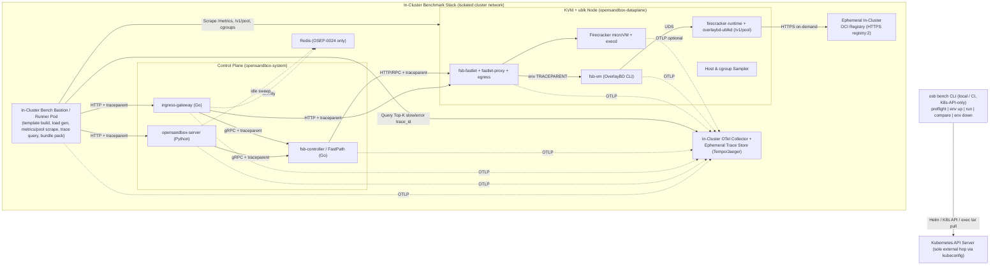

# OSEP-0033: Full-Stack Benchmark CLI (osb bench) and End-to-End OTel Tracing for Fast Sandbox (OverlayBD)

<!-- toc -->
- [Summary](#summary)
- [Motivation](#motivation)
  - [Goals](#goals)
  - [Non-Goals](#non-goals)
- [Requirements](#requirements)
- [Proposal](#proposal)
  - [Notes/Constraints/Caveats](#notesconstraintscaveats)
  - [Risks and Mitigations](#risks-and-mitigations)
- [Design Details](#design-details)
  - [1. CLI Packaging and Command Surface (osb bench)](#1-cli-packaging-and-command-surface-osb-bench)
  - [2. Full-Stack Provisioning and Preflight Pipeline (OverlayBD)](#2-full-stack-provisioning-and-preflight-pipeline-overlaybd)
  - [3. Phase 1 Workload Suites (OverlayBD Only)](#3-phase-1-workload-suites-overlaybd-only)
  - [4. Standardized Metrics Specification](#4-standardized-metrics-specification)
    - [4.1 End-to-End and Stage-Decomposed Lifecycle Latencies](#41-end-to-end-and-stage-decomposed-lifecycle-latencies)
    - [4.2 OverlayBD Storage, Cache, and ublk Pool Metrics](#42-overlaybd-storage-cache-and-ublk-pool-metrics)
    - [4.3 Scheduling, Pool, and Overcommit Metrics](#43-scheduling-pool-and-overcommit-metrics)
    - [4.4 Wake-on-Access / Wake-Storm Metrics (OSEP-0024)](#44-wake-on-access--wake-storm-metrics-osep-0024)
    - [4.5 High-Density Load and Saturation Metrics (Host, Fastlet, Egress, Fastlet-Proxy)](#45-high-density-load-and-saturation-metrics-host-fastlet-egress-fastlet-proxy)
    - [4.6 Correctness Verification and Leak Audit](#46-correctness-verification-and-leak-audit)
  - [5. End-to-End OpenTelemetry Tracing and Trace-Based Drill-Down](#5-end-to-end-opentelemetry-tracing-and-trace-based-drill-down)
    - [5.1 Current Tracing Coverage and Gaps](#51-current-tracing-coverage-and-gaps)
    - [5.2 W3C Context Propagation and Missing Spans](#52-w3c-context-propagation-and-missing-spans)
    - [5.3 In-Cluster OTel Trace Stack](#53-in-cluster-otel-trace-stack)
    - [5.4 Automated Trace Drill-Down in osb bench](#54-automated-trace-drill-down-in-osb-bench)
  - [6. Benchmark Profile, Report Schema, and Regression Comparison](#6-benchmark-profile-report-schema-and-regression-comparison)
  - [7. Kubeconfig Permission Model](#7-kubeconfig-permission-model)
- [Test Plan](#test-plan)
- [Drawbacks](#drawbacks)
- [Alternatives](#alternatives)
- [Infrastructure Needed](#infrastructure-needed)
- [Upgrade & Migration Strategy](#upgrade--migration-strategy)
<!-- /toc -->

## Summary

This proposal introduces an official `osb bench` CLI plugin (`opensandbox-bench`, loaded via the `opensandbox.cli.plugins` entry-point mechanism) that provisions a complete OpenSandbox + `fast-sandbox` (OverlayBD) environment from scratch using a privileged `kubeconfig`, executes standardized scheduling, lifecycle, and high-density benchmark suites, and produces machine-readable baseline reports for pre-release regression gating (tracking GitHub issue #3048).

Phase 1 scopes exclusively to the **`fast-sandbox` OverlayBD (OCI) path**. Alongside the benchmark harness, this proposal completes **end-to-end OpenTelemetry distributed tracing** across OpenSandbox (`server`, `ingress-gateway`, `execd`) and `fast-sandbox` (`controller/FastPath`, `fastlet`, `fastlet-proxy`, `fsb-vm`, `firecracker-runtime`), backed by an optional in-cluster OTel trace collector/store deployed by `osb bench`. Benchmark runs automatically drill down into P99 and failed requests via collected trace trees rather than manual log parsing, and capture high-density resource load across the host node, `fastlet`, `egress`, and `fastlet-proxy`.

## Motivation

OpenSandbox's `fast-sandbox` OverlayBD stack now spans multiple performance-sensitive subsystems: `ResourceAware` overcommit pools (OSEP-0026), node-level `overlaybd-ublkd` warm device pools, three-tier local caches (`manifest-cache`, `shared_snapfiles`, `blob-cache`), `Full` vs. `RootfsOnly` snapshots (FSEP-0001), rootfs layer-chain compaction/squash, and ingress-driven auto-pause / wake-on-access (OSEP-0024).

Today, validating and protecting this stack before each release has four structural gaps:

1. **No reproducible full-stack benchmark CLI**: Existing scripts (`tests/python/benchmarks/kubernetes_resume.py`, `scripts/fast-sandbox-env/create-bench.py`) are ad-hoc, cover narrow paths, and assume a pre-configured cluster. Operators and release engineers lack a single command that can stand up a clean, standardized OverlayBD deployment from a `kubeconfig` and run repeatable suites.
2. **Incomplete trace visibility forces brittle log grepping**: OSEP-0010 intentionally excluded OpenTelemetry Tracing from `execd`, `egress`, and `ingress`, and `opensandbox-server` does not yet propagate W3C `traceparent` into `FastPath` gRPC calls. Inside `fast-sandbox`, `internal/observability` provides OTLP trace export (`setup.go`) and spans for FastPath/Fastlet create stages, but tracing breaks at the `fsb-vm` subprocess boundary (`create --prepare-only`, `pack`) and is absent on Snapshot/Pause/RootfsOnly paths. Diagnosing a P99 spike currently requires correlating timestamps across pod logs on multiple nodes.
3. **OverlayBD-specific nonlinear cliffs are unmeasured**: Performance cliffs such as `overlaybd-ublkd` warm-pool exhaustion (`poolSizeGB` mismatch or burst > `poolHigh`), `blob-cache` eviction lock contention, non-reflink `copyFrozenUpper` fallback, and the 24-layer rootfs squash threshold (`defaultMaxRootfsLayers = 24`) are invisible to generic API latency benchmarks.
4. **High-density data-plane and host saturation are blind spots**: As sandbox density per node scales up, bottlenecks shift from single-sandbox startup latency to host I/O and CPU contention, `fastlet` memory/goroutine overhead, `egress` DNS/nftables/MITM proxy load, and `fastlet-proxy` connection/relay overhead.

### Goals

- Ship `osb bench` as an official `osb` CLI plugin (`opensandbox-bench`) using the existing `opensandbox.cli.plugins` entry-point group so `opensandbox-cli` stays lightweight.
- Support full-stack environment provisioning and teardown from a privileged `kubeconfig`: node preflight checks (KVM, `ublk_drv`, XFS `reflink=1`, spill dir), ephemeral in-cluster infrastructure (self-contained HTTPS OCI Registry, optional Redis, in-cluster OTel Collector + Trace Store — no external registry required), official Helm chart deployment (`base`, `fast-sandbox` with `runtime.oci.enabled=true`, `server`, `ingress-gateway`), golden OverlayBD template build, and `ResourceAware` `SandboxPool` setup.
- Define and collect a canonical Phase 1 OverlayBD metric set covering lifecycle latencies, OverlayBD storage/cache/`ublkd` warm-pool behavior, scheduling/overcommit behavior, OSEP-0024 wake-storms, and high-density load across host, `fastlet`, `egress`, and `fastlet-proxy`.
- Complete end-to-end W3C `traceparent` propagation and span instrumentation across `osb bench` -> `server` -> `FastPath` -> `fastlet` -> `fsb-vm` / `firecracker` (control plane) and `osb bench` -> `ingress-gateway` -> `fastlet-proxy` -> `execd` (data plane), plus Snapshot/Pause/RootfsOnly spans.
- Provide automated trace-based drill-down in `osb bench run` (querying the in-cluster trace backend for slow/failed `trace_id`s) and structured JSON/Markdown reporting with `osb bench compare` for pre-release baseline gating.

### Non-Goals

- **Non-OverlayBD backends and `LegacySlot` pools in Phase 1**: Classic Kubernetes (`BatchSandbox` + `Pool`), Docker runtime, `fast-sandbox` Native S3/DART artifact paths, and `LegacySlot` pools are explicitly out of scope for Phase 1; Phase 1 targets `fast-sandbox` OverlayBD with `ResourceAware` pools (OSEP-0026) only, while keeping the profile and report schemas extensible for Phase 2.
- **Replacing production observability platforms**: The in-cluster OTel Collector and trace store deployed by `osb bench env up` are ephemeral, benchmark-scoped infrastructure; production clusters may point the same standard `OTEL_EXPORTER_OTLP_*` environment variables at their own collector/Tempo/Jaeger backend.
- **Always-on 100% tracing in production**: Production deployments continue to default to tracing disabled (no-op `TracerProvider`) unless `OTEL_EXPORTER_OTLP_ENDPOINT` or `OTEL_EXPORTER_OTLP_TRACES_ENDPOINT` is explicitly configured.
- **Automated bare-metal OS provisioning**: `osb bench` assumes an existing Kubernetes cluster reachable via `kubeconfig` with Linux KVM nodes; optional node-level XFS/ublk preparation is opt-in (`--prepare-nodes`) and never mutates hosts by default.

## Requirements

| ID | Requirement | Priority |
|---|---|---|
| R1 | `osb bench` is packaged as an official `osb` plugin (`opensandbox.cli.plugins`) and invoked via `osb bench <subcommand>` | Must Have |
| R2 | Given a sufficiently privileged `kubeconfig` and a profile YAML, `osb bench env up` deploys the complete OverlayBD stack (charts, registry, optional Redis, in-cluster OTel trace stack, OverlayBD template, SandboxPool) and verifies readiness | Must Have |
| R3 | Phase 1 benchmark suites cover `schedule-burst`, `steady-churn`, `pause-resume` (Full checkpoint: warm, cache-evicted, cross-node, multi-round layer squash), `rootfs-only-restore` (create/fork from `RootfsOnly` snapshot: warm materialized, cold/cross-node, concurrent fan-out, and OSEP-0028 CPU/memory overrides), `wake-storm` (OSEP-0024), and `high-density-soak` on the `fast-sandbox` OverlayBD path | Must Have |
| R4 | `osb bench` requires connectivity **only** to the Kubernetes API Server (via `kubeconfig`); all in-cluster API calls, workload generation, white-box metric/pool scraping, and trace queries execute inside an in-cluster Bench Bastion/Runner Pod so the client need not share a network with cluster Services/Pods and external RTT jitter is eliminated | Must Have |
| R5 | End-to-end OTel tracing propagates W3C `traceparent` from `osb bench` through `server` / `ingress-gateway` into `fast-sandbox` (`FastPath`, `fastlet`, `fastlet-proxy`, `fsb-vm`) and `execd`, with spans covering Create, Resume, Pause, Snapshot (`Full` and `RootfsOnly`), and Wake-on-Access | Must Have |
| R6 | `osb bench run` records `trace_id` per operation and automatically queries the in-cluster trace backend to attach span-level waterfall breakdowns for top slow (P99) and failed operations in the output bundle | Must Have |
| R7 | High-density suites collect time-series load and saturation telemetry for the host node, `fastlet`, `egress`, and `fastlet-proxy` alongside sandbox latency and throughput | Must Have |
| R8 | Every run emits a self-contained JSON report (recording full environment fingerprint, metrics, load summaries, leak audit, and trace drill-downs) plus Markdown summary, and `osb bench compare` highlights regressions against a baseline JSON | Must Have |
| R9 | Tracing adds negligible overhead when disabled (no-op provider by default) and bounded overhead when enabled (configurable sampler and batch exporter) | Must Have |
| R10 | `osb bench env down` cleanly removes all benchmark-provisioned resources and verifies zero leaked sandboxes or `ublk` devices | Should Have |

## Proposal

We propose a two-pillar architecture: **(1) the `osb bench` full-stack benchmark plugin** and **(2) end-to-end OTel tracing completion across the OpenSandbox + `fast-sandbox` OverlayBD stack**.



### Notes/Constraints/Caveats

- **OverlayBD `poolSizeGB` exact match constraint**: As documented in `manifests/charts/fast-sandbox/values.yaml`, `runtime.oci.poolSizeGB` must exactly equal the built template's `rootfsSizeMiB / 1024` (e.g., `2` for 2 GiB); even a larger pool device causes a silent fallback to cold device creation. `osb bench env up` enforces this invariant automatically from the benchmark profile and fails fast on mismatch.
- **Ephemeral registry TLS trust without rebuilding release images**: Unlike local dev scripts that bake a custom `ca.crt` into rebuilt container images, `osb bench` deploys pre-built release images onto remote clusters. Furthermore, `sandboxtemplate-builder` Pods spawned dynamically by `fsb-controller` currently whitelist only scheduling fields (`tolerations`, `affinity`, `topologySpreadConstraints`). Phase 1 therefore adds an explicit `registryCABundleSecret` contract to the `fast-sandbox` chart and controller so the ephemeral registry's CA bundle is mounted into `fsb-fastlet`, `firecracker-runtime` (`overlaybd-ublkd`), and `sandboxtemplate-builder` Pods without rebuilding images.
- **Synchronous Create vs. asynchronous CRD-reconciled Pause/Resume/Snapshot**: In `fast-sandbox`, `CreateSandbox` synchronously invokes `fastlet` so the VM is running when the RPC returns; by contrast, `PauseSandbox`, `ResumeSandbox`, and `CreateSandboxSnapshot` (`sandbox_state.go`, `snapshot.go`) are compare-and-set CRD intent patches that return in milliseconds while the controller reconciles asynchronously. Both latency definitions (§4.1) and W3C trace propagation (§5.2) explicitly account for this split.
- **Two distinct node-side OverlayBD caches**: `runtime.oci.cacheSizeGB` (`OVERLAYBD_CACHE_SIZE_GB`) governs the `overlaybd-ublkd` block cache, whereas `FAST_SANDBOX_OCI_BLOB_CACHE_SIZE_BYTES` governs `fsb-vm`'s local checkpoint blob cache (`oci/blobs/sha256`, capped at 4096 files and 1 GiB free-space floor). Both must be pinned in the profile, audited separately, and cleared together in `cache-evicted` tests.
- **Client polling bias**: SDK default readiness polling (`200ms`) masks sub-100ms warm create latencies. `osb bench` defaults to `10ms` readiness polling (matching the `fast-sandbox-ack-2026-10-08.json` methodology) and records the exact polling interval in the report metadata.
- **In-guest `execd` trace export**: Exporting OTLP traces directly from inside Firecracker microVMs (`execd`) depends on guest egress rules permitting traffic to the in-cluster OTel Collector. When egress policies restrict guest outbound traffic, `execd` tracing is optional; the `fastlet-proxy` outbound client span still brackets the exact `execd` round-trip latency without requiring guest egress exemptions.

### Risks and Mitigations

| Risk | Mitigation |
|---|---|
| Privileged `kubeconfig` or node-prep accidentally mutates a shared/production cluster | `osb bench env up` installs into dedicated/explicitly named namespaces, labels all resources with `opensandbox.io/bench-run=<id>`, and keeps `--prepare-nodes` off by default (read-only preflight unless explicitly opted in). |
| Ephemeral `registry:2` runs out of disk or bottlenecks on slow backing storage during multi-round Full checkpoints | Default ephemeral registry storage budget to `200Gi` backed by fast local NVMe (`hostPath` / fast `StorageClass`), enable `REGISTRY_STORAGE_DELETE_ENABLED=true`, and run registry garbage collection / reset between major suites so checkpoint I/O reflects OverlayBD rather than slow disk or `disk full` failures. |
| Single-replica `opensandbox-server` (`replicaCount: 1`) saturates before `fast-sandbox` at high concurrency | Monitor `opensandbox-server` and `ingress-gateway` CPU/RSS/request queueing alongside node components, and report both `t_server_total` and trace-extracted `t_fastpath_grpc` so `server`-side queueing is cleanly separated from `FastPath`/`fastlet` scheduling latency. |
| 100% OTel trace sampling distorts P99 latency or overwhelms the ephemeral trace store during long/high-density runs | Bind sampling policy per suite: `1.0` (100%) on bounded latency-attribution suites (`schedule-burst`, `pause-resume`, `rootfs-only-restore`, `wake-storm`), and low head-sampling (`0.02`) + Collector tail-sampling (retaining slow/error traces) on sustained capacity suites (`steady-churn`, `high-density-soak`), with non-blocking drop-on-overflow queues. |
| `fsb-vm` short-lived CLI process exits before async OTLP batch flush completes | `fsb-vm` explicitly calls `provider.ForceFlush(ctx)` with a short bounded timeout (e.g., `200ms`) before process exit, or flushes to a node-local OTel Collector agent so flushing adds sub-millisecond overhead and never blocks sandbox creation on collector failure. |
| Benchmark runner Pod contends with Firecracker VMs for CPU/memory | Schedule the in-cluster runner Pod, ephemeral `registry:2`, and OTel stack via `nodeAffinity` / `podAntiAffinity` away from `fast-sandbox.io/firecracker-node=true` runtime nodes whenever control/utility nodes are available, and record placement in report metadata. |
| Cross-node resume fails on heterogeneous CPU clusters or silently lands back on the source node | `preflight` checks CPU family/model/stepping homogeneity across candidate nodes; cross-node tests isolate the source node's `fastlet` from `FastPath` placement (rather than relying on `kubectl cordon`, which `FastPath` ignores) and assert `before_node != after_node` on every sample. |

## Design Details

### 1. CLI Packaging and Command Surface (`osb bench`)

`osb bench` is implemented as an official Python package (`opensandbox-bench`, located in-repo under `tools/bench/` or `cli/plugins/bench/`) registered under the `opensandbox.cli.plugins` entry-point group consumed by `cli/src/opensandbox_cli/plugins.py`.

Command surface:

```bash
# 1. Read-only node & cluster preflight (KVM, ublk_drv, XFS reflink, spill dir, CPU homogeneity)
osb bench preflight --kubeconfig <path> --profile <profile.yaml>

# 2. Provision full OverlayBD stack (registry, optional Redis, OTel stack, Helm charts, template, pool)
osb bench env up --kubeconfig <path> --profile <profile.yaml> [--prepare-nodes]

# 3. Execute benchmark suites via in-cluster runner + white-box metrics + trace drill-down + leak audit
osb bench run --kubeconfig <path> --profile <profile.yaml> \
  --suite <all|schedule-burst|steady-churn|pause-resume|rootfs-only-restore|wake-storm|high-density-soak> \
  --output <dir-or-json>

# 4. Inspect a specific slow/failed operation's trace tree from a saved run bundle
osb bench trace <run-bundle-dir> [--trace-id <id> | --top-slow 5]

# 5. Compare two benchmark reports and emit Markdown diff + exit non-zero on regression thresholds
osb bench compare <baseline.json> <candidate.json> [--fail-on-regression]

# 6. Tear down benchmark-provisioned resources and run post-teardown leak check
osb bench env down --kubeconfig <path> --profile <profile.yaml>
```

For CI and pre-release automation, `osb bench run --provision --teardown` chains `preflight -> env up -> run -> env down` atomically while preserving the output bundle on failure.

### 2. Full-Stack Provisioning and Preflight Pipeline (OverlayBD)

`osb bench env up` orchestrates four deterministic stages using the supplied `kubeconfig`:

1. **Preflight Stage**:
   - Launches a short-lived inspection Job/DaemonSet on candidate nodes to probe `/dev/kvm`, cgroup v2, `ublk_drv` kernel module availability, `StateRoot` mount filesystem type and `cp --reflink=always` capability, `FAST_SANDBOX_SNAPSHOT_SPILL_DIR` availability/size, and host CPU identity (`family/model/stepping`).
   - Captures node capacity, kernel version, OS image, containerd version, and Kubernetes version into the environment fingerprint.
2. **Supporting Infrastructure Stage**:
   - **Ephemeral In-Cluster OCI Registry**: Always deploys an ephemeral in-cluster HTTPS `registry:2` (with `REGISTRY_STORAGE_DELETE_ENABLED=true`, backed by a fast 200 GiB NVMe `hostPath` or explicit high-IOPS `StorageClass`, and a generated benchmark-scoped CA) in the benchmark namespace. Provisions `fast-sandbox-agent-registry`, `template_oci_publish_secret`, and `registryCABundleSecret` so `fsb-fastlet`, `firecracker-runtime` (`overlaybd-ublkd`), and `sandboxtemplate-builder` Pods trust the ephemeral registry CA without rebuilding release images. An optional `imageRegistryMirror` in `profile.yaml` may mirror read-only upstream component/base images in air-gapped clusters, while 100% of benchmark template and snapshot reads/writes hit the ephemeral in-cluster `registry:2` (with garbage collection/reset between suites and full teardown on `osb bench env down`).
   - **In-Cluster OTel Stack**: Deploys an OpenTelemetry Collector (with `memory_limiter`, batching, and optional `tail_sampling` for soak suites) + ephemeral trace backend (Jaeger v2 or Grafana Tempo single-binary) in the benchmark observability namespace (`opensandbox-bench-obs`), exposing OTLP gRPC (`4317`) and HTTP query APIs inside the cluster.
   - **Redis (conditional)**: Deployed when `wake-storm` is enabled in the profile.
3. **OpenSandbox + `fast-sandbox` Helm Stage**:
   - Installs/upgrades `manifests/charts/opensandbox` (or individual sub-charts `base`, `fast-sandbox`, `server`, `ingress-gateway`) with profile-pinned values:
     - `fast-sandbox.runtime.oci.enabled=true`
     - `fast-sandbox.runtime.oci.cacheSizeGB`, `poolLow`, `poolHigh`, `poolSizeGB`
     - `OTEL_EXPORTER_OTLP_ENDPOINT` wired into `server`, `ingress-gateway`, `fsb-controller`, `fsb-fastlet`, `fsb-fastlet-proxy`, and `firecracker-runtime`
     - Optional `FAST_SANDBOX_SNAPSHOT_SPILL_DIR` and `FAST_SANDBOX_OCI_BLOB_CACHE_SIZE_BYTES` on pool fastlets
   - Waits until `firecracker-runtime` DaemonSet marks all target nodes `FirecrackerReady=True` and `/v1/pool` on each node reaches `idle >= poolLow`.
4. **In-Cluster Bench Bastion/Runner, Template, Pool, and Warmup Stage**:
   - **Network-isolated execution model**: Because the machine running `osb bench` is frequently outside the cluster VPC/Pod CIDR and cannot directly reach cluster Services (`opensandbox-server`, `ingress-gateway`, `registry:2`, OTel trace store, or Pod `/metrics` endpoints), `osb bench` treats the Kubernetes API Server as its **sole network hop**. It deploys a dedicated **In-Cluster Bench Bastion/Runner Pod** (`opensandbox-bench-runner`, scheduled off runtime nodes with a fixed resource budget such as 4 CPU / 4 GiB and a scoped in-cluster ServiceAccount) that executes all cluster-local operations over internal ClusterIP/Pod IPs:
     - Calls `POST /templates` on `opensandbox-server` via ClusterIP to build the OverlayBD golden template (`resourceLimits.disk` strictly matched to `runtime.oci.poolSizeGB`) and verifies `status.manifestRef` uses `oci://`.
     - Applies the profile's `ResourceAware` `SandboxPool` (OSEP-0026, with `overcommitRatio` and `egress` sidecar attached) and waits for all fastlet Pods and egress containers to become `Ready`.
     - Runs warmup cycles (default 2, excluded from statistics), executes all selected benchmark suites, scrapes `/metrics` and `/v1/pool`, gathers host/cgroup load samples, queries the in-cluster OTel trace store for Top-K slow/failed `trace_id`s, and packages the complete `run-bundle/` inside the Pod.
   - Local `osb bench run` streams progress/logs from the Bastion/Runner Pod via the Kubernetes API and pulls the finished `run-bundle/` back to `--output` as a tar stream over K8s `exec` (`pods/exec`). Subsequent `osb bench trace` and `osb bench compare` commands run completely offline against local bundles without cluster connectivity.

### 3. Phase 1 Workload Suites (OverlayBD Only)

| Suite | Pattern | Primary Questions Answered |
|---|---|---|
| `schedule-burst` | Waves of concurrent `create -> ping -> first-exec -> delete` at stepped concurrency (e.g., `1, 4, 8, 16, 32, 64`) | Max scheduling throughput (sandboxes/s), P50/P95/P99 warm create latency, `ublkd` warm-pool hit-to-miss cliff when burst > `poolHigh`, Top-K candidate contention, `ResourceAware` admission behavior |
| `steady-churn` | Sustained target RPS `create -> short workload -> delete` for a fixed duration (e.g., 10–15 min) | Steady-state tail latency, `deleting` slot backlog (`fsb-vm delete` / `ublkd` teardown speed), `blob-cache` & `shared_snapfiles` stability, memory/FD leak detection |
| `pause-resume` | Matrix of Full checkpoint `create -> write state -> pause -> resume -> verify state`: (a) same-node warm cache, (b) same-node cache-evicted (evicting `fsb-vm` `blob-cache`, `manifest-cache`, `shared_snapfiles`, **and** `overlaybd-ublkd` block cache while re-warming `/v1/pool` to `poolLow` so ublk device cold-create is not conflated with storage cache misses), (c) deterministic cross-node resume (isolating/draining the source node's `fastlet` from `FastPath` placement rather than `kubectl cordon`, and asserting `before_node != after_node`), (d) dirty-upper size ladder (`0MiB / 16MiB / 256MiB`), (e) long-chain multi-round pause/resume (`25+` rounds crossing `defaultMaxRootfsLayers=24` squash cliff) | Stop-the-world pause interruption window vs. async publish time, true Registry HTTP range-read lazy-load penalty on uncached blocks, layer-chain squash spike magnitude |
| `rootfs-only-restore` | Create `RootfsOnly` snapshot (FSEP-0001) at dirty-upper ladder (`0MiB / 16MiB / 256MiB`), then create new sandboxes from that snapshot across: (a) first cold materialize vs. warm materialized `shared_snapfiles` read-lock path, (b) concurrent fan-out (N sandboxes created simultaneously from one `RootfsOnly` snapshot), (c) cross-node create, (d) OSEP-0028 CPU/memory override create (`verifyBootMachine`), verifying disk state persistence and fresh `execd` readiness | `RootfsOnly` capture interruption (`FIFREEZE`->`FITHAW`) vs. Full pause, cold-boot restore latency (`t_api_ack` -> `t_first_ping` guest kernel+init+`execd` boot gap), lockless materialized snapfiles fan-out scaling, cross-node/override portability |
| `wake-storm` | Auto-pause a fleet of opted-in sandboxes (`lifecycle.idlePolicy`), then fire concurrent ingress traffic (both 1-request-per-sandbox fan-out and N-requests-to-1-sandbox singleflight bursts) | Wake-to-response P50/P95/P99, singleflight coalescing ratio, `--wake-park-max` / `--wake-restore-max` 503 shed rate, park-budget `Y` timeout rate, SDK retry convergence time |
| `high-density-soak` | Pack nodes to high target sandbox density (e.g., 50% / 80% / 100% of `ResourceAware` overcommit capacity), run periodic in-sandbox exec + outbound egress HTTP/TLS traffic + ingress proxy requests + background churn | Host CPU/mem/I/O saturation, `fastlet` / `egress` / `fastlet-proxy` resource scaling per active sandbox, tail-latency degradation under high density |

### 4. Standardized Metrics Specification

All latency distributions are reported as **P50, P90, P95, P99, Max, and Mean** (using nearest-rank percentiles for consistency with `fast-sandbox-ack-2026-10-08.json`), paired with sample count, success rate, and structured error breakdown.

#### 4.1 End-to-End and Stage-Decomposed Lifecycle Latencies

| Path | Layer | Metrics / Stages |
|---|---|---|
| **Create (Synchronous)** | Client black-box | `t_api_ack` (`CreateSandbox` gRPC return; VM is already running on completion, plus trace-split `t_server_overhead` vs. `t_fastpath_grpc`), `t_first_ping` (first `200` from guest `/ping` via ingress gateway — replaces status-poll `Running` tracking), `t_first_exec` (first `execd` command + disk read verification) |
| **Resume (Async CRD Intent)** | Client black-box | `t_api_ack` (CAS patch of `spec.state=Running` only; VM is **not** yet restored), `t_first_ping` (true end-to-end resume completion once async controller reconciliation + VM restore + ingress route convergence serve `/ping` `200`), `t_first_exec` (state-verified command + disk/memory marker check) |
| **Create / Resume** | Control Plane (`FastPath`) | `candidate_selection`, `crd_create`, `idempotency_read`, `fastlet_create`, `assignment_projection_wait` (`fast_sandbox_create_stage_latency_seconds`) |
| **Create / Resume (`Full`)** | Fastlet & OverlayBD (`fsb-vm` + Firecracker) | `validation`, `admission`, `runtime_ensure`, `oci_prepare` (`ping`, `resolveTpl`, `cred`, `resolveImg`, `snapfiles`, `vmmCheck`, `rootfsCfg`, `ublkdAcquire`), `launch` (`waitSocket`), `configure`, `boot` (`snapshot/load`), `data_plane_ready` |
| **Restore / Create (`RootfsOnly` Snapshot)** | Fastlet, OverlayBD & Guest Cold Boot | `oci_prepare` (highlighting `acquire_snapfiles`: first cold materialize vs. read-lock `tryAcquireMaterializedRootfsOnly` bypassing `ublkd.List`/ext4 mount), `pin_kernel` + jailer `rootfs-kernel` bind mount, `rootfs_boot_configure` (machine-config/boot-source/drives/NIC/vsock + OSEP-0028 CPU/memory override `verifyBootMachine`), `rootfs_boot_start` (`InstanceStart`), and **`guest_boot_to_first_ping_gap`** (kernel + `guest-init` + `execd` boot time from `t_api_ack` to `t_first_ping`) |
| **Pause / Snapshot (`Full`)** | Stop-the-world vs. Async | **Interruption window**: `snapshotMu` wait, `vcpu_pause`, `snapshot_create` (RAM dump, spill hit/miss), `capture_oci_upper` (`reflink` vs. `extents` vs. `sparse_scan`), `vcpu_resume`. **Async publish**: `fsb-vm pack` (`overlaybd-commit`, `snapfiles` ext4, optional `squashRootfsTail`), `oci_push`, `cache_oci_checkpoint` (note: completes before `Paused` is reported) |
| **Snapshot (`RootfsOnly`)** | Stop-the-world vs. Async | **Interruption window**: `guest_freeze_to_thaw` (vsock `FIFREEZE`/`FITHAW`), `vcpu_pause_to_resume`, `storage_drain_flush`, `capture_oci_upper`. **Async publish**: `fsb-vm pack --rootfs-only`, `oci_push`, `cache_oci_checkpoint` |

#### 4.2 OverlayBD Storage, Cache, and ublk Pool Metrics

| Metric | Source | Why It Matters |
|---|---|---|
| `ublkd_pool_hits_delta`, `ublkd_pool_misses_delta`, `ublkd_pool_idle_min/end` | `overlaybd-ublkd` `/v1/pool` | Directly exposes warm-pool efficiency and burst exhaustion cliffs |
| `ublkd_daemon_restarts` | K8s Pod status | Detects `overlaybd-ublkd` crashes under concurrency |
| `rootfs_layer_count` & `squash_triggered_count` | Trace attributes / `fsb-vm pack` | Isolates normal incremental pauses from 24-layer `overlaybd-merge` squash spikes |
| `upper_copy_mode` (`reflink` / `extents` / `sparse_scan`) | Trace attributes | Proves whether `captureOCIUpper` ran O(1) reflink or degraded to data copy |
| `artifact_rootfs_zfile_bytes` & `artifact_snapfiles_bytes` | Snapshot result / Registry | Quantifies storage/upload amplification (`Full` memory-sized vs. `RootfsOnly` KB-sized) |
| `overlaybd_block_cache_bytes` & `fsb_blob_cache_bytes` / `file_count` | Node pod probe (`oci/blobs/sha256` & `OVERLAYBD_CACHE_SIZE_GB` dir) | Tracks cache growth, eviction pressure, and lock contention |
| `first_exec_cold_read_ms` | Runner workload | Measures OverlayBD HTTP range-read lazy-load penalty on uncached blocks |

#### 4.3 Scheduling, Pool, and Overcommit Metrics

| Metric | Source | Meaning |
|---|---|---|
| `scheduling_throughput_rps` | Runner | Effective completed sandboxes/second across concurrency levels |
| `fast_sandbox_image_affinity_result_total{result}` | `fsb-controller` `/metrics` | `hit` / `miss` / `no_candidate` ratio; directly drives local OverlayBD cache reuse |
| `fast_sandbox_topk_retry_total{result}` | `fsb-controller` `/metrics` | Candidate lock / concurrent placement collision rate |
| `fast_sandbox_registry_heartbeat_age_seconds` & `candidate_count` | `fsb-controller` `/metrics` | Control-plane view freshness and eligible pool width |
| `fast_sandbox_fastlet_admission_total{operation,result,reason}` | `fsb-fastlet` `/metrics` | `ResourceAware` admission rejection rate and dominant rejection reasons (committed CPU/memory budget exhaustion, host/cgroup pressure, or runtime error) |
| `fast_sandbox_fastlet_admission_slots{state}` | `fsb-fastlet` `/metrics` | Peak `creating`, `running`, and `deleting` slot counts (detects teardown lag) |
| `fast_sandbox_fastlet_resource_admission_state{state,reason}` | `fsb-fastlet` `/metrics` | OSEP-0026 `ResourceAware` overcommit pressure state transitions |

#### 4.4 Wake-on-Access / Wake-Storm Metrics (OSEP-0024)

| Metric | Source | Meaning |
|---|---|---|
| `wake_to_response_ms` (P50/P95/P99) | Runner | Full end-to-end latency from first request to paused sandbox until HTTP response |
| `singleflight_coalesce_ratio` | Runner + `FastPath` `ResumeSandbox` count | Ratio of concurrent incoming requests per paused sandbox to actual `ResumeSandbox` RPCs |
| `wake_park_timeout_rate` (`503 + Retry-After`) | Runner | Fraction of requests exceeding park budget `Y` |
| `wake_shed_rate` (`503` pre-resume overflow) | Runner / Ingress metrics | Fraction shed by `--wake-park-max` or `--wake-restore-max` |
| `sdk_retry_convergence_ms` & `retry_count` | Runner | Time and attempts for SDK retry loop to succeed after `503 + Retry-After` |
| `fast_sandbox_sandbox_proxy_route_latency_seconds` | Proxy `/metrics` | Data-plane route resolution and forwarding latency |

#### 4.5 High-Density Load and Saturation Metrics (Host, Fastlet, Egress, Fastlet-Proxy)

During `high-density-soak` and high-concurrency `schedule-burst` / `steady-churn`, `osb bench` runs a lightweight sampler (configurable interval, default `2s`) collecting **Avg / P95 / Max** time-series summaries across four load layers:

| Target Layer | Collected Metrics | Bottleneck / Regression Signals |
|---|---|---|
| **Host Node** | CPU utilization (`user`, `sys`, `iowait`, `steal`), 1m load average, available memory / page cache / PSI (`cpu`, `memory`, `io` pressure stalls), `StateRoot` disk read/write IOPS & throughput & queue depth, open FDs, `conntrack` table usage (`nf_conntrack_count / max`), active `ublk` device count, Firecracker process count | Host I/O saturation from OverlayBD/snapshot writes, page-cache thrashing under high VM density, conntrack exhaustion, KVM/CPU contention |
| **Fastlet (`fsb-fastlet` container)** | Container CPU cores & `nr_throttled` / `throttled_time`, RSS & working-set memory (plus **per-active-sandbox memory slope**, MiB/sandbox), Go goroutine count, open FDs, GC pause time, RPC queue/admission latency | Control-loop contention, goroutine/FD leaks, cgroup CPU throttling stalling `runtime_ensure` or heartbeats |
| **Egress (`egress` sidecar container)** | Container CPU cores & throttling, RSS memory (and per-sandbox overhead), OSEP-0010 OTel/Prometheus metrics (DNS query QPS & latency, nftables rule count & policy apply duration, MITM TLS handshake latency & active intercepted connections, policy reload errors), Pod netns socket/conntrack pressure | DNS/nftables scaling cliff as per-Pod sandbox count grows, MITM TLS CPU bottleneck under concurrent outbound traffic |
| **Fastlet-Proxy (`fsb-fastlet-proxy` container)** | Container CPU cores & throttling, RSS memory, active proxied connections/streams, request throughput & proxy forwarding latency overhead (`fastlet-proxy` span duration minus `execd` duration), route table size & route-sync latency, 5xx/upstream-reset counts | Proxy CPU/memory saturation, connection-pool exhaustion, stale route errors during high churn or wake-storms |

Also capture **`firecracker-runtime` (`agent` + `overlaybd-ublkd` + `janitor`)** CPU/RSS/throttling (separating node-daemon overhead from per-Pod `fastlet` overhead) and **`opensandbox-server` + `ingress-gateway`** CPU/RSS/request-queueing latency (detecting single-replica `server` saturation so control-plane bottlenecks above `FastPath` are never misattributed to `fast-sandbox`).

#### 4.6 Correctness Verification and Leak Audit

Every suite asserts functional correctness and cleanliness; failures mark the run invalid for baseline publication:
- **State verification**: `Full` resume verifies both live in-memory process continuity and disk marker integrity; `RootfsOnly` resume verifies disk marker integrity and fresh `execd` responsiveness.
- **Post-run leak audit**: Zero residual `Sandbox` / `SandboxSnapshot` CRs, zero stuck `deleting` slots on all fastlets, zero orphaned `ublk` devices (`ublk list`), zero leaked Firecracker PIDs, and `StateRoot` disk usage returned within expected cache bounds.

### 5. End-to-End OpenTelemetry Tracing and Trace-Based Drill-Down

#### 5.1 Current Tracing Coverage and Gaps

| Component | Current State | Gap to Close in This OSEP |
|---|---|---|
| `osb bench` Runner | Not implemented | Start root span per benchmark operation, inject W3C `traceparent` into all HTTP requests (Server and Ingress), record `trace_id` in per-sample results |
| `opensandbox-server` (Python) | No `TracerProvider` or gRPC trace propagation | Initialize OTLP tracer (gated by `OTEL_EXPORTER_OTLP_*`), extract `traceparent` on FastAPI ingress, create lifecycle spans (`server.sandbox.create/pause/resume/delete`), inject `traceparent` into `FastPath` gRPC metadata |
| `ingress-gateway` (Go) | Metrics/Logs only (OSEP-0010 excluded tracing) | Initialize optional OTLP `TracerProvider`, extract `traceparent`, add spans for route lookup (`ResolveEndpoint`), OSEP-0024 request parking (`ingress.wake.park`, `ingress.wake.resume_rpc` with **OTel Span Links** connecting coalesced parked requests to the active singleflight resume trace), and upstream forwarding (`ingress.proxy.forward`), inject `traceparent` to `FastPath` gRPC and `fastlet-proxy` HTTP |
| `fast-sandbox` `controller/FastPath` & `fastlet` & `fastlet-proxy` (Go) | `internal/observability/setup.go`, `trace.go`, `grpc.go` exist; synchronous Create spans exist, but async `Pause`/`Resume`/`Snapshot` lose trace context across K8s Informer queues | Wire `OTEL_EXPORTER_OTLP_*` via Helm chart; persist W3C `traceparent` on `Sandbox` / `SandboxSnapshot` CR annotations (`observability.fast-sandbox.io/traceparent`) during `PauseSandbox`, `ResumeSandbox`, and `CreateSandboxSnapshot` so controller reconcilers extract and continue the caller's trace across async reconciliation into `fastlet`; add missing spans on **Pause / Resume / Snapshot (`Full` & `RootfsOnly`)** and **Delete** |
| `fast-sandbox` `fsb-vm` (Go CLI subprocess) | **Trace breaks at `exec.Command("fsb-vm", ...)`**; timing only printed to stderr | Propagate W3C `TRACEPARENT` (and `TRACESTATE`) env var from `fastlet` into `fsb-vm`; initialize `observability.Configure` in `fsb-vm` and emit child spans for `fsb-vm create` (`ping`, `resolve_tpl`, `cred`, `resolve_img`, `snapfiles`, `vmm_check`, `rootfs_cfg`, `ublkd_acquire`) and `fsb-vm pack` (`pack_rootfs`, `capture_snapfiles`, `seal_upper`, `squash_rootfs_tail`) |
| `execd` (Go, in-guest) | Metrics/Logs only (OSEP-0010) | Optional lightweight W3C `traceparent` extraction + HTTP/exec span when `OTEL_EXPORTER_OTLP_ENDPOINT` is set; no-op by default |

#### 5.2 W3C Context Propagation and Missing Spans

The target end-to-end trace waterfall for a single benchmark operation links every hop under one `trace_id`:

```text
[osb-bench] bench.create (trace_id=abc123)
  ├── [opensandbox-server] POST /sandboxes
  │     └── [fsb-controller] fastpath.CreateSandbox
  │           ├── fastpath.create.candidate_selection
  │           ├── fastpath.create.crd_create
  │           ├── fastpath.create.fastlet_create
  │           │     └── [fsb-fastlet] fastlet.create Sandbox
  │           │           ├── fastlet.create.validation
  │           │           ├── fastlet.create.admission
  │           │           └── fastlet.create.runtime_ensure
  │           │                 └── fastlet.firecracker.create
  │           │                       ├── fastlet.firecracker.oci.prepare
  │           │                       │     └── [fsb-vm] fsb_vm.create (via TRACEPARENT env)
  │           │                       │           ├── fsb_vm.ublkd_ping
  │           │                       │           ├── fsb_vm.resolve_template
  │           │                       │           ├── fsb_vm.cred_sync
  │           │                       │           ├── fsb_vm.resolve_images
  │           │                       │           ├── fsb_vm.acquire_snapfiles (attr: materialized, cache_hit)
  │           │                       │           ├── fsb_vm.rootfs_config (overlaybd-create)
  │           │                       │           └── fsb_vm.ublkd_acquire (attr: pool_hit, layers)
  │           │                       ├── fastlet.firecracker.acquire (network slot)
  │           │                       ├── fastlet.firecracker.infra (egress action hook)
  │           │                       ├── fastlet.firecracker.pin_kernel (RootfsOnly cold boot only)
  │           │                       ├── fastlet.firecracker.launch (waitSocket)
  │           │                       ├── fastlet.firecracker.configure (or rootfs_boot_configure + verify_boot_machine)
  │           │                       └── fastlet.firecracker.resume (Full) / fastlet.firecracker.rootfs_boot_start (RootfsOnly)
  │           └── fastpath.create.assignment_projection_wait
  └── [osb-bench] bench.first_exec
        └── [ingress-gateway] ingress.proxy
              ├── ingress.resolve_endpoint (or ingress.wake.park -> ResumeSandbox)
              └── [fsb-fastlet-proxy] fastlet-proxy POST /command
                    └── [execd] execd.command.run (optional)
```

For asynchronous CRD-reconciled operations (`PauseSandbox`, `ResumeSandbox`, `CreateSandboxSnapshot`), `FastPath` writes the active W3C `traceparent` (and `tracestate`) onto `observability.fast-sandbox.io/traceparent` when patching `Sandbox` or creating `SandboxSnapshot`. The controller reconciler (`sandbox_controller.go`, `sandboxsnapshot_controller.go`) extracts that carrier to parent its reconciliation and outbound `fastlet` RPC spans under the original `trace_id` (clearing/superseding the annotation on terminal convergence). For OSEP-0024 wake singleflight, coalesced `ingress.wake.park` spans attach an **OTel Span Link** (and `opensandbox.wake.flight_trace_id` attribute) pointing to the leader request's `ResumeSandbox` trace so every parked caller can drill down into the underlying restore waterfall.

Under `fastlet.snapshot.create`, new spans cover both `Full` and `RootfsOnly` capture and publication:
- `fastlet.firecracker.snapshot.capacity_check`
- `fastlet.firecracker.snapshot.lock_wait` (`snapshotMu` contention)
- `fastlet.firecracker.snapshot.guest_freeze` / `guest_thaw` (`RootfsOnly` vsock control)
- `fastlet.firecracker.snapshot.vcpu_pause_window` (parent span bracketing `vcpu_pause`, `snapshot_create` or `storage_drain_flush`, `capture_oci_upper`, `vcpu_resume`)
- `fastlet.firecracker.snapshot.pack` -> `[fsb-vm] fsb_vm.pack` (`pack_rootfs`, `capture_snapfiles`, `seal_upper`, `squash_rootfs_tail`)
- `fastlet.firecracker.snapshot.oci_push`
- `fastlet.firecracker.snapshot.cache_populate`

Standard low-cardinality span attributes attached to OverlayBD spans:
- `opensandbox.sandbox_id`, `opensandbox.bench.run_id`, `opensandbox.bench.suite`
- `overlaybd.snapshot.mode` (`full` | `rootfsOnly`)
- `overlaybd.rootfs.layers` (int), `overlaybd.rootfs.squash_triggered` (bool)
- `overlaybd.ublk.pool_hit` (bool), `overlaybd.snapfiles.cache_hit` (bool), `overlaybd.snapfiles.materialized` (bool)
- `overlaybd.upper.copy_mode` (`reflink` | `extents` | `sparse_scan`), `overlaybd.spill.used` (bool)
- `overlaybd.rootfs_boot.override_applied` (bool, OSEP-0028 CPU/memory override on `RootfsOnly` restore)

#### 5.3 In-Cluster OTel Trace Stack

When `tracing.inCluster.enabled: true` (default in benchmark profiles), `osb bench env up` deploys a self-contained, zero-external-dependency trace stack in `opensandbox-bench-obs`:
- **OpenTelemetry Collector** (`otel/opentelemetry-collector-contrib`): receives OTLP gRPC (`:4317`) and OTLP HTTP (`:4318`) from all cluster components and the benchmark runner, applies batching and memory limiting (`memory_limiter`), and forwards to the trace store.
- **Ephemeral Trace Store** (Jaeger v2 all-in-one or Grafana Tempo single-binary with local memory/emptyDir storage): provides fast trace lookup by `trace_id` (`GET /api/traces/{trace_id}`) for automated post-run drill-down and optional UI port-forwarding for human inspection.
- **Helm Chart Integration**: Add an optional `tracing` values block (`enabled`, `otlpEndpoint`, `sampler`, `samplerArg`) to `manifests/charts/opensandbox`, `fast-sandbox`, `server`, and `ingress-gateway` so both `osb bench` and production operators configure tracing through the same chart contract.

#### 5.4 Automated Trace Drill-Down in `osb bench`

Instead of forcing engineers to grep pod logs when P99 regresses:
1. For every benchmark operation, the runner records `(operation, sandbox_id, trace_id, latency_ms, status)`.
2. At the end of each suite, `osb bench run` automatically selects:
   - Top-K slowest successful operations (e.g., top 5 around P99/Max),
   - Representative median (P50) operations for comparison,
   - Up to K failed operations per error category.
3. The runner queries the in-cluster trace store API by `trace_id`, reconstructs the full span waterfall tree, computes **per-span self-time and critical-path share (%)**, and saves the trace trees into `<run-bundle>/traces/<trace_id>.json`.
4. The Markdown summary automatically includes a **"P99 Bottleneck Attribution"** table showing which spans dominated P99 vs. P50 (e.g., `fsb_vm.ublkd_acquire: 18ms -> 410ms (+22x, pool_hit=false)` or `fastlet.firecracker.snapshot.lock_wait: 0ms -> 620ms`).
5. Engineers can run `osb bench trace <run-bundle> --top-slow 5` offline to render ASCII waterfall trees directly in the terminal.

### 6. Benchmark Profile, Report Schema, and Regression Comparison

Example `profile.yaml` for Phase 1 OverlayBD baseline:

```yaml
apiVersion: bench.opensandbox.io/v1alpha1
kind: BenchmarkProfile
metadata:
  name: fast-sandbox-overlaybd-ref
environment:
  systemNamespace: opensandbox-system
  resourceNamespace: opensandbox-dataplane
  benchNamespace: opensandbox-bench
  prepareNodes: false
  runner:
    inCluster: true
    cpuLimit: "4"
    memoryLimit: "4Gi"
  imageRegistryMirror: "" # optional read-only mirror for base/component images in air-gapped clusters
  registry:
    ephemeralInCluster: true # self-contained HTTPS registry:2 + CA bundle injection, torn down with env down
    image: registry:2
    storageSize: 200Gi # fast local NVMe hostPath or explicit high-IOPS StorageClass; GC run between suites
  redis:
    enabled: true
  tracing:
    inCluster: true
    backend: jaeger # or tempo
    sampler: parentbased_traceidratio
    defaultSamplerArg: 1.0 # 100% on bounded latency suites; overridden on sustained/soak suites below
stack:
  chartPath: manifests/charts/opensandbox
  fastSandbox:
    runtime:
      oci:
        enabled: true
        cacheSizeGB: 16
        poolLow: 8
        poolHigh: 16
        poolSizeGB: 2
    pool:
      mode: ResourceAware # Phase 1 targets ResourceAware (OSEP-0026) only
      minFastlets: 4
      maxFastlets: 8
      overcommitRatio: { cpu: 2, memory: 2 }
      egressEnabled: true
      spillDir: /dev/shm/fsb-spill
      blobCacheMaxBytes: 17179869184
  template:
    baseImage: opensandbox/fsb-sandbox-golden:latest
    vcpus: 1
    memoryMiB: 2048
    diskGiB: 2 # validated == runtime.oci.poolSizeGB
suites:
  scheduleBurst:
    concurrencies: [1, 4, 8, 16, 32]
    attemptsPerLevel: 50
    readinessPollMs: 10
  steadyChurn:
    targetRps: 5
    durationSeconds: 600
    traceSamplerArg: 0.05 # 5% head sampling + tail-sampling on slow/error traces
  pauseResume:
    modes: [warm, cache-evicted, cross-node]
    dirtyUpperMiB: [0, 16, 256]
    chainSquashRounds: 26
    chainSquashTemplateMemoryMiB: 512 # compact RAM footprint when isolating 24-layer rootfs squash behavior
  rootfsOnlyRestore:
    dirtyUpperMiB: [0, 16, 256]
    fanoutConcurrencies: [1, 8, 16]
    crossNode: true
    resourceOverrides:
      - { vcpus: 2, memoryMiB: 4096 }
  wakeStorm:
    fleetSize: 32
    idleThresholdSeconds: 30
    fanoutConcurrency: 32
    singleflightBurst: 16
  highDensitySoak:
    targetSandboxesPerNode: 50
    durationSeconds: 900
    samplerIntervalSeconds: 2
    traceSamplerArg: 0.02 # 2% head sampling + tail-sampling on slow/error traces to avoid observer effect
```

Structured JSON report (`schema_version: 2`, backward-aligned with `fast-sandbox-ack-2026-10-08.json`) contains:
- `environment`: cluster/node inventory, deployed image digests, Firecracker version, `StateRoot` reflink status, spill dir, OverlayBD cache/pool settings, pool mode, runner spec.
- `suites.<name>`: throughput, error breakdown, client latencies, Prometheus metric deltas, OverlayBD `/v1/pool` deltas, trace-derived stage attribution (P50 vs. P99 critical path), and `trace_drilldowns[]`.
- `load_profiles`: time-series summaries (Avg/P95/Max) for `host`, `fastlet`, `egress`, `fastlet_proxy`, and `firecracker_runtime`.
- `leak_audit`: pass/fail assertions and post-run residual counts.

`osb bench compare <baseline.json> <candidate.json>` diffs throughput, P50/P95/P99 latencies, OverlayBD pool hit rates, high-density CPU/RSS per sandbox, and trace critical-path shifts, highlighting regressions exceeding configurable thresholds (default: >15% P95/P99 latency increase, >10% throughput drop, >15% per-sandbox overhead increase, or any leak audit failure).

### 7. Kubeconfig Permission Model

| Scope | Required Permissions | Purpose |
|---|---|---|
| Cluster-scoped (`kubeconfig` + Runner SA) | CRDs, ClusterRoles, ClusterRoleBindings (`base` chart & Runner SA); `nodes` (`get`, `list`, `watch`) | Full-stack chart installation, node hardware/CPU preflight |
| Namespace-scoped (`opensandbox-system`, `opensandbox-dataplane`, `opensandbox-bench*`) | Deployments, DaemonSets, Jobs, Services, ConfigMaps, Secrets, `SandboxPool`/`Sandbox`/`SandboxTemplate`/`SandboxSnapshot` CRs; `pods` (`get`, `list`, `delete`), `pods/exec`, `pods/log` | Stack lifecycle, launching and streaming from the in-cluster Bench Bastion/Runner Pod, pulling `run-bundle/` over `exec` tar stream, isolating source `fastlet` Pods for deterministic cross-node resume, and clearing all node-side caches for `cache-evicted` tests |
| Privileged Pod (opt-in only) | Only used when `--prepare-nodes` is explicitly passed or when collecting host-level `/proc` / `ublk` / `StateRoot` stats via a read-only host-metrics DaemonSet | Keep default runs strictly read-only on host filesystems |

## Test Plan

1. **Unit tests (`opensandbox-bench`)**:
   - Plugin discovery and registration under `opensandbox.cli.plugins` (`osb bench --help`).
   - Profile validation (including hard rejection when `template.diskGiB != runtime.oci.poolSizeGB`).
   - Percentile calculation, JSON schema validation, trace critical-path attribution math, and `osb bench compare` regression detection.
2. **Tracing integration tests**:
   - Verify W3C `traceparent` propagation end-to-end across `server -> FastPath -> fastlet -> fsb-vm` and `ingress -> fastlet-proxy -> execd` against an in-memory / local OTLP collector, asserting a single connected `trace_id` and expected OverlayBD span attributes.
   - Verify zero-export no-op behavior when `OTEL_EXPORTER_OTLP_ENDPOINT` is unset.
   - Verify `fsb-vm` flushes spans within the bounded timeout and succeeds normally when the OTLP collector is unreachable.
3. **End-to-end validation on a 2-node KVM + ublk cluster**:
   - Run full `osb bench preflight -> env up -> run --suite all -> compare -> env down` on the reference 2-node OverlayBD cluster.
   - Confirm `osb bench trace` renders complete multi-hop waterfalls for Create, Full Pause/Resume, RootfsOnly Snapshot/Boot, and Wake-on-Access.
   - Confirm high-density soak captures host, `fastlet`, `egress`, and `fastlet-proxy` load profiles and passes leak audit cleanly.

## Drawbacks

- **Cross-repository coordination**: Completing end-to-end tracing requires coordinated changes in both `OpenSandbox` (`server`, `ingress`, `execd`, Helm charts, `osb bench` plugin) and `fast-sandbox` (`fsb-vm`, `snapshot_driver.go`, `oci_checkpoint.go`, `rootfs_coordinator.go`).
- **Operational footprint of full-stack provisioning**: Deploying an ephemeral in-cluster registry, Redis, and OTel trace store increases setup time and cluster resource requirements compared to a pure API load generator (mitigated by scheduling them off runtime nodes and removing all ephemeral resources cleanly on `osb bench env down`).
- **Tracing overhead under extreme density**: Full 100% trace sampling during `high-density-soak` can add measurable CPU/memory overhead on `fastlet` and `fastlet-proxy`; profiles must tune sampling rates explicitly when measuring peak saturation.

## Alternatives

1. **Pure black-box CLI with log parsing (no OTel tracing)**: Simpler to build initially, but fails whenever log formats drift, cannot stitch cross-component async/network hops cleanly, and requires fragile SSH/log-scraping across multiple nodes to diagnose P99 spikes.
2. **Bundle `bench` directly into `opensandbox-cli` core**: Avoids a separate package, but forces every `osb` user to pull in `kubernetes` client and benchmark/chart orchestration dependencies. Using the #2936 plugin architecture keeps the core CLI minimal while preserving the exact `osb bench` UX.
3. **Require an external Prometheus + Grafana + Tempo stack**: Reduces in-cluster deployment code, but breaks the "start from scratch with only a `kubeconfig`" requirement and makes pre-release baselines inconsistent across environments.

## Infrastructure Needed

- A fixed reference 2+ node bare-metal Kubernetes cluster (Linux KVM, `CONFIG_BLK_DEV_UBLK`, XFS `reflink=1` `StateRoot`, homogeneous CPUs) for pre-release baseline runs prior to each `release-X.Y.Z` GA.
- Publication pipeline for the `opensandbox-bench` Python package (aligned with `opensandbox-cli` release governance in OSEP-0016) and a lightweight container image for the in-cluster `osb bench` runner Pod.
- Standard `docs/benchmarks/` directory (or release-note tables under `docs/releases/<version>.md`) to archive signed-off pre-release baseline JSON reports and Markdown summaries.

## Upgrade & Migration Strategy

- All changes are strictly additive and backward-compatible:
  - `opensandbox-cli` remains unchanged for users who do not install `opensandbox-bench`.
  - OTel tracing in `server`, `ingress-gateway`, `execd`, and `fast-sandbox` defaults to disabled (no-op) unless `OTEL_EXPORTER_OTLP_*` or Helm `tracing.enabled=true` is explicitly set.
  - Existing `fast-sandbox` Prometheus metrics and stderr timing logs remain intact during Phase 1 so existing scripts and dashboards continue working while teams transition to trace-based drill-down.
- **Phased rollout**:
  - **Phase 1 (this OSEP)**: `osb bench` plugin (preflight, full-stack OverlayBD provisioning with CA-injected ephemeral registry, 6 OverlayBD suites, high-density load sampling, automated trace drill-down, `compare`) + end-to-end OTel tracing completion (including async CRD annotation carriers and wake singleflight Span Links) across OpenSandbox and `fast-sandbox` OverlayBD paths.
  - **Phase 2 (follow-up)**: Extend `osb bench` profiles to cover `fast-sandbox` Native S3/DART, classic Kubernetes (`BatchSandbox` + `Pool`), and Docker runtimes.
