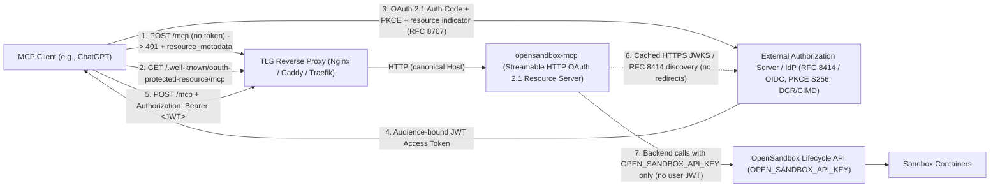

# OSEP-0033: Native OAuth 2.1 Resource-Server Support for OpenSandbox MCP

<!-- toc -->
- [Summary](#summary)
- [Motivation](#motivation)
  - [Goals](#goals)
  - [Non-Goals](#non-goals)
- [Requirements](#requirements)
- [Proposal](#proposal)
  - [Architecture Overview](#architecture-overview)
  - [Notes/Constraints/Caveats](#notesconstraintscaveats)
  - [Risks and Mitigations](#risks-and-mitigations)
- [Design Details](#design-details)
  - [Configuration Surface](#configuration-surface)
  - [Protocol Interoperability and SDK Integration](#protocol-interoperability-and-sdk-integration)
  - [Token Verification (JWT/JWKS MVP)](#token-verification-jwtjwks-mvp)
  - [Authorization and Scope Model](#authorization-and-scope-model)
  - [HTTP Hardening and Reverse-Proxy Semantics](#http-hardening-and-reverse-proxy-semantics)
  - [Trust Boundaries and Credential Separation](#trust-boundaries-and-credential-separation)
- [Test Plan](#test-plan)
- [Drawbacks](#drawbacks)
- [Alternatives](#alternatives)
- [Infrastructure Needed](#infrastructure-needed)
- [Upgrade & Migration Strategy](#upgrade--migration-strategy)
<!-- /toc -->

## Summary

This proposal adds optional, native **OAuth 2.1 Resource Server** support to the Python OpenSandbox MCP server (`opensandbox-mcp`) for its `streamable-http` transport, tracked in [opensandbox-group/OpenSandbox#2969](https://github.com/opensandbox-group/OpenSandbox/issues/2969). Remote MCP clients such as ChatGPT can discover a separate external Authorization Server via RFC 9728 Protected Resource Metadata, obtain audience-bound access tokens (RFC 8707), and authenticate directly to `opensandbox-mcp` without a dedicated `mcp-oauth-proxy` intermediary. Existing `stdio` usage, unauthenticated local HTTP defaults, tool schemas, and backend `OPEN_SANDBOX_API_KEY` authentication remain backward-compatible.

## Motivation

`opensandbox-mcp` exposes high-privilege sandbox operations—creating and terminating sandboxes, executing arbitrary shell commands, and mutating container filesystems—over either `stdio` or `streamable-http`. Today, operators who expose `opensandbox-mcp` to remote HTTPS MCP clients (such as ChatGPT or hosted AI agents) must deploy and maintain a separate OAuth-to-MCP reverse proxy (`mcp-oauth-proxy`) in front of the server because `opensandbox-mcp` has no built-in bearer-token validation or RFC 9728 metadata advertisement.

Maintaining a separate OAuth proxy introduces an extra service to operate, duplicate TLS and reverse-proxy routing rules, another token-validation boundary to keep aligned with evolving MCP authorization specifications, and an extra failure mode in self-hosted deployments. Because `opensandbox-mcp` already targets `mcp[cli]>=2.3.0,<3` and already installs PyJWT, cryptography, and Starlette directly and httpx through the OpenSandbox Python SDK, integrating the MCP Python SDK's native Resource Server hooks (`AuthSettings` and `TokenVerifier`) lets operators remove the proxy hop while delegating user authentication, login, consent, PKCE, and client registration to a standards-compliant external Authorization Server / Identity Provider (IdP).

### Goals

- Enable opt-in OAuth 2.1 Resource Server protection for `opensandbox-mcp --transport streamable-http` using the official MCP Python SDK (`MCPServer`, `AuthSettings`, `TokenVerifier`, and RFC 9728 protected-resource metadata routes).
- Validate bearer JWT access tokens against a trusted external Authorization Server's JWKS (pinned asymmetric algorithms, issuer, RFC 8707 audience/resource, expiration, not-before, token type, and required scopes) before any MCP request or tool handler executes.
- Verify OAuth configuration and load usable signing keys before serving requests. Fail closed on malformed or duplicate `Authorization` headers and on invalid or unverifiable tokens.
- Keep `stdio` transport, existing local HTTP defaults, all 21 MCP tool schemas/signatures, and backend `OPEN_SANDBOX_API_KEY` credential handling unchanged.
- Clearly document trust boundaries, reverse-proxy/TLS requirements, external IdP compatibility requirements, and the distinction between MCP client authentication and per-user sandbox multi-tenancy.

### Non-Goals

- Implementing an embedded OAuth Authorization Server, user database, login UI, consent screen, PKCE/code exchange, refresh-token minting, or Dynamic Client Registration inside OpenSandbox.
- Replacing or forwarding client OAuth access tokens to the OpenSandbox lifecycle server (`OPEN_SANDBOX_API_KEY` remains strictly separate).
- Requiring OAuth for `stdio` transport or silently changing existing unauthenticated local loopback HTTP defaults.
- Enforcing per-user sandbox ownership, multi-tenant sandbox RBAC, or lifecycle API authorization changes (tracked separately in multi-tenancy and server principal identity discussions such as #2627).
- Implementing RFC 7662 opaque-token introspection, sender-constrained tokens such as DPoP (RFC 9449) and mTLS (RFC 8705), or fine-grained per-tool scopes in Phase 1.

## Requirements

| ID | Requirement | Priority |
|---|---|---|
| R1 | With OAuth disabled (default `--oauth-mode none`), `stdio` and `streamable-http` behavior, CLI invocation, and all 21 MCP tool names/schemas remain backward-compatible. | Must |
| R2 | OAuth applies only to `streamable-http`; selecting OAuth with `--transport stdio` or providing other OAuth settings with `--oauth-mode none` must fail at startup with a clear, non-secret error. Built-in JWT verification loads issuer discovery and usable JWKS before the server becomes ready. An explicitly pinned JWKS URL skips discovery. | Must |
| R3 | When OAuth is enabled, serve RFC 9728 Protected Resource Metadata anonymously at the SDK-prescribed well-known path (`/.well-known/oauth-protected-resource<resource-path>`, plus root alias when `<resource-path>` is non-empty) using the statically configured public resource URL and issuer URL, never untrusted `Host` or `X-Forwarded-*` headers. | Must |
| R4 | Reject missing, malformed, duplicate, oversized, query-parameter, or invalid bearer tokens with HTTP `401 Unauthorized` and a standards-compliant `WWW-Authenticate: Bearer ... resource_metadata="..."` challenge; reject valid tokens missing required scopes with HTTP `403 Forbidden` (`insufficient_scope`). | Must |
| R5 | Validate JWT signature against trusted JWKS using only explicitly allowed asymmetric algorithms (forbidding `none` and `HS*`), exact configured `iss`, expected `aud`/resource, `exp`/`nbf` with bounded clock skew, non-ID-token `typ`/claims, and configured required scopes. | Must |
| R6 | Prevent SSRF and key-injection attacks: never fetch `jku`, `x5u`, or issuer URLs from untrusted tokens; require HTTPS for issuer/JWKS URLs by default (loopback HTTP opt-in only for local testing); disable outbound HTTP redirects; restrict automatic JWKS discovery to same-origin with the configured issuer unless an explicit trusted JWKS URL is configured. | Must |
| R7 | Never forward client OAuth access tokens to `opensandbox-server`, inject them into sandbox environments, expose them in tool outputs, or write them to logs or error messages. | Must |
| R8 | Enforce authentication and scope checks across all Streamable HTTP methods (`POST`, `GET`, `DELETE`) and every request in a session—not only `initialize`—and bind stateful MCP sessions to the authenticated principal (`client_id`, `iss`, `sub`). | Must |
| R9 | Declare httpx as a direct dependency because the verifier imports it. It is already installed through the OpenSandbox SDK, so the reference environment gains no new runtime package. | Should |
| R10 | Record an INFO audit event for each OAuth tool execution with issuer, subject when present, client ID, tool, sandbox ID when available, and outcome. Keep OAuth tokens, backend keys, tool payloads, and exception messages out of the audit event. | Must |

## Proposal

`opensandbox-mcp` adds an explicit, opt-in Resource Server authentication mode (`--oauth-mode jwt` / `OPEN_SANDBOX_MCP_OAUTH_MODE=jwt`) backed by the MCP Python SDK's `AuthSettings`, `TokenVerifier`, `BearerAuthBackend`, `RequireAuthMiddleware`, and RFC 9728 metadata routes, paired with a production-hardened `JWTTokenVerifier` and a lightweight `StrictBearerMiddleware` for duplicate-header, query-token, and oversized-header rejection.

### Architecture Overview

### Notes/Constraints/Caveats

- **Shared API permissions:** Every authorized caller can list or operate on all sandboxes visible to the configured backend API key. The IdP must restrict access to this deployment's dedicated audience and required scope by user, group, or organization. CIMD and DCR register clients. The IdP controls which accounts can authorize them. OAuth startup logs a warning about the shared backend permissions. Deploy one MCP instance per trust domain with a tenant-scoped API key and dedicated namespace on Kubernetes or an isolated lifecycle backend on Docker.
- **Stateless revocation:** Configure short access-token lifetimes in the IdP, for example 5–15 minutes. A configurable maximum token lifetime (`exp - iat`) and RFC 7662 introspection are follow-ups for deployments that need tighter controls.
- **External IdP capabilities:** Remote clients such as ChatGPT require RFC 8414 or OIDC discovery, PKCE (`S256`), a supported client registration method, and access tokens with the configured `aud` and required scope. When discovery advertises a cross-origin `jwks_uri`, pin the trusted URL with `--oauth-jwks-url`.

### Risks and Mitigations

| Risk | Severity | Mitigation |
|---|---|---|
| Accidental anonymous exposure when operator misconfigures OAuth flags | Critical | Fail closed at startup if `--oauth-mode none` is combined with any `--oauth-*` flag/env var, or if `--oauth-mode jwt` lacks issuer, resource URL, or required scopes. Keep `127.0.0.1` loopback bind default. |
| Algorithm confusion (`none`, `HS256` with RSA public key) or weak keys | Critical | Pin an asymmetric-only algorithm allowlist (`RS*`, `PS*`, `ES*`, `EdDSA`); reject symmetric/`none` algorithms at both config and verification time; enforce minimum key strengths aligned with `SECURITY.md` (RSA >= 2048 bits, EC >= 224 bits). |
| Token substitution / confused deputy (ID token or token for another API) | High | Require `aud` to match configured expected audience (defaulting to canonical `resource_url`), reject unsupported `typ` headers, and reject OIDC ID-token-only claims (`nonce`, `at_hash`, `c_hash`). |
| SSRF via JWT headers (`jku`, `x5u`) or malicious OIDC discovery redirects | High | Never read URLs from untrusted tokens; reject `jku`/`x5u`/`jwk` headers; require HTTPS by default; disable redirects (`follow_redirects=False`); require discovered `jwks_uri` to share origin with configured `issuer_url` unless operator explicitly pins `--oauth-jwks-url`. |
| Duplicate `Authorization` headers or token smuggling via query parameters | High | Wrap the protected MCP route in `StrictBearerMiddleware` that inspects raw ASGI headers to reject duplicate `Authorization` headers, oversized `Authorization` headers (> 16,500 bytes), and `?access_token=` query parameters with `401`. |
| Reverse-proxy `Host` / `X-Forwarded-*` spoofing or `421` breakage | High | Never derive metadata or `WWW-Authenticate` URLs from request headers; derive `TransportSecuritySettings.allowed_hosts` and `allowed_origins` explicitly from the configured canonical `resource_url` (plus optional `--oauth-allowed-host`). |
| JWKS refresh storm / DoS via unknown `kid` flood | Medium | Coalesce concurrent JWKS fetches behind an `asyncio.Lock` and enforce a minimum forced-refresh cooldown (default 30s) while bounding cache TTL (default 300s). |
| Credential leakage to backend or logs | High | Never pass `AccessToken` to `opensandbox` SDK calls, sandbox env vars, or tool outputs; disable URL access logs in the OAuth CLI and omit query strings and bearer headers from proxy logs. |

## Design Details

### Configuration Surface

All OAuth settings are opt-in, typed in a frozen `OAuthConfig` dataclass in `opensandbox_mcp.auth`, and configurable via CLI flags or `OPEN_SANDBOX_MCP_OAUTH_*` environment variables (CLI flags take precedence):

| CLI Flag | Environment Variable | Default | Validation / Notes |
|---|---|---|---|
| `--oauth-mode` | `OPEN_SANDBOX_MCP_OAUTH_MODE` | `none` | `none` or `jwt`. Any other `--oauth-*` setting with `none` fails startup. |
| `--oauth-issuer-url` | `OPEN_SANDBOX_MCP_OAUTH_ISSUER_URL` | `None` | Required when `jwt`. HTTPS URL (loopback HTTP allowed only with `--oauth-allow-insecure-http`); no query, fragment, or userinfo. |
| `--oauth-resource-url` | `OPEN_SANDBOX_MCP_OAUTH_RESOURCE_URL` | `None` | Required when `jwt`. Match the exact public MCP URL used by clients, such as `https://mcp.example.com/mcp`. Use lowercase scheme and host and omit a trailing slash on non-root paths. |
| `--oauth-audience` | `OPEN_SANDBOX_MCP_OAUTH_AUDIENCE` | `resource_url` | Expected JWT `aud` claim. Defaults to canonical `resource_url` per RFC 8707; override only when an IdP cannot emit a URL audience. |
| `--oauth-jwks-url` | `OPEN_SANDBOX_MCP_OAUTH_JWKS_URL` | `None` | Optional explicit JWKS URL. When omitted, discovered from `issuer_url` via RFC 8414 / OIDC discovery (same-origin enforced). |
| `--oauth-required-scope` | `OPEN_SANDBOX_MCP_OAUTH_REQUIRED_SCOPES` | `None` | Required when `jwt` (repeatable CLI flag or space/comma-separated env var). At least one non-empty scope must be configured. |
| `--oauth-allowed-algs` | `OPEN_SANDBOX_MCP_OAUTH_ALLOWED_ALGS` | `RS256,RS384,RS512,PS256,PS384,PS512,ES256,ES384,ES512,EdDSA` | Subset of supported asymmetric JWS algorithms; `none` and `HS*` are rejected. |
| `--oauth-clock-skew-seconds` | `OPEN_SANDBOX_MCP_OAUTH_CLOCK_SKEW_SECONDS` | `30` | Float in `[0, 300]`. Leeway for `exp` and `nbf`. |
| `--oauth-http-timeout-seconds` | `OPEN_SANDBOX_MCP_OAUTH_HTTP_TIMEOUT_SECONDS` | `5.0` | Float in `(0, 60]`. Timeout for outbound discovery/JWKS fetches. |
| `--oauth-jwks-cache-ttl-seconds` | `OPEN_SANDBOX_MCP_OAUTH_JWKS_CACHE_TTL_SECONDS` | `300` | Float in `(0, 86400]`. Maximum JWKS cache lifetime; expired cache fails closed if refresh fails. |
| `--oauth-jwks-refresh-cooldown-seconds` | `OPEN_SANDBOX_MCP_OAUTH_JWKS_REFRESH_COOLDOWN_SECONDS` | `30` | Float in `[0, 3600]`. Minimum interval between forced refreshes on unknown `kid` and between retries after a fetch failure. |
| `--oauth-allowed-host` | `OPEN_SANDBOX_MCP_OAUTH_ALLOWED_HOSTS` | Derived from `resource_url` | Optional extra `Host` header entries for reverse-proxy / healthcheck topologies. |
| `--oauth-allow-insecure-http` | `OPEN_SANDBOX_MCP_OAUTH_ALLOW_INSECURE_HTTP` | `false` | Allows `http://` ONLY for loopback hosts (`127.0.0.1`, `localhost`, `[::1]`) during local testing; non-loopback `http://` is always rejected. |

Repeatable CLI options use singular names for one value per occurrence. Their environment variables and the comma-separated algorithm option use plural names for lists.

### Protocol Interoperability and SDK Integration

`create_server(connection_config=..., *, oauth_config=None, token_verifier=None)` passes `auth=AuthSettings(...)` and `token_verifier=JWTTokenVerifier(oauth_config)` directly to `mcp.server.mcpserver.MCPServer`:

- `AuthSettings.issuer_url` is set to `oauth_config.issuer_url` (preserving empty path without adding a spurious trailing slash).
- `AuthSettings.resource_server_url` is set to `oauth_config.resource_url`.
- `AuthSettings.required_scopes` is set to `list(oauth_config.required_scopes)`.
- `AuthSettings.validate_token_resource` is enabled when the expected audience equals `resource_url`. The verifier enforces `aud` from the signed token. The SDK setting checks `AccessToken.resource` against its configured URL and offers no independent check of the signed claim for the built-in verifier.
- The SDK automatically mounts `/.well-known/oauth-protected-resource<resource-path>` with CORS and wraps `/mcp` in Starlette's `AuthenticationMiddleware`, followed by the SDK's `AuthContextMiddleware` and `RequireAuthMiddleware`.

The public `opensandbox_mcp.create_streamable_http_app()` helper wraps the SDK's `MCPServer.streamable_http_app()`. It adds the RFC 9728 root metadata alias for path-based resources and installs `StrictBearerMiddleware`. `create_server()` owns startup and shutdown for the built-in verifier through the public `MCPServer` lifespan hook. The OAuth CLI serves the composed ASGI app through Uvicorn with URL access logs disabled. The legacy CLI uses the SDK's existing `run()` entry point.

### Token Verification (JWT/JWKS MVP)

`JWTTokenVerifier.verify_token(token: str) -> AccessToken | None` implements `mcp.server.auth.provider.TokenVerifier` and fails closed (returns `None`, never raising unhandled `500` errors) on any malformed, invalid, or unverifiable token:

1. Reject empty, whitespace-containing, non-3-segment, or oversized (> 16,384 bytes) tokens before parsing.
2. Parse the unverified JWS header with `jwt.get_unverified_header`; reject missing/disallowed `alg`, reject `jku`/`x5u`/`jwk` header parameters, and reject `typ` values outside `{None, "jwt", "at+jwt", "application/at+jwt"}` (case-insensitive).
3. Resolve the verifying key from the bounded `opensandbox_mcp.auth.JWKSClient` cache (filtering `use == "sig"` when present, matching `alg` when present, matching `kid` when present, and refusing ambiguous keyless selection across multi-key sets). On an unknown `kid`, trigger at most one lock-serialized forced refresh per cooldown window.
4. Enforce cryptographic minimum key strength (RSA >= 2048 bits, EC >= 224 bits).
5. Verify signature and registered claims (`require=["exp", "iss", "aud"]`, exact `iss`, an exact `aud` value or array member matching `expected_audience`, `exp` and `nbf` with `clock_skew_seconds` leeway) via `pyjwt`.
6. Reserve the configured audience for access tokens, especially when the provider emits generic or untyped JWTs. Reject an explicit non-access `token_use`, reject OIDC ID-token indicators (`nonce`, `at_hash`, `c_hash`) and require a non-empty principal identifier (`sub`, `client_id`, or `azp`).
7. Extract scopes from `scope` (space-delimited string) and/or `scp` (string or list of strings), and return `AccessToken(token=token, client_id=..., subject=..., scopes=..., expires_at=..., resource=..., claims={"iss": ...})` so `StreamableHTTPSessionManager` binds stateful sessions to `(client_id, iss, sub)`.

### Authorization and Scope Model

Phase 1 enforces configured **server-wide required scopes** inside `RequireAuthMiddleware` on every HTTP request before any JSON-RPC frame or MCP tool handler is entered. All 21 tools require authentication and the configured scope or scopes. Phase 1 requires at least one scope so operators can grant access to this high-privilege tool set explicitly. Use an IdP that emits the grant in `scope` or `scp`.

As a future Phase 2 extension (if maintainers desire granular policies), tools can be partitioned by actual operational risk—never treating `file_read` or `command_run` as benign—using `get_access_token()` inside an `MCPServer` middleware:

- **Read/inspect tier (future `sandbox:read`):** `sandbox_list`, `sandbox_get_info`, `sandbox_healthcheck`, `sandbox_get_metrics`, `sandbox_get_endpoint`, `command_get_status`, `command_get_logs`, `file_search`, `file_read`.
- **Mutate/execute tier (future `sandbox:write` / `sandbox:exec`):** `sandbox_create`, `sandbox_connect`, `sandbox_renew`, `command_run`, `command_interrupt`, `file_write`, `file_delete`, `file_create_directories`, `file_delete_directories`, `file_move`, `file_replace_contents`.
- **Destructive lifecycle tier (future `sandbox:admin`):** `sandbox_kill`.

Keeping Phase 1 to server-wide scopes keeps the initial PR small, reviewable, and aligned with RFC 9728 `scopes_supported` while leaving room for granular scopes. The SDK marks `MCPServer.middleware` provisional, so validate that seam against the intended SDK version before relying on it.

### HTTP Hardening and Reverse-Proxy Semantics

- `StrictBearerMiddleware` wraps the protected MCP endpoint (`streamable_http_path`) before `AuthenticationMiddleware` and rejects duplicate `Authorization` headers, oversized `Authorization` headers (> 16,500 bytes), and `?access_token=` query parameters with `401 Unauthorized` and the canonical `WWW-Authenticate` challenge.
- `build_transport_security()` derives `TransportSecuritySettings(enable_dns_rebinding_protection=True, allowed_hosts=..., allowed_origins=...)` from `oauth_config.resource_url` (plus any explicit `--oauth-allowed-host` entries, and loopback entries only when `allow_insecure_http=True`). This avoids the SDK's loopback-only `421 Invalid Host header` rejection behind reverse proxies while still blocking DNS rebinding and spoofed `Host`/`Origin` headers.
- Metadata responses and `WWW-Authenticate` headers always emit the statically configured canonical `resource_url` and `issuer_url`, ignoring `X-Forwarded-Host`, `X-Forwarded-Proto`, and `Forwarded`.

### Trust Boundaries and Credential Separation

- **Client <-> Reverse Proxy <-> `opensandbox-mcp`:** Authenticated via short-lived OAuth 2.1 bearer access tokens validated against the external IdP's JWKS. TLS terminates at the reverse proxy (or edge gateway) in production.
- **`opensandbox-mcp` <-> `opensandbox-server`:** Authenticated exclusively via `OPEN_SANDBOX_API_KEY` inside `ConnectionConfig`. Inbound bearer tokens are never copied into `ConnectionConfig`, HTTP headers to `opensandbox-server`, sandbox environment variables, or tool responses.
- **Lifecycle identity follow-up:** [RFC 8693 token exchange](https://www.rfc-editor.org/rfc/rfc8693.html) is one option for giving the lifecycle API a separate API-audience credential that represents the caller. That design requires lifecycle API validation and resource authorization in addition to token exchange.

## Test Plan

Implementation PRs will ship deterministic, offline pytest coverage (using synthetic ephemeral RSA/EC keys and an in-process mock Authorization Server / JWKS endpoint, with zero live external IdP dependencies in CI):

1. **Configuration and fail-closed startup:** Missing required fields, partial flags with `--oauth-mode none`, OAuth with `--transport stdio`, non-HTTPS URLs without opt-in, non-loopback HTTP even with opt-in, disallowed algorithms (`none`, `HS256`), invalid timeouts/skew, env-var precedence, successful JWKS warmup, provider startup failure, and proxy-mode startup after removing all native OAuth settings.
2. **JWT integrity and adversarial verifier cases:** Bad signatures, untrusted keys, unknown `kid`, key rotation with rate-limited refresh, cache expiry with unreachable JWKS, wrong `iss`, wrong `aud`/cross-audience token substitution, expired and future-`nbf` tokens, clock-skew boundaries, `none` and `HS256` algorithm confusion, weak RSA keys (< 2048 bits), `jku`/`x5u`/`jwk` header injection, ID-token confusion (`typ: id+jwt`, `nonce`, `at_hash`), malformed base64/JSON, oversized tokens.
3. **HTTP protocol and scope enforcement:** Anonymous RFC 9728 metadata at both `/.well-known/oauth-protected-resource/mcp` and root alias, `401` + `WWW-Authenticate` on missing/invalid/duplicate/oversized/query-param/body-param tokens, `403 insufficient_scope` on missing scope, enforcement across `POST`/`GET`/`DELETE` and mid-session token expiration, session principal binding (cross-user session hijacking returns `404`), reverse-proxy `Host` and spoofed `X-Forwarded-*` invariance, DNS-rebinding rejection on untrusted `Host`/`Origin`.
4. **Isolation, concurrency, and regression:** Zero backend SDK side effects on every rejected request (`sandbox_kill`, `command_run`, `file_write`), attributable tool audit records without credential or payload leakage, concurrent valid/invalid clients without cross-request auth context leakage, `stdio` compatibility, and unchanged schemas/count for all 21 MCP tools.
5. **Manual external IdP / ChatGPT checklist:** Documented reproducible validation flow against a standards-compliant IdP (Keycloak/Auth0/local OIDC fixture) and ChatGPT connector setup, clearly distinguishing automated protocol tests from live external-provider verification.

## Drawbacks

- Adds OAuth configuration flags and verification code to `opensandbox-mcp`, increasing its maintenance surface compared to delegating all auth to an external proxy.
- JWT/JWKS validation does not support opaque access tokens or instantaneous pre-expiry revocation without adding RFC 7662 introspection in a follow-up.
- Operators might mistakenly assume OAuth authentication provides per-user sandbox multi-tenancy unless documentation and warnings make the boundary unmistakable.

## Alternatives

1. **Keep authentication solely in an external proxy (e.g., `mcp-oauth-proxy`):** Avoids code in `opensandbox-mcp`, but forces every self-hosted remote MCP user to deploy, configure, secure, and upgrade an extra proxy process alongside `opensandbox-mcp`, duplicating TLS/routing config and MCP protocol-version coupling. Keeping native OAuth opt-in lets operators choose either model.
2. **Embed an OAuth Authorization Server inside `opensandbox-mcp`:** Rejected because OpenSandbox should not become an identity provider, store user credentials, render login/consent pages, or manage OAuth client registrations when mature external IdPs already exist.
3. **Start with RFC 7662 introspection instead of JWT/JWKS:** Introspection handles opaque tokens and instant revocation, but requires storing IdP client credentials on `opensandbox-mcp` and adds a network hop per uncached request. Starting with stateless JWT/JWKS covers most modern OIDC/OAuth 2.1 IdPs with zero new dependencies, while the `TokenVerifier` interface keeps RFC 7662 introspection a clean additive follow-up.
4. **Custom OAuth routes/middleware instead of MCP SDK `AuthSettings`:** Rejected to avoid diverging from evolving MCP specifications and duplicating `RequireAuthMiddleware`, `BearerAuthBackend`, session principal binding, and RFC 9728 metadata handling already maintained in `mcp>=2.3.0`.

## Infrastructure Needed

Add `sdks/mcp/sandbox/python` to the `python-sdk-quality` matrix before merging the implementation PR. Its tests use in-process Starlette and httpx transports and ephemeral signing keys. The job requires no live IdP or secrets.

## Upgrade & Migration Strategy

- **Existing `stdio` and local HTTP deployments:** No breaking changes; `--oauth-mode` defaults to `none` and all existing CLI flags, environment variables, and tool schemas remain unchanged.
- **Migrating from `mcp-oauth-proxy` to native OAuth:** Configure the external Authorization Server to issue audience-bound JWT access tokens for `https://<public-host>/mcp` with the chosen required scope; start `opensandbox-mcp` with `--transport streamable-http --oauth-mode jwt` and the corresponding `--oauth-*` flags; update the TLS reverse proxy (Nginx/Caddy/Traefik) to route `/mcp` and `/.well-known/oauth-protected-resource*` directly to `opensandbox-mcp` while preserving the canonical `Host` header; verify RFC 9728 discovery and token rejection before retiring `mcp-oauth-proxy`.
- **Rollback:** Restore a separate private MCP upstream for `mcp-oauth-proxy`. If reusing the current upstream, disable direct public routes to it first. Remove every `--oauth-*` flag and unset all `OPEN_SANDBOX_MCP_OAUTH_*` variables, including the mode, before restarting MCP with its existing backend connection settings. Verify the proxy can reach that upstream, then route public MCP and OAuth metadata requests back through the proxy. Verify its unauthenticated challenge and a fresh authenticated session. Running sandboxes persist.
