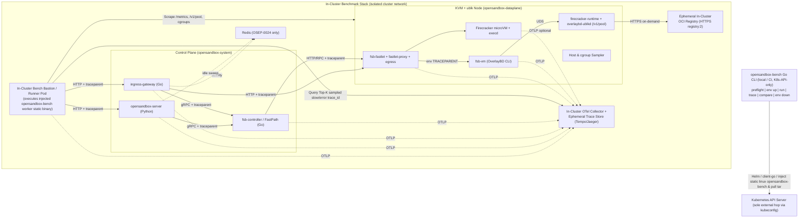

# OSEP-0034: Standalone Go Benchmark Harness (benchmark/tools) and End-to-End OTel Tracing for Fast Sandbox (OverlayBD)

<!-- toc -->
- [Summary](#summary)
- [Motivation](#motivation)
  - [Goals](#goals)
  - [Non-Goals](#non-goals)
- [Requirements](#requirements)
- [Proposal](#proposal)
  - [Notes/Constraints/Caveats](#notesconstraintscaveats)
  - [Risks and Mitigations](#risks-and-mitigations)
- [Design Details](#design-details)
  - [1. Repository Layout, Go Single-Binary Architecture, and Command Surface](#1-repository-layout-go-single-binary-architecture-and-command-surface)
  - [2. Full-Stack Provisioning and Preflight Pipeline (OverlayBD)](#2-full-stack-provisioning-and-preflight-pipeline-overlaybd)
  - [3. Phase 1 Workload Suites (OverlayBD Only)](#3-phase-1-workload-suites-overlaybd-only)
  - [4. Standardized Metrics Specification](#4-standardized-metrics-specification)
    - [4.1 End-to-End and Stage-Decomposed Lifecycle Latencies](#41-end-to-end-and-stage-decomposed-lifecycle-latencies)
    - [4.2 OverlayBD Storage, Cache, and ublk Pool Metrics](#42-overlaybd-storage-cache-and-ublk-pool-metrics)
    - [4.3 Scheduling, Pool, and Overcommit Metrics](#43-scheduling-pool-and-overcommit-metrics)
    - [4.4 Wake-on-Access / Wake-Storm Metrics (OSEP-0024)](#44-wake-on-access--wake-storm-metrics-osep-0024)
    - [4.5 High-Density Load and Saturation Metrics (Host, Fastlet, Egress, Fastlet-Proxy)](#45-high-density-load-and-saturation-metrics-host-fastlet-egress-fastlet-proxy)
    - [4.6 Correctness Verification, Zero-OOM, and Leak Audit](#46-correctness-verification-zero-oom-and-leak-audit)
  - [5. End-to-End OpenTelemetry Tracing and Trace-Based Drill-Down](#5-end-to-end-opentelemetry-tracing-and-trace-based-drill-down)
    - [5.1 Current Tracing Coverage and Gaps](#51-current-tracing-coverage-and-gaps)
    - [5.2 W3C Context Propagation and Missing Spans](#52-w3c-context-propagation-and-missing-spans)
    - [5.3 In-Cluster OTel Trace Stack and Explicit Opt-In Contract](#53-in-cluster-otel-trace-stack-and-explicit-opt-in-contract)
    - [5.4 Automated Trace Drill-Down](#54-automated-trace-drill-down)
  - [6. Benchmark Profile, Report Schema, and Regression Comparison](#6-benchmark-profile-report-schema-and-regression-comparison)
  - [7. Kubeconfig and Host Privilege Model](#7-kubeconfig-and-host-privilege-model)
- [Test Plan](#test-plan)
- [Drawbacks](#drawbacks)
- [Alternatives](#alternatives)
- [Infrastructure Needed](#infrastructure-needed)
- [Upgrade & Migration Strategy](#upgrade--migration-strategy)
<!-- /toc -->

## Summary

This proposal introduces a **standalone Go benchmark tool (`opensandbox-bench`)** under `benchmark/tools/` — deliberately decoupled from the user-facing `osb` CLI — that provisions a complete OpenSandbox + `fast-sandbox` (OverlayBD) environment from scratch using a privileged `kubeconfig`, cross-compiles and ships its own static Linux binary into an in-cluster Bench Bastion/Runner Pod, executes standardized scheduling, lifecycle, and high-density suites, and archives commit/tag-stamped baseline reports under `benchmark/reports/` (tracking GitHub issue #3048).

Phase 1 scopes exclusively to the **`fast-sandbox` OverlayBD (OCI) path** with **`ResourceAware` (OSEP-0026)** pools. Alongside the benchmark harness, this proposal completes **explicitly opt-in end-to-end OpenTelemetry distributed tracing** across OpenSandbox (`server`, `ingress-gateway`, `execd`) and `fast-sandbox` (`controller/FastPath`, `fastlet`, `fastlet-proxy`, `fsb-vm`, `firecracker-runtime`), backed by an ephemeral in-cluster OTel trace collector/store deployed during benchmark runs. Benchmark runs automatically drill down into slow and failed requests via collected trace trees rather than manual log parsing, and capture high-density resource load across the host node, `fastlet`, `egress`, and `fastlet-proxy`.

## Motivation

OpenSandbox's `fast-sandbox` OverlayBD stack now spans multiple performance-sensitive subsystems: `ResourceAware` overcommit pools (OSEP-0026), node-level `overlaybd-ublkd` warm device pools, three-tier local caches (`manifest-cache`, `shared_snapfiles`, `blob-cache`), `Full` vs. `RootfsOnly` snapshots (FSEP-0001), rootfs layer-chain compaction/squash, and ingress-driven auto-pause / wake-on-access (OSEP-0024).

Today, validating and protecting this stack before each release has four structural gaps:

1. **No reproducible full-stack maintainer benchmark harness**: Existing scripts (`tests/python/benchmarks/kubernetes_resume.py`, `scripts/fast-sandbox-env/create-bench.py`) are ad-hoc, cover narrow paths, and assume a pre-configured cluster. Maintainers and release CI need a standalone, high-concurrency harness (separate from the end-user `osb` CLI) that can stand up a clean, standardized OverlayBD deployment from a `kubeconfig`, dispatch a self-contained runner binary into the cluster without maintaining extra runner container images, and run repeatable suites.
2. **Incomplete trace visibility forces brittle log grepping**: OSEP-0010 intentionally excluded OpenTelemetry Tracing from `execd`, `egress`, and `ingress`, and `opensandbox-server` does not yet propagate W3C `traceparent` into `FastPath` gRPC calls. Inside `fast-sandbox`, `internal/observability` provides OTLP trace export (`setup.go`) and spans for synchronous create stages, but tracing breaks across K8s Informer queues on async CRD reconciliation, breaks at the `fsb-vm` subprocess boundary (`create --prepare-only`, `pack`), and is absent on Snapshot/Pause/RootfsOnly paths. Diagnosing a P99 spike currently requires correlating timestamps across pod logs on multiple nodes.
3. **OverlayBD-specific nonlinear cliffs are unmeasured**: Performance cliffs such as `overlaybd-ublkd` warm-pool exhaustion (`poolSizeGB` mismatch or burst > `poolHigh`), `blob-cache` eviction lock contention, non-reflink `copyFrozenUpper` fallback, and the 24-layer rootfs squash threshold (`defaultMaxRootfsLayers = 24`) are invisible to generic API latency benchmarks.
4. **High-density data-plane and host saturation are blind spots**: As sandbox density per node scales up, bottlenecks shift from single-sandbox startup latency to host I/O and CPU contention, `fastlet` memory/goroutine overhead, `egress` DNS/nftables/MITM proxy load, and `fastlet-proxy` connection/relay overhead.

### Goals

- Build a **standalone Go CLI (`opensandbox-bench`) under `benchmark/tools/`**, keeping maintainer/release benchmarking completely out of the user-facing `osb` CLI while allowing a single static Linux binary (`CGO_ENABLED=0`) to be injected directly into an in-cluster runner Pod.
- Support full-stack environment provisioning and teardown from a privileged `kubeconfig`: node preflight checks (KVM, `ublk_drv`, XFS `reflink=1`, spill dir), ephemeral in-cluster infrastructure (self-contained HTTPS `registry:2` with CA bundle injection, optional Redis, in-cluster OTel Collector + Trace Store — no external registry required), official Helm chart deployment (`base`, `fast-sandbox` with `runtime.oci.enabled=true`, `server`, `ingress-gateway`), golden OverlayBD template build, and `ResourceAware` `SandboxPool` setup.
- Define and collect a canonical Phase 1 OverlayBD metric set covering lifecycle latencies, OverlayBD storage/cache/`ublkd` warm-pool behavior, `ResourceAware` scheduling/overcommit behavior, OSEP-0024 wake-storms, and high-density load across host, `fastlet`, `egress`, and `fastlet-proxy`.
- Complete end-to-end W3C `traceparent` propagation and span instrumentation across `opensandbox-bench` -> `server` -> `FastPath` -> `fastlet` -> `fsb-vm` / `firecracker` (control plane, including async CRD reconciliation) and `opensandbox-bench` -> `ingress-gateway` -> `fastlet-proxy` -> `execd` (data plane), plus Snapshot/Pause/RootfsOnly spans.
- Provide automated trace-based drill-down and archive commit/tag-stamped JSON/Markdown baseline reports under `benchmark/reports/` with `opensandbox-bench compare` for pre-release regression gating.

### Non-Goals

- **User-facing `osb` CLI integration**: `opensandbox-bench` is a maintainer and release-validation tool under `benchmark/tools/`; it is not shipped as an `osb` subcommand or PyPI user package, so benchmark workloads and flags can evolve freely without public CLI compatibility constraints.
- **Non-OverlayBD backends and `LegacySlot` pools in Phase 1**: Classic Kubernetes (`BatchSandbox` + `Pool`), Docker runtime, `fast-sandbox` Native S3/DART artifact paths, and `LegacySlot` pools are explicitly out of scope for Phase 1; Phase 1 targets `fast-sandbox` OverlayBD with `ResourceAware` pools (OSEP-0026) only, while keeping profile and report schemas extensible for Phase 2.
- **Replacing production observability platforms or implicitly enabling traces**: The in-cluster OTel Collector and trace store deployed by `opensandbox-bench env up` are ephemeral, benchmark-scoped infrastructure. Production deployments keep tracing strictly disabled unless an **explicit trace opt-in** (`OTEL_TRACES_ENABLED=true`, Helm `tracing.enabled=true`, or `OTEL_EXPORTER_OTLP_TRACES_ENDPOINT`) is set; setting the generic `OTEL_EXPORTER_OTLP_ENDPOINT` for OSEP-0010 metrics alone never turns on tracing.
- **Automated bare-metal OS provisioning**: `opensandbox-bench` assumes an existing Kubernetes cluster reachable via `kubeconfig` with Linux KVM nodes; optional host disk formatting/loop-mounting (`--prepare-nodes`) is opt-in, separate from the mandatory container privileges required by the `fast-sandbox` Firecracker/ublk daemonset itself.

## Requirements

| ID | Requirement | Priority |
|---|---|---|
| R1 | `opensandbox-bench` is implemented in Go under `benchmark/tools/` as a standalone CLI, capable of cross-compiling a static Linux worker subcommand binary and injecting it into an in-cluster runner Pod without requiring a dedicated published runner image | Must Have |
| R2 | Given a sufficiently privileged `kubeconfig` and a profile YAML, `opensandbox-bench env up` deploys the complete OverlayBD stack (charts, ephemeral HTTPS registry, optional Redis, in-cluster OTel trace stack, OverlayBD template, `ResourceAware` SandboxPool) and verifies readiness | Must Have |
| R3 | Phase 1 benchmark suites cover `schedule-burst`, `steady-churn`, `pause-resume` (Full checkpoint: warm, cache-evicted, cross-node, multi-round layer squash), `rootfs-only-restore` (create/fork from `RootfsOnly` snapshot: warm materialized, cold/cross-node, concurrent fan-out, and OSEP-0028 CPU/memory overrides), `wake-storm` (OSEP-0024), and `high-density-soak` on the `fast-sandbox` OverlayBD path | Must Have |
| R4 | Local `opensandbox-bench` requires connectivity **only** to the Kubernetes API Server (via `kubeconfig`); all in-cluster API calls, workload generation, white-box metric/pool scraping, and trace queries execute inside the in-cluster Bench Bastion/Runner Pod via the injected `opensandbox-bench` binary | Must Have |
| R5 | End-to-end OTel tracing propagates W3C `traceparent` from `opensandbox-bench` through `server` / `ingress-gateway` into `fast-sandbox` (`FastPath`, async controller reconcilers, `fastlet`, `fastlet-proxy`, `fsb-vm`) and `execd`, gated behind an explicit trace opt-in switch so existing OSEP-0010 metrics-only `OTEL_EXPORTER_OTLP_ENDPOINT` deployments remain unaffected | Must Have |
| R6 | `opensandbox-bench run` records `(trace_id, sampled)` per operation and automatically queries the in-cluster trace backend over sampled operations to attach span-level waterfall breakdowns for top slow (P99) and failed operations in the output bundle | Must Have |
| R7 | High-density suites collect time-series load and saturation telemetry for the host node, `fastlet`, `egress`, and `fastlet-proxy` (plus `firecracker-runtime`, `server`, and `ingress-gateway`) alongside sandbox latency and throughput | Must Have |
| R8 | Every stage/release run emits a self-contained JSON report and Markdown summary explicitly stamped with exact `OpenSandbox` and `fast-sandbox` git `commit` SHAs and `tag`s, archived under `benchmark/reports/`, and `opensandbox-bench compare` highlights regressions against a baseline JSON | Must Have |
| R9 | Tracing adds zero overhead when disabled (no-op provider by default) and bounded overhead when enabled (per-suite head-sampling rate and non-blocking batch export) | Must Have |
| R10 | `opensandbox-bench env down` cleanly removes all benchmark-provisioned resources and verifies zero leaked sandboxes or `ublk` devices | Should Have |

## Proposal

We propose a two-pillar architecture: **(1) the standalone Go `opensandbox-bench` harness (`benchmark/tools/`) with isomorphic binary injection** and **(2) explicitly opt-in end-to-end OTel tracing across the OpenSandbox + `fast-sandbox` OverlayBD stack**.



### Notes/Constraints/Caveats

- **OverlayBD `poolSizeGB` exact match constraint**: As documented in `manifests/charts/fast-sandbox/values.yaml`, `runtime.oci.poolSizeGB` must exactly equal the built template's `rootfsSizeMiB / 1024` (e.g., `2` for 2 GiB); even a larger pool device causes a silent fallback to cold device creation. `opensandbox-bench env up` enforces this invariant automatically from the benchmark profile and fails fast on mismatch.
- **Ephemeral registry TLS trust without rebuilding release images**: Unlike local dev scripts that bake a custom `ca.crt` into rebuilt container images, `opensandbox-bench` deploys pre-built release images onto remote clusters. Furthermore, `sandboxtemplate-builder` Pods spawned dynamically by `fsb-controller` currently whitelist only scheduling fields (`tolerations`, `affinity`, `topologySpreadConstraints`). Phase 1 therefore adds an explicit `registryCABundleSecret` contract to the `fast-sandbox` chart and controller so the ephemeral registry's CA bundle is mounted into `fsb-fastlet`, `firecracker-runtime` (`overlaybd-ublkd`), and `sandboxtemplate-builder` Pods without rebuilding images.
- **Create fallback-to-Pending vs. asynchronous CRD-reconciled Pause/Resume/Snapshot**: On the fast path, `CreateSandbox` synchronously invokes `fastlet`; however, under saturation when a create exceeds the FastPath readiness deadline, `opensandbox-server` (`_create_sandbox_sync` in `services/fast_sandbox/service.py`) catches the timeout, reads the persisted CR, and returns an accepted `Pending` response while controller reconciliation continues asynchronously (and OSEP-0028 similarly notes an accepted create does not guarantee finished boot). Meanwhile, `PauseSandbox`, `ResumeSandbox`, and `CreateSandboxSnapshot` (`sandbox_state.go`, `snapshot.go`) are always compare-and-set CRD intent patches that converge asynchronously. Therefore, client `t_api_ack` is strictly defined as **intent/API response acceptance** (recording whether `Create` returned `Running` or fell back to `Pending`), **`t_first_ping` is the authoritative readiness completion timestamp**, and CRD `traceparent` annotations cover both async `Pause/Resume/Snapshot` and `Pending`-fallback `Create` paths.
- **Explicit trace opt-in preserving OSEP-0010 compatibility**: Existing deployments may already set `OTEL_EXPORTER_OTLP_ENDPOINT` solely for the OSEP-0010 metrics pipeline (`docs/guides/telemetry.md`). Tracing in `server`, `ingress-gateway`, `execd`, and `fast-sandbox` therefore activates **only** when an explicit trace switch is set (`OTEL_TRACES_ENABLED=true`, Helm `tracing.enabled=true`, or `OTEL_EXPORTER_OTLP_TRACES_ENDPOINT`), using the generic `OTEL_EXPORTER_OTLP_ENDPOINT` only as a fallback destination once tracing is explicitly enabled.
- **Two distinct node-side OverlayBD caches**: `runtime.oci.cacheSizeGB` (`OVERLAYBD_CACHE_SIZE_GB`) governs the `overlaybd-ublkd` block cache, whereas `FAST_SANDBOX_OCI_BLOB_CACHE_SIZE_BYTES` governs `fsb-vm`'s local checkpoint blob cache (`oci/blobs/sha256`, capped at 4096 files and 1 GiB free-space floor). Both must be pinned in the profile, audited separately, and cleared together in `cache-evicted` tests.
- **Client polling bias**: SDK default readiness polling (`200ms`) masks sub-100ms warm create latencies. `opensandbox-bench`'s Go runner defaults to `10ms` readiness polling (matching `fast-sandbox-ack-2026-10-08.json`) with negligible goroutine overhead and records the exact polling interval in report metadata.

### Risks and Mitigations

| Risk | Mitigation |
|---|---|
| Deploying onto a shared or restricted cluster without realizing `fast-sandbox` requires privileged node daemons | `preflight` and §7 explicitly disclose that `fast-sandbox` `firecracker-runtime` (`firecracker-agent` + `overlaybd-ublkd`) runs `privileged: true` with host path/PID access and labels nodes, separating mandatory runtime privileges from opt-in `--prepare-nodes` host disk formatting. |
| Ephemeral `registry:2` runs out of disk or bottlenecks on slow backing storage during multi-round Full checkpoints | Default ephemeral registry storage budget to `200Gi` backed by fast local NVMe (`hostPath` / fast `StorageClass`), enable `REGISTRY_STORAGE_DELETE_ENABLED=true`, and run registry garbage collection / reset between major suites so checkpoint I/O reflects OverlayBD rather than slow disk or `disk full` failures. |
| Single-replica `opensandbox-server` (`replicaCount: 1`) saturates before `fast-sandbox` at high concurrency | Monitor `opensandbox-server` and `ingress-gateway` CPU/RSS/request queueing alongside node components, and report both `t_server_total` and trace-extracted `t_fastpath_grpc` so `server`-side queueing is cleanly separated from `FastPath`/`fastlet` scheduling latency. |
| 100% OTel trace sampling distorts P99 latency during long/high-density runs, while head-dropping breaks naive tail-sampling | Bind consistent head-sampling per suite: `1.0` (100% sampled) on bounded latency-attribution suites (`schedule-burst`, `pause-resume`, `rootfs-only-restore`, `wake-storm`), and pure head-sampling (`0.02`–`0.05` `parentbased_traceidratio`, no conflicting tail-sampler claim) on sustained suites (`steady-churn`, `high-density-soak`), where §5.4 selects Top-K drill-downs strictly from the `sampled=true` subset. |
| `fsb-vm` short-lived CLI process exits before async OTLP batch flush completes | `fsb-vm` explicitly calls `provider.ForceFlush(ctx)` with a short bounded timeout (e.g., `200ms`) before process exit so flushing adds minimal overhead and never blocks sandbox creation on collector failure. |
| Benchmark runner Pod contends with Firecracker VMs for CPU/memory | Schedule the in-cluster runner Pod, ephemeral `registry:2`, and OTel stack via `nodeAffinity` / `podAntiAffinity` away from `fast-sandbox.io/firecracker-node=true` runtime nodes whenever control/utility nodes are available, and record placement in report metadata. |
| Cross-node resume fails on heterogeneous CPU clusters or silently lands back on the source node | `preflight` checks CPU family/model/stepping homogeneity across candidate nodes; cross-node tests isolate the source node's `fastlet` from `FastPath` placement (rather than relying on `kubectl cordon`, which `FastPath` ignores) and assert `before_node != after_node` on every sample. |

## Design Details

### 1. Repository Layout, Go Single-Binary Architecture, and Command Surface

Repository layout under a dedicated top-level `benchmark/` directory:
- `benchmark/tools/`: standalone Go module (`cmd/opensandbox-bench`) implementing both the local orchestration CLI and the in-cluster worker subcommands (`opensandbox-bench worker ...`), plus embedded reference profile YAMLs and Helm orchestration helpers (`client-go` + Helm Go SDK / CLI).
- `benchmark/reports/`: archives milestone and pre-release baseline reports organized with explicit version provenance (e.g., `benchmark/reports/<tag-or-date>-<short-commit>/` containing `report.json`, `summary.md`, and sampled `traces/`), where every report stamps exact `OpenSandbox` and `fast-sandbox` git `commit` SHAs and `tag`s.

**Isomorphic Binary Distribution (Zero Custom Runner Image)**:
Because `opensandbox-bench` is written in pure Go (`CGO_ENABLED=0`), `opensandbox-bench env up` / `run` cross-compiles `GOOS=linux GOARCH=<cluster-arch> go build ./cmd/opensandbox-bench` locally (or uses a pre-built release binary), launches a minimal base container Pod (`opensandbox-bench-runner`) in the cluster, copies the single static `opensandbox-bench` binary into `/tmp/opensandbox-bench` via `pods/exec` tar stream, and invokes `/tmp/opensandbox-bench worker run ...` inside the cluster. Maintainers iterating on benchmark scenarios locally can modify Go code under `benchmark/tools/` and re-run against a remote cluster in seconds without building or pushing any Docker image.

Command surface:

```bash
# Build once (or run via `go run ./benchmark/tools/cmd/opensandbox-bench`)
go build -o bin/opensandbox-bench ./benchmark/tools/cmd/opensandbox-bench

# 1. Node & cluster preflight (KVM, ublk_drv, XFS reflink, spill dir, CPU homogeneity)
opensandbox-bench preflight --kubeconfig <path> --profile <profile.yaml>

# 2. Provision full OverlayBD stack (ephemeral registry, optional Redis, OTel stack, Helm charts, template, pool)
opensandbox-bench env up --kubeconfig <path> --profile <profile.yaml> [--prepare-nodes]

# 3. Inject static linux worker binary into runner Pod, run suites + white-box scrape + trace drill-down + leak audit
opensandbox-bench run --kubeconfig <path> --profile <profile.yaml> \
  --suite <all|schedule-burst|steady-churn|pause-resume|rootfs-only-restore|wake-storm|high-density-soak> \
  --output benchmark/reports/<tag>-<commit>

# 4. Inspect slow/failed operation trace waterfalls offline from a saved run bundle
opensandbox-bench trace benchmark/reports/<tag>-<commit> [--trace-id <id> | --top-slow 5]

# 5. Compare two benchmark reports offline and emit Markdown diff + exit non-zero on regression thresholds
opensandbox-bench compare benchmark/reports/<base>/report.json benchmark/reports/<cand>/report.json [--fail-on-regression]

# 6. Tear down benchmark-provisioned resources and run post-teardown leak check
opensandbox-bench env down --kubeconfig <path> --profile <profile.yaml>
```

For CI and pre-release automation, `opensandbox-bench run --provision --teardown` chains `preflight -> env up -> run -> env down` atomically while preserving the output bundle on failure.

### 2. Full-Stack Provisioning and Preflight Pipeline (OverlayBD)

`opensandbox-bench env up` orchestrates four deterministic stages using the supplied `kubeconfig`:

1. **Preflight Stage**:
   - Launches a short-lived inspection Job/DaemonSet on candidate nodes to probe `/dev/kvm`, cgroup v2, `ublk_drv` kernel module availability, `StateRoot` mount filesystem type and `cp --reflink=always` capability, `FAST_SANDBOX_SNAPSHOT_SPILL_DIR` availability/size, and host CPU identity (`family/model/stepping`).
   - Captures node capacity, kernel version, OS image, containerd version, and Kubernetes version into the environment fingerprint.
2. **Supporting Infrastructure Stage**:
   - **Ephemeral In-Cluster OCI Registry**: Always deploys an ephemeral in-cluster HTTPS `registry:2` (with `REGISTRY_STORAGE_DELETE_ENABLED=true`, backed by a fast 200 GiB NVMe `hostPath` or explicit high-IOPS `StorageClass`, and a generated benchmark-scoped CA) in the benchmark namespace. Provisions `fast-sandbox-agent-registry`, `template_oci_publish_secret`, and `registryCABundleSecret` so `fsb-fastlet`, `firecracker-runtime` (`overlaybd-ublkd`), and `sandboxtemplate-builder` Pods trust the ephemeral registry CA without rebuilding release images. An optional `imageRegistryMirror` in `profile.yaml` may mirror read-only upstream component/base images in air-gapped clusters, while 100% of benchmark template and snapshot reads/writes hit the ephemeral in-cluster `registry:2` (with garbage collection/reset between suites and full teardown on `opensandbox-bench env down`).
   - **In-Cluster OTel Stack**: Deploys an OpenTelemetry Collector (with `memory_limiter` and batching) + ephemeral trace backend (Jaeger v2 or Grafana Tempo single-binary) in the benchmark observability namespace (`opensandbox-bench-obs`), exposing OTLP gRPC (`4317`) and HTTP query APIs inside the cluster.
   - **Redis (conditional)**: Deployed when `wake-storm` is enabled in the profile.
3. **OpenSandbox + `fast-sandbox` Helm Stage**:
   - Installs/upgrades `manifests/charts/opensandbox` (or individual sub-charts `base`, `fast-sandbox`, `server`, `ingress-gateway`) with profile-pinned values:
     - `fast-sandbox.runtime.oci.enabled=true`
     - `fast-sandbox.runtime.oci.cacheSizeGB`, `poolLow`, `poolHigh`, `poolSizeGB`
     - Explicit `tracing.enabled=true` + `OTEL_TRACES_ENABLED=true` + `OTEL_EXPORTER_OTLP_TRACES_ENDPOINT` wired into `server`, `ingress-gateway`, `fsb-controller`, `fsb-fastlet`, `fsb-fastlet-proxy`, and `firecracker-runtime`
     - Optional `FAST_SANDBOX_SNAPSHOT_SPILL_DIR` and `FAST_SANDBOX_OCI_BLOB_CACHE_SIZE_BYTES` on pool fastlets
   - Waits until `firecracker-runtime` DaemonSet marks all target nodes `FirecrackerReady=True` and `/v1/pool` on each node reaches `idle >= poolLow`.
4. **In-Cluster Bench Bastion/Runner, Template, Pool, and Warmup Stage**:
   - **Network-isolated execution model**: Because the machine running `opensandbox-bench` is frequently outside the cluster VPC/Pod CIDR and cannot directly reach cluster Services (`opensandbox-server`, `ingress-gateway`, `registry:2`, OTel trace store, or Pod `/metrics` endpoints), `opensandbox-bench` treats the Kubernetes API Server as its **sole network hop**. It deploys a dedicated **In-Cluster Bench Bastion/Runner Pod** (`opensandbox-bench-runner`, scheduled off runtime nodes with a fixed resource budget such as 4 CPU / 4 GiB and a scoped in-cluster ServiceAccount), streams the compiled static Linux `opensandbox-bench` binary into the Pod, and executes `opensandbox-bench worker` over internal ClusterIP/Pod IPs:
     - Calls `POST /templates` on `opensandbox-server` via ClusterIP to build the OverlayBD golden template (`resourceLimits.disk` strictly matched to `runtime.oci.poolSizeGB`) and verifies `status.manifestRef` uses `oci://`.
     - Applies the profile's `ResourceAware` `SandboxPool` (OSEP-0026, with `overcommitRatio` and `egress` sidecar attached) and waits for all fastlet Pods and egress containers to become `Ready`.
     - Runs warmup cycles (default 2, excluded from statistics), executes all selected benchmark suites using native Go concurrency, scrapes `/metrics` and `/v1/pool`, gathers host/cgroup load samples, queries the in-cluster OTel trace store for Top-K sampled slow/failed `trace_id`s, and packages the complete `run-bundle/` inside the Pod.
   - Local `opensandbox-bench run` streams progress from the Runner Pod via the Kubernetes API and pulls the finished `run-bundle/` back to `--output` as a tar stream over `pods/exec`. Subsequent `opensandbox-bench trace` and `opensandbox-bench compare` commands run completely offline against local bundles without cluster connectivity.

### 3. Phase 1 Workload Suites (OverlayBD Only)

| Suite | Pattern | Primary Questions Answered |
|---|---|---|
| `schedule-burst` | Waves of concurrent `create -> ping -> first-exec -> delete` at stepped concurrency (e.g., `1, 4, 8, 16, 32, 64`) | Max scheduling throughput (sandboxes/s), P50/P95/P99 warm create latency, synchronous `Running` vs. `Pending`-fallback create ratio, `ublkd` warm-pool hit-to-miss cliff when burst > `poolHigh`, Top-K candidate contention, `ResourceAware` admission behavior |
| `steady-churn` | Sustained target RPS `create -> short workload -> delete` for a fixed duration (e.g., 10–15 min) | Steady-state tail latency, `deleting` slot backlog (`fsb-vm delete` / `ublkd` teardown speed), `blob-cache` & `shared_snapfiles` stability, memory/FD leak detection |
| `pause-resume` | Matrix of Full checkpoint `create -> write state -> pause -> resume -> verify state`: (a) same-node warm cache, (b) same-node cache-evicted (evicting `fsb-vm` `blob-cache`, `manifest-cache`, `shared_snapfiles`, **and** `overlaybd-ublkd` block cache while re-warming `/v1/pool` to `poolLow` so ublk device cold-create is not conflated with storage cache misses), (c) deterministic cross-node resume (isolating/draining the source node's `fastlet` from `FastPath` placement rather than `kubectl cordon`, and asserting `before_node != after_node`), (d) dirty-upper size ladder (`0MiB / 16MiB / 256MiB`), (e) long-chain multi-round pause/resume (`25+` rounds crossing `defaultMaxRootfsLayers=24` squash cliff) | Stop-the-world pause interruption window vs. async publish time, true Registry HTTP range-read lazy-load penalty on uncached blocks, layer-chain squash spike magnitude |
| `rootfs-only-restore` | Create `RootfsOnly` snapshot (FSEP-0001) at dirty-upper ladder (`0MiB / 16MiB / 256MiB`), then create new sandboxes from that snapshot across: (a) first cold materialize vs. warm materialized `shared_snapfiles` read-lock path, (b) concurrent fan-out (N sandboxes created simultaneously from one `RootfsOnly` snapshot), (c) cross-node create, (d) OSEP-0028 CPU/memory override create (`verifyBootMachine`), verifying disk state persistence and fresh `execd` readiness | `RootfsOnly` capture interruption (`FIFREEZE`->`FITHAW`) vs. Full pause, cold-boot restore latency (`t_api_ack` -> `t_first_ping` guest kernel+init+`execd` boot gap), lockless materialized snapfiles fan-out scaling, cross-node/override portability |
| `wake-storm` | Auto-pause a fleet of opted-in sandboxes (`lifecycle.idlePolicy`), then fire concurrent ingress traffic (both 1-request-per-sandbox fan-out and N-requests-to-1-sandbox singleflight bursts) | Wake-to-response P50/P95/P99, singleflight coalescing ratio, `--wake-park-max` / `--wake-restore-max` 503 shed rate, park-budget `Y` timeout rate, SDK retry convergence time |
| `high-density-soak` | Step through explicit density tiers (recording both `%` of `ResourceAware` budget and physical memory oversell ratio `sum(declared_caps) / node_memory`), run periodic in-sandbox exec + outbound egress HTTP/TLS traffic + ingress proxy requests + background churn, then stop load and measure drain/recovery | Per-tier **density-pressure frontier** (resident MiB/sandbox, PSI P95, `MemAvailable` min, 429/admission denials, OOM kills, P99 latency), **post-load recovery time** (`deleting` backlog -> 0 and `MemAvailable`/PSI return to baseline), `StateRoot` storage wall/headroom, and `fastlet` / `egress` / `fastlet-proxy` scaling |

### 4. Standardized Metrics Specification

All latency distributions are reported as **P50, P90, P95, P99, Max, and Mean** (using nearest-rank percentiles for consistency with `fast-sandbox-ack-2026-10-08.json`), paired with sample count, success rate, and structured error breakdown.

#### 4.1 End-to-End and Stage-Decomposed Lifecycle Latencies

| Path | Layer | Metrics / Stages |
|---|---|---|
| **Create** | Client black-box | `t_api_ack` (`POST /sandboxes` response acceptance — tagged with `ack_state=Running` for fast-path completion vs. `ack_state=Pending` when saturated creates exceed the FastPath sync window and continue reconciling asynchronously, plus trace-split `t_server_overhead` vs. `t_fastpath_grpc`), `t_first_ping` (**authoritative readiness completion**: first `200` from guest `/ping` via ingress gateway), `t_first_exec` (first `execd` command + disk read verification) |
| **Resume (Async CRD Intent)** | Client black-box | `t_api_ack` (CAS patch of `spec.state=Running` intent acceptance only; VM is not yet restored), `t_first_ping` (**authoritative resume completion**: first `200` from guest `/ping` via ingress gateway once async controller reconciliation + VM restore + route convergence finish), `t_first_exec` (state-verified command + disk/memory marker check) |
| **Create / Resume** | Control Plane (`FastPath` / Controller) | `candidate_selection`, `crd_create`, `idempotency_read`, `fastlet_create`, `assignment_projection_wait` (`fast_sandbox_create_stage_latency_seconds`), plus async controller queue/reconcile latency when converging from `Pending` or `Resume` |
| **Create / Resume (`Full`)** | Fastlet & OverlayBD (`fsb-vm` + Firecracker) | `validation`, `admission`, `runtime_ensure`, `oci_prepare` (`ping`, `resolveTpl`, `cred`, `resolveImg`, `snapfiles`, `vmmCheck`, `rootfsCfg`, `ublkdAcquire`), `launch` (`waitSocket`), `configure`, `boot` (`snapshot/load`), `data_plane_ready` |
| **Restore / Create (`RootfsOnly` Snapshot)** | Fastlet, OverlayBD & Guest Cold Boot | `oci_prepare` (highlighting `acquire_snapfiles`: first cold materialize vs. read-lock `tryAcquireMaterializedRootfsOnly` bypassing `ublkd.List`/ext4 mount), `pin_kernel` + jailer `rootfs-kernel` bind mount, `rootfs_boot_configure` (machine-config/boot-source/drives/NIC/vsock + OSEP-0028 CPU/memory override `verifyBootMachine`), `rootfs_boot_start` (`InstanceStart`), and **`guest_boot_to_first_ping_gap`** (kernel + `guest-init` + `execd` boot time between VMM `InstanceStart` and `t_first_ping`) |
| **Pause / Snapshot (`Full`)** | Stop-the-world vs. Async | **Interruption window**: `snapshotMu` wait, `vcpu_pause`, `snapshot_create` (RAM dump, spill hit/miss), `capture_oci_upper` (`reflink` vs. `extents` vs. `sparse_scan`), `vcpu_resume`. **Async publish**: `fsb-vm pack` (`overlaybd-commit`, `snapfiles` ext4, optional `squashRootfsTail`), `oci_push`, `cache_oci_checkpoint` (note: completes before `Paused` is reported) |
| **Snapshot (`RootfsOnly`)** | Stop-the-world vs. Async | **Interruption window**: `guest_freeze_to_thaw` (vsock `FIFREEZE`/`FITHAW`), `vcpu_pause_to_resume`, `storage_drain_flush`, `capture_oci_upper`. **Async publish**: `fsb-vm pack --rootfs-only`, `oci_push`, `cache_oci_checkpoint` |

#### 4.2 OverlayBD Storage, Cache, and ublk Pool Metrics

| Metric | Source | Why It Matters |
|---|---|---|
| `ublkd_pool_hits_delta`, `ublkd_pool_misses_delta`, `ublkd_pool_idle_min/end` | `overlaybd-ublkd` `/v1/pool` | Directly exposes warm-pool efficiency and burst exhaustion cliffs |
| `ublkd_daemon_restarts` | K8s Pod status | Detects `overlaybd-ublkd` crashes under concurrency |
| `rootfs_layer_count` & `squash_triggered_count` | Trace attributes / `fsb-vm pack` | Isolates normal incremental pauses from 24-layer `overlaybd-merge` squash spikes |
| `upper_copy_mode` (`reflink` / `extents` / `sparse_scan`) | Trace attributes | Proves whether `captureOCIUpper` ran O(1) reflink or degraded to data copy |
| `artifact_rootfs_zfile_bytes` & `artifact_snapfiles_bytes` | Snapshot result / Registry | Quantifies storage/upload amplification (`Full` memory-sized vs. `RootfsOnly` KB-sized) |
| `overlaybd_block_cache_bytes` & `fsb_blob_cache_bytes` / `file_count` | Node pod probe (`oci/blobs/sha256` & `OVERLAYBD_CACHE_SIZE_GB` dir) | Tracks cache growth, eviction pressure, and lock contention |
| `stateroot_du_bytes_per_sandbox` & `stateroot_free_headroom_bytes` | Node pod `du` / `statfs` probe | Directly measures on-disk growth per active/snapshotted sandbox and remaining `StateRoot` headroom (catching the storage wall before disk exhaustion) |
| `first_exec_cold_read_ms` | Runner workload | Measures OverlayBD HTTP range-read lazy-load penalty on uncached blocks |

#### 4.3 Scheduling, Pool, and Overcommit Metrics

| Metric | Source | Meaning |
|---|---|---|
| `scheduling_throughput_rps`, `create_pending_fallback_rate` & `client_429_retry_after_rate` | Runner | Effective completed sandboxes/second across concurrency levels, fraction of creates falling back to async `Pending` convergence, and client-observed `429` (+ `Retry-After`) backpressure rate |
| `fast_sandbox_image_affinity_result_total{result}` | `fsb-controller` `/metrics` | `hit` / `miss` / `no_candidate` ratio; directly drives local OverlayBD cache reuse |
| `fast_sandbox_topk_retry_total{result}` | `fsb-controller` `/metrics` | Candidate lock / concurrent placement collision rate |
| `fast_sandbox_registry_heartbeat_age_seconds` & `candidate_count` | `fsb-controller` `/metrics` | Control-plane view freshness and eligible pool width |
| `fast_sandbox_fastlet_admission_total{operation,result,reason}` | `fsb-fastlet` `/metrics` | `ResourceAware` admission rejection rate and dominant rejection reasons (committed CPU/memory budget exhaustion, host/cgroup pressure, or runtime error) |
| `fast_sandbox_fastlet_admission_slots{state}` | `fsb-fastlet` `/metrics` | Peak `creating`, `running`, and `deleting` slot counts (detects teardown lag) |
| `fast_sandbox_fastlet_resource_admission_state{state,reason}` | `fsb-fastlet` `/metrics` | OSEP-0026 `ResourceAware` overcommit pressure state transitions |

#### 4.4 Wake-on-Access / Wake-Storm Metrics (OSEP-0024)

| Metric | Source | Meaning |
|---|---|---|
| `wake_to_response_ms` (P50/P95/P99) | Runner | Full end-to-end latency from first request to paused sandbox until HTTP response |
| `singleflight_coalesce_ratio` | Runner + `FastPath` `ResumeSandbox` count | Ratio of concurrent incoming requests per paused sandbox to actual `ResumeSandbox` RPCs |
| `wake_park_timeout_rate` (`503 + Retry-After`) | Runner | Fraction of requests exceeding park budget `Y` |
| `wake_shed_rate` (`503` pre-resume overflow) | Runner / Ingress metrics | Fraction shed by `--wake-park-max` or `--wake-restore-max` |
| `sdk_retry_convergence_ms` & `retry_count` | Runner | Time and attempts for retry loop to succeed after `503 + Retry-After` |
| `fast_sandbox_sandbox_proxy_route_latency_seconds` | Proxy `/metrics` | Data-plane route resolution and forwarding latency |

#### 4.5 High-Density Load and Saturation Metrics (Host, Fastlet, Egress, Fastlet-Proxy)

During `high-density-soak` and high-concurrency `schedule-burst` / `steady-churn`, `opensandbox-bench` runs a lightweight Go sampler (configurable interval, default `2s`) collecting **Avg / P95 / Max** time-series summaries across four primary load layers:

| Target Layer | Collected Metrics | Bottleneck / Regression Signals |
|---|---|---|
| **Host Node** | CPU utilization (`user`, `sys`, `iowait`, `steal`), 1m load average, `MemAvailable` min/P5 & page cache, qualified Linux PSI (`/proc/pressure/{cpu,memory,io}` `some` and `full` across `avg10`, `avg60`, `avg300`), host OOM-kill count (`/proc/vmstat` `oom_kill` / kernel OOM events), `StateRoot` disk read/write IOPS & throughput & `statfs` free headroom, open FDs, `conntrack` table usage (`nf_conntrack_count / max`), active `ublk` device count, Firecracker process count | Host I/O or storage-wall saturation, comparable PSI stall tracking (`cpu some avg60` / `memory full`), `MemAvailable` floor erosion, host OOM regressions, conntrack exhaustion |
| **Fastlet & Sandbox Parent Cgroup (`fsb-fastlet` + `podcgroup`)** | `fsb-fastlet` container CPU cores & `nr_throttled` / `throttled_time`, RSS & working-set memory (plus **per-active-sandbox resident memory slope**, MiB/sandbox), Go goroutine count, open FDs, GC pause time; **plus Fastlet sandbox-parent cgroup subtree (`internal/fastlet/podcgroup`)** `memory.current`, `memory.max`, `memory.events{high,max,oom,oom_kill}`, and cgroup-level PSI (`some`/`full` `avg10`/`avg60`) | Aggregate sandbox cgroup budget exhaustion before node-wide RAM saturates, cgroup OOM kills, control-loop contention, goroutine/FD leaks, CPU throttling stalling heartbeats or `runtime_ensure` |
| **Egress (`egress` sidecar container)** | Container CPU cores & throttling, RSS memory (and per-sandbox overhead), OSEP-0010 OTel/Prometheus metrics (DNS query QPS & latency, nftables rule count & policy apply duration, MITM TLS handshake latency & active intercepted connections, policy reload errors), Pod netns socket/conntrack pressure | DNS/nftables scaling cliff as per-Pod sandbox count grows, MITM TLS CPU bottleneck under concurrent outbound traffic |
| **Fastlet-Proxy (`fsb-fastlet-proxy` container)** | Container CPU cores & throttling, RSS memory, active proxied connections/streams, request throughput & proxy forwarding latency overhead (`fastlet-proxy` span duration minus `execd` duration), route table size & route-sync latency, 5xx/upstream-reset counts | Proxy CPU/memory saturation, connection-pool exhaustion, stale route errors during high churn or wake-storms |

Also capture **`firecracker-runtime` (`agent` + `overlaybd-ublkd` + `janitor`)** CPU/RSS/throttling (separating node-daemon overhead from per-Pod `fastlet` overhead) and **`opensandbox-server` + `ingress-gateway`** CPU/RSS/request-queueing latency (detecting single-replica `server` saturation so control-plane bottlenecks above `FastPath` are never misattributed to `fast-sandbox`).

> **Scope boundary for future dynamic reclaim extensions**: Phase 1 collects signals from implemented `OpenSandbox` and `fast-sandbox` mechanisms (host PSI/`MemAvailable`, `podcgroup` accounting, Free-Page Reporting residency effects via host RSS deltas, and OSEP-0026 `ResourceAware` admission). Future dynamic memory-reclaim / managed-balloon / red-line admission proposals (such as #2915), once accepted and implemented, can attach an optional `load_profiles.reclaim` extension block without altering the Phase 1 baseline contract.

#### 4.6 Correctness Verification, Zero-OOM, and Leak Audit

Every suite asserts functional correctness, host/cgroup stability, and cleanliness; failures mark the run invalid for baseline publication:
- **State verification**: `Full` resume verifies both live in-memory process continuity and disk marker integrity; `RootfsOnly` restore verifies disk marker integrity and fresh `execd` responsiveness.
- **Zero host/pool OOM & storage headroom gate**: Zero host-level OOM kills and zero Fastlet sandbox-parent cgroup `oom_kill` events (`memory.events.oom_kill == 0`, distinguishing host/pool cgroup OOMs from guest-internal application OOMs inside a microVM), plus `StateRoot` free headroom remaining above the configured safety floor.
- **Post-run leak audit & recovery**: Zero residual `Sandbox` / `SandboxSnapshot` CRs, zero stuck `deleting` slots on all fastlets, zero orphaned `ublk` devices (`ublk list`), zero leaked Firecracker PIDs, `StateRoot` disk usage returned within expected cache bounds, and recorded post-load recovery time (`deleting` drain + `MemAvailable`/PSI recovery).

### 5. End-to-End OpenTelemetry Tracing and Trace-Based Drill-Down

#### 5.1 Current Tracing Coverage and Gaps

| Component | Current State | Gap to Close in This OSEP |
|---|---|---|
| `opensandbox-bench` Go Worker | Not implemented | Start root span per benchmark operation (respecting per-suite head-sampling rate), inject W3C `traceparent` into all HTTP requests (Server and Ingress), record `(trace_id, sampled)` in per-sample results |
| `opensandbox-server` (Python) | No `TracerProvider` or gRPC trace propagation | Initialize OTLP tracer **only when explicitly opted in** (`OTEL_TRACES_ENABLED=true` or `OTEL_EXPORTER_OTLP_TRACES_ENDPOINT`), extract `traceparent` on FastAPI ingress, create lifecycle spans (`server.sandbox.create/pause/resume/delete`), inject `traceparent` into `FastPath` gRPC metadata |
| `ingress-gateway` (Go) | Metrics/Logs only (OSEP-0010 excluded tracing) | Initialize optional OTLP `TracerProvider` gated by explicit trace opt-in (`OTEL_TRACES_ENABLED=true` or `OTEL_EXPORTER_OTLP_TRACES_ENDPOINT`), extract `traceparent`, add spans for route lookup (`ResolveEndpoint`), OSEP-0024 request parking (`ingress.wake.park`, `ingress.wake.resume_rpc` with **OTel Span Links** connecting coalesced parked requests to the active singleflight resume trace), and upstream forwarding (`ingress.proxy.forward`), inject `traceparent` to `FastPath` gRPC and `fastlet-proxy` HTTP |
| `fast-sandbox` `controller/FastPath` & `fastlet` & `fastlet-proxy` (Go) | `internal/observability/setup.go`, `trace.go`, `grpc.go` exist; sync Create spans exist, but async `Pause`/`Resume`/`Snapshot` (and `Pending`-fallback `Create`) lose trace context across K8s Informer queues | Gate tracing on explicit opt-in via Helm chart (`tracing.enabled=true` -> `OTEL_TRACES_ENABLED=true` + `OTEL_EXPORTER_OTLP_TRACES_ENDPOINT`); persist W3C `traceparent` on `Sandbox` / `SandboxSnapshot` CR annotations (`observability.fast-sandbox.io/traceparent`) during `CreateSandbox`, `PauseSandbox`, `ResumeSandbox`, and `CreateSandboxSnapshot` so controller reconcilers extract and continue the caller's trace across async reconciliation into `fastlet`; add missing spans on **Pause / Resume / Snapshot (`Full` & `RootfsOnly`)** and **Delete** |
| `fast-sandbox` `fsb-vm` (Go CLI subprocess) | **Trace breaks at `exec.Command("fsb-vm", ...)`**; timing only printed to stderr | Propagate W3C `TRACEPARENT` (and `TRACESTATE`) env var from `fastlet` into `fsb-vm`; initialize `observability.Configure` in `fsb-vm` and emit child spans for `fsb-vm create` (`ping`, `resolve_tpl`, `cred`, `resolve_img`, `snapfiles`, `vmm_check`, `rootfs_cfg`, `ublkd_acquire`) and `fsb-vm pack` (`pack_rootfs`, `capture_snapfiles`, `seal_upper`, `squash_rootfs_tail`) |
| `execd` (Go, in-guest) | Metrics/Logs only (OSEP-0010) | Optional lightweight W3C `traceparent` extraction + HTTP/exec span gated by explicit `OTEL_TRACES_ENABLED=true` / `OTEL_EXPORTER_OTLP_TRACES_ENDPOINT`; no-op by default |

#### 5.2 W3C Context Propagation and Missing Spans

The target end-to-end trace waterfall for a single benchmark operation links every hop under one `trace_id`:

```text
[opensandbox-bench] bench.create (trace_id=abc123)
  ├── [opensandbox-server] POST /sandboxes
  │     └── [fsb-controller] fastpath.CreateSandbox
  │           ├── fastpath.create.candidate_selection
  │           ├── fastpath.create.crd_create (writes observability.fast-sandbox.io/traceparent)
  │           ├── fastpath.create.fastlet_create (or async controller.reconcile Sandbox on Pending fallback)
  │           │     └── [fsb-fastlet] fastlet.create Sandbox
  │           │           ├── fastlet.create.validation
  │           │           ├── fastlet.create.admission
  │           │           └── fastlet.create.runtime_ensure
  │           │                 └── fastlet.firecracker.create
  │           │                       ├── fastlet.firecracker.oci.prepare
  │           │                       │     └── [fsb-vm] fsb_vm.create (via TRACEPARENT env)
  │           │                       │           ├── fsb_vm.ublkd_ping
  │           │                       │           ├── fsb_vm.resolve_template
  │           │                       │           ├── fsb_vm.cred_sync
  │           │                       │           ├── fsb_vm.resolve_images
  │           │                       │           ├── fsb_vm.acquire_snapfiles (attr: materialized, cache_hit)
  │           │                       │           ├── fsb_vm.rootfs_config (overlaybd-create)
  │           │                       │           └── fsb_vm.ublkd_acquire (attr: pool_hit, layers)
  │           │                       ├── fastlet.firecracker.acquire (network slot)
  │           │                       ├── fastlet.firecracker.infra (egress action hook)
  │           │                       ├── fastlet.firecracker.pin_kernel (RootfsOnly cold boot only)
  │           │                       ├── fastlet.firecracker.launch (waitSocket)
  │           │                       ├── fastlet.firecracker.configure (or rootfs_boot_configure + verify_boot_machine)
  │           │                       └── fastlet.firecracker.resume (Full) / fastlet.firecracker.rootfs_boot_start (RootfsOnly)
  │           └── fastpath.create.assignment_projection_wait
  └── [opensandbox-bench] bench.first_exec
        └── [ingress-gateway] ingress.proxy
              ├── ingress.resolve_endpoint (or ingress.wake.park -> ResumeSandbox)
              └── [fsb-fastlet-proxy] fastlet-proxy POST /command
                    └── [execd] execd.command.run (optional)
```

For asynchronous CRD-reconciled operations (`PauseSandbox`, `ResumeSandbox`, `CreateSandboxSnapshot`, as well as saturated `CreateSandbox` requests that exceed the synchronous wait window and converge from `Pending`), `FastPath` writes the active W3C `traceparent` (and `tracestate`) onto `observability.fast-sandbox.io/traceparent` when creating/patching `Sandbox` or `SandboxSnapshot`. The controller reconciler (`sandbox_controller.go`, `sandboxsnapshot_controller.go`) extracts that carrier whenever no synchronous fastlet execution already completed it, parenting reconciliation and outbound `fastlet` RPC spans under the original `trace_id` (clearing/superseding the annotation on terminal convergence). For OSEP-0024 wake singleflight, coalesced `ingress.wake.park` spans attach an **OTel Span Link** (and `opensandbox.wake.flight_trace_id` attribute) pointing to the leader request's `ResumeSandbox` trace so every parked caller can drill down into the underlying restore waterfall.

Under `fastlet.snapshot.create`, new spans cover both `Full` and `RootfsOnly` capture and publication:
- `fastlet.firecracker.snapshot.capacity_check`
- `fastlet.firecracker.snapshot.lock_wait` (`snapshotMu` contention)
- `fastlet.firecracker.snapshot.guest_freeze` / `guest_thaw` (`RootfsOnly` vsock control)
- `fastlet.firecracker.snapshot.vcpu_pause_window` (parent span bracketing `vcpu_pause`, `snapshot_create` or `storage_drain_flush`, `capture_oci_upper`, `vcpu_resume`)
- `fastlet.firecracker.snapshot.pack` -> `[fsb-vm] fsb_vm.pack` (`pack_rootfs`, `capture_snapfiles`, `seal_upper`, `squash_rootfs_tail`)
- `fastlet.firecracker.snapshot.oci_push`
- `fastlet.firecracker.snapshot.cache_populate`

Standard low-cardinality span attributes attached to OverlayBD spans:
- `opensandbox.sandbox_id`, `opensandbox.bench.run_id`, `opensandbox.bench.suite`
- `overlaybd.snapshot.mode` (`full` | `rootfsOnly`)
- `overlaybd.rootfs.layers` (int), `overlaybd.rootfs.squash_triggered` (bool)
- `overlaybd.ublk.pool_hit` (bool), `overlaybd.snapfiles.cache_hit` (bool), `overlaybd.snapfiles.materialized` (bool)
- `overlaybd.upper.copy_mode` (`reflink` | `extents` | `sparse_scan`), `overlaybd.spill.used` (bool)
- `overlaybd.rootfs_boot.override_applied` (bool, OSEP-0028 CPU/memory override on `RootfsOnly` restore)

#### 5.3 In-Cluster OTel Trace Stack and Explicit Opt-In Contract

When `tracing.inCluster: true` (default in benchmark profiles), `opensandbox-bench env up` deploys a self-contained, zero-external-dependency trace stack in `opensandbox-bench-obs`:
- **OpenTelemetry Collector** (`otel/opentelemetry-collector-contrib`): receives OTLP gRPC (`:4317`) and OTLP HTTP (`:4318`) from all cluster components and the benchmark worker, applies batching and memory limiting (`memory_limiter`), and forwards to the trace store.
- **Ephemeral Trace Store** (Jaeger v2 all-in-one or Grafana Tempo single-binary with local memory/emptyDir storage): provides fast trace lookup by `trace_id` (`GET /api/traces/{trace_id}`) for automated post-run drill-down and optional UI port-forwarding for human inspection.
- **Explicit Helm & Env Opt-In Contract**: Add an optional `tracing` values block (`enabled: false` by default, `otlpTracesEndpoint`, `sampler`, `samplerArg`) to `manifests/charts/opensandbox`, `fast-sandbox`, `server`, and `ingress-gateway`. Across all components, `TracerProvider` initialization requires **`OTEL_TRACES_ENABLED=true` or a non-empty `OTEL_EXPORTER_OTLP_TRACES_ENDPOINT`**; setting `OTEL_EXPORTER_OTLP_ENDPOINT` alone (used by OSEP-0010 metrics) never enables trace export.

#### 5.4 Automated Trace Drill-Down

Instead of forcing engineers to grep pod logs when P99 regresses:
1. For every benchmark operation, `opensandbox-bench worker` records `(operation, sandbox_id, trace_id, sampled, latency_ms, status)`.
2. At the end of each suite, `opensandbox-bench` filters to the **`sampled == true` pool** (which is 100% of operations on bounded latency suites with `traceSamplerArg: 1.0`, and the uniformly head-sampled subset on `steady-churn` / `high-density-soak`) and selects:
   - Top-K slowest sampled successful operations (e.g., top 5 around P99/Max),
   - Representative median (P50) sampled operations for comparison,
   - Up to K sampled failed operations per error category.
3. The worker queries the in-cluster trace store API by `trace_id` (plus linked `flight_trace_id` for coalesced wake requests), reconstructs the full span waterfall tree, computes **per-span self-time and critical-path share (%)**, and saves the trace trees into `<run-bundle>/traces/<trace_id>.json`.
4. The Markdown summary automatically includes a **"P99 Bottleneck Attribution"** table showing which spans dominated P99 vs. P50 (e.g., `fsb_vm.ublkd_acquire: 18ms -> 410ms (+22x, pool_hit=false)` or `fastlet.firecracker.snapshot.lock_wait: 0ms -> 620ms`).
5. Maintainers can run `opensandbox-bench trace <run-bundle> --top-slow 5` offline to render ASCII waterfall trees directly in the terminal.

### 6. Benchmark Profile, Report Schema, and Regression Comparison

Example `profile.yaml` for Phase 1 OverlayBD baseline:

```yaml
apiVersion: bench.opensandbox.io/v1alpha1
kind: BenchmarkProfile
metadata:
  name: fast-sandbox-overlaybd-ref
environment:
  systemNamespace: opensandbox-system
  resourceNamespace: opensandbox-dataplane
  benchNamespace: opensandbox-bench
  prepareNodes: false
  runner:
    baseImage: alpine:3.20 # lightweight base pod; static linux opensandbox-bench binary is injected at runtime
    cpuLimit: "4"
    memoryLimit: "4Gi"
  imageRegistryMirror: "" # optional read-only mirror for base/component images in air-gapped clusters
  registry:
    ephemeralInCluster: true # self-contained HTTPS registry:2 + CA bundle injection, torn down with env down
    image: registry:2
    storageSize: 200Gi # fast local NVMe hostPath or explicit high-IOPS StorageClass; GC run between suites
  redis:
    enabled: true
  tracing:
    inCluster: true
    backend: jaeger # or tempo
    sampler: parentbased_traceidratio
    defaultSamplerArg: 1.0 # 100% head-sampled on bounded latency suites; overridden on sustained suites below
stack:
  chartPath: manifests/charts/opensandbox
  fastSandbox:
    runtime:
      oci:
        enabled: true
        cacheSizeGB: 16
        poolLow: 8
        poolHigh: 16
        poolSizeGB: 2
    pool:
      mode: ResourceAware # Phase 1 targets ResourceAware (OSEP-0026) only
      minFastlets: 4
      maxFastlets: 8
      overcommitRatio: { cpu: 2, memory: 2 }
      egressEnabled: true
      spillDir: /dev/shm/fsb-spill
      blobCacheMaxBytes: 17179869184
  template:
    baseImage: opensandbox/fsb-sandbox-golden:latest
    vcpus: 1
    memoryMiB: 2048
    diskGiB: 2 # validated == runtime.oci.poolSizeGB
suites:
  scheduleBurst:
    concurrencies: [1, 4, 8, 16, 32]
    attemptsPerLevel: 50
    readinessPollMs: 10
  steadyChurn:
    targetRps: 5
    durationSeconds: 600
    traceSamplerArg: 0.05 # 5% pure head-sampling; drill-down selects from sampled=true operations
  pauseResume:
    modes: [warm, cache-evicted, cross-node]
    dirtyUpperMiB: [0, 16, 256]
    chainSquashRounds: 26
    chainSquashTemplateMemoryMiB: 512 # compact RAM footprint when isolating 24-layer rootfs squash behavior
  rootfsOnlyRestore:
    dirtyUpperMiB: [0, 16, 256]
    fanoutConcurrencies: [1, 8, 16]
    crossNode: true
    resourceOverrides:
      - { vcpus: 2, memoryMiB: 4096 }
  wakeStorm:
    fleetSize: 32
    idleThresholdSeconds: 30
    fanoutConcurrency: 32
    singleflightBurst: 16
  highDensitySoak:
    oversellTiers: [0.5, 1.0, 1.5, 2.0] # sum(declared sandbox memory caps) / node RAM, mapped onto ResourceAware capacity
    durationSecondsPerTier: 600
    measureRecovery: true # record time for deleting->0 and MemAvailable/PSI return to baseline after each tier
    minStateRootFreeGiB: 10
    samplerIntervalSeconds: 2
    traceSamplerArg: 0.02 # 2% pure head-sampling to avoid observer effect; drill-down selects from sampled=true pool
```

Structured JSON report (`schema_version: 2`, archived under `benchmark/reports/<tag-or-date>-<short-commit>/report.json` alongside `summary.md`) contains:
- `provenance` (**required**): explicit `opensandbox_tag`, `opensandbox_commit`, `fast_sandbox_tag`, `fast_sandbox_commit` (matching `manifests/third-party/fast-sandbox.commit` or explicit override), `bench_git_commit`, and UTC `timestamp`.
- `environment`: cluster/node inventory, deployed image digests, Firecracker version, `StateRoot` reflink status, spill dir, OverlayBD cache/pool settings, pool mode, runner spec.
- `suites.<name>`: throughput, error breakdown, client latencies (`t_api_ack` with `Running`/`Pending` split, `t_first_ping`, `t_first_exec`), Prometheus metric deltas, OverlayBD `/v1/pool` deltas, trace-derived stage attribution (P50 vs. P99 critical path), and `trace_drilldowns[]`.
- `load_profiles`: time-series summaries (Avg/P95/Max) for `host` (including qualified PSI `some`/`full` `avg10/60/300` and `StateRoot` `du`/headroom), `fastlet` (including `podcgroup` `memory.current`/`max`/`events`), `egress`, `fastlet_proxy`, `firecracker_runtime`, `opensandbox_server`, and `ingress_gateway`, plus per-tier `density_frontier[]` rows and post-tier `recovery_time_seconds` (with an extensible `reclaim` slot reserved for future dynamic-reclaim features).
- `leak_audit`: pass/fail assertions (zero host/cgroup OOM kills, storage headroom floor, and zero leaked CRs/slots/`ublk` devices/PIDs) and post-run residual counts.

`opensandbox-bench compare <baseline.json> <candidate.json>` diffs throughput, P50/P95/P99 latencies, OverlayBD pool hit rates, high-density CPU/RSS per sandbox, and trace critical-path shifts, highlighting regressions exceeding configurable thresholds (default: >15% P95/P99 latency increase, >10% throughput drop, >15% per-sandbox overhead increase, or any leak audit failure).

### 7. Kubeconfig and Host Privilege Model

| Scope | Required Permissions / Privileges | Purpose |
|---|---|---|
| Cluster-scoped (`kubeconfig` + Runner SA) | CRDs, ClusterRoles, ClusterRoleBindings (`base` chart & Runner SA); `nodes` (`get`, `list`, `watch`, plus `patch` required by the `fast-sandbox` runtime readiness loop) | Full-stack chart installation, node hardware/CPU preflight, `FirecrackerReady` node self-labeling |
| Namespace-scoped (`opensandbox-system`, `opensandbox-dataplane`, `opensandbox-bench*`) | Deployments, DaemonSets, Jobs, Services, ConfigMaps, Secrets, `SandboxPool`/`Sandbox`/`SandboxTemplate`/`SandboxSnapshot` CRs; `pods` (`get`, `list`, `create`, `delete`), `pods/exec`, `pods/log` | Stack lifecycle, launching the Bench Runner Pod, injecting static `opensandbox-bench` binary and pulling `run-bundle/` over `pods/exec` tar stream, isolating source `fastlet` Pods for deterministic cross-node resume, and clearing caches for `cache-evicted` tests |
| Mandatory `fast-sandbox` Runtime Host Privileges (`env up`) | `firecracker-runtime` DaemonSet (`firecracker-agent` + `overlaybd-ublkd`) runs `privileged: true` with `hostPID`, `/dev/kvm`, `/dev/ublk*`, `StateRoot` `hostPath`, and installs Firecracker assets under `/opt/fast-sandbox/firecracker` while labeling candidate nodes | Inherent requirement of deploying the `fast-sandbox` Firecracker + OverlayBD runtime chart; restricted clusters that forbid privileged DaemonSets cannot host `env up` |
| Optional Benchmark Host Prep (`--prepare-nodes`, default `false`) | One-shot privileged host-prep Job to allocate/format loop-backed XFS `reflink=1` `StateRoot` or `modprobe ublk_drv` (plus optional read-only `/proc` & disk-stat host sampler) | Disabled by default so `opensandbox-bench` never formats or mounts host filesystems unless explicitly requested |

## Test Plan

Exhaustive unit tests for the benchmark harness itself (`benchmark/tools/`) are intentionally unnecessary; validation focuses on core runtime/tracing behavior and live-cluster end-to-end execution:

1. **Minimal CLI smoke check**:
   - Verify `go build ./benchmark/tools/cmd/opensandbox-bench`, static Linux cross-compilation (`GOOS=linux CGO_ENABLED=0`), and profile fail-fast checks (e.g., rejecting `template.diskGiB != runtime.oci.poolSizeGB`).
2. **Tracing integration tests (component level)**:
   - Verify explicit opt-in gating: setting `OTEL_EXPORTER_OTLP_ENDPOINT` alone (OSEP-0010 metrics posture) exports zero trace spans; setting `OTEL_TRACES_ENABLED=true` or `OTEL_EXPORTER_OTLP_TRACES_ENDPOINT` activates tracing.
   - Verify W3C `traceparent` propagation end-to-end across `server -> FastPath -> fastlet -> fsb-vm` (including async CRD annotation carriers on `Pause/Resume/Snapshot` and `Pending`-fallback `Create`) and `ingress -> fastlet-proxy -> execd` against a local OTLP collector, asserting a single connected `trace_id` and expected OverlayBD span attributes.
   - Verify `fsb-vm` bounded flush succeeds normally when the collector is unreachable.
3. **Live-cluster end-to-end validation and report archiving**:
   - Run `opensandbox-bench preflight -> env up -> run --suite all -> compare -> env down` on a 2-node KVM + ublk cluster, verifying static binary injection into the runner Pod.
   - Confirm `opensandbox-bench trace` renders complete multi-hop waterfalls for Create, Full Pause/Resume, RootfsOnly Snapshot/Boot, and Wake-on-Access.
   - Archive the resulting stage/release report (with explicit `commit` and `tag` provenance) under `benchmark/reports/` and verify `opensandbox-bench compare` against it.

## Drawbacks

- **Cross-repository coordination**: Completing end-to-end tracing requires coordinated changes in both `OpenSandbox` (`server`, `ingress`, `execd`, Helm charts, `benchmark/tools/`) and `fast-sandbox` (`fsb-vm`, `snapshot_driver.go`, `oci_checkpoint.go`, `rootfs_coordinator.go`, async reconciler trace extraction).
- **Operational footprint and runtime privilege requirements**: Deploying `fast-sandbox` with OverlayBD plus an ephemeral in-cluster registry, Redis, and OTel trace store requires bare-metal KVM + ublk nodes that permit privileged runtime DaemonSets.
- **Sampled-only drill-down on soak suites**: Under 2%–5% pure head-sampling in `steady-churn` and `high-density-soak`, only sampled slow/failed operations have full trace waterfalls in the store (an intentional trade-off to avoid observer-effect distortion at high density).

## Alternatives

1. **Expose benchmarking as an `osb bench` subcommand / CLI plugin**: Couples maintainer-only full-stack cluster provisioning and rapidly evolving workload flags to the user-facing Python `osb` CLI, adds GIL/concurrency overhead during high-rate load generation, and requires building/publishing a separate runner Docker image instead of injecting a compiled static Go binary.
2. **Pure black-box CLI with log parsing (no OTel tracing)**: Simpler to build initially, but fails whenever log formats drift, cannot stitch cross-component async CRD or subprocess hops cleanly, and requires fragile log-scraping across multiple nodes to diagnose P99 spikes.
3. **Require an external Prometheus + Grafana + Tempo + Registry stack**: Reduces in-cluster deployment code, but breaks the "start from scratch with only a `kubeconfig`" requirement and makes pre-release baselines inconsistent across environments.

## Infrastructure Needed

- A fixed reference 2+ node bare-metal Kubernetes cluster (Linux KVM, `CONFIG_BLK_DEV_UBLK`, XFS `reflink=1` `StateRoot`, homogeneous CPUs) for pre-release baseline runs prior to each `release-X.Y.Z` GA.
- Go build/lint integration in CI for `benchmark/tools/` (no PyPI package or custom runner container image publication pipeline needed — the Runner Pod uses a standard base image and receives the compiled static `opensandbox-bench` binary at runtime).
- Dedicated `benchmark/reports/` directory in the repository to archive milestone and pre-release baseline reports stamped with explicit `commit` SHAs and `tag`s (referenced from `docs/releases/<version>.md`).

## Upgrade & Migration Strategy

- All changes are strictly additive and backward-compatible:
  - `opensandbox-cli` (`osb`) is completely untouched.
  - OTel tracing in `server`, `ingress-gateway`, `execd`, and `fast-sandbox` defaults to disabled (no-op) unless `OTEL_TRACES_ENABLED=true`, `OTEL_EXPORTER_OTLP_TRACES_ENDPOINT`, or Helm `tracing.enabled=true` is explicitly configured; existing OSEP-0010 `OTEL_EXPORTER_OTLP_ENDPOINT` metrics configurations continue to export metrics only.
  - Existing `fast-sandbox` Prometheus metrics and stderr timing logs remain intact during Phase 1 so existing scripts and dashboards continue working while teams transition to trace-based drill-down.
- **Phased rollout**:
  - **Phase 1 (this OSEP)**: Standalone Go `opensandbox-bench` harness under `benchmark/tools/` (preflight, full-stack OverlayBD provisioning with CA-injected ephemeral registry, static worker binary injection, 6 OverlayBD suites, high-density load sampling, automated trace drill-down, `compare`, tagged report archiving in `benchmark/reports/`) + explicitly opt-in end-to-end OTel tracing across OpenSandbox and `fast-sandbox` OverlayBD paths.
  - **Phase 2 (follow-up)**: Attach the optional `load_profiles.reclaim` telemetry & elastic-inflation scenarios once dynamic memory-reclaim / managed-balloon admission lands, and extend `benchmark/tools/` profiles to cover `fast-sandbox` Native S3/DART, classic Kubernetes (`BatchSandbox` + `Pool`), and Docker runtimes.
